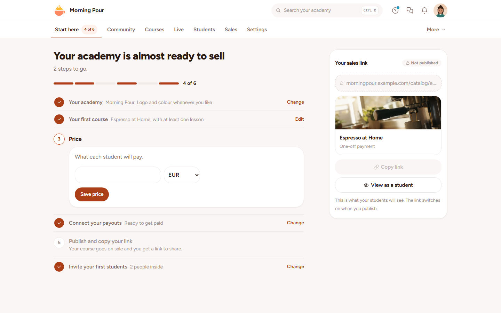

# Getting started

From zero to your first sale on Didacta Cloud. You need an email address and, to get paid, your bank and business details; you do not need a card or any technical keys.

## 1 · Sign up

1. Go to [didacta.io/en/start](https://didacta.io/en/start) (in Spanish, `/es/start`; in Brazilian Portuguese, `/pt-br/start`).
2. Fill in your academy's name, your name, your email and, if you wish, your phone number.
3. Choose **where your bank account is**. It is where what you sell will be sent, and whether you can get paid depends on it: see the [supported countries](payouts.md#countries-and-currencies).
4. Accept the terms of use and the privacy policy, and click **Create my academy**.

You receive two emails: one with your academy's address and another, separate one, with a link to set your password. If they do not arrive within a few minutes, check your spam folder.

!!! info "One sign-up per email"
    Each email address can open an academy only once. If you already had one with that email, the form tells you.

The academy starts in the **language you signed up from** (Spanish, English or Brazilian Portuguese) and you can change it later in [Your academy](your-academy.md#language).

!!! warning "If your bank is in a country where payouts are not available"
    You can create the academy and build your community and free courses, but you cannot get paid for sales yet. The sign-up tells you plainly and does not send you to connect payouts you could not use. Depending on the moment, you may instead be put on a waiting list and be told when payouts open in your country.

## 2 · Three questions

The first time you sign in it asks for your photo and name (you can leave that for later) and then **three questions**:

1. **What is your academy called?**
2. **What are you going to sell?** A **course** (one-off payment: whoever buys it gets in for good) or a **membership** (monthly payment: access to your courses and the community while they pay). You pick one thing to start with; you can add more later.
3. **How much does it cost?** The price and the currency. Below, you see how much you keep from each sale: Didacta keeps 5% and Stripe charges its card fee.

You also choose the **academy language**. This creates the course (or the membership) as a draft, the basic community spaces and a welcome post signed by you. It is all real data you can edit or delete.

## 3 · "Start here"

The **Start here** screen takes you from zero to a link you can sell with. There are six steps:

| Step | What you do |
| --- | --- |
| **Your academy** | You add your logo and colour. Without a logo, the academy uses your initials. |
| **Your first course** | You add a lesson (video, text or PDF). One is enough to start selling. |
| **Price** | You confirm what each student will pay. The one from sign-up is only a starting point: until you confirm it, the step does not count as done. |
| **Connect your payouts** | You set up your Stripe payout account (about 5 minutes) and then your tax details. Details in [Payouts](payouts.md). |
| **Publish and copy your link** | Your course (or membership) goes on sale and you get a link to share. |
| **Invite your first students** | You share your link wherever your people follow you, or invite them by email. |

- Publishing needs **at least one lesson**, a **price** and **connected payouts**: without them nobody could pay you, so the academy does not let you publish.
- If your payouts are connected but your tax details are missing, **you can still publish**: your students will be able to buy, but the money from sales is held until you complete them.
- If you get stuck, the **Get help** button on the screen itself writes to the team (see [Support](support.md)).

## 4 · Your first sale

When someone buys:

- The academy notifies you and the sale shows up in **Sales** with what they paid, the card fee, Didacta's 5% and what you receive.
- The student sees a summary of the purchase and receives the receipt by email.
- "Start here" becomes **Home**, with your summary of sales, students and next live class.
- The video you can upload gets higher limits: see [Video, inactivity and backups](video-and-inactivity.md).

## Afterwards

- **Sell more:** turn on [Invite and earn](referrals.md) so your students bring in more people.
- **Make the academy yours:** logo, colour, language and email in [Your academy](your-academy.md).
- **Go beyond simple mode:** in **Settings → Switch to the full mode** you get every advanced option; nothing is deleted and you can go back whenever you like. See [the visual walkthrough](../installation/visual-walkthrough.md#10-simple-mode).
