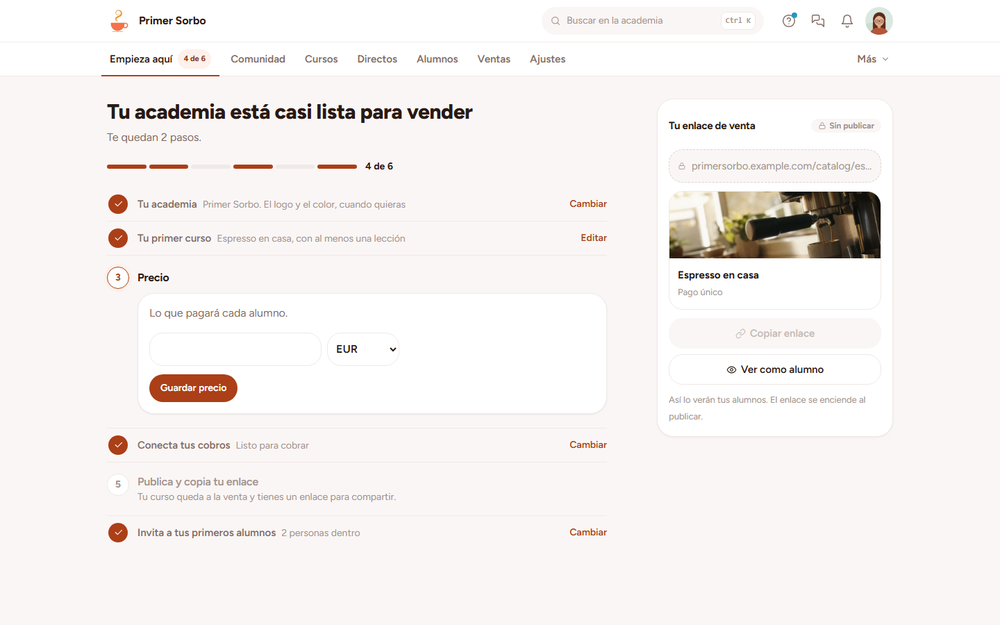

# Empezar

De cero a tu primera venta en Didacta Cloud. Necesitas un correo y, para cobrar, los datos de tu banco y de tu actividad; no necesitas tarjeta ni claves técnicas.

## 1 · Date de alta

1. Entra en [didacta.io/es/start](https://didacta.io/es/start) (en inglés, `/en/start`; en portugués de Brasil, `/pt-br/start`).
2. Rellena el nombre de tu academia, tu nombre, tu correo y, si quieres, tu teléfono.
3. Elige **dónde tienes tu cuenta bancaria**. Es adonde se enviará lo que vendas, y de ello depende que puedas cobrar: mira los [países admitidos](payouts.md#paises-y-monedas).
4. Acepta las condiciones de uso y la política de privacidad, y pulsa **Crear mi academia**.

Recibes dos correos: uno con la dirección de tu aula y otro, aparte, con un enlace para crear tu contraseña. Si no llegan en unos minutos, mira en la carpeta de spam.

!!! info "Un alta por correo"
    Cada correo puede abrir una academia una sola vez. Si ya tuviste una con ese correo, el formulario te lo dice.

El aula nace en el **idioma desde el que te diste de alta** (español, inglés o portugués de Brasil) y puedes cambiarlo después en [Tu aula](your-academy.md#idioma).

!!! warning "Si tu banco está en un país sin cobro"
    Puedes crear la academia y montar tu comunidad y cursos gratuitos, pero todavía no podrás cobrar ventas. El alta te lo dice con claridad y no te manda a conectar unos cobros que no podrías usar. Según el momento, puede que en su lugar te apunten a una lista de espera y te avisen cuando se pueda cobrar desde tu país.

## 2 · Tres preguntas

La primera vez que entras te pide tu foto y tu nombre (puedes dejarlo para luego) y después **tres preguntas**:

1. **¿Cómo se llama tu academia?**
2. **¿Qué vas a vender?** Un **curso** (pago único: quien compra entra para siempre) o una **membresía** (pago mensual: acceso a tus cursos y a la comunidad mientras paguen). Eliges una cosa para empezar; luego puedes añadir más.
3. **¿Cuánto cuesta?** El precio y la moneda. Debajo ves cuánto te queda de cada venta: Didacta se queda el 5 % y Stripe cobra su comisión de tarjeta.

Además eliges el **idioma de la academia**. Con eso se crean el curso (o la membresía) en borrador, los espacios básicos de la comunidad y una publicación de bienvenida firmada por ti. Todo son datos reales que puedes editar o borrar.

## 3 · «Empieza aquí»

La pantalla **Empieza aquí** te lleva de cero a un enlace con el que vender. Son seis pasos:

| Paso | Qué haces |
| --- | --- |
| **Tu academia** | Pones tu logo y tu color. Sin logo, el aula usa tus iniciales. |
| **Tu primer curso** | Añades una lección (vídeo, texto o PDF). Con una basta para empezar a vender. |
| **Precio** | Confirmas lo que pagará cada alumno. El del alta es solo de partida: hasta que lo confirmas, el paso no cuenta como hecho. |
| **Conecta tus cobros** | Das de alta tu cuenta de cobros con Stripe (unos 5 minutos) y, después, tus datos fiscales. Detalle en [Cobros y pagos](payouts.md). |
| **Publica y copia tu enlace** | Tu curso (o tu membresía) queda a la venta y tienes un enlace para compartir. |
| **Invita a tus primeros alumnos** | Compartes tu enlace donde te siga tu gente, o los invitas por correo. |

- Para publicar hace falta **al menos una lección**, un **precio** y los **cobros conectados**: sin ellos nadie podría pagarte y el aula no deja publicar.
- Si tus cobros están conectados pero faltan tus datos fiscales, **puedes publicar igualmente**: tus alumnos podrán comprar, pero el dinero de las ventas se queda retenido hasta que los completes.
- Si te atascas, el botón **Pedir ayuda** de la propia pantalla escribe al equipo (ver [Soporte](support.md)).

## 4 · Tu primera venta

Cuando alguien compra:

- Te avisa el aula y la venta aparece en **Ventas** con lo que pagó, la comisión de la tarjeta, el 5 % de Didacta y lo que te llega.
- El alumno ve el resumen de su compra y le llega el recibo por correo.
- «Empieza aquí» pasa a llamarse **Inicio** y se queda con tu resumen de ventas, alumnos y próximo directo.
- El vídeo que puedes subir amplía sus límites: ver [Vídeo, inactividad y copias](video-and-inactivity.md).

## Después

- **Vende mejor:** activa [Invita y gana](referrals.md) para que tus alumnos traigan a más gente.
- **Haz tuya el aula:** logo, color, idioma y correo en [Tu aula](your-academy.md).
- **Ve más allá del modo sencillo:** en **Ajustes → Cambiar al modo completo** tienes todas las opciones avanzadas; no se borra nada y puedes volver cuando quieras. Ver [el recorrido visual](../installation/visual-walkthrough.md#10-el-modo-sencillo).
