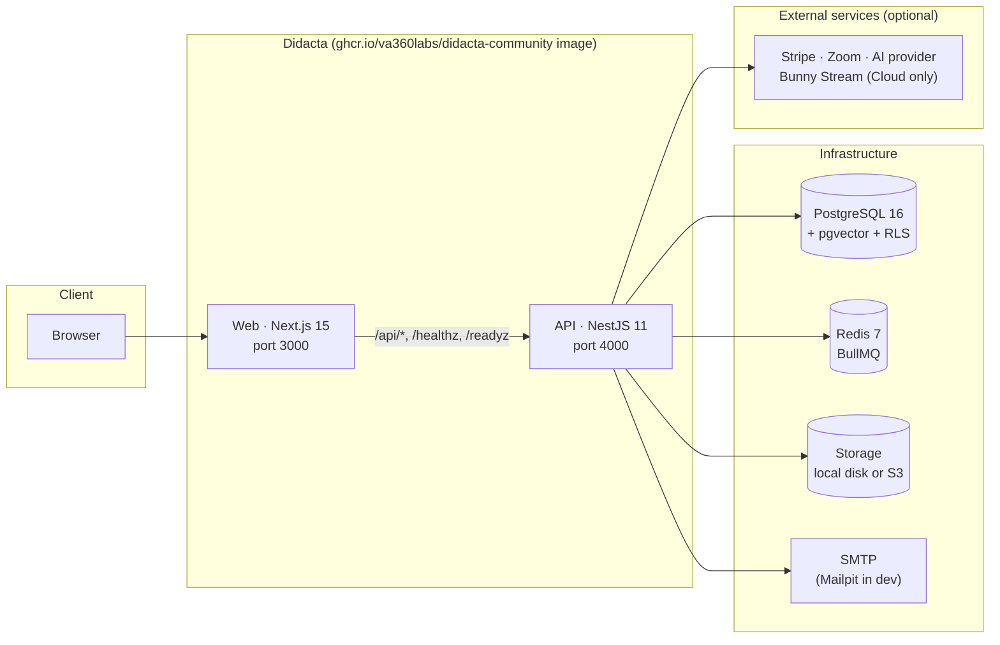

# Architecture

A high-level view of how Didacta is built and how its pieces fit together in an installation.

## The pieces of an installation

- **A single Docker image** (`ghcr.io/va360labs/didacta-community`) contains both the web app and the API. On first start it automatically applies the versioned Prisma migrations, the RLS policies and the idempotent system seed.
- **PostgreSQL 16** requires the **pgvector** extension (the AI layer stores embeddings in `vector` columns). The official compose file uses the `pgvector/pgvector:pg16` image.
- **A single origin**: web and API run in the same container and the web app rewrites `/api/*`, `/healthz` and `/readyz` to the API (`:4000`), so you only need to publish port 3000 (no second domain or CORS). Behind your proxy, `TRUSTED_PROXY_HOPS` says how many trusted proxies there are so the client's real IP is known.
- **Redis 7** backs the cache and the job queues (BullMQ): the event outbox, email delivery and background tasks.
- **Storage**: local disk by default (the `didacta_data` volume) or any S3-compatible provider. On the same volume, **outside** the storage that is served over HTTP, lives the master encryption key for per-tenant secrets (`/app/data/secrets`).
- **External services**, all optional and configured per academy from the panel (except what the operator defines through the environment): Stripe (payments), Zoom (live classes), the AI provider you choose and, on Didacta Cloud, Bunny Stream for video upload.

## Multi-tenant from the core

Didacta is multi-tenant by design:

- Each organisation is a **tenant** (an **academy**); the active tenant is resolved from the request **host** (exact match: a host that belongs to no academy answers 404). See [Branding → Own domain](../configuration/branding.md#own-domain).
- **Every table carries `tenant_id`** and a **Row-Level Security** policy in PostgreSQL. Policies are auto-discovered and reapplied on every start, so one tenant's data is invisible to the rest even in the face of an application bug.
- Everything specific to an installation (branding, domains, copy) is **tenant configuration or tenant data**, never code: the product is whitelabel out of the box.

## Core + modules

The repository is a monorepo (Turborepo + pnpm workspaces) with three areas:

| Area | What it contains |
| --- | --- |
| `apps/` | `api` (NestJS), `web` (Next.js) and `e2e` (Playwright). |
| `packages/` | The shared core: `core-kernel` (events/hooks), `core-registry` (module registry and lifecycle), `database` (Prisma + RLS), `license-sdk` (Enterprise license validation), `module-package-spec` (the module package contract). |
| `modules/` | The **27** functional modules (courses, assessments, certificates, gamification, platform payments, automated messages, help…). Each one with its manifest, its `mod_<slug>_*` tables and its isolated logic. See the [catalog](../modules/catalog/index.md). |

The isolation rules between modules (no cross imports, no foreign keys across modules, communication through events and hooks) are explained in [Modules → How they work](../modules/index.md).

## One installation, two ways to use the panel

The same installation offers the panel in **full mode** (side menu with everything) or in **[simple mode](../configuration/simple-mode.md)** (tabs and a short path to the first sale). It is a per-academy setting, not another edition: the routes are the same and nothing is deleted when switching.

## Charging: own keys or platform payments

By default each academy charges with **its own Stripe keys** (`mod.billing`, `mod.subscriptions`), with no commission. If the operator defines `PAYMENTS_PLATFORM_STRIPE_SECRET_KEY`, **platform mode** is switched on ([mod.payouts](../modules/catalog/payouts.md)): the student pays into the operator's account and the module splits the money with the creator, with a ledger, refunds, disputes and commission invoices. It is Didacta Cloud's mode; on a regular Community installation that module is inert.

## The AI Gateway (BYOK)

Didacta's AI goes through a **multi-provider gateway** in the API: each installation configures its own LLM provider and API key (Bring Your Own Key). No provider is hardwired into the product. See [Configuring AI](../configuration/ai.md).

## Editions and gating

Enterprise capabilities live in `*.ee.*` files inside the core, covered by their own license, and are unlocked with a signed JWT (ES256) validated by `license-sdk`. Modules are never gated. See [Editions](editions.md) and [Enterprise](../enterprise/index.md).
