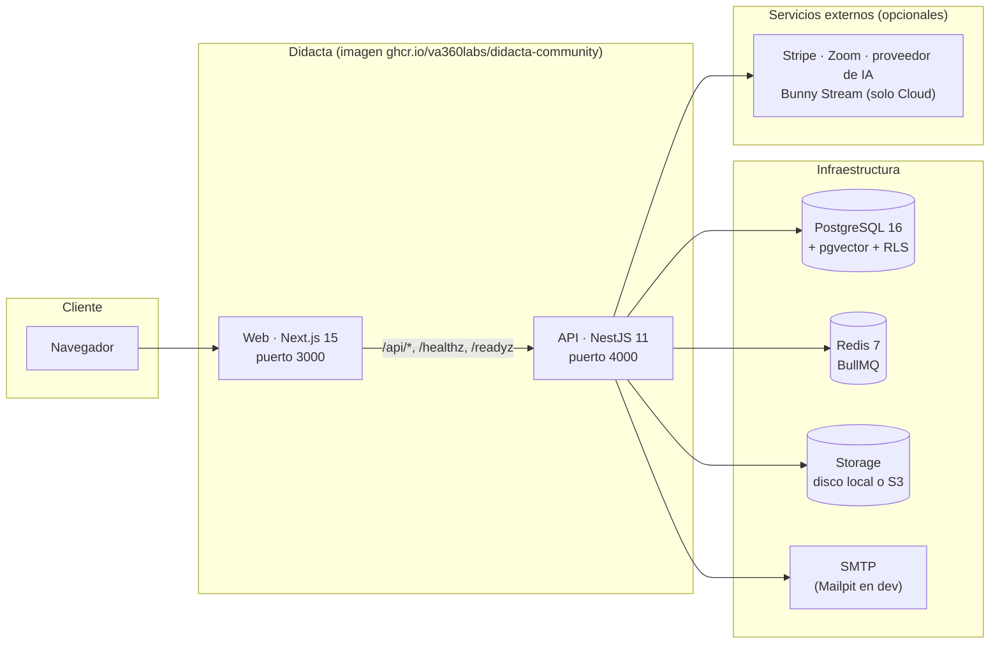

# Arquitectura

Visión de alto nivel de cómo está construido Didacta y cómo se relacionan sus piezas en una instalación.

## Piezas de una instalación

- **Una sola imagen Docker** (`ghcr.io/va360labs/didacta-community`) contiene la web y la API. En el primer arranque aplica automáticamente las migraciones Prisma versionadas, las políticas RLS y el seed idempotente de sistema.
- **PostgreSQL 16** necesita la extensión **pgvector** (la IA guarda embeddings en columnas `vector`). El compose oficial usa la imagen `pgvector/pgvector:pg16`.
- **Un solo origen**: web y API corren en el mismo contenedor y la web reescribe `/api/*`, `/healthz` y `/readyz` hacia la API (`:4000`), así que solo hay que publicar el puerto 3000 (sin segundo dominio ni CORS). Detrás de tu proxy, `TRUSTED_PROXY_HOPS` dice cuántos proxies de confianza hay para saber la IP real del cliente.
- **Redis 7** respalda la cache y las colas de trabajos (BullMQ): outbox de eventos, envío de emails, tareas en segundo plano.
- **Storage**: disco local por defecto (volumen `didacta_data`) o cualquier proveedor S3-compatible. En el mismo volumen, **fuera** del storage que se sirve por HTTP, vive la clave maestra de cifrado de los secretos por tenant (`/app/data/secrets`).
- **Servicios externos**, todos opcionales y configurados por academia desde el panel (salvo lo que el operador defina por entorno): Stripe (cobros), Zoom (clases en directo), el proveedor de IA que elijas y, en Didacta Cloud, Bunny Stream para la subida de vídeo.

## Multi-tenant desde el núcleo

Didacta es multi-tenant por diseño:

- Cada organización es un **tenant** (una **academia**); el tenant activo se resuelve por el **host** de la petición (match exacto: un host que no es de ninguna academia responde 404). Ver [Branding → Dominio propio](../configuration/branding.md#dominio-propio).
- **Toda tabla lleva `tenant_id`** y una política de **Row-Level Security** en PostgreSQL. Las políticas se autodescubren y reaplican en cada arranque, de modo que los datos de un tenant son invisibles para el resto incluso ante un bug de aplicación.
- Todo lo específico de una instalación (marca, dominios, textos) es **configuración o datos de tenant**, nunca código: el producto es whitelabel de serie.

## Core + módulos

El repositorio es un monorepo (Turborepo + pnpm workspaces) con tres zonas:

| Zona | Qué contiene |
| --- | --- |
| `apps/` | `api` (NestJS), `web` (Next.js) y `e2e` (Playwright). |
| `packages/` | El core compartido: `core-kernel` (eventos/hooks), `core-registry` (registro y ciclo de vida de módulos), `database` (Prisma + RLS), `license-sdk` (validación de licencia Enterprise), `module-package-spec` (contrato de paquetes de módulo). |
| `modules/` | Los **27 módulos** funcionales (cursos, evaluaciones, certificados, gamificación, cobros de plataforma, mensajes automáticos, ayuda…). Cada uno con su manifest, sus tablas `mod_<slug>_*` y su lógica aislada. Ver el [catálogo](../modules/catalog/index.md). |

Las reglas de aislamiento entre módulos (sin imports cruzados, sin FKs entre módulos, comunicación por eventos y hooks) están explicadas en [Módulos → Cómo funcionan](../modules/index.md).

## Una instalación, dos formas de usar el panel

La misma instalación ofrece el panel en **modo completo** (menú lateral con todo) o en **[modo sencillo](../configuration/simple-mode.md)** (pestañas y un camino corto hasta la primera venta). Es un ajuste por academia, no otra edición: las rutas son las mismas y nada se borra al cambiar.

## Cobrar: claves propias o cobros de plataforma

Por defecto cada academia cobra con **sus propias claves de Stripe** (`mod.billing`, `mod.subscriptions`), sin comisión. Si el operador define `PAYMENTS_PLATFORM_STRIPE_SECRET_KEY`, se activa el **modo plataforma** ([mod.payouts](../modules/catalog/payouts.md)): el alumno paga en la cuenta del operador y el módulo reparte al creador, con libro mayor, reembolsos, disputas y facturas de la comisión. Es el modo de Didacta Cloud; en una instalación Community normal ese módulo está inerte.

## El AI Gateway (BYOK)

La IA de Didacta pasa por un **gateway multi-proveedor** en la API: cada instalación configura su proveedor LLM y su clave (Bring Your Own Key). Ningún proveedor está cableado en el producto. Ver [Configurar la IA](../configuration/ai.md).

## Ediciones y gating

Las capabilities Enterprise viven en ficheros `*.ee.*` dentro del core, cubiertos por una licencia propia, y se desbloquean con un JWT firmado (ES256) que valida `license-sdk`. Los módulos nunca se gatean. Ver [Ediciones](editions.md) y [Enterprise](../enterprise/index.md).
