# Visual walkthrough: notifications and sales

The second part of the visual walkthrough — it picks up where [Visual walkthrough: getting started](visual-walkthrough.md) ends. Here we configure outgoing mail and get the instance ready to sell: individual courses and memberships.

!!! note "Where these screenshots come from"
    The same isolated, seed-free instance as part one (version 0.1.0-beta.24, **full mode**), started with no Stripe key in its environment. SMTP points at the Mailpit service bundled in `docker-compose.alpha.yml` — this is a real send, not a simulation: the test email genuinely lands in the mailbox.

## 1 · Notifications (SMTP)

Under **Administration → Settings → Notifications** (`/admin/settings?tab=notifications`) each academy can define its own SMTP server. Above it sits "Reply-to email": the address your students' replies go to. Without its own SMTP, the academy inherits the instance-wide SMTP server if the operator configured one through environment variables — the notice says so ("Your emails go out through the platform's email service…") — and if there is none, it warns that emails cannot be sent. See [Email](../configuration/email.md).

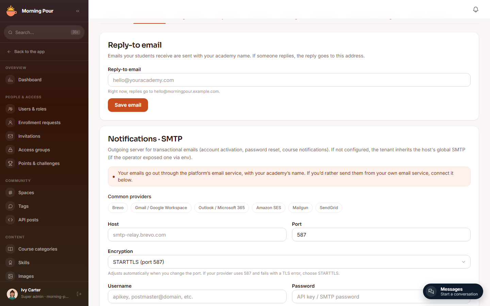

Fill in host, port, username/password and the sender; the "Common providers" buttons (Brevo, Gmail, Outlook, Amazon SES, Mailgun, SendGrid) pre-fill each one's host and port. **"Encryption"** is a drop-down — "STARTTLS (port 587)", "Implicit TLS (port 465)" or "No encryption (internal MTAs only)" — and adjusts itself when you change the port. The development Mailpit listens unencrypted: host `mailpit`, port `1025`, "No encryption", and it accepts any username and password.

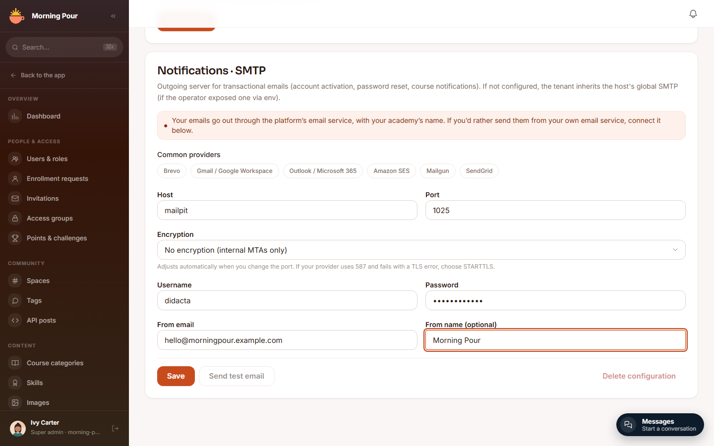

On saving, the banner switches to "Configured but unverified" — Didacta does not test the connection when you save, it only validates the format.

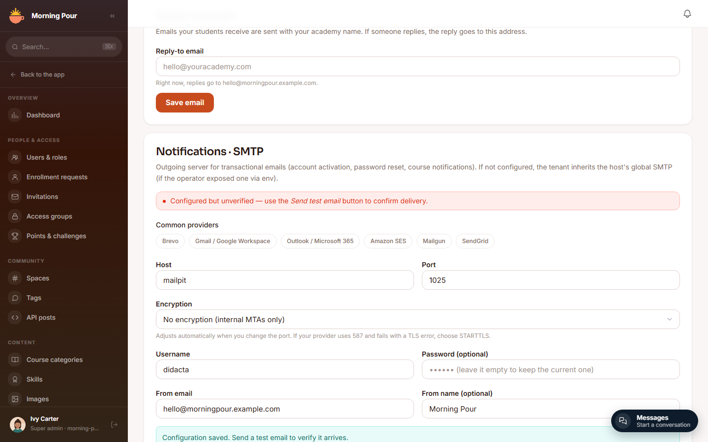

**"Send test email"** confirms that the configuration really works: it opens a dialog with the admin's own email pre-filled.

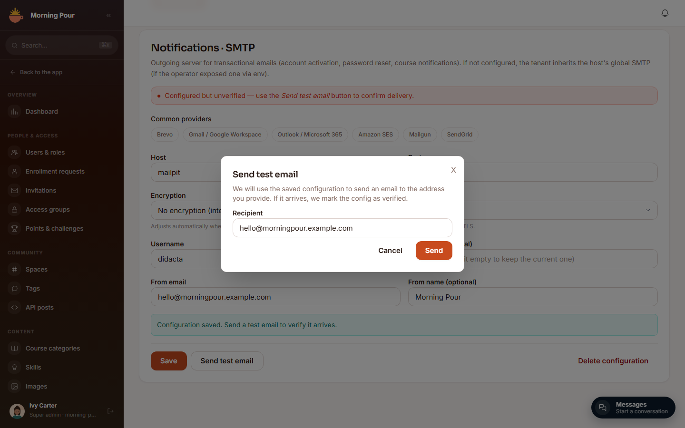

If the email goes out, the banner switches to **"Verified"** with the date and time — the sign that the academy can now send real invitations, password resets and course notifications.

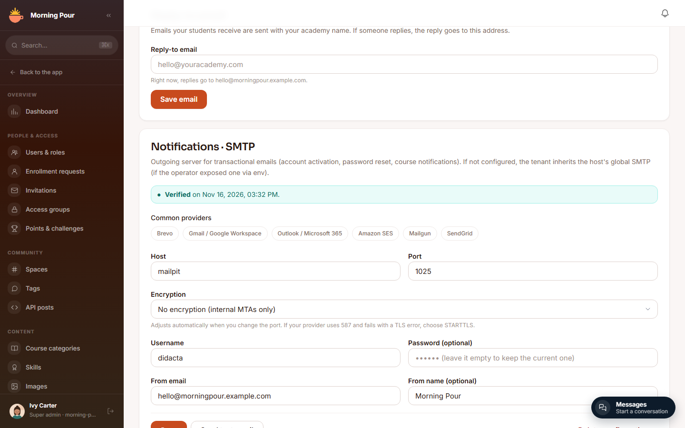

And the email itself, real, in the mailbox, with the academy's logo and name:

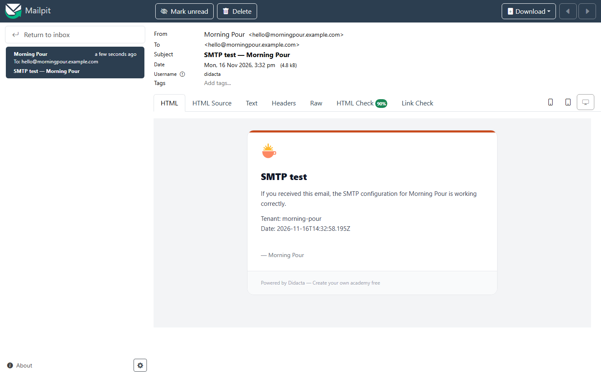

!!! tip "Editing the content of the emails"
    The form above only configures the **transport**. The text of each email (subject, body) is edited per academy under **Administration → Emails** (`/admin/emails`), with no code changes — see [Email](../configuration/email.md).

## 2 · Selling individual courses (mod.billing)

Stripe is configured **per academy, from the admin panel** — there is no need to touch the instance `.env`. A single pair of credentials (secret key + webhook secret) covers both individual courses (`mod.billing`) and subscriptions/membership (`mod.subscriptions`): they share the same Stripe account, so one academy charges through both paths.

Under **Administration → Settings → Payments** (`/admin/settings?tab=payments`), with nothing configured yet:

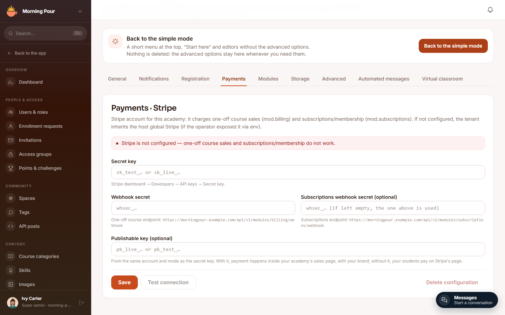

While Stripe is not configured, two more screens warn you **before** a student tries to pay, rather than letting the failure show up in production with no context:

- **Membership** (`/admin/membership`) shows a notice at the very top — plans and the `/join` page are prepared all the same, but the actual charge will fail until you configure Stripe.

  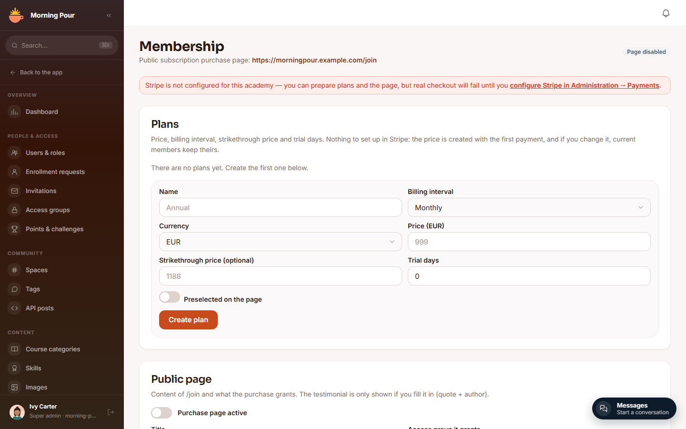

- **Payments · Stripe products** (`/admin/billing/products`) still lets you pick the course and the Price, but clicking "Link" without Stripe configured returns a clear message and a direct link to the Payments tab — never a raw 500.

  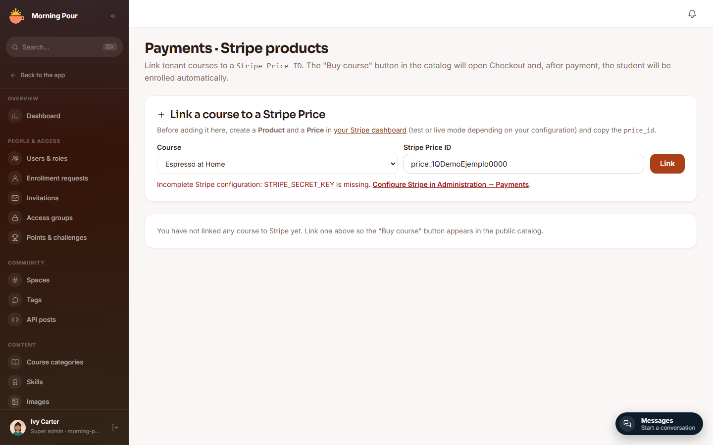

To activate it: paste the **secret key** (Stripe → Developers → API keys) and the **webhook secret** — the card itself shows the two URLs to paste into your Stripe dashboard (`{your-domain}/api/v1/modules/billing/webhook` and `.../modules/subscriptions/webhook`; the subscriptions webhook is optional — leave it empty and it reuses the same secret as individual courses). Keys are never shown: the fields are password fields and the values are stored encrypted.

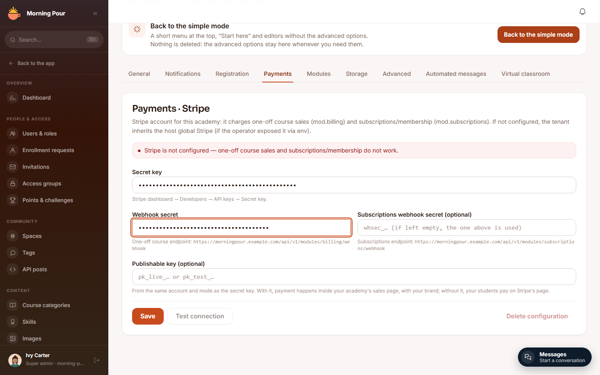

On saving, just like SMTP, the banner switches to "Configured but not verified" — Didacta does not call Stripe when you save, it only validates the format.

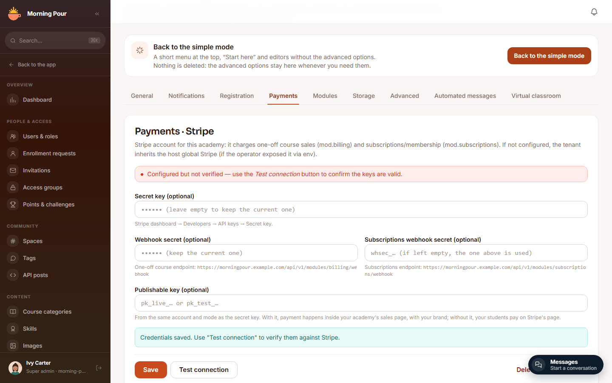

**"Test connection"** does call Stripe's real API (`balance.retrieve`, read-only, with no side effects). With a genuine key it marks the banner as verified; here, with a made-up key for this demo, Stripe rejects it with its own error message ("Stripe rejected the key: Invalid API Key provided…") — proof that the validation is real, not cosmetic:

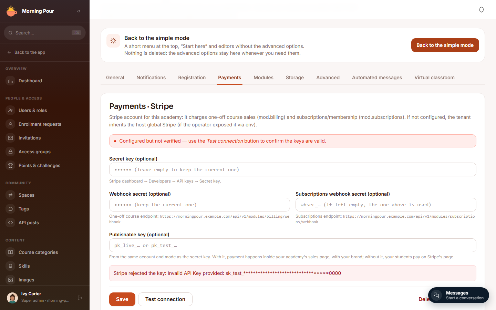

With a real key saved and verified: for each course linked from **Payments · Stripe products**, you pick the published course, paste the `price_id` of a **Product + Price you already created in your Stripe dashboard** (Didacta validates against the API that it exists and is active before saving) and the buy button appears on that course's sales page.

!!! warning "Not to be confused with «Payment connections»"
    `/admin/integrations/payment-connections` is a **different** screen: it reconciles subscribers from an **external** Stripe account using a read-only restricted key — it does not enable Didacta's checkout. To actually sell, the only way is to configure Stripe under **Administration → Settings → Payments**, above.

!!! tip "Installations that already used STRIPE_SECRET_KEY from .env"
    It still works as an instance-wide fallback: if an academy does not configure its own credentials in the panel, it inherits the operator's environment variables (when they are defined) — exactly like the instance-wide SMTP server. With **several academies** on the same instance, the fallback no longer applies on its own: the operator has to allow it with `STRIPE_ALLOW_GLOBAL_FALLBACK=true`, and until then the Payments tab warns that the academy is not charging.

## 3 · Selling memberships (mod.subscriptions)

Unlike individual courses, **creating and editing membership plans does not require Stripe to be configured** — the Stripe Price is generated on its own at the first real charge. Only the final checkout (the "Continue to secure payment" button) depends on the same credentials as the previous step.

### Access group

Each plan grants access through an **access group**. Before creating the plan, we add one at `/admin/access-groups` with type "All courses":

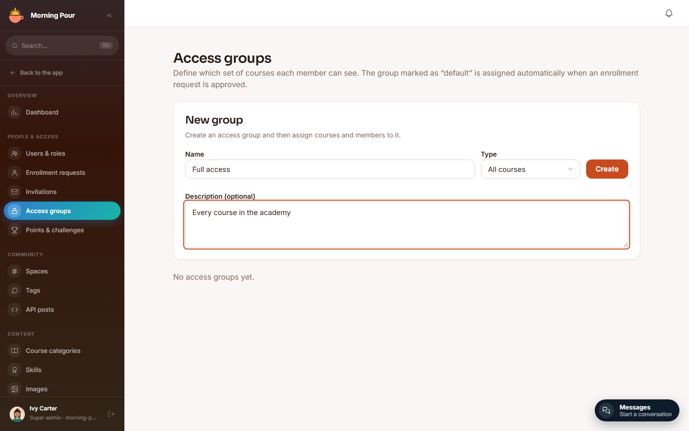

### The plan

Under **Membership** (`/admin/membership`) we create the plan: name, billing interval, currency, price (and an optional strikethrough price), trial days and whether it appears pre-selected on the public page.

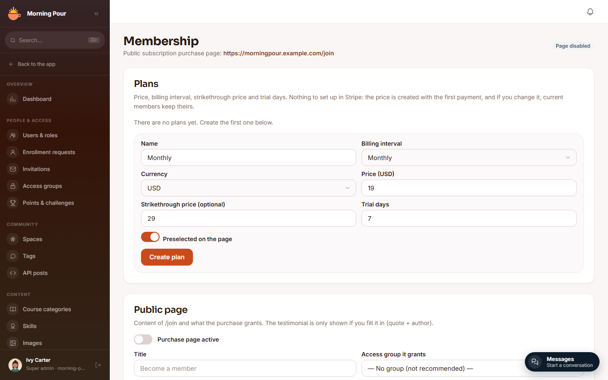

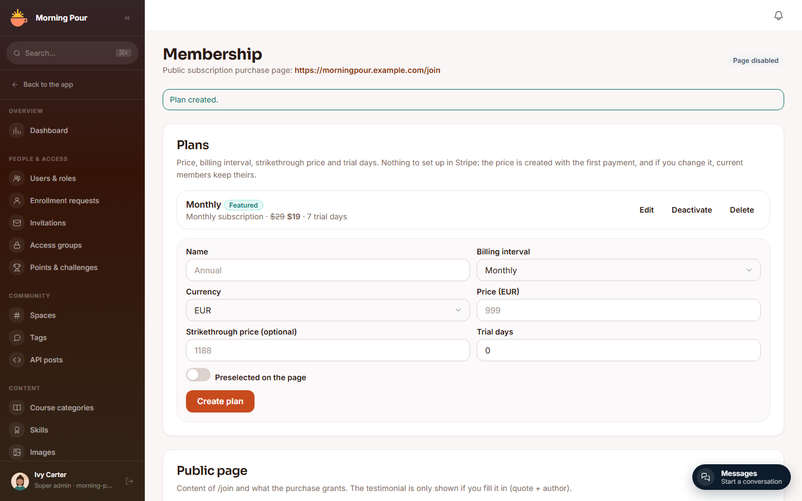

### The public `/join` page

On the same screen, the "Public page" card controls the content of `/join`: whether it is enabled, the title, the access group it grants, the subtitle, whether it shows the catalog of included courses, how many lessons per course are visible during the trial, each course's reference price and an optional testimonial.

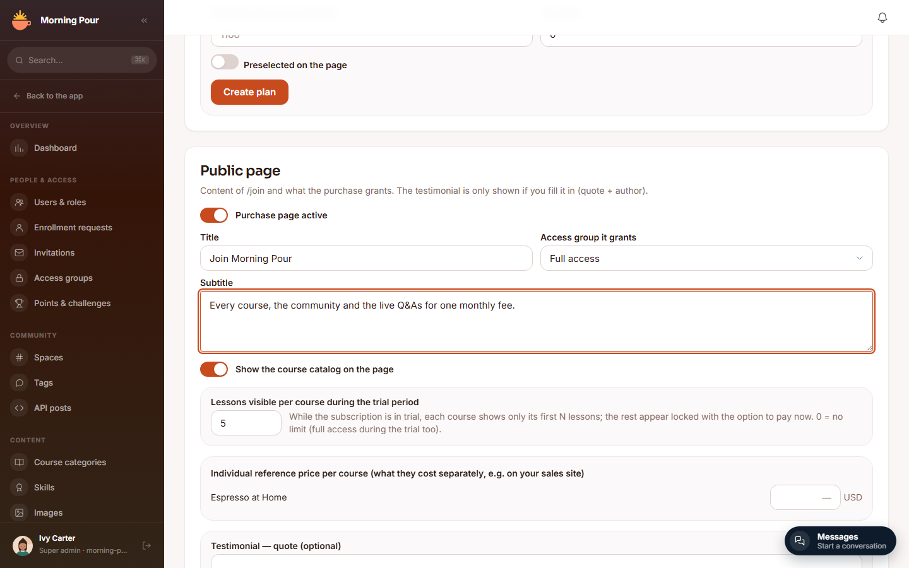

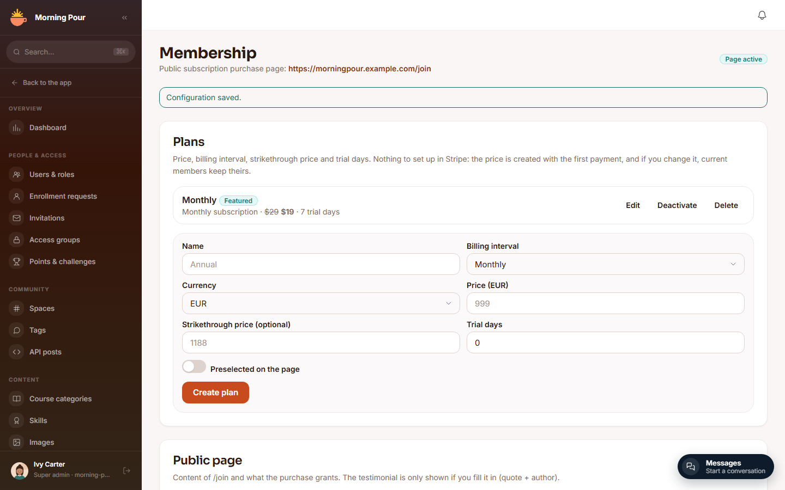

And the result, live and signed out — with the price, the saving, what is charged today, the included course and the FAQ already generated from the academy's real data:

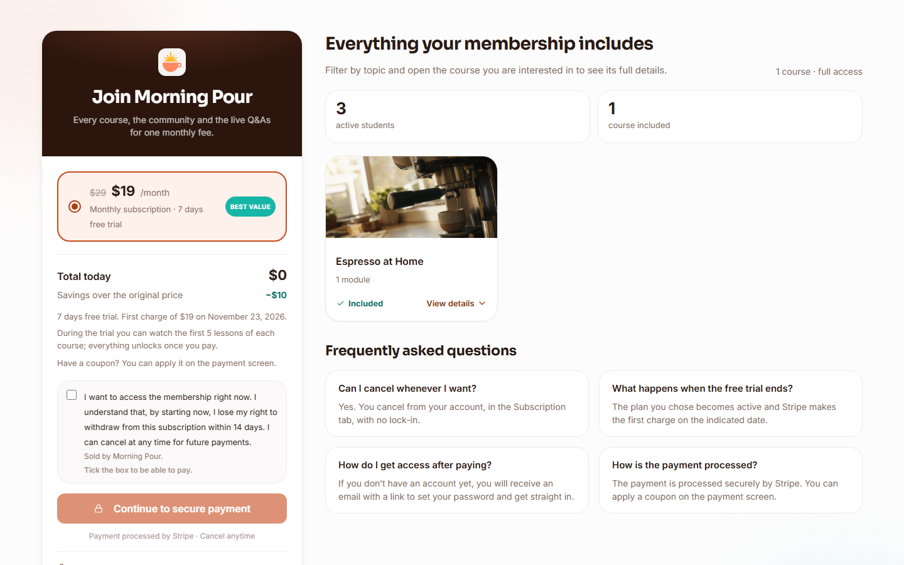

The "Continue to secure payment" button is enabled once the buyer ticks the immediate-access box (which waives the 14-day withdrawal right) and opens Stripe Checkout — it works as soon as you configure Stripe under **Administration → Settings → Payments** (§2). With no credentials (neither the academy's nor the instance fallback), it returns the same error explained above.

## Next step

- [Email](../configuration/email.md) — instance-wide vs. per-academy SMTP, templates.
- [mod.billing — Stripe Checkout](../modules/catalog/billing.md)
- [mod.subscriptions — Subscriptions](../modules/catalog/subscriptions.md)
- [mod.payment-connections — Payment connections](../modules/catalog/payment-connections.md) — so you do not confuse it with the above.
