# Recorrido visual: notificaciones y ventas

Segunda parte del recorrido visual — continúa donde termina [Recorrido visual: primeros pasos](visual-walkthrough.md). Aquí configuramos el correo saliente y preparamos la instancia para vender: cursos sueltos y membresías.

!!! note "De dónde salen estas capturas"
    Misma instancia aislada y sin seeds de la primera parte (versión 0.1.0-beta.24, **modo completo**), arrancada sin ninguna clave de Stripe en el entorno. El SMTP apunta al Mailpit del propio `docker-compose.alpha.yml` — es un envío real, no una simulación: el correo de prueba llega de verdad al buzón.

## 1 · Notificaciones (SMTP)

En **Administración → Configuración → Notificaciones** (`/admin/settings?tab=notifications`) cada academia puede definir su propio servidor SMTP. Encima está «Correo para respuestas»: la dirección a la que llegan las respuestas de tus alumnos. Sin SMTP propio, la academia hereda el SMTP global de la instancia si el operador lo configuró por variables de entorno — el aviso lo dice («Tus correos salen con el servicio de correo de la plataforma…») — y si no hay ninguno, avisa de que los correos no se pueden enviar. Ver [Email](../configuration/email.md).

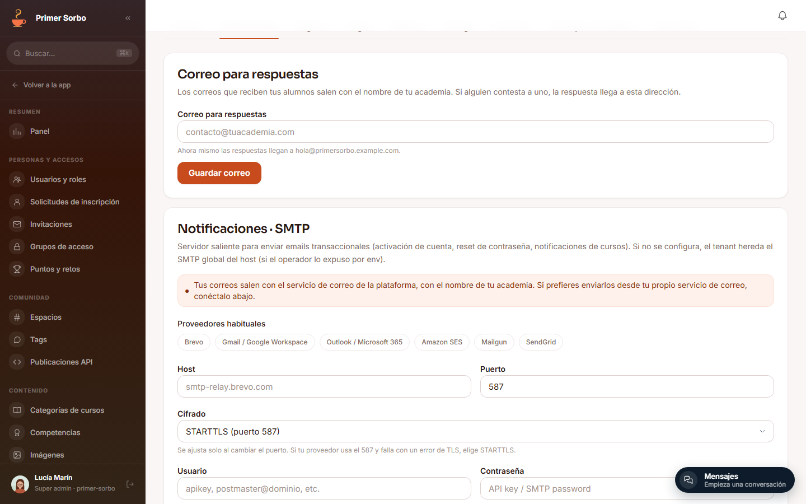

Rellena host, puerto, usuario/contraseña y el remitente; los botones de «Proveedores habituales» (Brevo, Gmail, Outlook, Amazon SES, Mailgun, SendGrid) prerrellenan el host y el puerto de cada uno. El **«Cifrado»** se elige en un desplegable — «STARTTLS (puerto 587)», «TLS implícito (puerto 465)» o «Sin cifrado (solo MTAs internos)» — y se ajusta solo al cambiar el puerto. El Mailpit de desarrollo escucha sin cifrado: host `mailpit`, puerto `1025`, «Sin cifrado», y acepta cualquier usuario y contraseña.

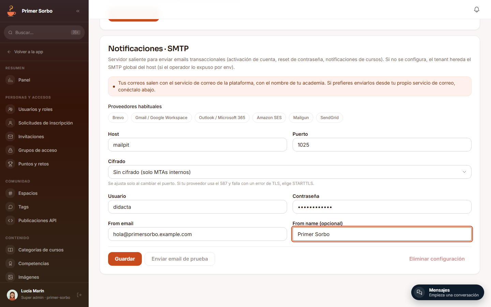

Al guardar, el banner pasa a «Configurado pero sin verificar» — Didacta no prueba la conexión al guardar, solo valida el formato.

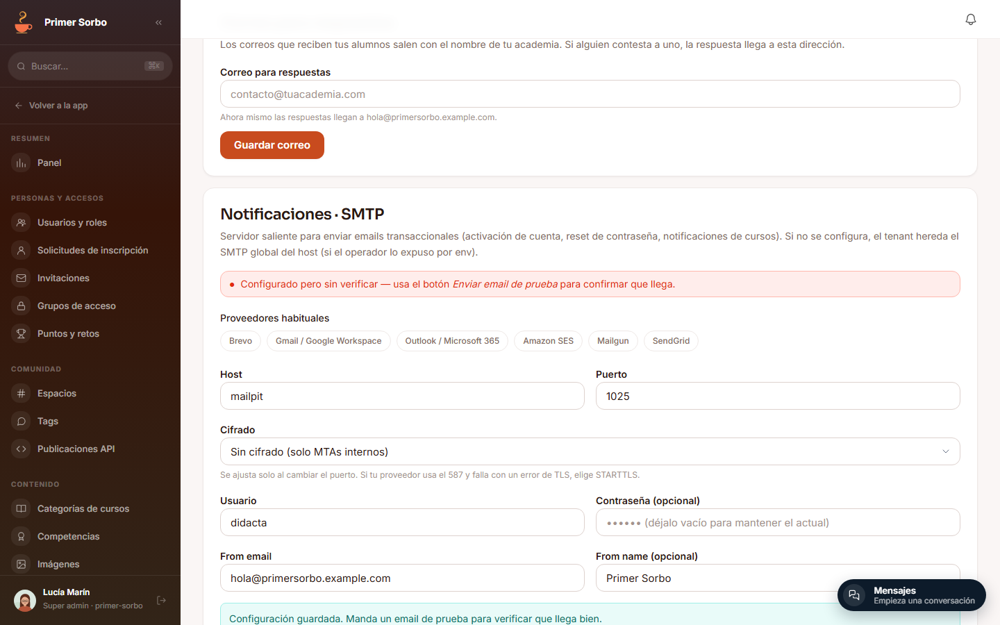

**«Enviar email de prueba»** confirma que la configuración funciona de verdad: abre un diálogo con el email del propio admin prellenado.

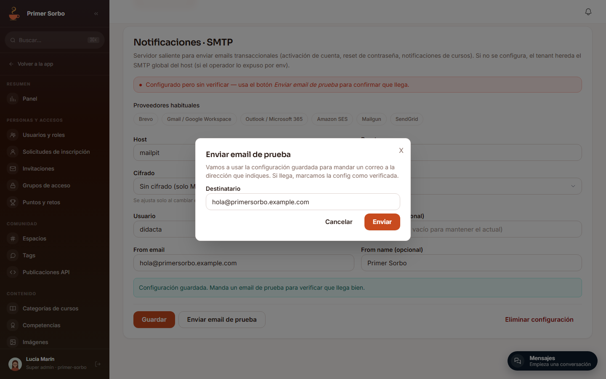

Si el correo sale, el banner pasa a **«Verificado»** con fecha y hora — la señal de que la academia ya puede mandar invitaciones, resets de contraseña y avisos de curso de verdad.

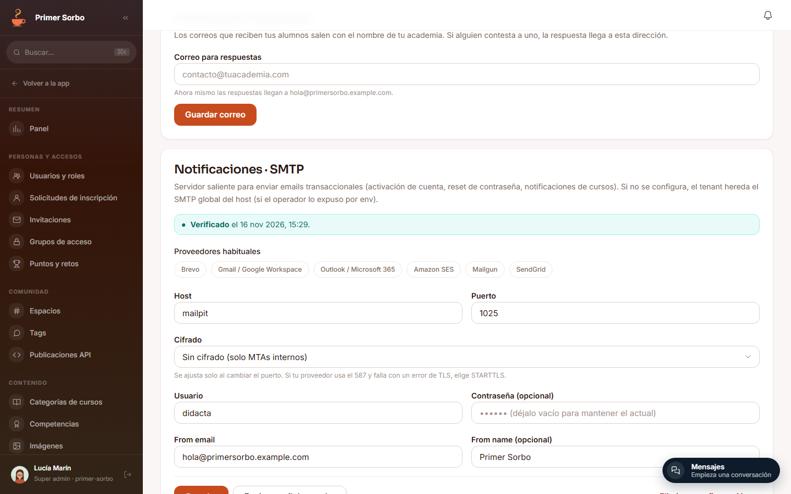

Y el correo, real, en el buzón, con el logo y el nombre de la academia:

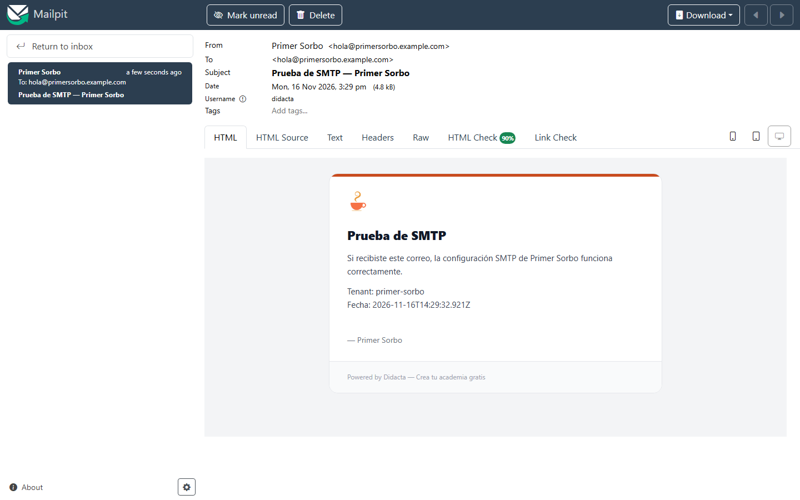

!!! tip "Editar el contenido de los emails"
    El formulario de arriba solo configura el **transporte**. El texto de cada email (asunto, cuerpo) se edita por academia en **Administración → Emails** (`/admin/emails`), sin tocar código — ver [Email](../configuration/email.md).

## 2 · Vender cursos sueltos (mod.billing)

Stripe se configura **por academia, desde el panel** — no hace falta tocar el `.env` de la instancia. Un único par de credenciales (clave secreta + secreto de webhook) sirve tanto para cursos sueltos (`mod.billing`) como para suscripciones/membresía (`mod.subscriptions`): comparten cuenta de Stripe, la misma academia cobra por los dos caminos.

En **Administración → Configuración → Pagos** (`/admin/settings?tab=payments`), sin nada configurado todavía:

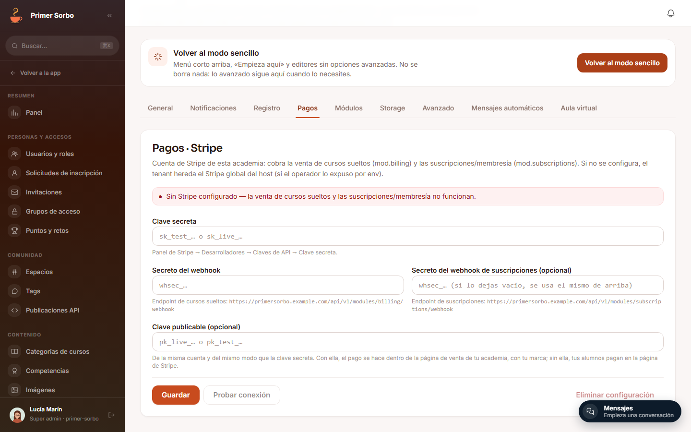

Mientras Stripe no esté configurado, dos pantallas más lo avisan **antes** de que un alumno intente pagar, en vez de dejar que el fallo aparezca en producción sin más contexto:

- **Membresía** (`/admin/membership`) muestra un aviso arriba del todo — planes y la página `/join` se preparan igual, pero el cobro real fallará hasta que configures Stripe.

  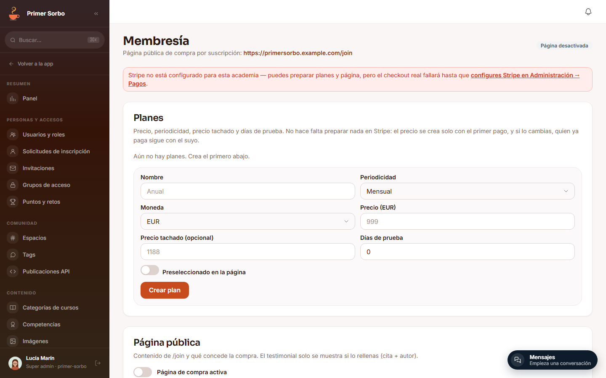

- **Pagos → Productos Stripe** (`/admin/billing/products`) deja elegir el curso y el Price igual, pero al pulsar «Vincular» sin Stripe configurado responde con un mensaje claro y un enlace directo a la pestaña Pagos — nunca un 500 crudo.

  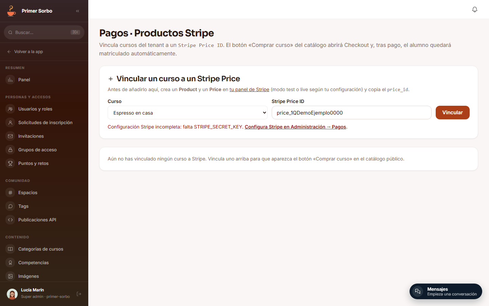

Para activarlo: pega la **clave secreta** (Stripe → Desarrolladores → Claves de API) y el **secreto del webhook** — la propia tarjeta enseña las dos URLs a pegar en tu panel de Stripe (`{tu-dominio}/api/v1/modules/billing/webhook` y `.../modules/subscriptions/webhook`; el webhook de suscripciones es opcional, si lo dejas vacío reutiliza el mismo secreto que cursos sueltos). Las claves nunca se muestran: los campos son de tipo contraseña y se guardan cifradas.

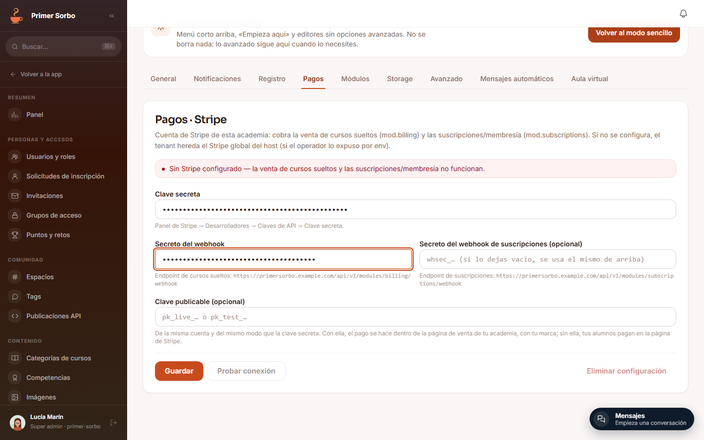

Al guardar, igual que SMTP, el banner pasa a «Configurado pero sin verificar» — Didacta no llama a Stripe al guardar, solo valida el formato.

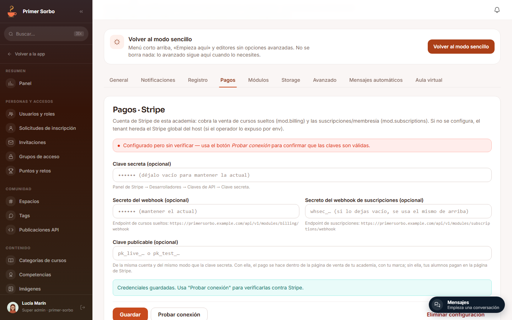

**«Probar conexión»** sí llama a la API real de Stripe (`balance.retrieve`, de solo lectura, sin efectos secundarios). Con una clave de verdad marca el banner como verificado; aquí, con una clave inventada para esta demo, Stripe la rechaza con su propio mensaje de error («Stripe rechazó la clave: Invalid API Key provided…») — la señal de que la validación es real, no cosmética:

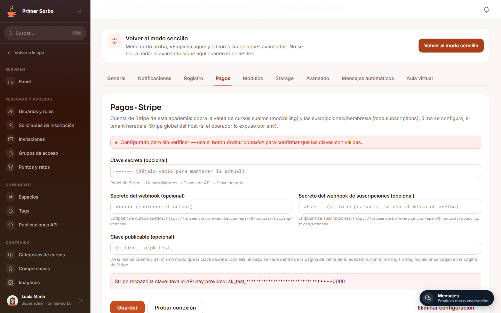

Con una clave real guardada y verificada: en cada curso vinculado desde **Pagos → Productos Stripe**, eliges el curso publicado, pegas el `price_id` de un **Product + Price ya creado en tu dashboard de Stripe** (Didacta valida contra la API que existe y está activo antes de guardar) y el botón de compra aparece en la ficha de venta de ese curso.

!!! warning "No confundir con «Conexiones de pago»"
    `/admin/integrations/payment-connections` es una pantalla **distinta**: sirve para reconciliar suscriptores de una cuenta de Stripe **externa** con una clave restringida de solo lectura — no habilita el checkout de Didacta. Para vender de verdad, la única vía es configurar Stripe en **Administración → Configuración → Pagos**, de arriba.

!!! tip "Instalaciones que ya usaban STRIPE_SECRET_KEY por .env"
    Sigue funcionando como fallback de instancia: si una academia no configura sus propias credenciales en el panel, hereda las variables de entorno del operador (si están definidas) — igual que el SMTP global. Con **varias academias** en la misma instancia, el fallback ya no se aplica solo: el operador tiene que permitirlo con `STRIPE_ALLOW_GLOBAL_FALLBACK=true`, y mientras tanto la pestaña Pagos avisa de que esa academia no está cobrando.

## 3 · Vender membresías (mod.subscriptions)

A diferencia de los cursos sueltos, **crear y editar planes de membresía no necesita Stripe configurado** — el Price de Stripe se genera solo en el primer cobro real. Solo el checkout final (el botón «Continuar al pago seguro») depende de las mismas credenciales del paso anterior.

### Grupo de acceso

Cada plan concede acceso a través de un **grupo de acceso**. Antes de crear el plan, damos de alta uno en `/admin/access-groups` con tipo «Todos los cursos»:

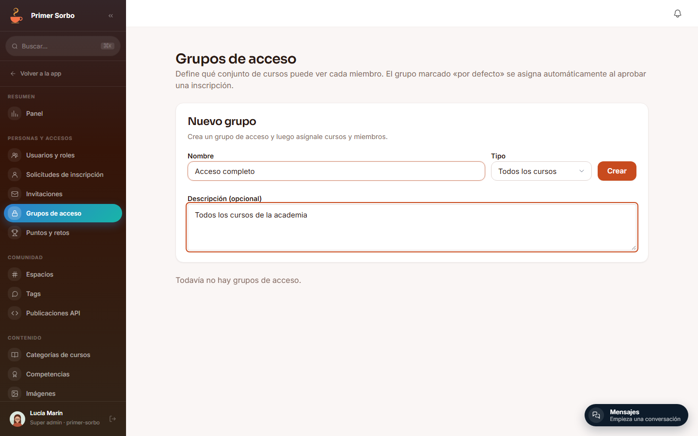

### El plan

En **Membresía** (`/admin/membership`) creamos el plan: nombre, periodicidad, moneda, precio (y precio tachado opcional), días de prueba y si aparece preseleccionado en la página pública.

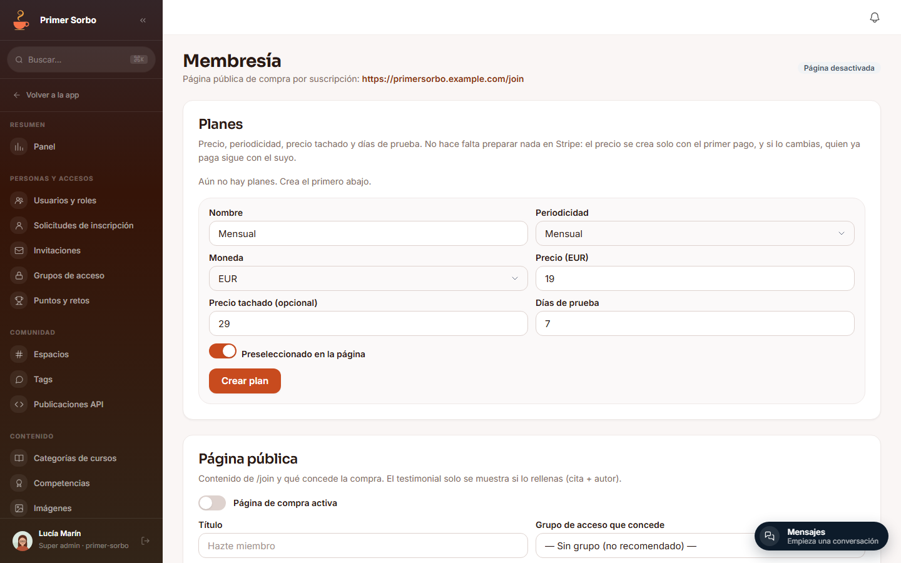

### La página pública `/join`

En la misma pantalla, la tarjeta «Página pública» controla el contenido de `/join`: activarla, título, el grupo de acceso que otorga, subtítulo, si muestra el catálogo de cursos incluidos, cuántas lecciones por curso se ven durante la prueba, el precio de referencia de cada curso y un testimonio opcional.

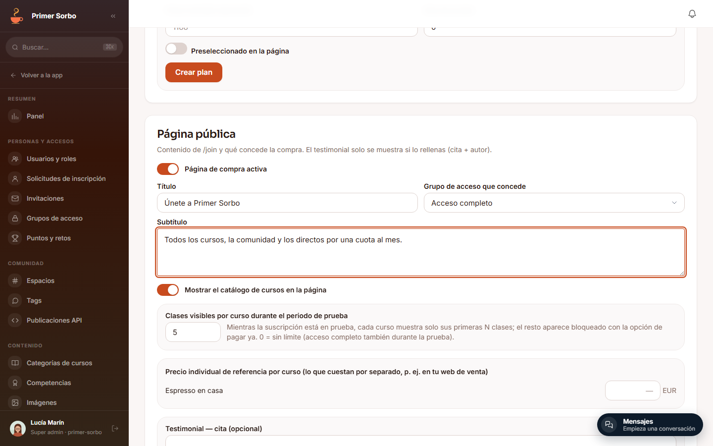

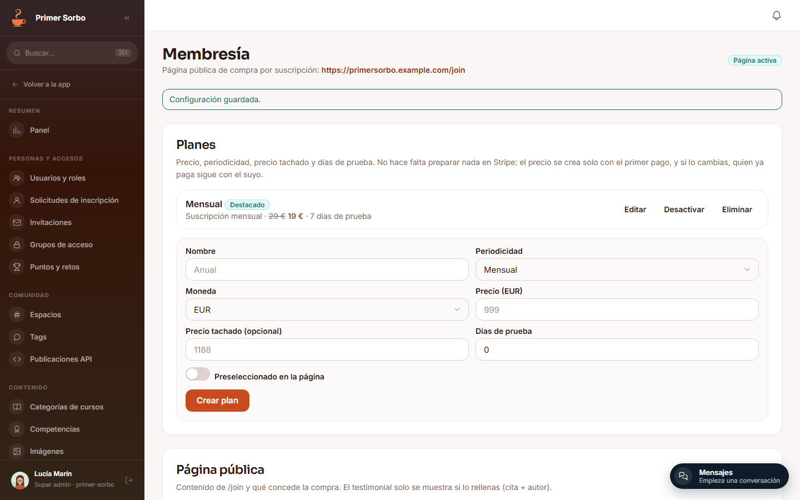

Y el resultado, en vivo, sin sesión — con el precio, el ahorro, lo que se cobra hoy, el curso incluido y las preguntas frecuentes ya generadas a partir de datos reales de la academia:

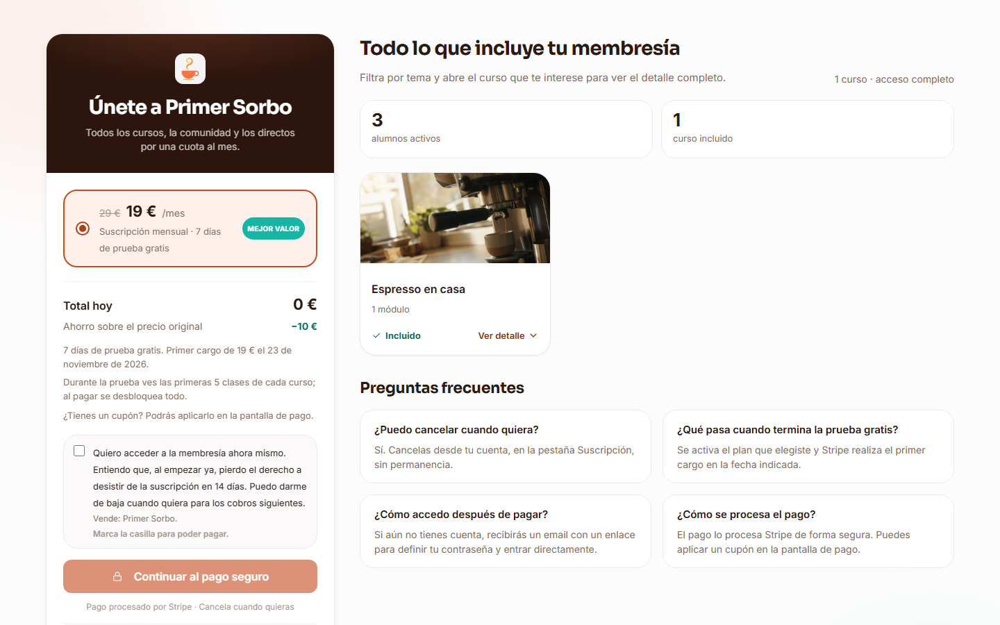

El botón «Continuar al pago seguro» se activa al marcar la casilla de acceso inmediato (con la que el comprador renuncia al desistimiento de 14 días) y abre Stripe Checkout — funciona en cuanto configures Stripe en **Administración → Configuración → Pagos** (§2). Sin credenciales (ni de la academia ni del fallback de instancia), responde el mismo error explicado arriba.

## Siguiente paso

- [Email](../configuration/email.md) — SMTP global vs. por academia, plantillas.
- [mod.billing — Stripe Checkout](../modules/catalog/billing.md)
- [mod.subscriptions — Suscripciones](../modules/catalog/subscriptions.md)
- [mod.payment-connections — Conexiones de pago](../modules/catalog/payment-connections.md) — para no confundirlo con lo anterior.
