# Recorrido visual: primeros pasos

Esta guía recorre una instalación de Didacta **desde cero**, tal y como la vería cualquier self-hoster nuevo: una instancia sin ningún dato previo y el camino real de un operador — asistente de configuración, asistente de bienvenida de la academia, primer curso, alta de alumnado y certificado — con una captura en cada paso.

!!! note "De dónde salen estas capturas"
    Se tomaron contra una instancia aislada, efímera y sin seeds de la versión 0.1.0-beta.18. La academia, el curso y las personas son de ejemplo (`Primer Sorbo`, `Lucía Marín`, `Elena Vidal`, dominio `primersorbo.example.com`) — sustitúyelos por los tuyos.

    Una instalación nueva arranca en **modo completo** (menú lateral con todas las opciones); el [último paso](#10-el-modo-sencillo) enseña cómo pasar al **modo sencillo**, el de las aulas de Didacta Cloud.

## 1 · Primer arranque y asistente de configuración

Mientras la instancia no tenga ninguna organización, Didacta redirige cualquier ruta a `/setup`. El asistente pide un **token de un solo uso** que la instancia imprime en sus logs al arrancar: ábrelo con el enlace completo `/setup?token=…` (`docker logs didacta-app | grep "Setup token"`; el instalador `install.sh` ya te lo enseña al terminar). La pantalla de bienvenida resume qué vas a configurar en menos de un minuto.

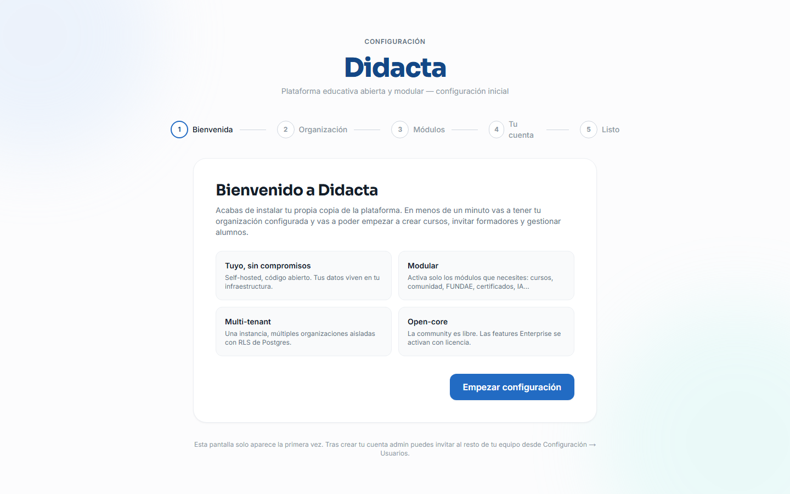

El segundo paso pide el nombre de la organización y el dominio público (el host desde el que accedes, editable).

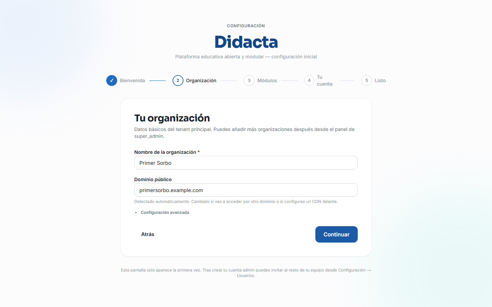

Después de elegir los módulos activos (los core vienen pre-marcados), el asistente pide los datos del primer administrador — cuenta con rol `super_admin`.

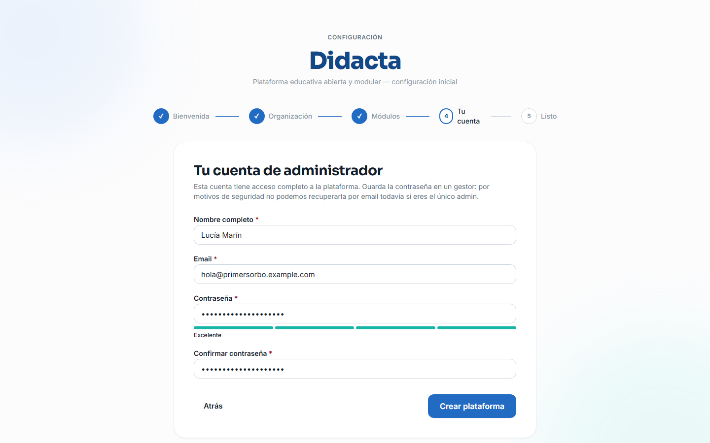

Al terminar, la organización y el administrador ya existen y la sesión queda iniciada: no hace falta volver a entrar.

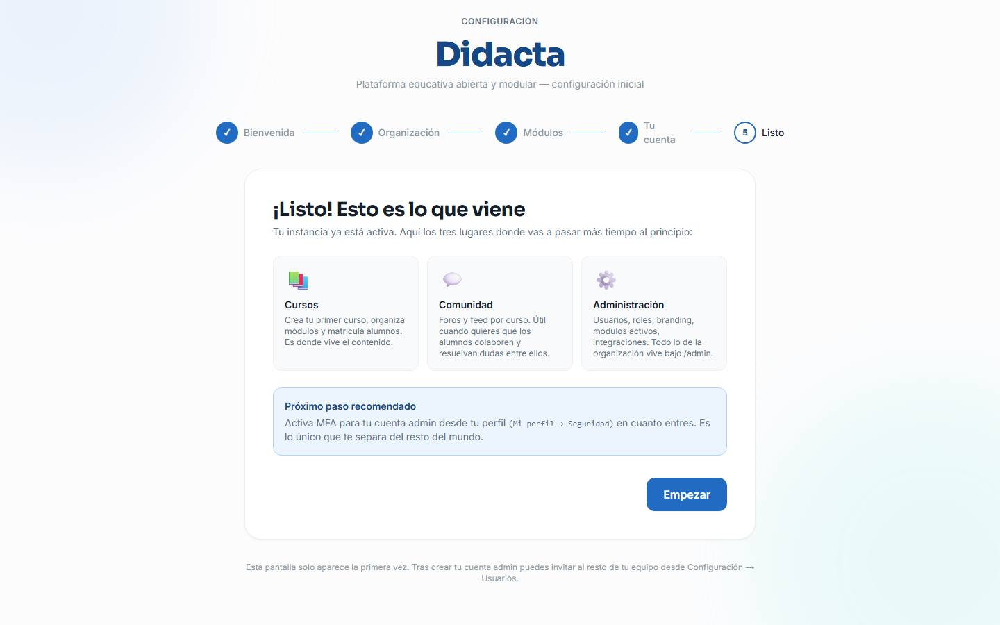

→ Detalle completo de qué crea el asistente en [Asistente de configuración](setup-wizard.md).

## 2 · Asistente de bienvenida de la academia

Al pulsar «Empezar», Didacta abre el asistente de bienvenida (`/welcome`): seis pasos — **Nombre**, **Logo y color**, **Primer curso**, **Alumnos**, **Cobros** y **Correo** — que dejan la academia presentable sin salir de la pantalla. Solo los dos primeros son obligatorios; el resto tiene «Ahora no».

En **Logo y color** subes el logo, eliges cómo se muestra («Solo el logo» o «Logo y nombre») y el color de marca, con una vista previa de cómo lo verán tus alumnos. Todo se puede cambiar después en **Administración → Branding** (`/admin/branding`).

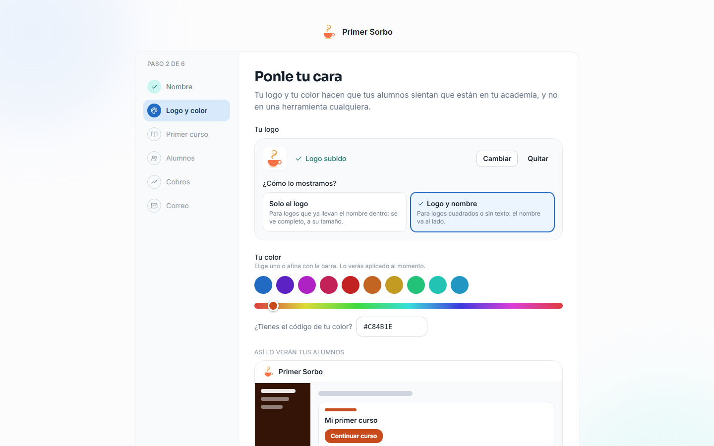

En **Primer curso** escribes un título y el curso se crea en borrador; en **Alumnos** pegas correos (uno por línea) y cada persona recibe una invitación para definir su contraseña. **Cobros** y **Correo** embeben las mismas tarjetas de Stripe y SMTP de Configuración ([segunda parte del recorrido](visual-walkthrough-sales.md)). El resumen final enseña la dirección de la academia y lo que quedó pendiente.

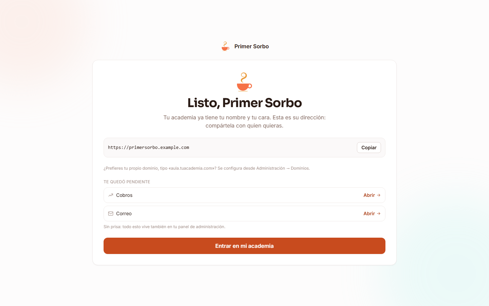

## 3 · Completa tu perfil

La primera vez que cualquier cuenta entra (incluida la del administrador), Didacta pide completar un perfil mínimo — foto obligatoria, nombre, idioma y preferencias de notificación — antes de dejar pasar al resto de la plataforma.

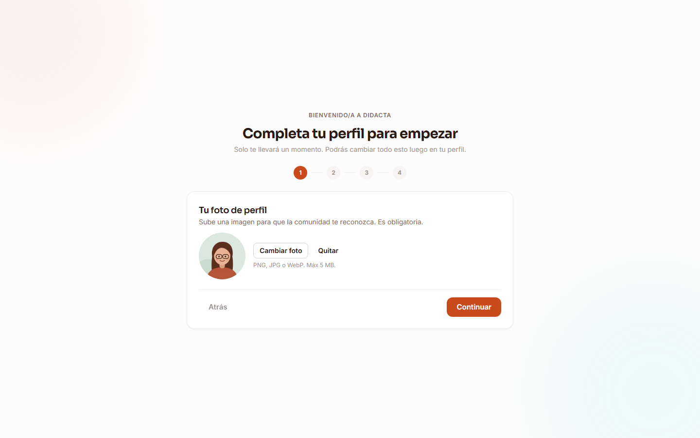

Al terminar llegas a la comunidad, con la tarjeta «Primeros pasos» que marca lo que ya está hecho y lo que falta.

## 4 · La pantalla de acceso

La pantalla de acceso (`/signin`) ya lleva la marca de la academia: logo, color, cifras reales (alumnado activo, cursos incluidos) y el titular que configures en **Administración → Branding**.

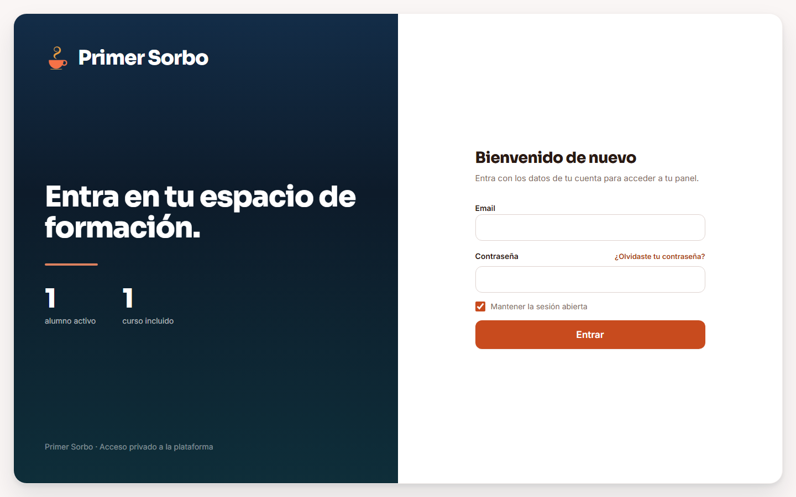

## 5 · Monta y publica tu primer curso

El asistente dejó el curso en borrador. Ábrelo desde **Formador → Mis cursos** (`/studio/courses`) → «Editar»: con «Editar» de la cabecera completas la descripción, la categoría y la portada. Dentro del curso añades secciones y, dentro de cada sección, lecciones — aquí una lección de texto.

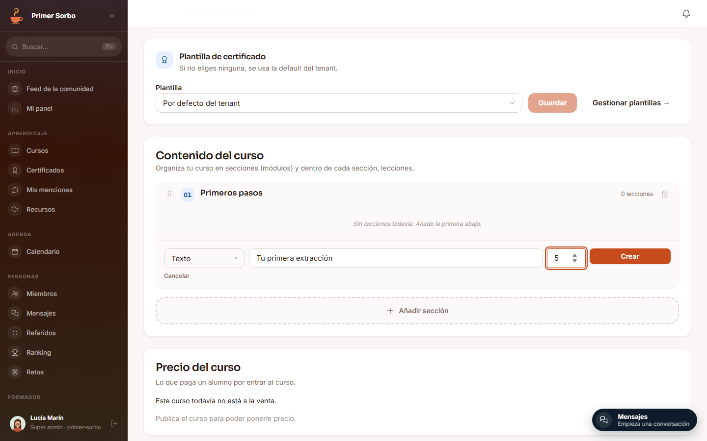

Publicar exige cuatro requisitos (título, descripción, al menos una sección y una lección); la tarjeta «Antes de publicar» te dice en todo momento qué falta y pasa a «Listo para publicar» cuando está todo.

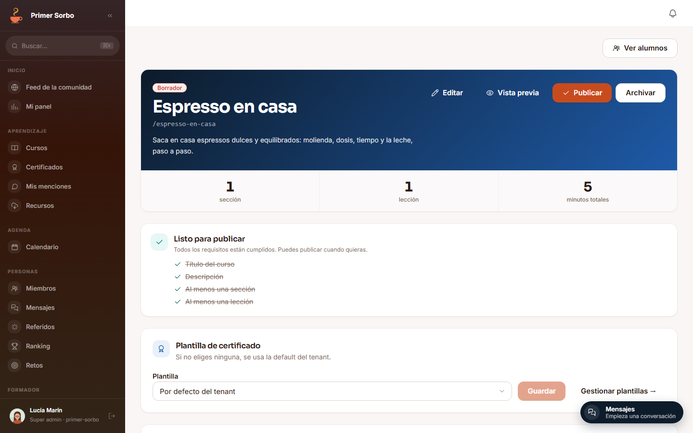

Con «Publicar», el curso pasa a **Publicado**.

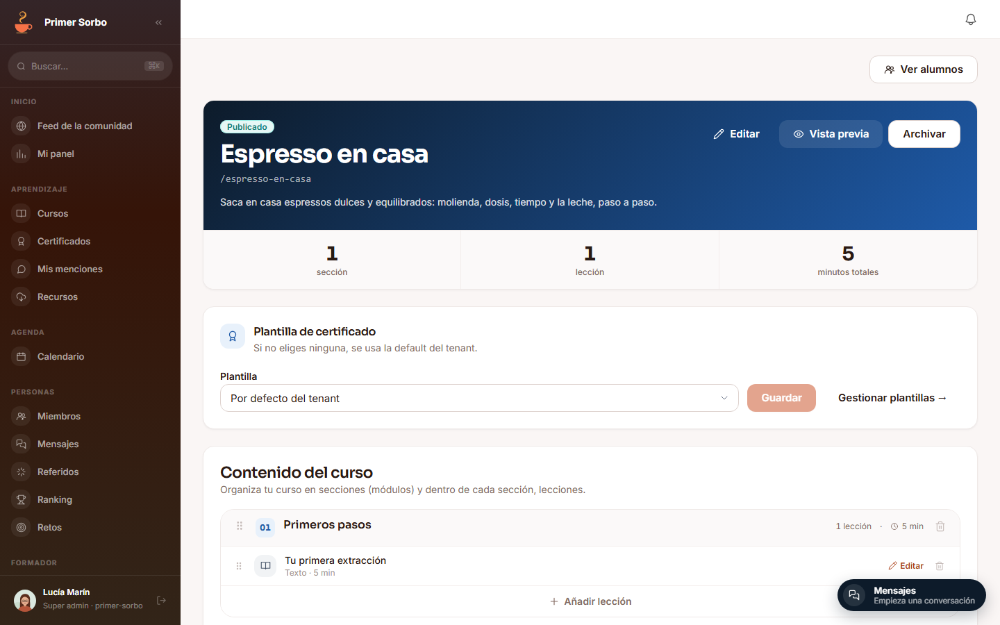

## 6 · Invita a tu alumnado

Sin auto-matriculación pública, la vía normal para que alguien entre a un curso sin pagar es un **código de invitación**, generado desde la tarjeta «Invitaciones» del propio curso.

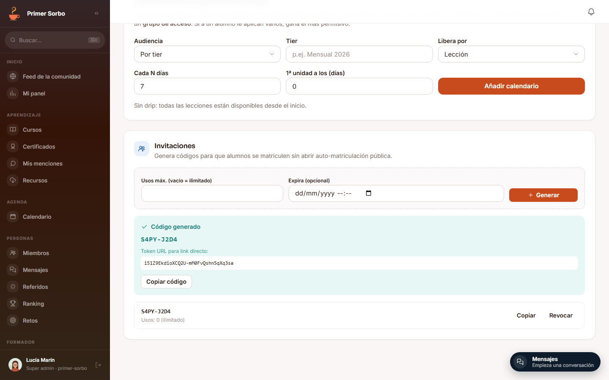

!!! tip "El catálogo público (`/catalog`) es el de venta"
    `/catalog` es la ficha pública para cursos **a la venta** — pensada para el visitante que compra con tarjeta sin registrarse antes. Un curso publicado sin precio, como el de este recorrido, no aparece ahí: sigue siendo accesible por invitación o desde el catálogo interno una vez el alumnado ha entrado. Ver [Tres formas de llenar tu academia](../getting-started/index.md#tres-formas-de-llenar-tu-academia-de-alumnos).

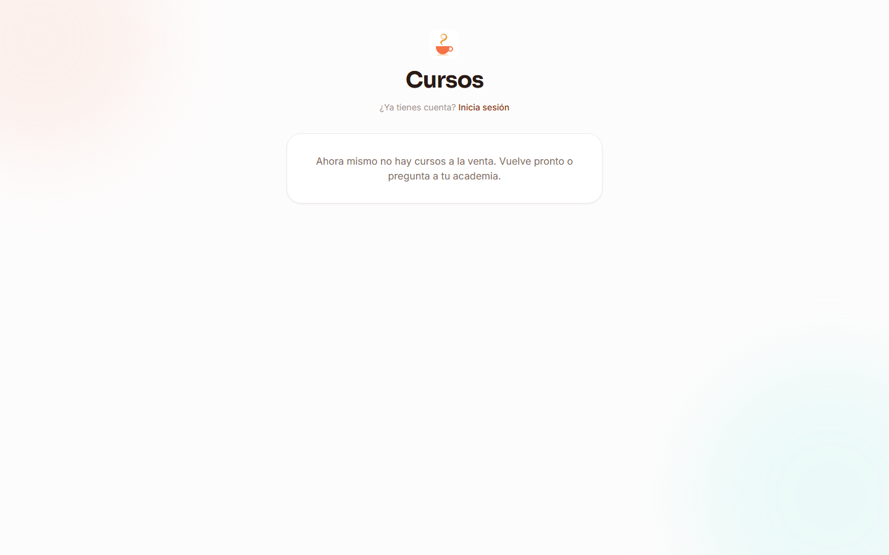

Para dar de alta a una persona directamente (además de las que invitaste en el asistente), **Administración → Usuarios y roles → Invitar persona** (`/admin/users/invite`) crea la cuenta y le envía un email para que defina su contraseña.

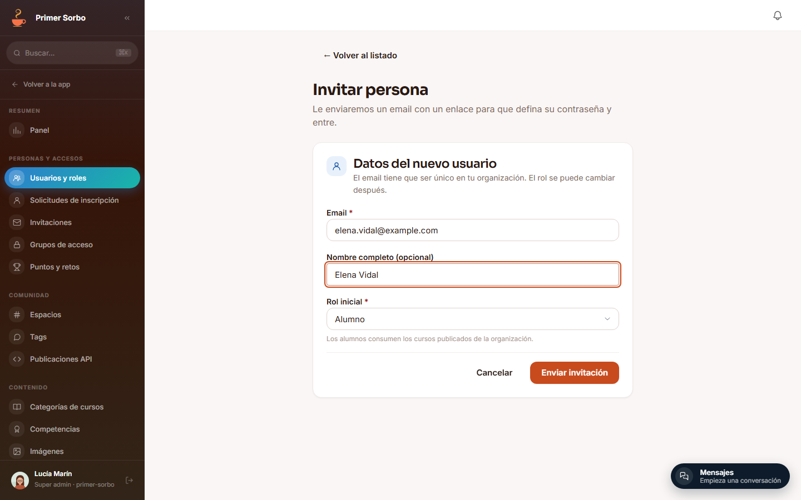

## 7 · La alumna entra y se matricula

Desde el enlace del email, la alumna define su contraseña; después entra con ella y completa su perfil (paso 3).

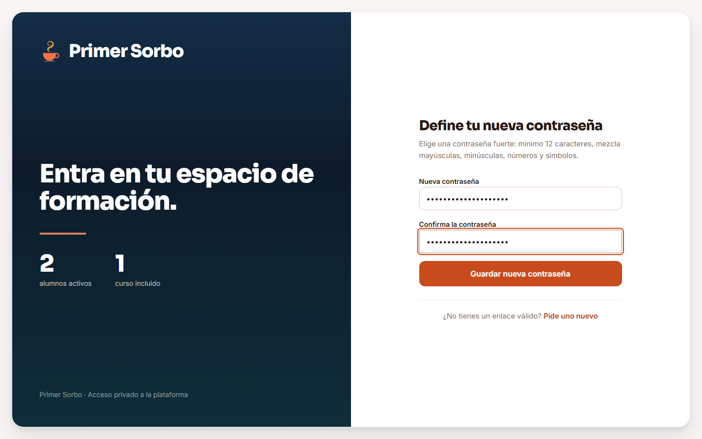

Con sesión iniciada, `/courses` es el catálogo **interno** de la app: lista todos los cursos publicados de la organización, tengan o no precio (a diferencia del `/catalog` de venta del paso anterior).

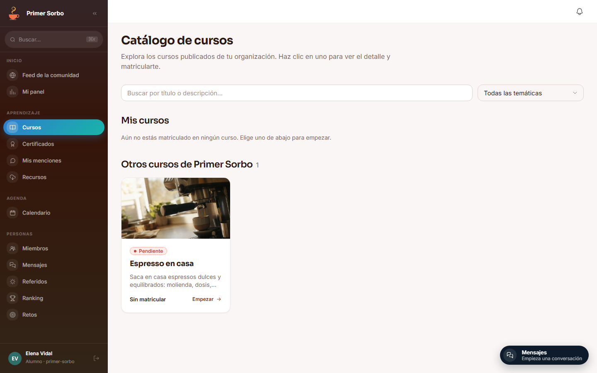

En la ficha del curso, canjea el código de invitación que le dio la organización.

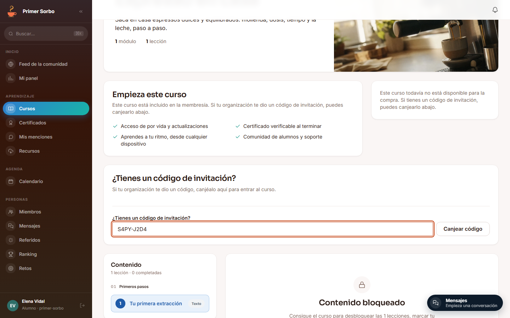

Al canjearlo queda matriculada al instante: ve su progreso, el temario y la lección abierta. Para tipos como texto o PDF, el botón «Marcar como completada» registra la lección a mano.

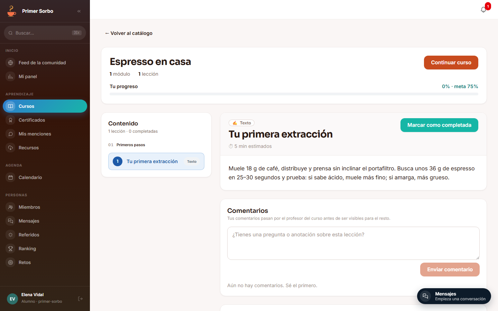

## 8 · Completa el curso y descarga el certificado

Al alcanzar el umbral de finalización del curso, Didacta emite el certificado de forma automática y el botón de la cabecera cambia a «Descargar certificado».

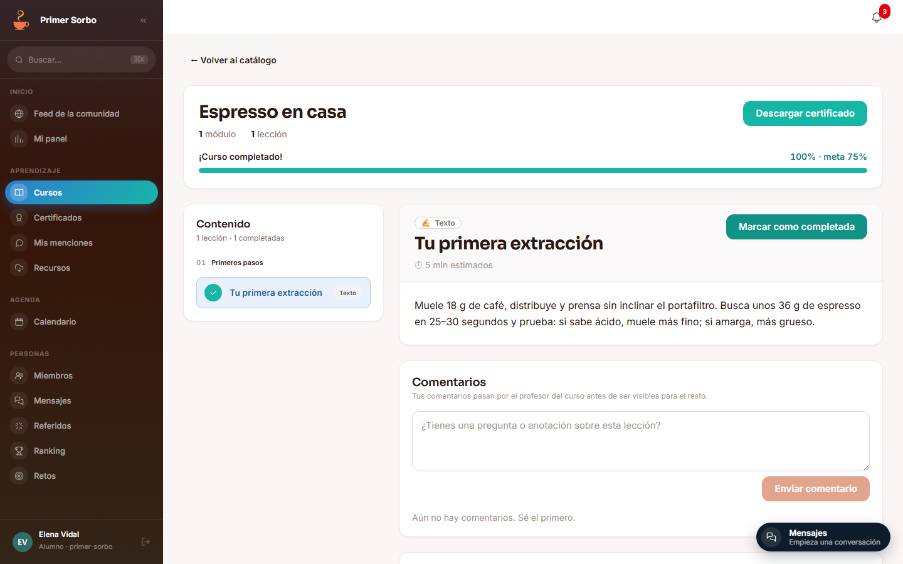

Todos los certificados del alumnado quedan también en `/my-certificates`, con número correlativo verificable, descarga en PDF y «Añadir a LinkedIn».

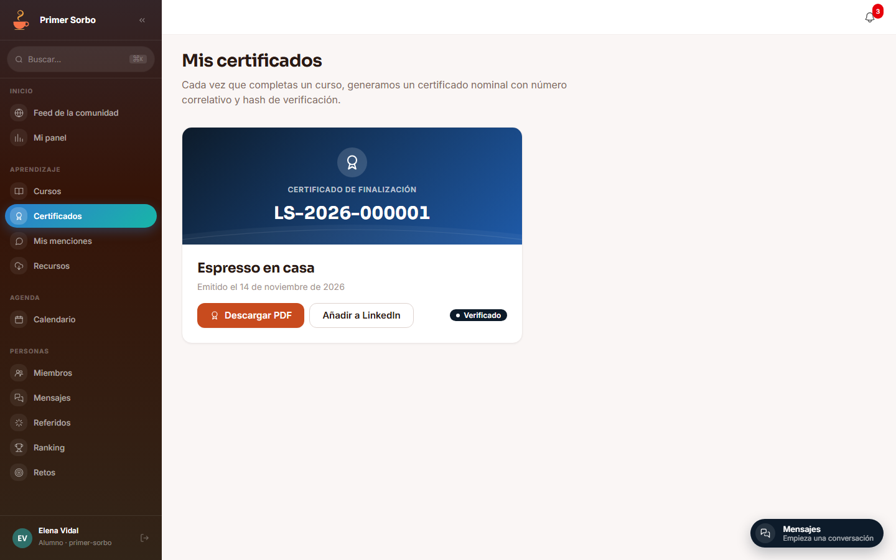

## 9 · Un vistazo a Administración → Licencia

Community funciona completo sin licencia. **Administración → Licencia** (`/admin/license`) muestra el estado actual y permite activar una licencia Enterprise pegando la clave — la verificación es local, sin llamadas a un servidor externo. Si el operador fijó `DIDACTA_LICENSE_KEY` por entorno, la pantalla pasa a solo lectura; ver [Licencia](../enterprise/license.md).

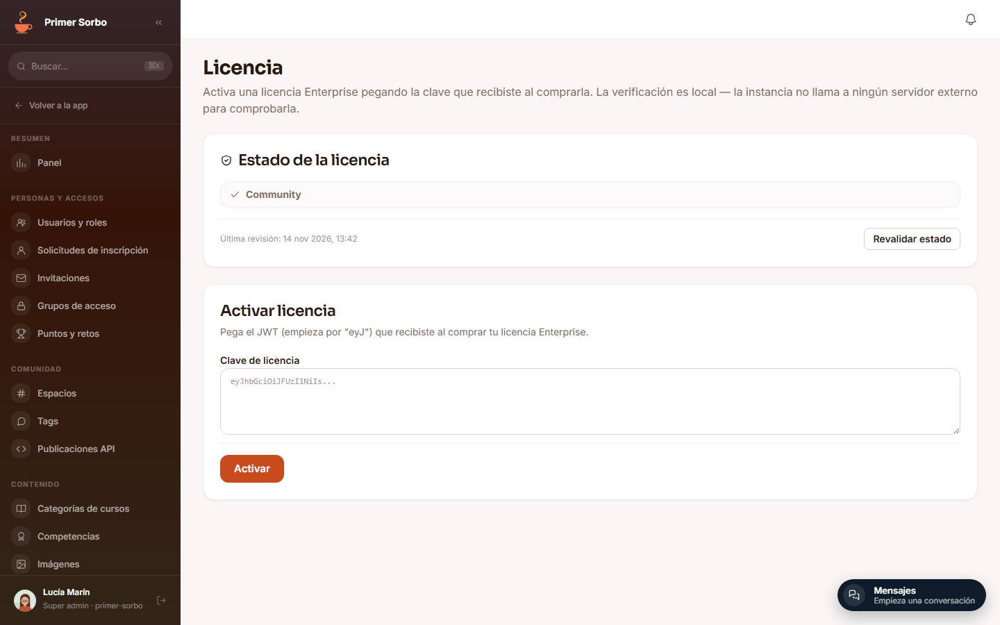

## 10 · El modo sencillo

Didacta tiene dos modos de aula. El **completo** — el de una instalación nueva y el de todas las capturas anteriores — enseña todas las opciones en un menú lateral. El **sencillo** deja unas pocas pestañas arriba («Empieza aquí» —«Inicio» tras la primera venta—, «Comunidad», «Cursos», «Directos», «Alumnos», «Ventas», «Ajustes»), editores sin opciones avanzadas y todo lo demás en «Más»; es el modo con el que nacen las aulas de Didacta Cloud. Para cambiar, en **Administración → Configuración** (`/admin/settings`) pulsa **«Volver al modo sencillo»**; no se borra nada.

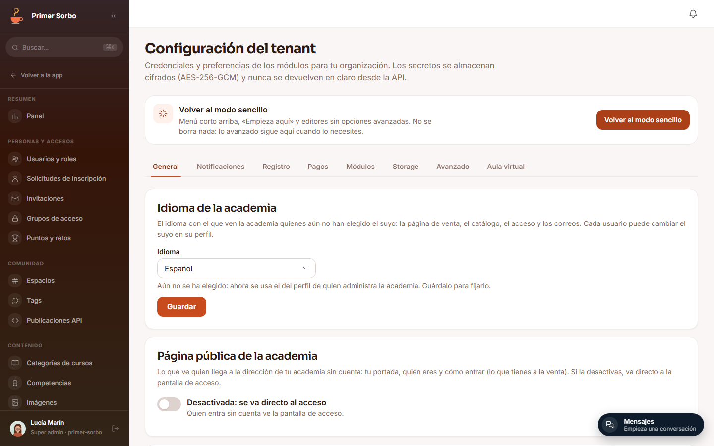

En modo sencillo, quien administra aterriza en «Empieza aquí» (`/start`), con lo que le falta para su primera venta. Para volver, **Ajustes → «Usar el modo completo»**.

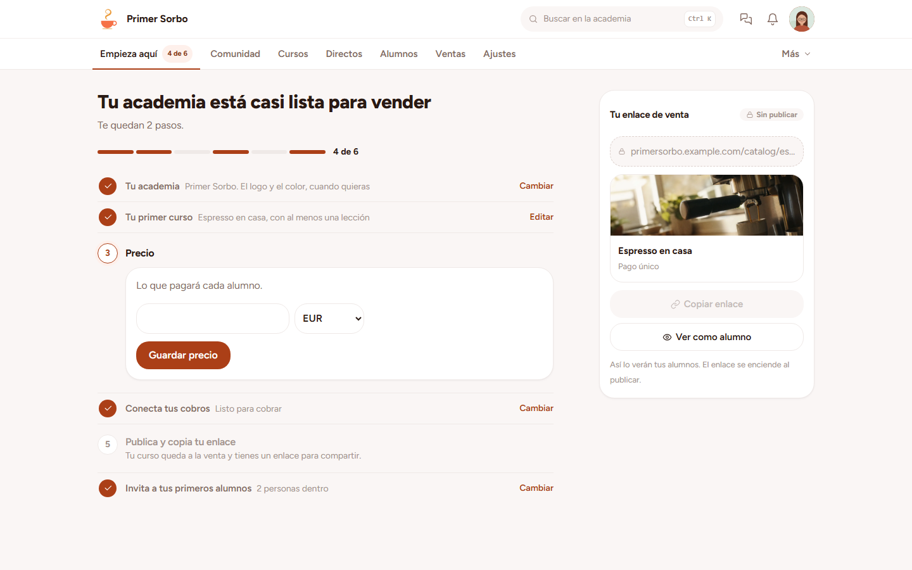

## Qué no se ve en estas capturas

- El endpoint de matrículas propias (`GET /me/enrollments`) puede tardar hasta ~1 segundo en reflejar una matrícula recién creada. Si acabas de canjear un código y no ves el curso de inmediato en algún listado, recarga.

## Siguiente paso

- [Recorrido visual: notificaciones y ventas](visual-walkthrough-sales.md) — configura SMTP de verdad y prepara la instancia para vender cursos y membresías.
- [Configuración](../configuration/index.md) — SMTP real, storage S3, IA.
- [Gestionar módulos](../modules/managing.md) — activa o desactiva módulos opcionales.
- [Copias de seguridad](backups.md) — antes de que haya datos de verdad.
