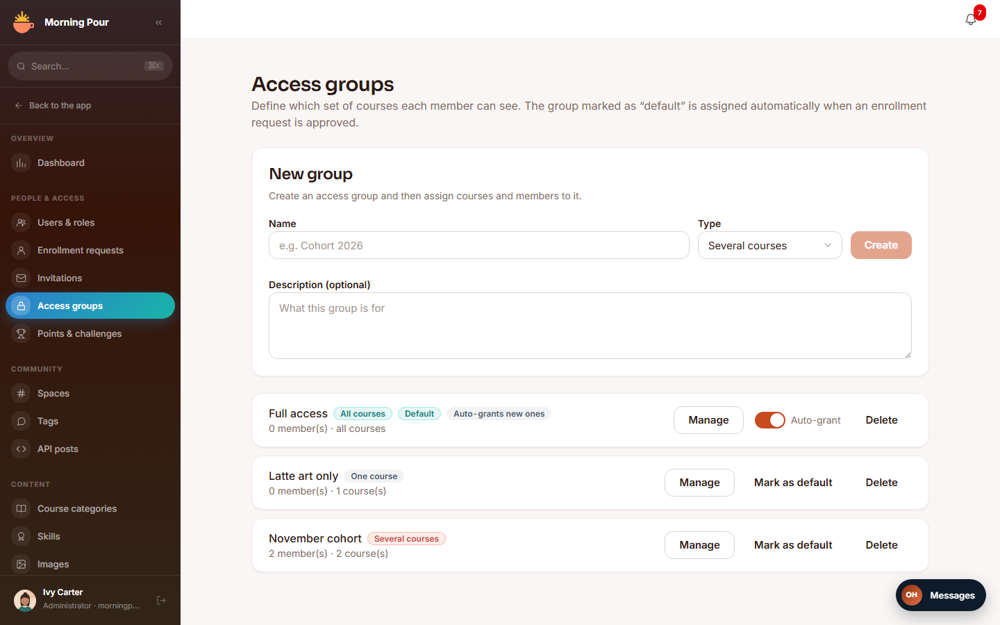
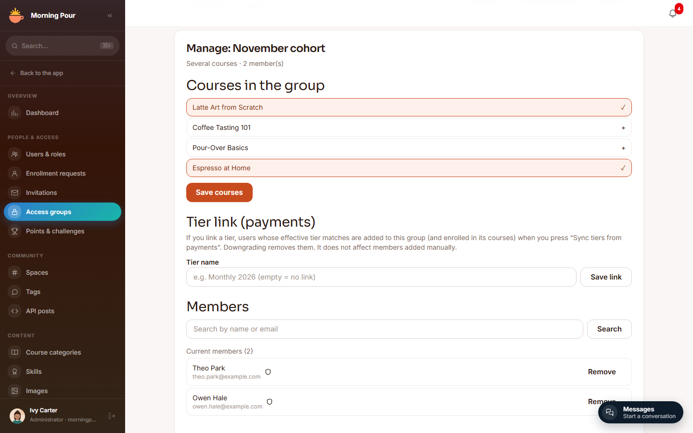
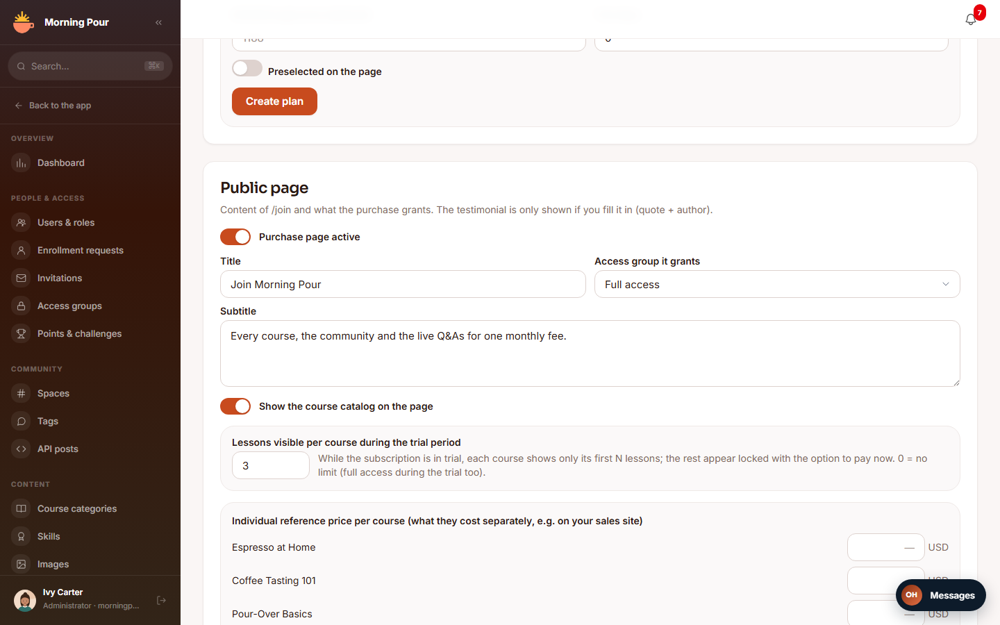

# mod.access-groups — Access groups

Community · **Core** category (always active — trying to disable it returns `422 CORE_MODULE_NOT_DISABLEABLE`)

## What it does

It encapsulates the entitlement "which courses a member can see" as a composable building block. A group is defined with one of three kinds (`kind`):

- **`ALL_COURSES`** — every published course, with `autoGrantNewCourses` to enroll members automatically in each new course.
- **`COURSE`** / **`MULTI_COURSE`** — an explicit set of courses.

Group membership materialises as **real core enrollments** (through `mod.learning`, with origin `GROUP`), never by touching another module's tables.

## How it works

- Members arrive through three routes with different owners: **MANUAL** (added by an admin or on registration approval — *sticky*, never revoked on its own), **TIER** (reconciled against `mod.payment-connections` tiers) and **MEMBERSHIP** (granted by the paid membership from `mod.subscriptions`).
- The key design idea is **refcounting with provenance**: a course is only unenrolled when no live group grants it, and enrollments with origin `PURCHASE`, `SUBSCRIPTION` or `API` are never touched.
- Revocation on cancellation or non-payment removes **only** the memberships whose origin is `MEMBERSHIP`. In `/admin/access-groups` and in the user dossier, those memberships are marked with the "By membership" badge.
- **Who owns a membership.** A manual add over an already active membership of another origin **promotes** it to `MANUAL`: from then on neither a tier change nor a non-payment removes it. Conversely, a **revoked** membership that is reactivated (by a payment, for example) becomes the property of whoever reactivates it, even if it used to be `MANUAL`: that way access granted by money does not outlive the payment stopping.
- **Refcount and refunds.** The refcount is the number of live grants (`mod_access_groups_grant` without `revoked_at`) of a course to a person across all their groups. When a course purchase is refunded, the purchase enrollment is withdrawn unless some group still grants it: in that case it goes back to origin `GROUP`.
- Deleting a group revokes its memberships and cleans up orphaned drip schedules.
- **Membership levels.** Each [level](subscriptions.md#levels) (Basic, Pro, Free…) is a group of its own that the membership creates and maintains through this module's public service: it is called "Membresía · Pro" (with the level's name) and is "All courses" or "Several courses" depending on what was chosen when the level was created. On a level change, the bridge grants the new group and only then removes the old one (only what has `MEMBERSHIP` origin), so shared courses are never lost. The free level's group is the one marked as default when approving registrations.
- **Content by level.** Community spaces and live classes can be restricted to paid membership levels (each level is a group) with "Who can see it": they are seen by whoever is an **active** member of any of them. See [Community](community.md#spaces-by-level) and [Virtual classroom](zoom-live.md#live-classes-by-level).
- A group can be flagged `isDefaultForApproval` (granted when registrations are approved; only one per tenant: flagging another unflags the previous one) or linked to a tier (`linkedTierName`). Changing or removing the tier link removes those who came in through the previous tier; whoever still qualifies comes back on the next sync.

It is a first-party module **formalised as a package** (`modules/access-groups/`, with its own manifest) whose NestJS orchestration — controller, Prisma service and event bridges — lives in the host (`apps/api/src/modules/access-groups/`), the standard built-in module pattern.

## Configuration

Being a **core**-category module, it does not appear in the list of switchable modules (Administration → Brand & settings → Settings, "Modules" tab): it is always active for every tenant. It reads no environment variables of its own and no setting requires an Enterprise licence — everything is Community.

Everything is configured from the panel, always with an admin role (`super_admin` / `tenant_admin`):

- **Create a group** — `/admin/access-groups` (Administration → People & access → "Access groups"): fields "Name", "Type" ("All courses", "Several courses", "One course") and "Description (optional)".
- **"Mark as default"** — `/admin/access-groups`: sets `isDefaultForApproval`; that group is granted when `mod.member-registration` requests are approved.
- **"Auto-grant" switch** — `/admin/access-groups`, only on "All courses" groups: `autoGrantNewCourses` (**on** by default), enrolls members in every course as it is published.
- **"Courses in the group"** — `/admin/access-groups` → "Manage": the course set of a "Several courses"/"One course" group, with "Save courses".
- **"Tier link (payments)"** — `/admin/access-groups` → "Manage": "Tier name" field + "Save link" (`linkedTierName`). Reconciliation is triggered with the "Sync tiers from payments" button on `/admin/integrations/payment-connections` (owner: `mod.payment-connections`).
- **"Access group it grants"** — `/admin/membership`: which group the paid membership grants. That setting belongs to `mod.subscriptions`, not to this module. With paid levels it is not shown: each level gives its own group, and its courses are changed in **Membership → "Levels"**.

!!! note "Screenshots in full mode"
    The screenshots on this page come from **full mode** (side menu), the mode a new installation starts in. In **simple mode** the same routes are still available from "More", except for the screens that mode replaces with a simplified version (the course editor, Settings, Sales, Students, Live, the community and Referrals); to use them as shown here, switch to full mode under **Settings → "Use the full mode"**.

## Step-by-step usage

1. Go to Administration → People & access → **Access groups** (`/admin/access-groups`).
2. Under "New group", type the "Name", pick the "Type" and press **Create**.

3. Press **Manage** on the newly created group:
    - On a "Several courses" or "One course" group, tick the published courses and press **Save courses**.
    - An "All courses" group needs no selection; turn on the "Auto-grant" switch if you also want it to enroll members in every new course.
4. Add members by hand: search by name or email, press **Search** and then **Add** next to the user. These additions have origin `MANUAL` (*sticky*): only an admin removes them with **Remove**. Members who arrived through payments are marked with the "By tier" and "By membership" badges.

5. *(Optional)* Press **Mark as default** on the group that should be granted when member registrations are approved.
6. *(Optional, with `mod.payment-connections`)* Under "Tier link (payments)", type the "Tier name" and press **Save link**. Users whose effective tier matches join (and leave when downgraded) when you press **Sync tiers from payments** on `/admin/integrations/payment-connections`.
7. *(Optional, with `mod.subscriptions`)* On `/admin/membership`, pick the group under "Access group it grants" so the paid membership grants and revokes it on its own.

!!! note "The screenshot is from a classroom without levels"
    Since version 0.1.0-beta.27, in a classroom with paid levels that picker is replaced by the note "Each level gives its own courses: change them above, in “Levels”.", and the "Levels" card sits above "Plans". See [Subscriptions → Levels](subscriptions.md#levels).

From a person's profile (`/u/<id>`, "Record" → "Training" → "Access groups", admins only) you can also add them to a group with "Add" or take them out with "Remove": removing them withdraws the enrollment in the courses that only came from that group (progress is kept in case they return). "By tier" memberships are managed by the payment.

The member never sees "groups" on any screen: the group's courses simply show up as active enrollments in `/courses`, and disappear when no live group grants them (enrollments from any other origin are never touched).

## Dependencies

- Hard: `mod.courses`, `mod.learning`. Optional: `mod.payment-connections`, `mod.subscriptions`.

## Data model

`mod_access_groups_group` (group, kind, flags) · `mod_access_groups_group_course` (the group's courses) · `mod_access_groups_group_member` (membership with `status` and `source`) · `mod_access_groups_grant` (provenance/refcount per group, user and course).

## API

Prefix `/modules/access-groups` — **everything requires admin**, reads included (they expose the roster): list and create groups, `GET/PATCH/DELETE /:id`, `PUT /:id/courses`, `POST /:id/members`, `DELETE /:id/members/:userId` and the `GET /catalog/courses` and `GET /catalog/users` catalogs for the panel's pickers. The exception is `GET /options` (`{ id, name }` for the "Who can see it" field of spaces and live classes), which instructors can also call. Details in [Reference → Learning](../../api/reference/learning.md#access-groups-modulesaccess-groups-all-admin).

## Events

- **Emits**: none.
- **Consumes**: `courses.course.published`, `payment_connections.user_tier.changed`, `subscriptions.membership.activated/plan_changed`, `subscriptions.subscription.activated/canceled/unpaid/paused`.
