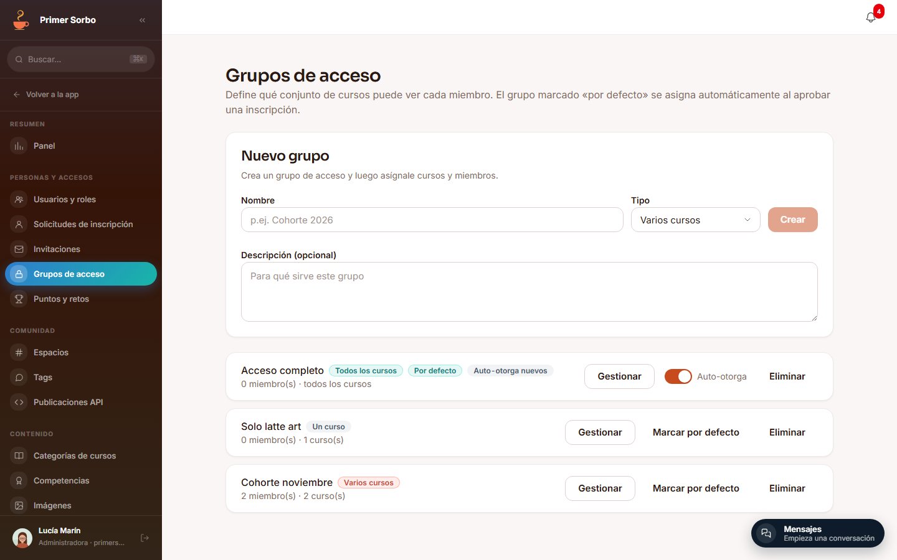
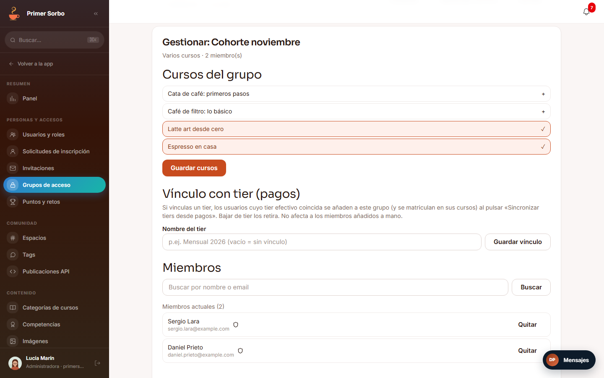
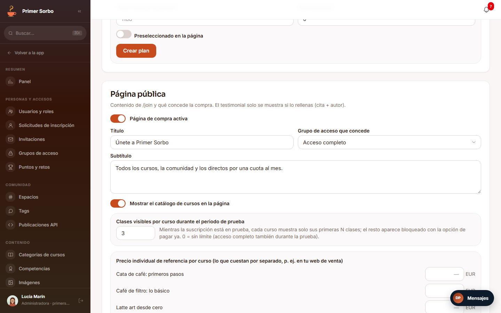

# mod.access-groups — Grupos de acceso

Community · Categoría **core** (siempre activo — intentar desactivarlo responde `422 CORE_MODULE_NOT_DISABLEABLE`)

## Qué hace

Encapsula el *entitlement* «qué cursos puede ver un miembro» como pieza componible. Un grupo se define con tres tipos (`kind`):

- **`ALL_COURSES`** — todos los cursos publicados, con `autoGrantNewCourses` para matricular automáticamente en cada curso nuevo.
- **`COURSE`** / **`MULTI_COURSE`** — un set explícito de cursos.

La pertenencia al grupo se materializa como **matrículas reales** del core (vía `mod.learning`, con origen `GROUP`), nunca tocando tablas ajenas.

## Cómo funciona

- Los miembros entran por tres vías con dueño distinto: **MANUAL** (alta del admin o aprobación de inscripción — *sticky*, nunca se revoca sola), **TIER** (reconciliada con los tiers de `mod.payment-connections`) y **MEMBERSHIP** (concedida por la membresía de pago de `mod.subscriptions`).
- La clave del diseño es el **refcount con provenance**: un curso solo se desmatricula cuando ningún grupo vivo lo otorga, y jamás se tocan matrículas de origen `PURCHASE`, `SUBSCRIPTION` o `API`.
- La revocación por cancelación o impago retira **solo** las membresías de origen `MEMBERSHIP`. En `/admin/access-groups` y en el dossier del usuario, esas membresías se distinguen con el badge «Por membresía».
- **Quién es dueño de una membresía.** Un alta manual sobre una membresía ya activa de otro origen la **promociona** a `MANUAL`: desde entonces ni un cambio de tier ni un impago la retiran. Al revés, una membresía **revocada** que se reactiva (por un pago, por ejemplo) pasa a ser de quien la reactiva, aunque antes fuera `MANUAL`: así un acceso concedido por dinero no sobrevive a que el pago deje de entrar.
- **Refcount y reembolsos.** El refcount es el número de concesiones vivas (`mod_access_groups_grant` sin `revoked_at`) de un curso a una persona entre todos sus grupos. Cuando se reembolsa la compra de un curso, la matrícula de compra se retira salvo que algún grupo siga dándolo: en ese caso vuelve a ser de origen `GROUP`.
- Borrar un grupo revoca sus membresías y limpia los calendarios de drip huérfanos.
- **Niveles de la membresía.** Cada [nivel](subscriptions.md#niveles) (Básico, Pro, Gratis…) es un grupo propio que crea y mantiene la membresía con el service público de este módulo: se llama «Membresía · Pro» (con el nombre del nivel) y es «Todos los cursos» o «Varios cursos» según lo que se eligió al crear el nivel. Al cambiar de nivel, el puente concede el grupo nuevo y después retira el viejo (solo lo de origen `MEMBERSHIP`), así que los cursos comunes no se pierden. El grupo del nivel gratis es el que se marca «por defecto» al aprobar inscripciones.
- **Contenido por nivel.** Los espacios de la comunidad y las clases en directo se pueden restringir a grupos (niveles) con «Quién puede verlo»: los ve quien es miembro **activo** de alguno de ellos. Ver [Comunidad](community.md#espacios-por-nivel) y [Aula virtual](zoom-live.md#directos-por-nivel).
- Un grupo puede marcarse `isDefaultForApproval` (se concede al aprobar inscripciones; solo uno por tenant: al marcar otro, se desmarca el anterior) o vincularse a un tier (`linkedTierName`). Cambiar o quitar el vínculo con el tier retira a quienes entraron por el tier anterior; los que corresponda vuelven en la siguiente sincronización.

Es un módulo first-party **formalizado como paquete** (`modules/access-groups/`, manifest propio) cuya orquestación NestJS —controller, service Prisma y bridges de eventos— vive en el host (`apps/api/src/modules/access-groups/`), el patrón estándar de módulo built-in.

## Configuración

Al ser de categoría **core** no aparece en el listado de módulos activables (Administración → Marca y ajustes → Configuración, pestaña «Módulos»): está siempre activo en todos los tenants. No lee ninguna variable de entorno propia y ningún ajuste exige licencia Enterprise — todo es Community.

Todo se configura desde el panel, siempre con rol admin (`super_admin` / `tenant_admin`):

- **Crear grupo** — `/admin/access-groups` (Administración → Personas y accesos → «Grupos de acceso»): campos «Nombre», «Tipo» («Todos los cursos», «Varios cursos», «Un curso») y «Descripción (opcional)».
- **«Marcar por defecto»** — `/admin/access-groups`: fija `isDefaultForApproval`; ese grupo se concede al aprobar solicitudes de `mod.member-registration`.
- **Interruptor «Auto-otorga»** — `/admin/access-groups`, solo en grupos «Todos los cursos»: `autoGrantNewCourses` (por defecto **activado**), matricula a los miembros en cada curso que se publique.
- **«Cursos del grupo»** — `/admin/access-groups` → «Gestionar»: el set de cursos de un grupo «Varios cursos»/«Un curso», con «Guardar cursos».
- **«Vínculo con tier (pagos)»** — `/admin/access-groups` → «Gestionar»: campo «Nombre del tier» + «Guardar vínculo» (`linkedTierName`). La reconciliación se lanza con el botón «Sincronizar tiers desde pagos» de `/admin/integrations/payment-connections` (dueño: `mod.payment-connections`).
- **«Grupo de acceso que concede»** — `/admin/membership`: qué grupo otorga la membresía de pago. El ajuste pertenece a `mod.subscriptions`, no a este módulo. Con niveles de pago no aparece: cada nivel da su propio grupo, y sus cursos se cambian en **Membresía → «Niveles»**.

!!! note "Capturas en modo completo"
    Las capturas de esta página son del **modo completo** (menú lateral), el de una instalación nueva. En **modo sencillo** las mismas rutas siguen disponibles desde «Más», salvo las pantallas que ese modo sustituye por una versión simplificada (el editor de cursos, Ajustes, Ventas, Alumnos, Directos, la comunidad y Referidos); para usarlas tal como se ven aquí, cambia al modo completo en **Ajustes → «Usar el modo completo»**.

## Uso paso a paso

1. Entra en Administración → Personas y accesos → **Grupos de acceso** (`/admin/access-groups`).
2. En «Nuevo grupo», escribe el «Nombre», elige el «Tipo» y pulsa **Crear**.

3. Pulsa **Gestionar** en el grupo recién creado:
    - En un grupo «Varios cursos» o «Un curso», marca los cursos publicados y pulsa **Guardar cursos**.
    - Un grupo «Todos los cursos» no pide selección; activa el interruptor «Auto-otorga» si además quieres que matricule en cada curso nuevo.
4. Añade miembros a mano: busca por nombre o email, pulsa **Buscar** y después **Añadir** junto al usuario. Estas altas son de origen `MANUAL` (*sticky*): solo las retira un admin con **Quitar**. Los miembros que llegaron por pagos se distinguen con los badges «Por tier» y «Por membresía».

5. *(Opcional)* Pulsa **Marcar por defecto** en el grupo que deba concederse al aprobar inscripciones de miembros.
6. *(Opcional, con `mod.payment-connections`)* En «Vínculo con tier (pagos)», escribe el «Nombre del tier» y pulsa **Guardar vínculo**. Los usuarios cuyo tier efectivo coincida entran (y salen al bajar de tier) al pulsar **Sincronizar tiers desde pagos** en `/admin/integrations/payment-connections`.
7. *(Opcional, con `mod.subscriptions`)* En `/admin/membership`, elige el grupo en «Grupo de acceso que concede» para que la membresía de pago lo otorgue y lo revoque sola.

!!! note "La captura es de un aula sin niveles"
    Desde la versión 0.1.0-beta.27, en un aula con niveles de pago ese selector se sustituye por la nota «Cada nivel da sus propios cursos: se cambian arriba, en «Niveles».», y encima de «Planes» está la tarjeta «Niveles». Ver [Suscripciones → Niveles](subscriptions.md#niveles).

Desde el perfil de una persona (`/u/<id>`, «Expediente» → «Formación» → «Grupos de acceso», solo admins) también puedes añadirla a un grupo con «Añadir» o sacarla con «Quitar»: quitarla retira la matrícula de los cursos que solo venían de ese grupo (el progreso se conserva por si vuelve). Las membresías «Por tier» las gestiona el pago.

El miembro no ve «grupos» en ninguna pantalla: simplemente los cursos del grupo aparecen como matrículas activas en `/courses`, y desaparecen si ningún grupo vivo los otorga (las matrículas de otro origen nunca se tocan).

## Dependencias

- Duras: `mod.courses`, `mod.learning`. Opcionales: `mod.payment-connections`, `mod.subscriptions`.

## Modelo de datos

`mod_access_groups_group` (grupo, kind, flags) · `mod_access_groups_group_course` (cursos del grupo) · `mod_access_groups_group_member` (membresía con `status` y `source`) · `mod_access_groups_grant` (provenance/refcount por grupo, usuario y curso).

## API

Prefijo `/modules/access-groups` — **todo requiere admin**, incluidas las lecturas (exponen el roster): listar y crear grupos, `GET/PATCH/DELETE /:id`, `PUT /:id/courses`, `POST /:id/members`, `DELETE /:id/members/:userId` y los catálogos `GET /catalog/courses` y `GET /catalog/users` para los selectores del panel. La excepción es `GET /options` (`{ id, name }` para «Quién puede verlo» de espacios y directos), que también puede pedir el formador. Detalle en [Referencia → Aprendizaje](../../api/reference/learning.md#grupos-de-acceso-modulesaccess-groups-todo-admin).

## Eventos

- **Emite**: ninguno.
- **Consume**: `courses.course.published`, `payment_connections.user_tier.changed`, `subscriptions.membership.activated/plan_changed`, `subscriptions.subscription.activated/canceled/unpaid/paused`.
