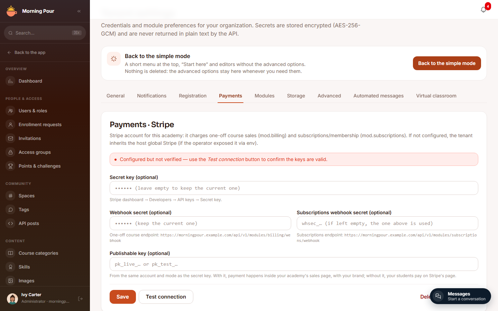
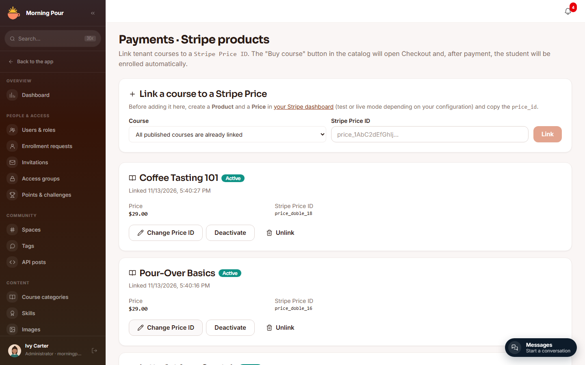

# mod.billing — Stripe Checkout (one-off payment)

Community · **Core** category (always active)

## What it does

Course monetization with one-off payments through **Stripe Checkout**: the admin links each course to a Stripe price (or creates one from Didacta), the student clicks buy, the backend creates the Checkout Session and redirects to the hosted checkout. Once the payment is confirmed, the webhook completes the order and emits `billing.order.completed`, which `mod.learning` listens to in order to enroll the student with origin `PURCHASE`.

It also covers the **public purchase journey**: a visitor **with no account** buys from the public catalog (`/catalog`) or from a course's sales page (`/catalog/<slug>`); the order starts as `PENDING` with no owner and fulfillment materialises the account with the email confirmed by Stripe (find-or-create + a welcome email with a "set your password" link, template `billing.welcome`, editable per tenant under Administration → Emails). The return pages for a public payment are `/catalog/checkout/success` and `/catalog/checkout/cancel`.

## How it works

- **Explicit idempotency**: every Stripe `evt_*` event is persisted and never reprocessed — redelivering an anonymous checkout duplicates neither the account nor the enrollment.
- Guards before charging: 404 if the course does not exist, 409 if it is not published, 409 if you already have access.
- With no Stripe configured the module still registers itself: the public catalog returns an empty list and checkout returns 503 with a clear message. The rest of the platform is unaffected.
- **Withdrawal waiver**: without the waiver checkbox (the buyer agrees to start right away and give up the 14-day right of withdrawal), checkout answers 422 and neither the order nor the payment session is created. The text is served by the API (`GET /purchase-consent/withdrawal-waiver`, in Spanish, English and Portuguese), stored as proof together with its version, and the receipt confirms it to the buyer.
- **Pinned price**: the sales page sends the price the buyer is looking at; if it changed in the meantime, checkout rejects it instead of charging a different amount.
- **Payment inside the page**: if the account that collects the money has a **publishable key**, the public sales page (`/catalog/<slug>`) renders the payment inside the page itself, with the academy's branding (Stripe embedded Checkout); without it, it redirects to the usual hosted checkout. The return is always `/catalog/checkout/success`, which **asks** the API whether the session is paid (`GET /modules/billing/public/checkout-session/<id>`) and grants nothing by itself: access is granted by the webhook. The signed-in checkout (`/courses/<slug>`) is always hosted.
- **Referrals and country**: checkout carries the referral-link code (`?ref=`) through to the `mod.referrals` commission, and the order stores the buyer's country and the coupon applied for the sales screen.
- **Refunds** (with your own keys, from the Stripe dashboard; with platform payments, see [mod.payouts](payouts.md)): the `charge.refunded` webhook flags the order. Only a **full** refund moves the order to `REFUNDED` and removes access — it cancels the purchase enrolment even if the student had already finished the course and **revokes their certificates** for that course (not deleted: public verification starts saying they are not valid) — unless another paid purchase or an access group still grants the course. A partial one touches neither access nor the order status; it emits `billing.order.partially_refunded`, with the cumulative amount refunded, so the referral commission can be trimmed proportionally.
- **Sales and emails**: every payment shows up on the **Sales** screen and the buyer gets a receipt-style email; see below.

!!! note "Screenshots in full mode"
    The screenshots on this page come from **full mode** (side menu), the mode a new installation starts in. In **simple mode** the same routes are still available from "More", except for the screens that mode replaces with a simplified version (the course editor, Settings, Sales, Students, Live, the community and Referrals); to use them as shown here, switch to full mode under **Settings → "Use the full mode"**.

## Configuration

The module belongs to the **core** category: it is active in every tenant and has no switch of its own.

### Stripe credentials (per tenant)

Under `/admin/settings?tab=payments` (the **Payments** tab), card **"Payments · Stripe"** — shared with `mod.subscriptions`, a single key pair per academy:

- **"Secret key"** — the `sk_test_…` or `sk_live_…` of your account (Stripe dashboard → Developers → API keys).
- **"Webhook secret"** — the `whsec_…` of the one-off course endpoint (see below).
- **"Subscriptions webhook secret (optional)"** — only for `mod.subscriptions`; leave it empty to reuse the one above.
- **"Publishable key (optional)"** — the `pk_test_…` / `pk_live_…` of the **same account and the same mode** as the secret key (if they do not match, saving is rejected). With it, payment happens inside the sales page; without it, on Stripe's page.
- Buttons **"Save"**, **"Test connection"** (verifies against Stripe and tells you whether the account is in test or LIVE mode) and **"Delete configuration"**.

The card opens with a status banner: verified, configured but unverified, "using the host's global Stripe (fallback)", "This academy is NOT taking payments…" (the server has a shared account but, with several academies, it is no longer inherited; see `STRIPE_ALLOW_GLOBAL_FALLBACK`) or "no Stripe configured — selling courses and subscriptions/membership will not work". Credentials are stored **encrypted**; the fields are write-only (they are never shown back).

### Webhook to register in Stripe

The card itself shows the exact URL. For this module:

- Endpoint: `https://<your-academy-domain>/api/v1/modules/billing/webhook`
- Events to select: `checkout.session.completed`, **`checkout.session.async_payment_succeeded`**, `checkout.session.expired`, `checkout.session.async_payment_failed`, `charge.refunded`.

Paste the `whsec_…` Stripe generates into the **"Webhook secret"** field.

!!! danger "The five events are not optional"
    Each one closes a path, and whichever is missing stays open silently — Stripe does not warn you about what it isn't sending you:

    - **Without `async_payment_succeeded`**, a purchase paid by bank transfer or SEPA **never enrols anyone**: it waits forever. This is the most commonly forgotten one, because cards don't need it.
    - **Without `charge.refunded`**, a refund **does not revoke access**.
    - **Without `checkout.session.expired`**, abandoned carts pile up as eternally pending orders.

## Which payment methods are accepted

Whichever you have enabled **in your Stripe dashboard** (Settings → Payment methods). Didacta does not pin the list: enable PayPal or Bizum and they show up at checkout without touching anything here or waiting for a new release.

Stripe filters down to what works for the amount, currency and country of the buyer.

!!! info "If you enable delayed-notification methods"
    Bank transfer, SEPA and some Klarna flows **do not confirm the charge on the spot**: the buyer finishes the form and the money arrives hours or days later. Didacta handles this — enrolment waits for the confirmed charge, not for the form — but it **requires `checkout.session.async_payment_succeeded` to be registered** on the webhook. Without that event those purchases never complete.

## Discount codes

The checkout screen accepts **Stripe promotion codes**. You create them once in the dashboard (Products → Coupons → Promotion codes) and they work for single-course sales and for the membership alike.

This is different from the **compare-at price** on each purchase option, which is a permanent discount rendered on the course page. The code is typed by the buyer; the strikethrough is seen by everyone.

### Environment variables (instance fallback)

| Variable | What it is for |
| --- | --- |
| `STRIPE_SECRET_KEY` / `STRIPE_WEBHOOK_SECRET` | Instance fallback: used only if the tenant has not configured its own keys in the panel. |
| `STRIPE_PUBLISHABLE_KEY` | Publishable key (`pk_…`) of the same account as `STRIPE_SECRET_KEY`. Optional: with it, academies that inherit the instance account pay inside the sales page (embedded Checkout); without it, they are redirected to Stripe. An academy with its own keys sets its own in the panel. |
| `STRIPE_ALLOW_GLOBAL_FALLBACK` | May an academy with no Stripe of its own collect with the instance `STRIPE_*` keys? Unset: **yes only if the instance has a single academy**; with several, no (so one academy's money does not end up in the operator's account). `true` = all inherit it; `false` = none does. The `allowGlobalStripeFallback` instance setting (scope `billing`, in `instance_setting`), if present, overrides the variable. It is never inherited when platform payments are on. |
| `BILLING_SUCCESS_URL_BASE` / `BILLING_CANCEL_URL_BASE` | Last-resort fallback for the return URLs: the HTTP checkout (authenticated and public) **always** passes per-request URLs derived from the real Host — `/courses/checkout/success|cancel` for the authenticated one, `/catalog/checkout/success|cancel` for the public one — so these variables only apply if an in-process caller omits the URLs. |

No feature of this module is gated behind an Enterprise licence.

### Products (course ↔ price)

Under `/admin/billing/products` (**"Payments · Stripe products"**; with platform payments the form switches to typing the amount directly, see [mod.payouts](payouts.md)): the **"Link a course to a Stripe Price"** form has a **"Course"** selector (only published, unlinked courses) and the **"Stripe Price ID"** field (a `price_…` created beforehand in your Stripe dashboard); button **"Link"**. The backend validates against Stripe that the price exists and is active before saving. Through the API, the same endpoint alternatively accepts an amount (`amountCents`) and creates the Product + Price in Stripe for you; a course supports several purchase options (option name, strikethrough price `compareAtCents`, featured), which the panel lists and the catalog renders as formats. Through the API you can also pin per-market prices (`currencyOptions`, currency → amount); the usual choice is to set none and let Stripe show the price converted to the buyer's currency.

## Step-by-step usage

1. Configure Stripe under `/admin/settings?tab=payments`: save the **"Secret key"**, register the webhook in Stripe with the URL and events above, paste the **"Webhook secret"** and click **"Test connection"**.
2. Under `/admin/billing/products`, link the course: pick the **"Course"**, paste the **"Stripe Price ID"** and click **"Link"**. Each listed product offers **"Change Price ID"**, **"Deactivate"**/**"Reactivate"** and **"Unlink"** (historical orders are kept). If Stripe is not configured, the page says so with the link "Configure Stripe in Administration → Payments".

    

3. Selling to a student **with an account**: `/courses/<slug>` shows the **"Start this course"** box with the **"Buy"** button (if the course has several options, the **"Choose your format"** section lists them with price, discount and the "Most popular" tag). Payment opens Stripe's hosted checkout and returns to `/courses/checkout/success`.

4. Selling to a visitor **without an account**: `/catalog` lists the courses on sale (**"View course"**) and `/catalog/<slug>` is the sales page with **"Buy now"** ("Secure payment with Stripe. VAT included."). After paying, they land on `/catalog/checkout/success` — "Thank you for your purchase!" — and get the email to **set their password**; if the email already had an account, the course is added to it.

5. The webhook completes the order (`COMPLETED`) and `mod.learning` enrolls automatically with origin `PURCHASE`. Nothing to do by hand.
6. Refunds: with your own keys, issue them from the Stripe dashboard. A full refund marks the order `REFUNDED` and removes access (and revokes the course certificate); a partial one leaves the purchase in place.
7. Review purchases under **Sales** (next section) and, if you like, customise the emails the buyer receives.

## Sales

The **"All your sales"** screen: who bought, what, how much they paid and what you get. One row per one-off payment or collected instalment, with columns **Date, Buyer, Product, Paid, Fees, You get, Status** (Paid, Held, Transferred, Refunded, Partially refunded, Disputed) and **Country**; search by name, email or product, filters by dates, product and status, a detail view of each sale (coupon, referral balance, who brought the sale, receipt, payment/refund/dispute history) and export as **"Sales as CSV"**, **"Sales as Excel"** and **"Buyers as CSV"** with the filters applied. It refreshes itself every minute. It is only for `tenant_admin` and `super_admin`; every export is written to the audit log (`sales.exported`) and a support session cannot export.

Where it lives depends on the mode:

- **Full mode with your own keys**: `/admin?tab=business` (the **Business** tab of the Dashboard).
- **With platform payments**: Income → **Payouts** (`/admin/payments`), with the **"Refund"** button in the detail view; see [mod.payouts](payouts.md).
- **Simple mode**: the **Sales** tab.

With your own keys the detail view does not refund: "This sale was charged with your own Stripe account: to refund it, do it from your Stripe dashboard". The API is `GET /admin/sales`, `GET /admin/sales/:id` and `GET /admin/sales/export?format=csv|xlsx&view=sales|buyers`; it does not belong to the module (it does not hang under `/modules/billing`).

## Sales emails

The buyer receives a receipt-style email with the academy's branding: **Purchase receipt** (when paying for a course or starting a membership, with the button to get in or to choose a password if they have never logged in), **Renewal receipt**, **Failed payment** and **Refund** (the last one only with platform payments, where the refund is issued from Didacta). The creator changes the **subject** and the **message** of each one, per language (es, en, pt), under `/admin/emails` (full mode, "Sales and access emails") or in the **Emails** section of Settings (simple mode), with a preview using sample data and **"Send me a test"**. Purchase data can be inserted (name, course or membership, amount, order number, date, academy, email, next renewal, deadline) and there is a **"Refund policy"** field with a link that appears on every receipt.

!!! note "What cannot be removed"
    The receipt (order, amount, payment method, who sells and the withdrawal waiver) and the button always go below the message: a customised email never leaves the buyer without the minimum legal information. API: `GET /admin/sale-emails` and `PUT|DELETE /admin/sale-emails/:key/:lang` (keys `purchase.receipt`, `purchase.renewal_receipt`, `purchase.payment_failed`, `purchase.refund`).

## Permissions

`billing.product.read`, `billing.product.write`, `billing.order.read`, `billing.checkout.create`. Managing products additionally requires the `tenant_admin` or `super_admin` role.

## Dependencies

Hard: `mod.learning`, `mod.courses`.

## Data model

`mod_billing_product` (sellable course ↔ price, unique per course and per price) · `mod_billing_order` (the purchase: `PENDING → COMPLETED | CANCELLED | FAILED | REFUNDED`, with a nullable `user_id` for anonymous purchases; it also stores the buyer's country and the coupon) · `mod_billing_webhook_event` (idempotent log, PK = `stripe_event_id`).

## API

Prefix `/modules/billing`: authenticated checkout, public surface (`public/catalog`, `public/offer`, `public/checkout`, `public/checkout-session`), admin CRUD for products, and the webhook. Details in [Reference → Payments](../../api/reference/payments-live-ai.md#one-off-payment-billing-modulesbilling).

## Events

**Emits**: `billing.order.created/completed/failed/refunded/partially_refunded`. It consumes none.
