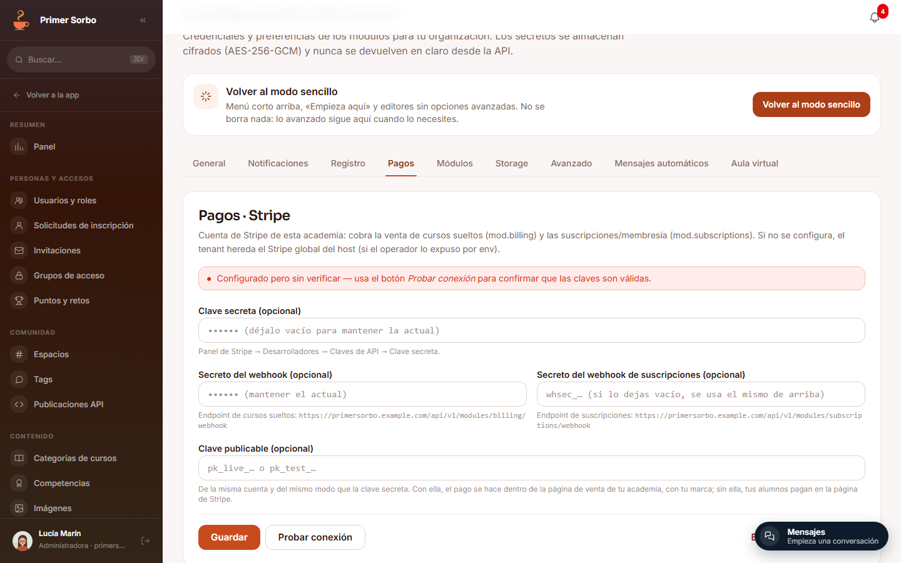
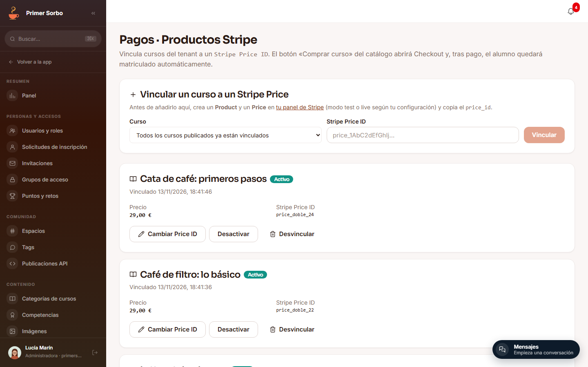

# mod.billing — Stripe Checkout (pago único)

Community · Categoría **core** (siempre activo)

## Qué hace

Monetización de cursos con pago único vía **Stripe Checkout**: el admin liga cada curso a un precio de Stripe (o lo crea desde Didacta), el alumno pulsa comprar, el backend crea la Checkout Session y redirige al checkout hosted. Al confirmarse el pago, el webhook completa la orden y emite `billing.order.completed`, que `mod.learning` escucha para matricular con origen `PURCHASE`.

Incluye además el **viaje de compra pública**: un visitante **sin cuenta** compra desde el catálogo público (`/catalog`) o la ficha de venta del curso (`/catalog/<slug>`); la orden nace `PENDING` sin dueño y el fulfillment materializa la cuenta con el email confirmado por Stripe (find-or-create + email de bienvenida con enlace «Define tu contraseña», plantilla `billing.welcome`, editable por tenant en Administración → Emails). Las páginas de retorno del pago público son `/catalog/checkout/success` y `/catalog/checkout/cancel`.

## Cómo funciona

- **Idempotencia explícita**: cada evento `evt_*` de Stripe se persiste y no se reprocesa — la reentrega de un checkout anónimo no duplica cuenta ni matrícula.
- Guardas previas al cobro: 404 curso inexistente, 409 no publicado, 409 si ya tienes acceso.
- Sin Stripe configurado el módulo se registra igualmente: el catálogo público devuelve lista vacía y el checkout responde 503 con mensaje claro. El resto de la plataforma no se ve afectado.
- **Renuncia al desistimiento**: sin la casilla de renuncia (el comprador acepta empezar ya y perder los 14 días de desistimiento), el checkout responde 422 y no se crea ni la orden ni la sesión de pago. El texto lo sirve la API (`GET /purchase-consent/withdrawal-waiver`, en español, inglés y portugués), se guarda como prueba con su versión y el recibo lo confirma al comprador.
- **Precio fijado**: la ficha manda el precio que el comprador tiene delante; si entretanto ha cambiado, el checkout lo rechaza en lugar de cobrar otro importe.
- **Pago dentro de la ficha**: si la cuenta que cobra tiene **clave publicable**, la ficha de venta pública (`/catalog/<slug>`) pinta el pago dentro de la propia página, con la marca del aula (Checkout embebido de Stripe); sin ella, redirige al checkout hosted de siempre. La vuelta es siempre `/catalog/checkout/success`, que **pregunta** a la API si la sesión está pagada (`GET /modules/billing/public/checkout-session/<id>`) y no concede nada por sí misma: el acceso lo da el webhook. El checkout con sesión iniciada (`/courses/<slug>`) es siempre hosted.
- **Referidos y país**: el checkout lleva el código del enlace de referido (`?ref=`) hasta la comisión de `mod.referrals`, y la orden guarda el país del comprador y el cupón aplicado para la pantalla de ventas.
- **Reembolsos** (con claves propias, desde el dashboard de Stripe; con cobros de plataforma, ver [mod.payouts](payouts.md)): el webhook `charge.refunded` marca la orden. Solo el reembolso **total** pasa la orden a `REFUNDED` y retira el acceso —cancela la matrícula de compra aunque el alumno ya hubiera terminado el curso y **revoca sus certificados** de ese curso (sin borrarlos: la verificación pública pasa a decir que no son válidos)—, salvo que otra compra cobrada o un grupo de acceso sigan dando el curso. Uno parcial no toca el acceso ni el estado de la orden; emite `billing.order.partially_refunded`, con lo devuelto acumulado, para recortar la comisión de referidos en proporción.
- **Ventas y correos**: cada pago se ve en la pantalla de **Ventas** y el comprador recibe un correo-recibo; ver más abajo.

!!! note "Capturas en modo completo"
    Las capturas de esta página son del **modo completo** (menú lateral), el de una instalación nueva. En **modo sencillo** las mismas rutas siguen disponibles desde «Más», salvo las pantallas que ese modo sustituye por una versión simplificada (el editor de cursos, Ajustes, Ventas, Alumnos, Directos, la comunidad y Referidos); para usarlas tal como se ven aquí, cambia al modo completo en **Ajustes → «Usar el modo completo»**.

## Configuración

El módulo es de categoría **core**: viene activo en todos los tenants y no tiene interruptor propio.

### Credenciales de Stripe (por tenant)

En `/admin/settings?tab=payments` (pestaña **Pagos**), tarjeta **«Pagos · Stripe»** — compartida con `mod.subscriptions`, un único par de claves por academia:

- **«Clave secreta»** — la `sk_test_…` o `sk_live_…` de tu cuenta (Panel de Stripe → Desarrolladores → Claves de API).
- **«Secreto del webhook»** — el `whsec_…` del endpoint de cursos sueltos (ver abajo).
- **«Secreto del webhook de suscripciones (opcional)»** — solo para `mod.subscriptions`; vacío = se reutiliza el de arriba.
- **«Clave publicable (opcional)»** — la `pk_test_…` / `pk_live_…` de la **misma cuenta y el mismo modo** que la clave secreta (si no coinciden, el guardado se rechaza). Con ella, el pago se hace dentro de la ficha de venta; sin ella, en la página de Stripe.
- Botones **«Guardar»**, **«Probar conexión»** (verifica contra Stripe y muestra si la cuenta es test o LIVE) y **«Eliminar configuración»**.

La tarjeta abre con un banner de estado: verificado, configurado sin verificar, «Usando Stripe global del host (fallback)», «Esta aula NO está cobrando…» (el servidor tiene una cuenta común pero, al haber varias aulas, ya no se hereda; ver `STRIPE_ALLOW_GLOBAL_FALLBACK`) o «Sin Stripe configurado — la venta de cursos sueltos y las suscripciones/membresía no funcionan». Las credenciales se guardan **cifradas**; los campos son write-only (nunca se re-muestran).

### Webhook a dar de alta en Stripe

La propia tarjeta muestra la URL exacta. Para este módulo:

- Endpoint: `https://<dominio-de-tu-academia>/api/v1/modules/billing/webhook`
- Eventos a seleccionar: `checkout.session.completed`, **`checkout.session.async_payment_succeeded`**, `checkout.session.expired`, `checkout.session.async_payment_failed`, `charge.refunded`.

Pega el `whsec_…` que genera Stripe en el campo **«Secreto del webhook»**.

!!! danger "Los cinco eventos no son opcionales"
    Cada uno cierra un camino, y el que falte se queda abierto en silencio — Stripe no avisa de lo que no te manda:

    - **Sin `async_payment_succeeded`**, una compra pagada por transferencia o SEPA **nunca llega a matricular**: se queda esperando para siempre. Este es el que más se olvida, porque con tarjeta no hace falta.
    - **Sin `charge.refunded`**, un reembolso **no retira el acceso**.
    - **Sin `checkout.session.expired`**, los carritos abandonados se acumulan como pedidos pendientes eternos.

## Qué formas de pago acepta

Las que tengas activadas **en tu panel de Stripe** (Configuración → Métodos de pago). Didacta no fija la lista: si activas PayPal o Bizum, aparecen en la pantalla de pago sin tocar nada aquí ni esperar a una versión nueva.

Stripe filtra solo lo que sirve para el importe, la moneda y el país del comprador.

!!! info "Si activas métodos de notificación diferida"
    Transferencia, SEPA y algún Klarna **no confirman el cobro en el momento**: el comprador termina el formulario y el dinero llega horas o días después. Didacta lo contempla — la matrícula espera a que el cobro esté confirmado, no al formulario — pero **exige que `checkout.session.async_payment_succeeded` esté dado de alta** en el webhook. Sin ese evento, esas compras no se completan nunca.

## Códigos de descuento

La pantalla de pago acepta **códigos promocionales de Stripe**. Se crean una vez en el dashboard (Productos → Cupones → Códigos promocionales) y valen para la venta de cursos y para la membresía por igual.

Es distinto del **precio tachado** de cada opción de compra, que es un descuento permanente que se pinta en la ficha. El código lo teclea el comprador; el tachado lo ve todo el mundo.

### Variables de entorno (fallback de instancia)

| Variable | Para qué |
| --- | --- |
| `STRIPE_SECRET_KEY` / `STRIPE_WEBHOOK_SECRET` | Fallback de instancia: solo se usan si el tenant no configuró sus claves en el panel. |
| `STRIPE_PUBLISHABLE_KEY` | Clave publicable (`pk_…`) de la misma cuenta que `STRIPE_SECRET_KEY`. Opcional: con ella las aulas que heredan la cuenta de instancia pagan dentro de la ficha (Checkout embebido); sin ella, redirección a Stripe. Un aula con claves propias pone la suya en el panel. |
| `STRIPE_ALLOW_GLOBAL_FALLBACK` | ¿Puede un aula sin Stripe propio cobrar con las `STRIPE_*` de instancia? Sin definir: **sí solo si la instancia tiene una única aula**; con varias, no (para que el dinero de un aula no acabe en la cuenta del operador). `true` = todas la heredan; `false` = ninguna. El ajuste de instancia `allowGlobalStripeFallback` (scope `billing`, en `instance_setting`), si existe, manda sobre la variable. Con cobros de plataforma activos nunca se hereda. |
| `BILLING_SUCCESS_URL_BASE` / `BILLING_CANCEL_URL_BASE` | Respaldo de último recurso para las URLs de retorno: el checkout HTTP (autenticado y público) **siempre** pasa URLs por petición derivadas del Host real — `/courses/checkout/success|cancel` para el autenticado, `/catalog/checkout/success|cancel` para el público — así que estas variables solo aplican si un llamador in-process omite las URLs. |

No hay ninguna funcionalidad de este módulo condicionada a licencia Enterprise.

### Productos (curso ↔ precio)

En `/admin/billing/products` (**«Pagos · Productos Stripe»**; con cobros de plataforma el formulario cambia a escribir directamente el importe, ver [mod.payouts](payouts.md)): el formulario **«Vincular un curso a un Stripe Price»** tiene un selector **«Curso»** (solo cursos publicados sin vincular) y el campo **«Stripe Price ID»** (`price_…` creado antes en tu dashboard de Stripe); botón **«Vincular»**. El backend valida contra Stripe que el price exista y esté activo antes de guardar. Por API, el mismo endpoint acepta alternativamente un importe (`amountCents`) y crea el Product + Price en Stripe por ti; un curso admite varias opciones de compra (nombre de opción, precio tachado `compareAtCents`, destacada), que el panel muestra y el catálogo pinta como formatos. Por API también se pueden fijar precios por mercado (`currencyOptions`, moneda → importe); lo normal es no poner ninguno y dejar que Stripe enseñe el precio convertido a la moneda del comprador.

## Uso paso a paso

1. Configura Stripe en `/admin/settings?tab=payments`: guarda la **«Clave secreta»**, da de alta el webhook en Stripe con la URL y los eventos de arriba, pega el **«Secreto del webhook»** y pulsa **«Probar conexión»**.
2. En `/admin/billing/products`, vincula el curso: elige el **«Curso»**, pega el **«Stripe Price ID»** y pulsa **«Vincular»**. Cada producto listado ofrece **«Cambiar Price ID»**, **«Desactivar»**/**«Reactivar»** y **«Desvincular»** (las órdenes históricas se conservan). Si Stripe no está configurado, la página lo avisa con el enlace «Configura Stripe en Administración → Pagos».

    

3. Venta al alumno **con cuenta**: en `/courses/<slug>` aparece la caja **«Empieza este curso»** con el botón **«Comprar»** (si el curso tiene varias opciones, la sección **«Elige tu formato»** las lista con su precio, descuento y la etiqueta «El más elegido»). El pago abre el checkout hosted de Stripe y vuelve a `/courses/checkout/success`.

4. Venta al visitante **sin cuenta**: `/catalog` lista los cursos a la venta (**«Ver curso»**) y `/catalog/<slug>` es la ficha de venta con **«Comprar ahora»** («Pago seguro con Stripe. IVA incluido.»). Tras pagar, aterriza en `/catalog/checkout/success` — «¡Gracias por tu compra!» — y recibe el email para **definir su contraseña**; si el email ya tenía cuenta, el curso se añade a ella.

5. El webhook completa la orden (`COMPLETED`) y `mod.learning` matricula automáticamente con origen `PURCHASE`. No hay que hacer nada a mano.
6. Reembolsos: con claves propias, hazlos desde el dashboard de Stripe. Un reembolso total marca la orden `REFUNDED` y retira el acceso (y revoca el certificado del curso); uno parcial deja la compra en pie.
7. Mira las compras en **Ventas** (siguiente apartado) y, si quieres, personaliza los correos que recibe el comprador.

## Ventas

Pantalla **«Todas tus ventas»**: quién compró, qué, cuánto pagó y lo que te llega. Una fila por pago único o cuota cobrada, con columnas **Fecha, Comprador, Producto, Pagó, Comisiones, Te llega, Estado** (Pagada, Retenida, Transferida, Reembolsada, Reembolsada en parte, Disputada) y **País**; búsqueda por nombre, correo o producto, filtros por fechas, producto y estado, detalle de cada venta (cupón, saldo de referidos, quién trajo la venta, recibo, historia de cobro/reembolso/disputa) y exportación **«Ventas en CSV»**, **«Ventas en Excel»** y **«Compradores en CSV»** con los filtros puestos. Se refresca sola cada minuto. Es solo para `tenant_admin` y `super_admin`; cada exportación queda en la auditoría (`sales.exported`) y una sesión de soporte no puede exportar.

Dónde está según el modo:

- **Modo completo con claves propias**: `/admin?tab=business` (pestaña **Negocio** del Panel).
- **Con cobros de plataforma**: Ingresos → **Cobros** (`/admin/payments`), con el botón **«Reembolsar»** del detalle; ver [mod.payouts](payouts.md).
- **Modo sencillo**: pestaña **Ventas**.

Con claves propias el detalle no reembolsa: «Esta venta se cobró con tu propia cuenta de Stripe: para devolverla, hazlo desde tu panel de Stripe». La API es `GET /admin/sales`, `GET /admin/sales/:id` y `GET /admin/sales/export?format=csv|xlsx&view=sales|buyers`; no pertenece al módulo (no cuelga de `/modules/billing`).

## Correos de venta

El comprador recibe un correo con aspecto de recibo y la marca del aula: **Recibo de compra** (al pagar un curso o empezar una membresía, con el botón para entrar o para elegir contraseña si nunca ha entrado), **Recibo de renovación**, **Pago fallido** y **Reembolso** (este último solo con cobros de plataforma, donde el reembolso se lanza desde Didacta). El creador cambia el **asunto** y el **mensaje** de cada uno, por idioma (es, en, pt), en `/admin/emails` (modo completo, «Correos de venta y acceso») o en la sección **Correos** de Ajustes (modo sencillo), con vista previa con datos de ejemplo y **«Enviarme una prueba»**. Se pueden insertar datos de la compra (nombre, curso o membresía, importe, nº de pedido, fecha, academia, correo, próxima renovación, fecha límite) y hay un campo **«Política de devoluciones»** con un enlace que sale en cada recibo.

!!! note "Lo que no se puede quitar"
    El recibo (pedido, importe, método de pago, quién vende y la renuncia al desistimiento) y el botón van siempre debajo del mensaje: un correo personalizado nunca deja al comprador sin la información legal mínima. API: `GET /admin/sale-emails` y `PUT|DELETE /admin/sale-emails/:key/:lang` (claves `purchase.receipt`, `purchase.renewal_receipt`, `purchase.payment_failed`, `purchase.refund`).

## Permisos

`billing.product.read`, `billing.product.write`, `billing.order.read`, `billing.checkout.create`. La gestión de productos exige además rol `tenant_admin` o `super_admin`.

## Dependencias

Duras: `mod.learning`, `mod.courses`.

## Modelo de datos

`mod_billing_product` (curso vendible ↔ precio, unicidad por curso y por precio) · `mod_billing_order` (compra: `PENDING → COMPLETED | CANCELLED | FAILED | REFUNDED`, `user_id` nullable para compra anónima; guarda también país del comprador y cupón) · `mod_billing_webhook_event` (log idempotente, PK = `stripe_event_id`).

## API

Prefijo `/modules/billing`: checkout autenticado, superficie pública (`public/catalog`, `public/offer`, `public/checkout`, `public/checkout-session`), CRUD admin de productos y webhook. Detalle en [Referencia → Pagos](../../api/reference/payments-live-ai.md#pago-unico-billing-modulesbilling).

## Eventos

**Emite**: `billing.order.created/completed/failed/refunded/partially_refunded`. No consume.
