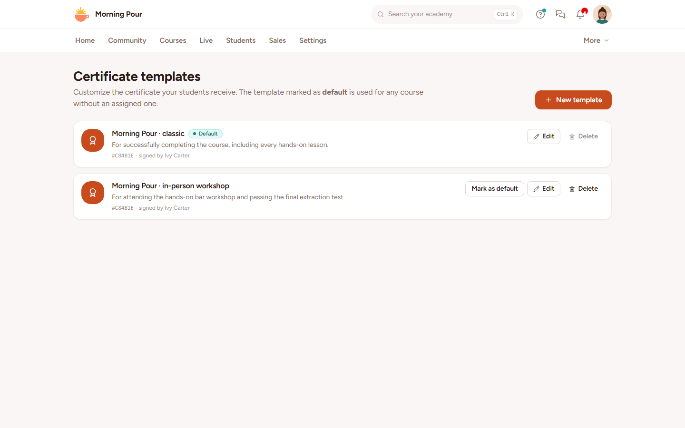
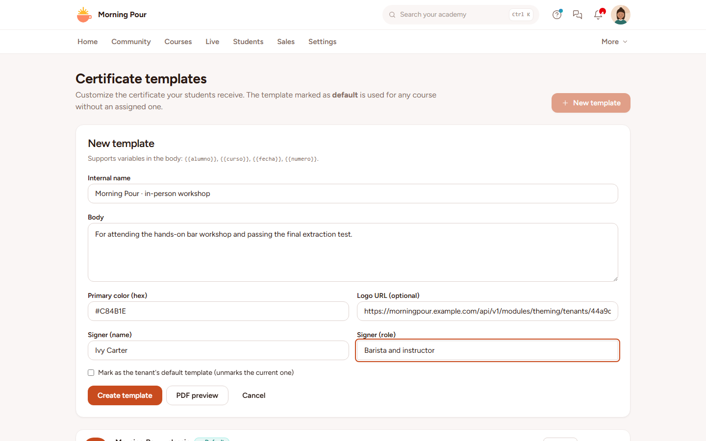
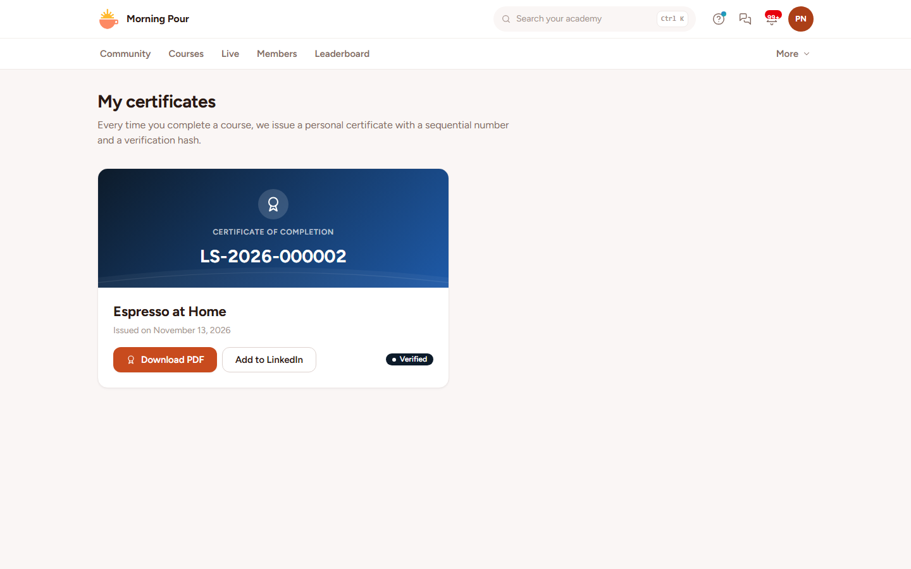
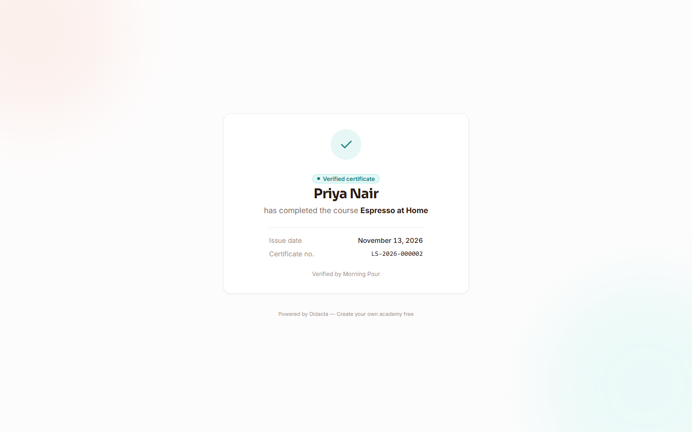

# mod.certificates — Certificates

Community · **Core** category (always active)

## What it does

Issuing and managing PDF certificates on course completion: **customisable templates** per organization (logo, copy, color, signatory) with a default template, **automatic issuing** on receiving `learning.course.completed`, unique sequential numbering per tenant, and **public verification** through a shareable link (the URL you add to a LinkedIn profile).

## How it works

- Every issued certificate stores an **immutable snapshot** (student, course, date, plus what is needed to draw it: text, color, signatory, logo, academy name and language) and the SHA-256 hash of the PDF: renaming the course afterwards does not alter an already issued certificate. Downloads serve **the issued PDF**, kept in storage; only if that object no longer exists is it drawn again from the snapshot.
- The PDF comes out in the **student's language** (Spanish, English or Portuguese): the one on their profile and, if they have none, the classroom's; the language is kept in the snapshot so a redraw looks the same. The template preview uses the language of whoever is viewing it.
- Two uniqueness constraints: `(tenant, number)` guarantees sequential numbering and `(tenant, enrollment)` prevents issuing twice for the same enrollment.
- **Public verification** (`/modules/certificates/verify/:id`, no session; the credential is the UUID itself) returns `{ number, studentName, courseTitle, issuedAt, valid }` without ever exposing an email address or internal data.
- **Revocation**: there is no button or endpoint to revoke by hand. The only path today is a **refund** of the course purchase: if the student does not keep access some other way (another paid purchase, or an access group that still grants the course), their enrollment is cancelled —even if it was already completed— and their certificates are revoked with reason `refund`. A revoked row is not deleted: `revoked_at` and `revoke_reason` are stamped, the certificate disappears from "My certificates" and public verification answers `valid: false` ("Revoked certificate"). If the person buys the course again, the refund revocation is undone; a revocation for any other reason is left alone.
- The template editor has a **PDF preview** with sample data, persisting nothing.

## Configuration

- **Activation**: a `core`-category module, always active. It does not appear in the "Modules" tab at `/admin/settings?tab=modules` and cannot be disabled.
- **Tenant templates**: all customisation goes through templates, at `/studio/certificates/templates` ("Certificate templates"); the instructor, tenant_admin and super_admin roles can manage them. The one marked as **default** applies to any course without an assigned template.
- **Template per course**: assigned in the builder (`/studio/courses/<id>`, "Certificate template" card; the "Tenant default" option delegates to the default).
- **Environment variables**: none of its own. Issued PDFs are stored in the instance's file backend (`/admin/settings?tab=storage`).
- **License**: the whole module is Community; no feature requires Enterprise capabilities.

!!! note "Screenshots in simple mode"
    The screenshots on this page come from an academy in **simple mode** (tabs at the top). Screens without a tab of their own live under **"More"**, with the same name as in the administration menu; in **full mode** they open from the side menu. Routes (`/admin/…`, `/studio/…`) are the same in both modes.

## Step-by-step usage

### Designing the templates (instructor or admin)

1. At `/studio/certificates/templates`, click "New template". Fill in "Internal name", the "Body" (the certificate's central text), "Primary color (hex)", "Logo URL (optional)" and the signatory ("Signer (name)" and "Signer (role)"). The student's name, the course, the date and the number are always rendered by the PDF layout itself, in fixed positions.
2. Click "PDF preview" to see the result with sample data; nothing is saved until you click "Create template".
3. Mark one template as the default ("Mark as the tenant's default template" or the "Mark as default" button): it will apply to every course without its own template. The default cannot be deleted, and deleting a template in use returns 409.

    

    

4. If a specific course needs a different template, assign it from the course builder: "Certificate template" card → pick it under "Template" → "Save". The "Manage templates →" link returns to this screen.

### Issuing is automatic

1. When the student crosses the completion threshold, `mod.learning` emits `learning.course.completed` and the certificate is issued on its own: immutable snapshot, the tenant's sequential number and a PDF with the course's template (or the default). There is no "issue" button; two simultaneous completions neither duplicate nor overwrite the certificate.

### Downloading and sharing (student)

1. At `/my-certificates` ("My certificates"; in simple mode, in the avatar menu) the student sees each certificate with its number and date ("Issued on…").
2. "Download PDF" opens the certificate; "Add to LinkedIn" opens LinkedIn's pre-filled *Add to Profile* flow: credential name (the course), organization (the academy's name), credential ID (the certificate number), issue year and month and, as the URL, the public verification page `/verify/<id>`. Didacta does not write to LinkedIn: it only opens the pre-filled form and the person confirms it.
3. The completed course's page also shows "Download certificate".

    

### Verifying a certificate (anyone, no account)

1. The public page `/verify/<id>` shows "Verified certificate" with the number, student, course and "Issue date" — or "Revoked certificate" if it is no longer valid. It exposes no email or internal data; if the snapshot's name was an email address, it is hidden.

    

## Dependencies

- Hard: `mod.learning` (issuing is triggered on completion). Optional: `mod.courses` (reading course data when issuing).

## Data model

| Table | What it stores |
| --- | --- |
| `mod_certificates_template` | Templates: body, color, logo, signatory, default flag. |
| `mod_certificates_issued` | Issued certificates: number, SHA-256 hash, JSON snapshot, storage key, revocation (`revoked_at`, `revoke_reason`). |

## API

Prefix `/modules/certificates`: the student's own (`me`, detail, download), templates (instructor and above) and public verification. Details in [Reference → Learning](../../api/reference/learning.md#certificates-modulescertificates).

## Events

- **Emits** (manifest): `certificates.issued` and `certificates.revoked`. The latter is published when a student's valid certificates in a course are revoked (today, the refund revocation) with `{ userId, courseId, reason, revokedCount }`; if nothing valid was left to revoke, nothing is published. Undoing the revocation on a repurchase emits nothing.
- **Consumes**: `learning.course.completed` (automatic issuing).
