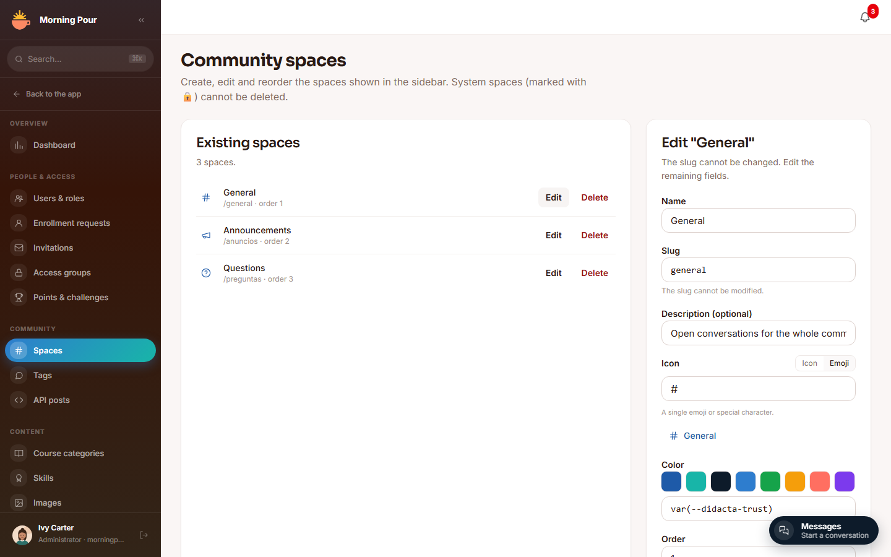
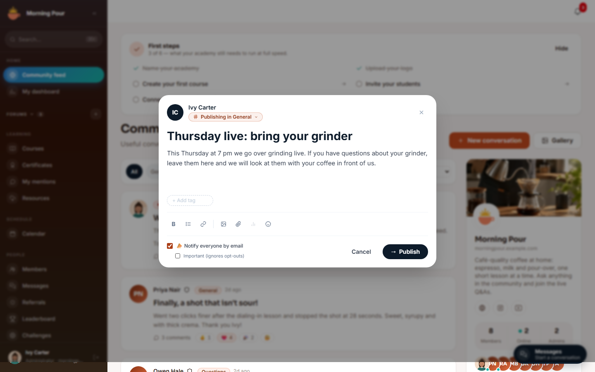
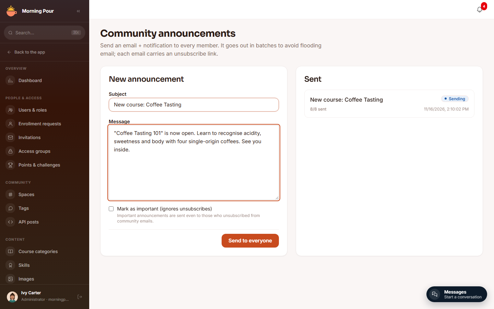
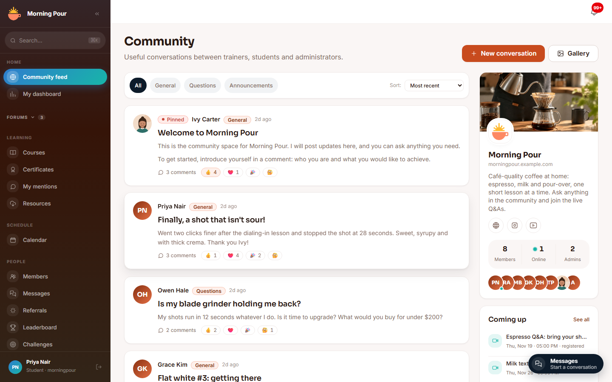

# mod.community — Community

Community · **Core** category (always active)

## What it does

The tenant's social feed: **posts** (optionally tied to a course and a space), **comments** with one level of replies, emoji **reactions**, `@user` **mentions** with autocomplete, admin-**curated tags** (name, color, icon) and manageable **spaces** (the 4 system ones are editable but cannot be deleted). On top of that: moderation, pinned posts, a member directory, a weekly email digest and **announcements** (broadcasts) with an unsubscribe link.

## How it works

- A deliberate distinction between **moderation hiding** (`hidden`, reversible, the row is preserved along with the reason) and **deletion by the author** (soft delete).
- A post with `notifyAll` (admin only) also generates an email + bell broadcast to every member; `important` ignores the recipient's opt-out.
- Broadcasts are sent **in throttled batches** (to protect SMTP reputation) and carry a resume cursor for retries.
- Publishing over the **external API** (`/community-api`, with an API key scoped `community:post` whose owner is an admin): those posts come in with `source='api'`, which is how automated content is distinguished.
- The weekly digest collects the mentions and replies of the last 7 days and is only sent if there are any; it is scheduled with `COMMUNITY_DIGEST_CRON` (Mondays at 09:00 UTC by default) and honours each user's opt-out.

!!! note "Screenshots in full mode"
    The screenshots on this page come from **full mode** (side menu), the mode a new installation starts in. In **simple mode** the same routes are still available from "More", except for the screens that mode replaces with a simplified version (the course editor, Settings, Sales, Students, Live, the community and Referrals); to use them as shown here, switch to full mode under **Settings → "Use the full mode"**.

## Configuration

**Activation.** `mod.community` is a **core**-category module: it is always active and does not appear on the "Modules" tab of `Administration → Settings` (`/admin/settings`), which only lists the modules that can be disabled. If anything tries to disable it over the API, the backend rejects it with `CORE_MODULE_NOT_DISABLEABLE`.

Everything else is configured from the panel, each thing on its own screen:

- **Spaces** — `/admin/community/spaces` ("Community spaces", Community group of the admin area). Per space: "Name", "Slug" (permanent once created), "Description (optional)", icon or emoji, "Color" and "Order" (lower number → appears earlier in the sidebar). System spaces are marked with 🔒: editable, not deletable. An admin can also create a space from the "+" button of the "Forums" sidebar group.
- **Curated tags** — `/admin/community/tags` ("Community tags"). Name (normalized to lowercase to avoid duplicates), color and icon; editing a tag affects every post that uses it. Authors can still write free-form tags in their posts.
- **Posts via API** — `/admin/community/api-posts` ("Posts via API") lists the posts created with `POST /community-api/posts`, grouped by the admin who owns the API key. Keys (scope `community:post`) are managed in `/admin/api-keys` ("API keys").
- **Announcements** — `/admin/broadcasts` ("Community announcements", Communication group): "Subject", "Message" and the "Mark as important (ignores unsubscribes)" checkbox.
- **Weekly digest, per user** — each member controls it in `/account`, "Notifications" tab: the "Community" row ("Mentions, replies and the weekly digest.") crossed with the "Email" column.
- **Roles** — hide/restore, pin, tags, spaces, announcements and `notifyAll` require `super_admin` or `tenant_admin`; instructors do not moderate the community.

Environment variables (workers):

- `REDIS_URL` — without it the weekly digest queue does not start; announcements fall back to an in-process mode with no queue or durability (the feed keeps working).
- `COMMUNITY_DIGEST_CRON` — cron for the weekly digest (`0 9 * * 1`, Mondays 09:00 UTC).
- `COMMUNITY_BROADCAST_BATCH_SIZE` (5) and `COMMUNITY_BROADCAST_INTERVAL_MS` (10 000 ms) — batch size and pause between announcement batches.
- `AUTH_SECRET` — signs the announcements' unsubscribe link (no fallback chain; the API does not start without it).
- `WEB_PUBLIC_URL` — fallback domain for the links in background emails (announcements and digest): the tenant's verified classroom domain is used and, if it has none, this variable.

Manual digest trigger (QA): `POST /modules/community/digest/run-now`, `super_admin` only. No feature of this module requires an Enterprise license.

## Step-by-step usage

**The operator (admin):**

1. Shape the spaces in `/admin/community/spaces`: rename the system ones, create your own and sort them with "Order".
2. Curate the official tags in `/admin/community/tags` so the feed and the sidebar paint them with color and icon.
3. Publish the first post from the feed with "New conversation". Only admins see the "📣 Notify everyone by email" checkbox; ticking it reveals "Important (ignores opt-outs)" for when the message really must bypass unsubscribes.

    

4. Moderate from the feed itself: "Hide post" (asks for an optional reason and preserves the row), "Restore", "Pin" and "Unpin"; comments can also be hidden and restored. Hiding also revokes the points the content earned if gamification is active. The author or an admin can also edit a post (the feed shows "edited").
5. For announcements without a post, `/admin/broadcasts`: subject, message and "Send to everyone". The history ("Sent") shows each announcement's status and its "{sent}/{total} sent" progress.

    

**The student (member):**

1. In `/community` press "New conversation": title, rich text, tags, `@user` mentions with autocomplete, up to 10 images and 5 files per post. "Publish".

    

2. Posts can live inside a space: spaces hang from the "Forums" sidebar group and each one lives at `/spaces/<slug>`, with sorting ("Most recent", "Oldest first", "Most commented") and a "Gallery" tab with the space's attachments.
3. Comment (one level of replies) and react with emoji on posts and comments.
4. Mentions accumulate in `/community/mentions` ("My mentions"); the directory lives at `/members` and each member's public profile at `/u/<id>`.
5. To stop community emails, turn off the "Community" row in `/account` → "Notifications", or use the unsubscribe link in the email itself; announcements marked as important still arrive.

## Sanctions and the user record

Besides hiding content, an admin can **sanction a person**: they can still sign in and read (and keep what they have bought), but can no longer contribute content in the areas you pick. This is not account suspension, which cuts access entirely. This part lives in the **core** (not in `mod.community`), because a sanction spans several modules at once and is enforced at a single control point.

- **Where**: on the person's profile (`/u/<id>`), for `super_admin` and `tenant_admin` only, "Moderate" button. A shield also appears next to the name of anyone with an active sanction.
- **Areas**: "Community" (post, comment and react; includes the external `/community-api`), "Messages", "File uploads", "AI Tutor" and "Whole platform" (all of the above plus the profile, lesson comments and challenge submissions; it never affects payments or an already purchased course).
- **Duration**: "24 hours", "7 days", "30 days" or "Permanent". The "Reason (required)" is mandatory (up to 500 characters): it is shown to the person when they try to post and is kept in the audit log. Expiry is lazy: an expired sanction simply stops applying.
- **Lifting** ("Lift") does not delete the row: it stamps the date and reason, and the full history stays in the "Sanctions" tab.
- **User record**: the same profile shows admins only the person's "Record" with the tabs "Overview", "Purchases and subscription", "Training", "Activity", "Messages", "Access" and "Sanctions". It includes the content of private messages, so **every time it is opened is recorded** in the audit log (`admin.user.dossier_viewed`); reflect this in your privacy policy.

Endpoints (admin only): `GET/POST /admin/users/:userId/restrictions`, `POST /admin/users/:userId/restrictions/:restrictionId/lift`, `GET /admin/users/:userId/dossier`, `GET /admin/restrictions/scopes` and `GET /admin/restrictions/active?userIds=…`. Table `user_restriction` (core).

## Feed sidebar

`GET /modules/community/sidebar` returns the `/community` sidebar in one call: the academy card (name, logo, cover, description and brand links, member count and who is online), the **monthly ranking** (top 5) and the **latest comments** (3). Each block is omitted when there is no data; the ranking and presence only appear if `mod.gamification` and `mod.messaging` are active, and the branding comes from `mod.theming`. It is all read-only by `tenant_id`; what is common to the classroom is cached for 30 s.

## Dependencies

No hard dependencies. Optional (read-only, declared in the manifest): `mod.courses` (posts tied to a course), `mod.gamification` (sidebar ranking), `mod.messaging` (presence) and `mod.theming` (branding for the academy card).

## Data model

`mod_community_post` · `_comment` · `_reaction` · `_mention` · `_tag` · `_space` · `_broadcast` (with status and cursor) · `_user_pref` (preferences: digest opt-out and announcement opt-out). A hidden post keeps `hidden_at`/`hidden_by_id`/`hidden_reason`, pinning stores `pinned_at`, and the last content edit is `edited_at`.

## API

Prefix `/modules/community` + `/community-api` (integrations) + public token-based unsubscribe. Details in [Reference → Community and people](../../api/reference/community.md#community-modulescommunity).

## Events

**Declared in the manifest** (`eventsEmitted`): `community.post.created`, `community.comment.created`, `community.reaction.added` and, when moderating, `community.post.hidden`/`community.post.unhidden` and `community.comment.hidden`/`community.comment.unhidden` (payload `{ postId | commentId, reason }`; [gamification](gamification.md) listens to `community.post.hidden` to revoke points). It consumes none. Its events feed gamification and the [outgoing webhooks](../../api/conventions.md#outgoing-webhooks).
