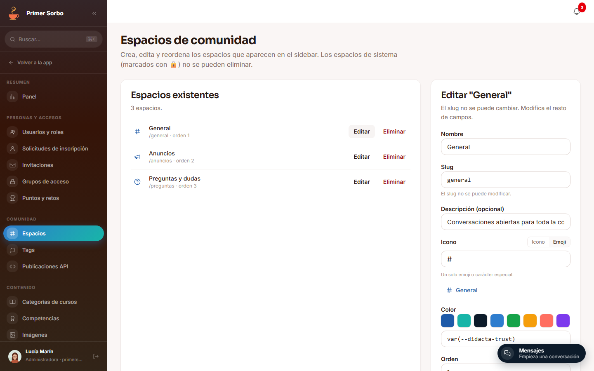
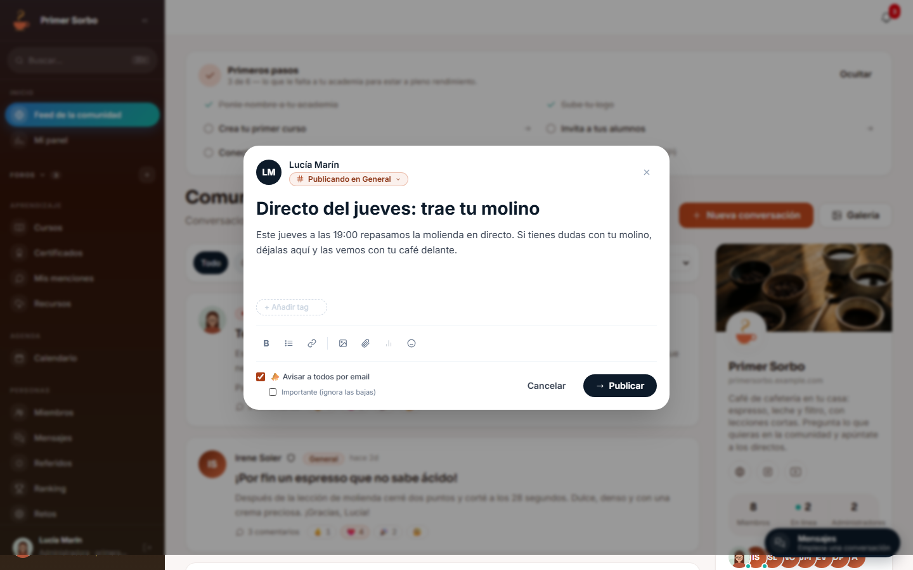
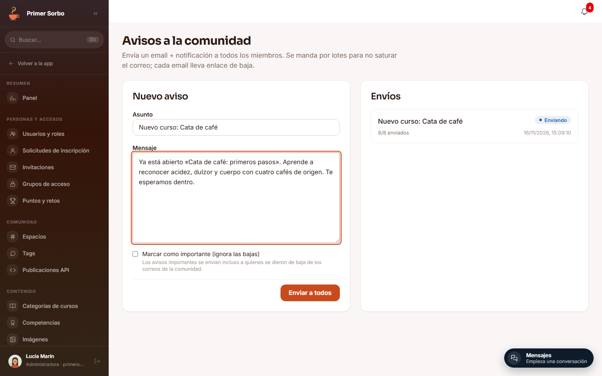
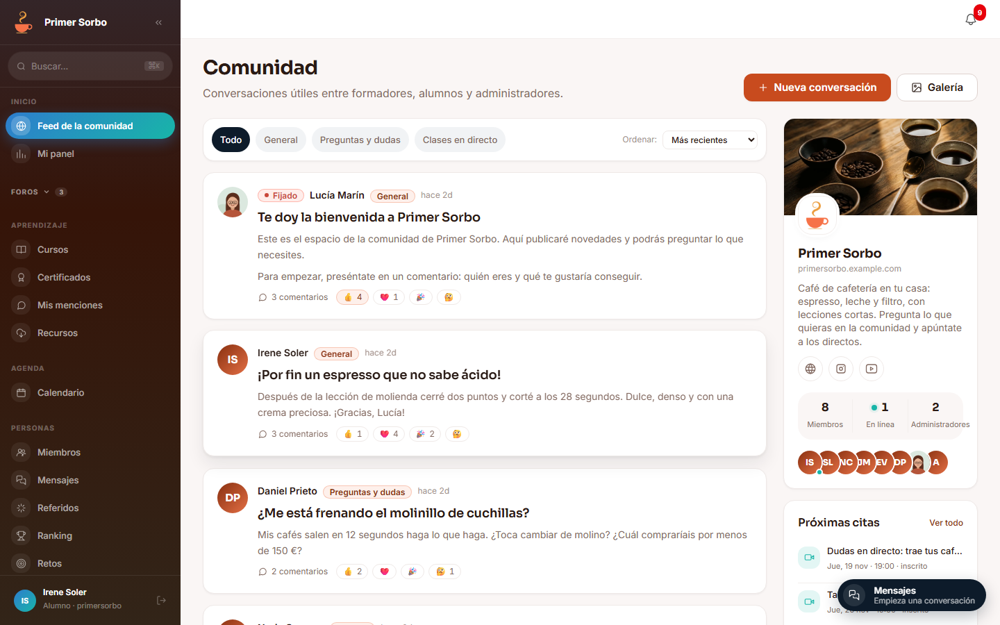

# mod.community — Comunidad

Community · Categoría **core** (siempre activo)

## Qué hace

El feed social del tenant: **posts** (opcionalmente ligados a un curso y a un espacio), **comentarios** con un nivel de respuesta, **reacciones** por emoji, **menciones** `@usuario` con autocomplete, **tags curados** por el admin (nombre, color, icono) y **espacios** administrables (los 4 de sistema son editables pero no eliminables). Encima: moderación, pinning de posts, directorio de miembros, digest semanal por email y **avisos masivos** (broadcasts) con baja por enlace.

## Cómo funciona

- Distinción deliberada entre **ocultado de moderación** (`hidden`, reversible, la fila se preserva con motivo) y **borrado del autor** (soft-delete).
- Un post con `notifyAll` (solo admin) genera además un broadcast por email y campana a todos los miembros; `important` ignora el opt-out del receptor.
- Los broadcasts se envían **por lotes con throttling** (para cuidar la reputación SMTP) y llevan cursor de reanudación para reintentos.
- Publicación por **API externa** (`/community-api`, con API key de scope `community:post` cuyo dueño sea admin): los posts entran con `source='api'` — así se distingue el contenido automatizado.
- El digest semanal recoge las menciones y las respuestas de los últimos 7 días y solo se envía si hay alguna; se programa con `COMMUNITY_DIGEST_CRON` (lunes 09:00 UTC por defecto) y respeta el opt-out por usuario.

!!! note "Capturas en modo completo"
    Las capturas de esta página son del **modo completo** (menú lateral), el de una instalación nueva. En **modo sencillo** las mismas rutas siguen disponibles desde «Más», salvo las pantallas que ese modo sustituye por una versión simplificada (el editor de cursos, Ajustes, Ventas, Alumnos, Directos, la comunidad y Referidos); para usarlas tal como se ven aquí, cambia al modo completo en **Ajustes → «Usar el modo completo»**.

## Configuración

**Activación.** `mod.community` es de categoría **core**: está siempre activo y no aparece en la pestaña «Módulos» de `Administración → Configuración` (`/admin/settings`), que solo lista los módulos desactivables. Si algo intenta desactivarlo por API, el backend lo rechaza con `CORE_MODULE_NOT_DISABLEABLE`.

Todo lo demás se configura desde el panel, cada cosa en su pantalla:

- **Espacios** — `/admin/community/spaces` («Espacios de comunidad», grupo Comunidad del área de administración). Por espacio: «Nombre», «Slug» (permanente una vez creado), «Descripción (opcional)», icono o emoji, «Color» y «Orden» (número menor → aparece antes en el sidebar). Los espacios de sistema van marcados con 🔒: editables, no eliminables. Un admin también puede crear un espacio desde el botón «+» del grupo «Foros» del sidebar.
- **Tags curados** — `/admin/community/tags` («Tags de comunidad»). Nombre (se normaliza a minúsculas para evitar duplicados), color e icono; editar un tag impacta a todos los posts que lo usan. Los autores siguen pudiendo escribir tags libres en sus posts.
- **Publicaciones por API** — `/admin/community/api-posts` («Publicaciones por API») lista los posts entrados con `POST /community-api/posts`, agrupados por el admin dueño de la API key. Las claves (scope `community:post`) se gestionan en `/admin/api-keys` («Claves API»).
- **Avisos masivos** — `/admin/broadcasts` («Avisos a la comunidad», grupo Comunicación): «Asunto», «Mensaje» y el checkbox «Marcar como importante (ignora las bajas)».
- **Digest semanal, por usuario** — cada miembro lo controla en `/account`, pestaña «Notificaciones»: fila «Comunidad» («Menciones, respuestas y resumen semanal.») cruzada con la columna «Email».
- **Roles** — ocultar/restaurar, fijar, tags, espacios, avisos y `notifyAll` exigen `super_admin` o `tenant_admin`; el formador no modera la comunidad.

Variables de entorno (workers):

- `REDIS_URL` — sin ella no arranca la cola del digest semanal; los avisos masivos caen a un modo en el propio proceso, sin cola ni durabilidad (el feed sigue funcionando).
- `COMMUNITY_DIGEST_CRON` — cron del digest semanal (`0 9 * * 1`, lunes 09:00 UTC).
- `COMMUNITY_BROADCAST_BATCH_SIZE` (5) y `COMMUNITY_BROADCAST_INTERVAL_MS` (10 000 ms) — tamaño del lote y pausa entre lotes de los avisos.
- `AUTH_SECRET` — con ella se firma el enlace de baja de los avisos (sin cadena de respaldo; la API no arranca sin ella).
- `WEB_PUBLIC_URL` — dominio de respaldo para los enlaces de los correos de fondo (avisos y digest): se usa el dominio verificado del aula del tenant y, si no tiene, esta variable.

Disparo manual del digest (QA): `POST /modules/community/digest/run-now`, solo `super_admin`. Ninguna función del módulo exige licencia Enterprise.

## Uso paso a paso

**El operador (admin):**

1. Deja los espacios como quiere que se vea la comunidad en `/admin/community/spaces`: renombra los de sistema, crea los suyos y ordénalos con «Orden».
2. Cura los tags oficiales en `/admin/community/tags` para que el feed y el sidebar los pinten con color e icono.
3. Publica el primer post desde el feed con «Nueva conversación». Solo el admin ve el checkbox «📣 Avisar a todos por email»; al marcarlo aparece «Importante (ignora las bajas)» para saltarse el opt-out cuando de verdad toca.

    

4. Modera desde el propio feed: «Ocultar post» (pide un motivo opcional y la fila se conserva), «Restaurar», «Fijar» y «Desfijar»; los comentarios también se pueden ocultar y restaurar. Ocultar también revoca los puntos que dio el contenido si la gamificación está activa. El autor o un admin pueden además editar un post (el feed marca «editado»).
5. Para comunicados sin post, `/admin/broadcasts`: asunto, mensaje y «Enviar a todos». El historial («Envíos») muestra el estado y el progreso «{sent}/{total} enviados» de cada aviso.

    

**El alumno (miembro):**

1. En `/community` pulsa «Nueva conversación»: título, texto enriquecido, tags, menciones `@usuario` con autocomplete, hasta 10 imágenes y 5 archivos por publicación. «Publicar».

    

2. Puede publicar dentro de un espacio: cuelgan del grupo «Foros» del sidebar y cada uno vive en `/spaces/<slug>`, con orden («Más recientes», «Más antiguas», «Más comentadas») y pestaña «Galería» con los adjuntos del espacio.
3. Comenta (un nivel de respuesta) y reacciona con emoji sobre posts y comentarios.
4. Sus menciones se acumulan en `/community/mentions` («Mis menciones»); el directorio está en `/members` y el perfil público de cada miembro en `/u/<id>`.
5. Si no quiere emails de comunidad, apaga la fila «Comunidad» en `/account` → «Notificaciones», o usa el enlace de baja del propio email; los avisos marcados como importantes llegan igual.

## Sanciones y expediente

Además de ocultar contenido, un admin puede **sancionar a una persona**: sigue entrando y leyendo (y manteniendo lo que ha comprado), pero deja de poder aportar contenido en las áreas que marques. No es la suspensión de la cuenta, que corta el acceso entero. Esta parte vive en el **core** (no en `mod.community`), porque una sanción cruza varios módulos a la vez y se aplica en un único punto de control.

- **Dónde**: en el perfil de la persona (`/u/<id>`), solo para `super_admin` y `tenant_admin`, botón «Moderar». También aparece un escudo junto al nombre de quien tiene una sanción vigente.
- **Áreas**: «Comunidad» (publicar, comentar y reaccionar; incluye la API externa `/community-api`), «Mensajes», «Subidas de archivos», «Tutor IA» y «Toda la plataforma» (lo anterior más el perfil, los comentarios de lección y las entregas de retos; nunca afecta a pagos ni al curso ya comprado).
- **Duración**: «24 horas», «7 días», «30 días» o «Permanente». El «Motivo» es obligatorio (hasta 500 caracteres): se le muestra a la persona cuando intenta publicar y queda en el registro de auditoría. La caducidad es perezosa: una sanción vencida deja de aplicar sola.
- **Levantar** («Levantar») no borra la fila: sella la fecha y el motivo, y el histórico completo queda en la pestaña «Sanciones».
- **Expediente**: el mismo perfil muestra, solo a admins, el «Expediente» de la persona con las pestañas «Resumen», «Compras y suscripción», «Formación», «Actividad», «Mensajes», «Acceso» y «Sanciones». Incluye el contenido de los mensajes privados, así que **cada apertura queda registrada** en el log de auditoría (`admin.user.dossier_viewed`); refléjalo en tu política de privacidad.

Endpoints (solo admin): `GET/POST /admin/users/:userId/restrictions`, `POST /admin/users/:userId/restrictions/:restrictionId/lift`, `GET /admin/users/:userId/dossier`, `GET /admin/restrictions/scopes` y `GET /admin/restrictions/active?userIds=…`. Tabla `user_restriction` (del core).

## Barra lateral del feed

`GET /modules/community/sidebar` devuelve en una llamada la barra lateral de `/community`: la tarjeta de la academia (nombre, logo, portada, descripción y enlaces de la marca, número de miembros y quién está conectado), el **ranking del mes** (top 5) y los **últimos comentarios** (3). Cada bloque se omite si no hay dato; el ranking y la presencia solo aparecen si `mod.gamification` y `mod.messaging` están activos, y la marca sale de `mod.theming`. Todo es lectura por `tenant_id`; lo común al aula se cachea 30 s.

## Dependencias

Sin dependencias duras. Opcionales (solo lectura, declaradas en el manifest): `mod.courses` (posts ligados a curso), `mod.gamification` (ranking de la barra lateral), `mod.messaging` (presencia) y `mod.theming` (marca de la tarjeta de la academia).

## Modelo de datos

`mod_community_post` · `_comment` · `_reaction` · `_mention` · `_tag` · `_space` · `_broadcast` (con estado y cursor) · `_user_pref` (preferencias: baja del digest y baja de los avisos masivos). Un post oculto conserva `hidden_at`/`hidden_by_id`/`hidden_reason` y el fijado guarda `pinned_at`; la última edición de contenido, `edited_at`.

## API

Prefijo `/modules/community` + `/community-api` (integraciones) + baja pública por token. Detalle en [Referencia → Comunidad y personas](../../api/reference/community.md#comunidad-modulescommunity).

## Eventos

**Declara en el manifest** (`eventsEmitted`): `community.post.created`, `community.comment.created`, `community.reaction.added` y, al moderar, `community.post.hidden`/`community.post.unhidden` y `community.comment.hidden`/`community.comment.unhidden` (payload `{ postId | commentId, reason }`; la [gamificación](gamification.md) escucha `community.post.hidden` para revocar puntos). No consume ninguno. Sus eventos alimentan la gamificación y los [webhooks salientes](../../api/conventions.md#webhooks-salientes).
