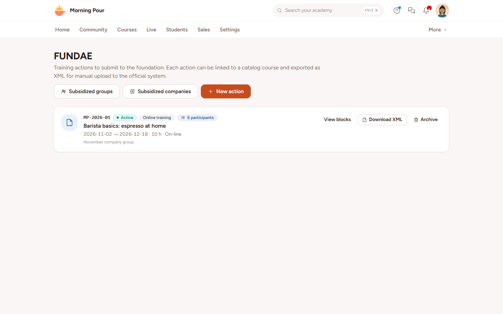
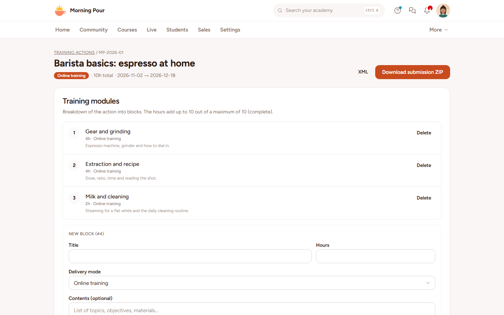

# mod.fundae — Fundae compliance

Community · **Compliance** category (can be disabled)

## What it does

Regulatory compliance for **subsidised training in Spain** (Royal Decree 694/2017):

- **Training actions** with a code, delivery mode (`PRESENCIAL`/`TELEFORMACION`/`MIXTA`), hours, dates and content blocks.
- **Subsidised companies** with a validated tax ID (DNI/NIE/CIF checksum), social security account code (CCC) and annual credit.
- **RLPT notices** to the workers' legal representatives, with the statutory 15 calendar day period calculated automatically and the evidence (PDF) stored in the Evidence Vault with its hash.
- **Subsidised groups** with a lifecycle (`DRAFT → ACTIVE → CLOSED/CANCELLED`), allocated costs and named participant enrollment.
- **Completion** with a configurable threshold (75% by default): APTO / NO_APTO / EN_CURSO per participant, with a `preview` mode.
- **Defensible hours**: the hours that are exported come from each learner's **interaction trail** (recorded time and who marked each lesson as completed), not from a box the learner ticks.
- **Monitoring access** (inspection): a read-only account tied to one group, with which whoever inspects the action browses the course and consults the monitoring record.
- **Exports**: group start and group end XML files, plus a complete **audit ZIP** (`manifest.json` with a SHA-256 hash for every artifact + XMLs + CSVs + RLPT evidence), verifiable offline against those hashes.

## How it works

- Starting a group validates the **RLPT lead time** (15 days) and the company's **available credit**; closing the group debits the credit consumed.
- A company's tax ID is **immutable** once created (a change of tax ID means a new company, for traceability).
- The block hours cannot add up to more than the action's hours (Fundae checks this when the XML is uploaded).
- **How hours are counted**: each lesson contributes at most its declared duration. If it is marked completed it contributes that duration; if it is partly done it contributes the time actually recorded. Lessons closed by a third party (viewing time, assessment, SCORM or instructor) count as **verified**; self-declared ones still add up but are reported separately as **unverified hours** (in the ZIP and in the monitoring record). The three paths that export hours (action XML, group close and PDF evidence) read from the same calculation, so the participant's paper never contradicts the XML.
- **Completion criterion** per action (`criterioFinalizacion`): `UMBRAL_PROGRESO` (the default: percentage of completed lessons against the group threshold) or `INSTRUCCION_75` (requires the threshold on **hours**, **activities** —quizzes and SCORM— and **controls** —quizzes— all at once, counting only what a third party verified). It is an action API field: the panel does not show or edit it yet.
- It is the natural consumer of the `courses.publish.validate` hook: it can block a course from being published if objectives or duration are missing.
- The whole management surface is admin-only: every endpoint requires `super_admin` or `tenant_admin`. The instructor role has no access to Fundae. The only exception is reading the monitoring record (see below), which also opens to whoever holds a live grant on that group.
- **Monitoring access**: the account browses the course through an enrollment with source `INSPECTION`, which is **excluded** from the nominal lists, the XML and the CSVs (it does not show up as a participant of the action it inspects). Granting or revoking access is recorded in the audit log; revoking does **not** delete the row (it keeps who could look at the record and when), and an expired or revoked grant stops opening at once.

## Configuration

- **Enabling or disabling the module**: `/admin/settings?tab=modules` (**Modules** tab) — a per-organization switch.
- **Access**: the **Fundae** entry in the **Integrations & API** group of the admin menu (`/admin/fundae`); only `tenant_admin` and `super_admin` see it.
- **`inspector` role**: assignable from user administration. On its own it opens nothing: without a grant on a group it sees none.
- **Completion threshold**: per group (`umbralFinalizacionPct`, 1–100; 75 by default), set through the API when creating or editing the group; the completion calculation also accepts a one-off `umbralOverride` without touching the persisted config. The panel shows the applied value as **Threshold {pct}%**.
- No environment variables of its own. Nothing requires an Enterprise license.

!!! note "Screenshots in simple mode"
    The screenshots on this page come from an academy in **simple mode** (tabs at the top). Screens without a tab of their own live under **"More"**, with the same name as in the administration menu; in **full mode** they open from the side menu. Routes (`/admin/…`, `/studio/…`) are the same in both modes.

## Step by step

Register the action and the company:

1. In `/admin/fundae`, click **New action** and fill in **Action code** (unique per tenant), **Delivery mode**, **Name**, **Start date**, **End date** and **Hours**; optionally **Location**, **Training center tax ID (CIF/NIF)**, **Linked course UUID (optional)** and **Internal notes (not included in the XML)**. Click **Create action**.

    

2. Open **View blocks** (`/admin/fundae/<id>`) and break the action down with **Add block** (title, hours, delivery mode, contents); the screen shows how many hours are left up to the action's maximum. If the action has a linked course, the **Participants** section lists the active enrollments and lets you download each one's **PDF evidence**; **Download submission ZIP** bundles the XML with all the evidence files. From the list, **Download XML** exports the action's XML.

    

3. In `/admin/fundae/companies` (**Subsidized companies**), click **New company**: **NIF / CIF** (checksum-validated; immutable afterwards), **Company name**, **Social Security contribution account code**, **Workforce**, **FUNDAE credit (€)** and contact details. Click **Create company**.
4. Open **Detail / RLPT** (`/admin/fundae/companies/<id>`) and click **Upload document**: type (**Initial notification**, **Acknowledgement of receipt** or **Statement of disagreement**), date and the PDF or image (max 10 MB, persisted with a SHA-256 hash). The header shows whether the company already meets the 15 calendar days required to start groups.

Operate the subsidised group:

5. In `/admin/fundae/groups` (**Subsidized groups**), click **New group**: **Training action ID**, **Subsidized company ID**, **Delivery mode**, planned dates and **Estimated credit (€)**. The group is created in **Draft**.
6. Open **View detail** and enroll participants: one by one with **Enroll** (student UUID) or everyone enrolled in the linked course with **Bulk enroll from course**. Record costs with **Add cost** (**Direct**, **Indirect** or **Organization**).
7. Click **Start group**: it validates the 15-day RLPT lead time and the company's available credit. With the group active, generate the **Start XML**.
8. To close: **Completion preview** computes APTO / NO_APTO / EN_CURSO per participant with the applied threshold (without persisting), **Persist completion** consolidates it, and **Close group** debits the consumed credit. Then download the **Completion XML** and the **Audit ZIP**. Besides `manifest.json`, `inicio.xml`, `finalizacion.xml` and `costes.csv`, the ZIP contains `participantes.csv` (with attended hours, unverified hours, accesses and activities) and `seguimiento.csv` (one row per participant and lesson: position in the itinerary, first and last access, recorded time, completion date and who marked it done), plus the RLPT attachments.

Give the inspection monitoring access:

9. Create (or choose) the account you will report to Fundae and give it the `inspector` role in user administration.
10. In the group detail (`/admin/fundae/groups`, **View detail**), in the **Monitoring access** card, paste the **Account ID** (UUID), optionally set **Expires on (optional)** and **Notes**, and click **Grant access**. **View the record** opens the same screen the inspection will see, so you can check it before reporting the credentials. **Revoke access** closes it (with a confirmation).
11. The inspector signs in with their account and sees **Fundae monitoring** in the Learning group of the menu (`/inspection`): the read-only record with, per participant, **Hours** (and the "unverified" ones), **Activities**, **Lessons**, **First / last access** and **Result**, and with **Show itinerary** the lesson-by-lesson path. They browse the course content from "My courses", like a learner.

## Dependencies

Optional: `mod.courses` (validating the linked course) and `mod.learning` (enrollments and completion).

## Data model

`mod_fundae_action` · `_block` · `_company` · `_rlpt_notice` · `_group` · `_cost` · `_group_participant` · `_inspector_access` (grant per group and account, with expiry and revocation).

## API

Prefix `/modules/fundae` (actions, exports) + the admin surface at `/admin/fundae/*` (companies, RLPT, groups, costs, participants, plus `/admin/fundae/groups/:id/inspectors` to grant, list and revoke monitoring access) + the record is read at `/fundae/inspection/groups` and `/fundae/inspection/groups/:id`, with no write verb at all. Details in [Reference → Learning](../../api/reference/learning.md#fundae-modulesfundae-all-admin-the-instructor-role-has-no-access) and [Reference → Administration](../../api/reference/administration.md#fundae-admin-the-instructor-role-has-no-access).

## Events

**Emits** 31 events covering the whole cycle: `fundae.action.*`, `fundae.company.*`, `fundae.rlpt.notice.*`, `fundae.group.*` (including XML and ZIP generation), `fundae.block.*` (the action's blocks), `fundae.cost.*`, `fundae.inspector.granted/revoked`, `fundae.export.generated` and `fundae.zip.generated`. It consumes none.
