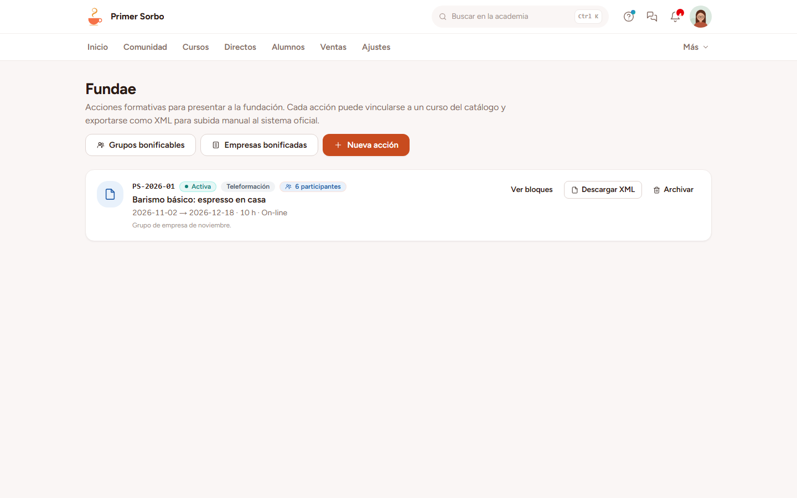
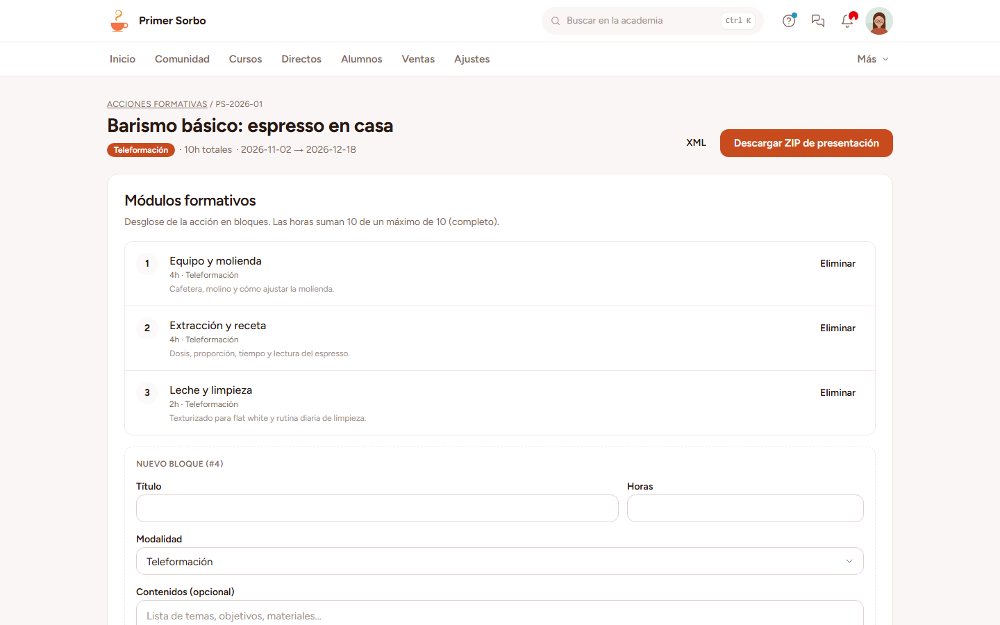

# mod.fundae — Cumplimiento Fundae

Community · Categoría **compliance** (desactivable)

## Qué hace

Cumplimiento regulatorio para **formación bonificable en España** (RD 694/2017):

- **Acciones formativas** con código, modalidad (`PRESENCIAL`/`TELEFORMACION`/`MIXTA`), horas, fechas y bloques de contenido.
- **Empresas bonificadas** con NIF validado (checksum DNI/NIE/CIF), CCC y crédito anual.
- **Notificaciones RLPT** a la representación legal de las personas trabajadoras, con el plazo legal de 15 días naturales calculado automáticamente y la evidencia (PDF) en el Evidence Vault con hash.
- **Grupos bonificables** con ciclo de vida (`DRAFT → ACTIVE → CLOSED/CANCELLED`), costes imputados y matrícula nominal de participantes.
- **Finalización** con umbral configurable (75% por defecto): APTO / NO_APTO / EN_CURSO por participante, con modo `preview`.
- **Horas defendibles**: las horas que se exportan salen del **rastro de interacción** de cada alumno (tiempo registrado y quién dio cada lección por completada), no de una casilla marcada por el propio alumno.
- **Acceso de seguimiento** (inspección): una cuenta de solo lectura, atada a un grupo, con la que quien inspecciona la acción recorre el curso y consulta el expediente de seguimiento.
- **Exports**: XML de inicio y de fin de grupo, y un **ZIP de auditoría** completo (`manifest.json` con hash SHA-256 de cada artefacto + XMLs + CSVs + evidencias RLPT), verificable offline contra esos hashes.

## Cómo funciona

- Arrancar un grupo valida la **antelación RLPT** (15 días) y el **crédito disponible** de la empresa; cerrar el grupo debita el crédito consumido.
- El NIF de una empresa es **inmutable** tras el alta (cambio de NIF = empresa nueva, por trazabilidad).
- La suma de horas de los bloques no puede superar las horas de la acción (Fundae lo verifica al subir el XML).
- **Cómo se cuentan las horas**: cada lección aporta como máximo su duración declarada. Si está dada por completada, aporta esa duración; si va a medias, aporta el tiempo realmente registrado. Las lecciones que cerró un tercero (tiempo de visionado, evaluación, SCORM o instructor) cuentan como **verificadas**; las autodeclaradas siguen sumando, pero viajan aparte como **horas sin verificar** (en el ZIP y en el expediente de seguimiento). Las tres vías que exportan horas (XML de la acción, cierre de grupo y PDF de evidencia) leen del mismo cálculo, así que el papel del participante no contradice al XML.
- **Criterio de finalización** por acción (`criterioFinalizacion`): `UMBRAL_PROGRESO` (por defecto: porcentaje de lecciones completadas contra el umbral del grupo) o `INSTRUCCION_75` (exige a la vez el umbral en **horas**, en **actividades** —cuestionarios y SCORM— y en **controles** —cuestionarios—, contando solo lo verificado por un tercero). Es un campo del API de la acción: el panel no lo muestra ni lo edita todavía.
- Es el consumidor natural del hook `courses.publish.validate`: puede bloquear la publicación de un curso si faltan objetivos o duración.
- Toda la superficie de gestión es de administración: cada endpoint exige `super_admin` o `tenant_admin`. El rol formador no accede a Fundae. La única excepción es la lectura del expediente de seguimiento (ver más abajo), que se abre también a quien tenga una concesión viva sobre ese grupo.
- **Acceso de seguimiento**: la cuenta recorre el curso mediante una matrícula de origen `INSPECTION`, que queda **excluida** de los listados nominales, del XML y de los CSV (no aparece como participante de la acción que inspecciona). Conceder o retirar el acceso queda en el registro de auditoría; al retirarlo la fila **no se borra** (conserva quién pudo mirar el expediente y cuándo), y una concesión caducada o retirada deja de abrir en el acto.

## Configuración

- **Activar o desactivar el módulo**: `/admin/settings?tab=modules` (pestaña **Módulos**) — interruptor por organización.
- **Acceso**: entrada **Fundae** en el grupo **Integraciones y API** del menú de administración (`/admin/fundae`); solo la ven `tenant_admin` y `super_admin`.
- **Rol `inspector`**: asignable desde la administración de usuarios. Por sí solo no abre nada: sin una concesión sobre un grupo no ve ninguno.
- **Umbral de finalización**: por grupo (`umbralFinalizacionPct`, 1–100; 75 por defecto), se fija por API al crear o editar el grupo; el cálculo de finalización admite además un `umbralOverride` puntual sin tocar la configuración persistida. El panel muestra el valor aplicado como **Umbral {pct}%**.
- Sin variables de entorno propias. Ninguna función exige licencia Enterprise.

!!! note "Capturas en modo sencillo"
    Las capturas de esta página son de una academia en **modo sencillo** (pestañas arriba). Las pantallas que no tienen pestaña propia están en **«Más»**, con el mismo nombre que en el menú de administración; en **modo completo** se abren desde el menú lateral. Las rutas (`/admin/…`, `/studio/…`) son las mismas en los dos modos.

## Uso paso a paso

Dar de alta la acción y la empresa:

1. En `/admin/fundae`, pulsa **Nueva acción** y rellena **Código de acción** (único por tenant), **Modalidad**, **Nombre**, **Fecha inicio**, **Fecha fin** y **Horas**; opcionales **Lugar**, **CIF/NIF del centro**, **UUID del curso vinculado (opcional)** y **Notas internas (no van al XML)**. Pulsa **Crear acción**.

    

2. Entra en **Ver bloques** (`/admin/fundae/<id>`) y desglosa la acción con **Añadir bloque** (título, horas, modalidad, contenidos); la pantalla avisa de cuántas horas quedan hasta el máximo de la acción. Si la acción tiene curso vinculado, la sección **Participantes** lista las matrículas activas y permite descargar la **Evidencia PDF** de cada una; **Descargar ZIP de presentación** empaqueta el XML con todas las evidencias. Desde la lista, **Descargar XML** exporta el XML de la acción.

    

3. En `/admin/fundae/companies` (**Empresas bonificadas**), pulsa **Nueva empresa**: **NIF / CIF** (con checksum validado; inmutable después), **Razón social**, **Código Cuenta Cotización**, **Plantilla**, **Crédito Fundae (€)** y datos de contacto. Pulsa **Crear empresa**.
4. Abre **Detalle / RLPT** (`/admin/fundae/companies/<id>`) y pulsa **Subir documento**: tipo (**Notificación inicial**, **Acuse de recibo** o **Acta de discrepancia**), fecha y el PDF o imagen (máx. 10 MB, persistido con hash SHA-256). La cabecera indica si la empresa ya cumple los 15 días naturales para iniciar grupos.

Operar el grupo bonificable:

5. En `/admin/fundae/groups` (**Grupos bonificables**), pulsa **Nuevo grupo**: **ID Acción formativa**, **ID Empresa bonificada**, **Modalidad**, fechas previstas y **Crédito estimado (€)**. El grupo nace en **Borrador**.
6. Abre **Ver detalle** y matricula participantes: uno a uno con **Matricular** (UUID del alumno) o todos los inscritos del curso vinculado con **Bulk enroll desde curso**. Registra costes con **Añadir coste** (**Directo**, **Indirecto** u **Organización**).
7. Pulsa **Iniciar grupo**: valida la antelación RLPT de 15 días y el crédito disponible de la empresa. Con el grupo **En curso**, genera el **XML inicio**.
8. Para cerrar: **Vista previa finalización** calcula APTO / NO_APTO / EN_CURSO por participante con el umbral aplicado (sin persistir), **Persistir finalización** lo consolida, y **Cerrar grupo** debita el crédito consumido. Después descarga **XML finalización** y el **ZIP auditoría**. Además de `manifest.json`, `inicio.xml`, `finalizacion.xml` y `costes.csv`, el ZIP trae `participantes.csv` (con horas asistidas, horas sin verificar, accesos y actividades) y `seguimiento.csv` (una fila por participante y lección: orden en el itinerario, primer y último acceso, tiempo registrado, fecha de completado y quién la dio por hecha), más los adjuntos RLPT.

Dar acceso de seguimiento a la inspección:

9. Crea (o elige) la cuenta que comunicarás a Fundae y asígnale el rol `inspector` en la administración de usuarios.
10. En el detalle del grupo (`/admin/fundae/groups`, **Ver detalle**), en la tarjeta **Acceso de seguimiento**, pega el **ID de la cuenta** (UUID), pon si quieres **Caduca el (opcional)** y **Notas**, y pulsa **Conceder acceso**. **Ver el expediente** abre la misma pantalla que verá la inspección, para comprobarla antes de comunicar las claves. **Retirar acceso** la cierra (con confirmación).
11. Quien inspecciona entra con su cuenta y ve **Seguimiento Fundae** en el grupo Aprendizaje del menú (`/inspection`): el expediente en solo lectura con, por participante, **Horas** (y las «sin verificar»), **Actividades**, **Lecciones**, **Primer / último acceso** y **Resultado**, y con **Ver itinerario** el recorrido lección a lección. El contenido del curso lo recorre desde «Mis cursos», como un alumno.

## Dependencias

Opcionales: `mod.courses` (validación de curso vinculado) y `mod.learning` (matrículas y completitud).

## Modelo de datos

`mod_fundae_action` · `_block` · `_company` · `_rlpt_notice` · `_group` · `_cost` · `_group_participant` · `_inspector_access` (concesión por grupo y cuenta, con caducidad y retirada).

## API

Prefijo `/modules/fundae` (acciones, exports) + superficie admin en `/admin/fundae/*` (empresas, RLPT, grupos, costes, participantes, y `/admin/fundae/groups/:id/inspectors` para conceder, listar y retirar accesos de seguimiento) + lectura del expediente en `/fundae/inspection/groups` y `/fundae/inspection/groups/:id`, sin ningún verbo de escritura. Detalle en [Referencia → Aprendizaje](../../api/reference/learning.md#fundae-modulesfundae-todo-admin-el-rol-formador-no-accede) y [Referencia → Administración](../../api/reference/administration.md#fundae-admin-el-rol-formador-no-accede).

## Eventos

**Emite** 31 eventos que cubren todo el ciclo: `fundae.action.*`, `fundae.company.*`, `fundae.rlpt.notice.*`, `fundae.group.*` (incluidos los de generación de XML y ZIP), `fundae.block.*` (bloques de la acción), `fundae.cost.*`, `fundae.inspector.granted/revoked`, `fundae.export.generated` y `fundae.zip.generated`. No consume.
