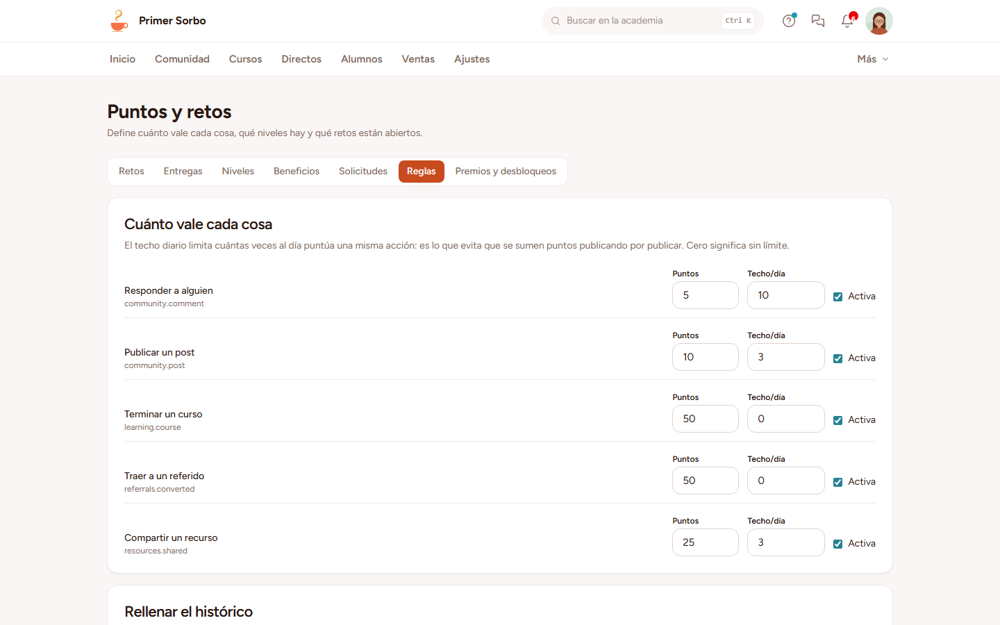
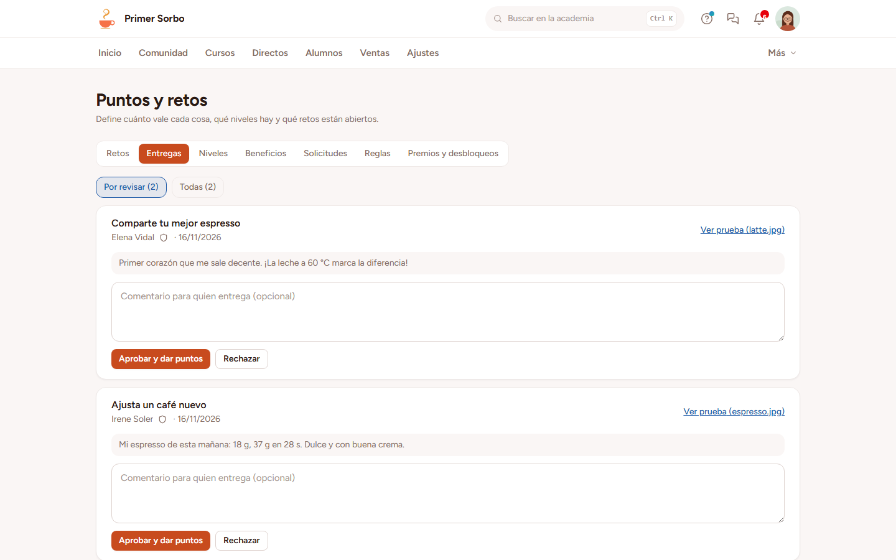
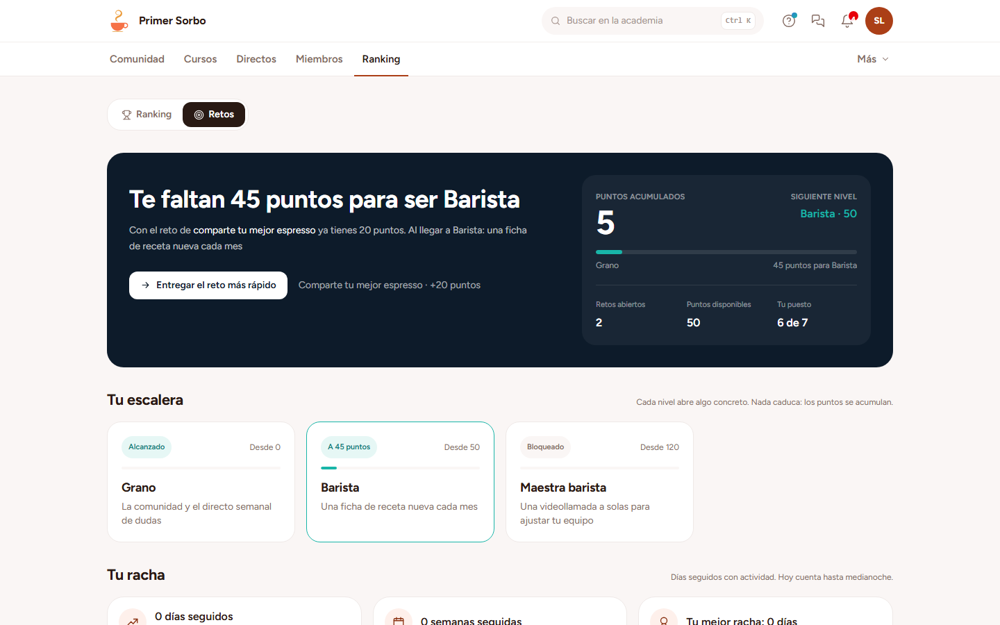
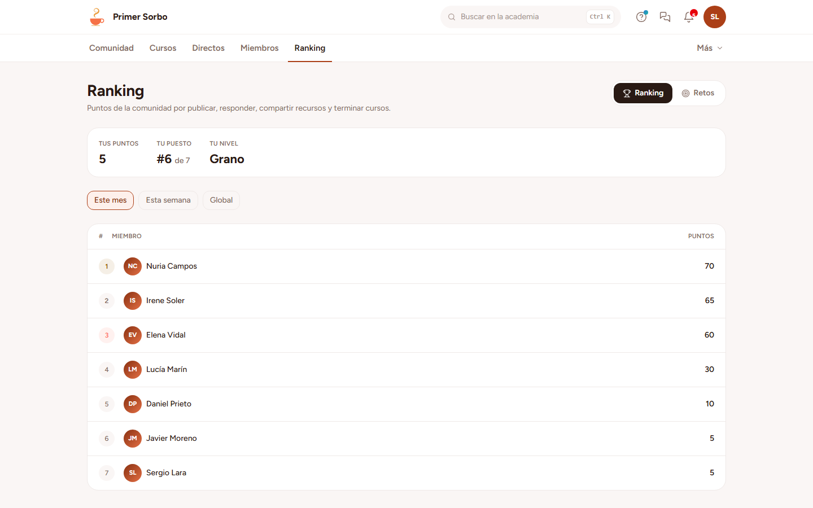

# mod.gamification — Puntos y retos

Community · Categoría **engagement** (desactivable a propósito)

## Qué hace

Convierte la actividad de la comunidad en un **libro de puntos auditable**, con dos capas deliberadamente distintas:

- **Actividad** — asientos automáticos disparados por eventos del bus (post, comentario, recurso, curso completado, referido…), con pesos bajos y **techo diario** por regla: premian constancia, no volumen.
- **Hitos** — **retos** con prueba obligatoria y revisión humana, con pesos altos.

Encima, los **niveles** se calculan sobre puntos de por vida y nunca bajan; la **clasificación** se calcula por rango de fechas (semana/mes/total) y sí se mueve. Un nivel desbloquea **beneficios** definidos por el operador (sesión 1:1, clase extra…) con cupo por alumno y espera opcional; el alumno los solicita y una persona los atiende.

Además, una **capa de retención** opcional para que el alumno vuelva: **contenido que se desbloquea por nivel**, **premios automáticos** al llegar a un nivel o unos puntos, **insignias**, **rachas** de días y semanas, y **celebraciones** en la comunidad.

## Cómo funciona

- La única defensa real contra el doble cobro es la unicidad `(tenant, usuario, sourceKey)`, donde la `sourceKey` identifica el **hecho** (`community.post:<id>`), no el evento — el bus entrega al menos una vez.
- Los **beneficios no tocan los grupos de acceso**: el acceso a cursos es producto de pago y no puede ganarse participando (decisión de producto explícita). La única excepción es el desbloqueo por nivel de un curso de pago con **«Regalarlo al llegar al nivel»**, que el operador tiene que marcar a propósito (ver más abajo).
- Moderar contenido (ocultarlo) **revoca** los puntos que dio; restaurarlo los devuelve.
- El **backfill** rellena el ledger con la actividad histórica: idempotente, repetible, excluye contenido oculto y posts por API, y no aplica el techo diario hacia atrás.
- Niveles y retos **nacen vacíos a propósito** (sus nombres y premios son decisiones de marca); solo se siembran las reglas de pesos y el catálogo de insignias.
- **Desbloqueo por nivel**: un curso entero, o una de sus secciones, sale con candado («Se desbloquea en el nivel N», con los puntos que faltan) hasta que la persona llega al nivel; entonces se abre solo y se le avisa. El nivel ya alcanzado no se vuelve a cerrar aunque una revocación le baje los puntos. Si el curso es **de pago**, llegar al nivel no lo regala (quien lo compró entra siempre) salvo que el operador marque **«Regalarlo al llegar al nivel»**.
- **Rachas**: días y semanas seguidos con actividad (publicar, comentar o avanzar en un curso), contados en el día local de cada persona. Un día sin actividad no rompe la racha hasta que termina, y nunca se avisa de que se va a perder.
- **Insignias**: se ganan solas; el producto trae seis (primera publicación, primer comentario, primer curso terminado, racha de 7 días, racha de 30 días y nivel 3), que el operador puede desactivar o renombrar. Salen en el perfil y en la tarjeta de miembro.
- **Premios automáticos**: un mensaje o enlace, o un código de descuento que el operador ya creó en su cuenta de pagos (Didacta no crea cupones), que se entrega solo al llegar a un nivel o a unos puntos, con aviso y registro de entregas. En las aulas que cobran con los cobros de plataforma ([mod.payouts](payouts.md)) no hay premio de código de descuento (esos pagos no admiten cupones).
- **Celebraciones**: publicaciones automáticas, a nombre de quien administra el aula y en el espacio General, cuando alguien termina un curso, se presenta, cumple años en la comunidad o sube de nivel; si el mismo día hay varias del mismo tipo salen en una sola. Cada miembro puede elegir no aparecer.

!!! note "Capturas en modo sencillo"
    Las capturas de esta página son de una academia en **modo sencillo** (pestañas arriba). Las pantallas que no tienen pestaña propia están en **«Más»**, con el mismo nombre que en el menú de administración; en **modo completo** se abren desde el menú lateral. Las rutas (`/admin/…`, `/studio/…`) son las mismas en los dos modos.

## Configuración

- **Activación** — `Administración → Configuración`, pestaña «Módulos» (`/admin/settings`): interruptor de «Puntos y retos» (`mod.gamification`). Al desactivarlo desaparecen del menú «Ranking» y «Retos», y «Puntos y retos» del área de administración.
- **Panel único** — `/admin/gamification` («Puntos y retos», grupo Personas y accesos del área de administración), con 7 pestañas: «Retos», «Entregas», «Niveles», «Beneficios», «Solicitudes», «Reglas» y «Premios y desbloqueos».
- **Reglas de puntuación** — pestaña «Reglas» («Cuánto vale cada cosa»): por cada acción («Publicar un post», «Responder a alguien», «Compartir un recurso», «Terminar un curso», «Traer a un referido») se fijan «Puntos», «Techo/día» (0 = sin límite) y el checkbox «Activa». Las reglas vienen sembradas con pesos por defecto.
- **Relleno del histórico** — misma pestaña «Reglas», tarjeta «Rellenar el histórico» con el botón «Rellenar ahora»: da puntos por la actividad anterior con su fecha original; se puede repetir sin duplicar nada.
- **Premios y desbloqueos** — pestaña «Premios y desbloqueos» (la capa de retención): «Contenido que se desbloquea por nivel» (elige «Curso», «Sección», «Se desbloquea en» y «Cerrar hasta ese nivel»; «Abrir ya» quita el candado), «Premios automáticos» (nombre, «Se entrega al llegar a» un nivel o unos puntos, «Qué recibe»: un mensaje o enlace, o un código; «Crear premio», con «Pausar»/«Activar» y «Registro de entregas»), «Insignias» («Dar insignias» y renombrar), «Rachas» («Contar rachas») y «Celebraciones en la comunidad» (cuatro interruptores: cursos, presentaciones, aniversarios y niveles). **Rachas e insignias nacen activadas; las cuatro celebraciones, apagadas.**
- **Roles** — reglas, niveles, beneficios, backfill y toda la capa de retención (premios, desbloqueos, insignias, rachas y celebraciones): solo `super_admin` / `tenant_admin`; retos, entregas y solicitudes de beneficio: también `formador`.
- Variable de entorno: `GAMIFICATION_ANNIVERSARY_CRON` — cron del barrido diario de aniversarios para las celebraciones (`0 8 * * *`, UTC). Ninguna función exige licencia Enterprise.

!!! note "La captura es anterior a la pestaña «Premios y desbloqueos»"
    La captura muestra el panel con seis pestañas; la séptima, «Premios y desbloqueos», se añadió después y no sale en ella.

## Uso paso a paso

**El operador:**

1. Repasa los pesos y techos en «Reglas»; vienen sembrados, pero cuánto vale cada acción es una decisión suya.
2. Crea la escalera en «Niveles»: «Nuevo nivel» con «Nombre», «Desde (puntos)» y «Beneficio». Hasta que exista el primero, nadie tiene nivel — los puntos se acumulan igual.
3. Cuelga «Beneficios» de cada nivel: «Qué desbloquea», «Nivel que lo desbloquea», «Veces por alumno (0 = sin límite)» y «Espera entre solicitudes (días)». Un beneficio se puede «Pausar» sin borrarlo.
4. Publica retos en «Retos»: título, «Puntos», «Qué hay que hacer» y el checkbox «Exigir prueba (captura, archivo o enlace) para poder entregar». Nacen en «Borrador»: pulsa «Abrir» cuando la comunidad deba verlos.
5. Revisa las entregas en «Entregas» (pestaña «Por revisar»): «Ver prueba», comentario opcional y «Aprobar y dar puntos» o «Rechazar». El comentario lo ve quien entregó.

    

6. Atiende las peticiones en «Solicitudes»: «Aprobar» la solicitud, cumplirla en el mundo real y «Marcar hecho» (o «Rechazar» con respuesta opcional).
7. Si la comunidad ya tenía actividad antes de los puntos, «Rellenar ahora»: el resumen dice cuántos asientos nuevos salieron de posts, comentarios, recursos, cursos y referidos.

**El alumno:**

1. `/challenges` («Retos»: en modo sencillo, el botón «Retos» de la pestaña «Ranking»; en modo completo, el grupo Personas): la cabecera dice cuántos puntos tiene, cuántos le faltan para el siguiente nivel y cuál es el reto más rápido para llegar («Entregar el reto más rápido»). Debajo, «Tu escalera» con los niveles, «En qué puedes gastar tus puntos» con los beneficios y «Retos abiertos».

    

2. «Entregar» abre el modal de entrega: qué ha hecho, la prueba (archivo o enlace, obligatoria si el reto la exige) y una confirmación — cada reto se entrega **una sola vez**. Queda «En revisión» hasta que el equipo la resuelve.
3. Con un beneficio desbloqueado, «Pedirlo» crea la solicitud; la pantalla muestra el estado («Solicitado», «Aprobado», «Hecho») y cuándo puede volver a pedirlo si hay espera.
4. En `/challenges` también ve **«Tu racha»**, **«Tus insignias»**, **«Tus premios»** (con su código o enlace y lo que le falta para el siguiente) y **«Tu privacidad»**: puede elegir **«Aparecer en las celebraciones de la comunidad»** y **«Mostrar mi racha en mi perfil»**. Su nivel, sus insignias y su racha salen también en su perfil (`/u/<id>`).
5. `/leaderboard` («Ranking»): el ranking por «Este mes», «Esta semana» o «Global», con «Tus puntos», «Tu puesto» y «Tu nivel» arriba.

    

## Permisos

`gamification.read`, `gamification.submit` y `gamification.manage`.

## Dependencias

Opcionales (solo lectura para el backfill): `mod.community`, `mod.learning`, `mod.resources`.

## Modelo de datos

`mod_gamification_ledger_entry` (asiento, append-only salvo revocación) · `_profile` (saldo materializado) · `_rule` · `_level` · `_perk` · `_perk_request` · `_challenge` · `_submission` (una entrega por reto y persona). Capa de retención: `_settings` · `_member_prefs` · `_activity_day` · `_streak` · `_badge` · `_user_badge` · `_content_lock` · `_content_unlock` · `_reward` · `_reward_grant` · `_celebration` · `_celebration_mark`.

## API

Prefijo `/modules/gamification` (miembro + `/admin`). Detalle en [Referencia → Comunidad y personas](../../api/reference/community.md#gamificacion-modulesgamification).

## Eventos

- **Emite**: `gamification.points.awarded/revoked`, `gamification.level.changed`, `gamification.challenge.submitted/reviewed`, `gamification.perk.requested/handled`, `gamification.badge.awarded`, `gamification.reward.granted`, `gamification.content.unlocked`.
- **Consume**: `community.post.created/comment.created/post.hidden/unhidden/comment.hidden/unhidden`, `resources.resource.created/deleted`, `learning.course.completed`, `learning.progress.updated`, `referrals.referral.attributed`, y sus propios `gamification.level.changed` y `gamification.points.awarded` (para premios, desbloqueos y celebraciones).
