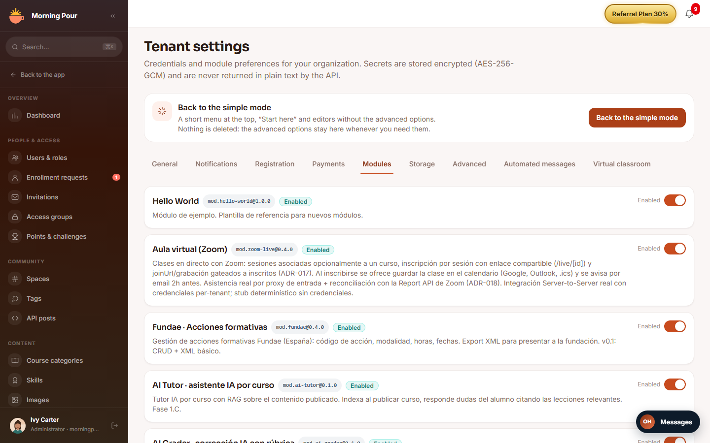

# mod.hello-world — Reference module

Community · **Example** category (can be disabled)

## What it does

An example module and a **starting template** for building new modules. It demonstrates the elements of the contract:

1. A valid **manifest** parsed with the core-kernel's `parseModuleManifest`.
2. The four **lifecycle hooks** (`onRegister`, `onEnable`, `onDisable`, `onUninstall`), with comments describing what a real module would do in each one.
3. A **domain service** (`HelloWorldService`) that receives the `ModuleContext` and uses `eventBus` and `i18n`.
4. A **contract test suite** that registers the module in a real `ModuleRegistry` and verifies it end to end.
5. A **public surface** (`publico`): a page the module publishes at the `/hello-world` route, server-rendered and visible without a session (see below).

## How to use it

The procedure for starting a new module: copy the folder, rename `name`/`tablePrefix`/`apiNamespace`/permissions, write the domain logic, implement the lifecycle and update the tests — the full guide is in [Building a module](../building-a-module/index.md).

The isolation rules every module honours — never import another module's code, never touch another module's tables with Prisma, never modify the core for your own features, and never emit events without declaring them — are collected in [Building a module → The golden rules](../building-a-module/index.md#the-golden-rules).

## Configuration

None of its own: no environment variables, no panel settings and no Enterprise capabilities. As a **non-core** module (category `example`), it ships registered in the instance and appears with its switch under Administration → Brand & settings → Settings, "Modules" tab (`/admin/settings?tab=modules`), where an admin can enable or disable it per tenant. Its other surface is the public `/hello-world` page, which only exists on the classroom domains that serve the public site (see "Public surface").

!!! note "Screenshots in full mode"
    The screenshots on this page come from **full mode** (side menu), the mode a new installation starts in. In **simple mode** the same routes are still available from "More", except for the screens that mode replaces with a simplified version (the course editor, Settings, Sales, Students, Live, the community and Referrals); to use them as shown here, switch to full mode under **Settings → "Use the full mode"**.

## Step-by-step usage

It is a template for developers; the flow lives in code, not in the panel:

1. Copy the `modules/hello-world/` folder as `modules/<your-slug>/`.
2. In `src/manifest.ts`, rename `name`, `displayName`, `tablePrefix`, `apiNamespace` and the permissions.
3. Replace `HelloWorldService` with your domain services and implement the four lifecycle hooks in `src/index.ts` with real work (migrations in `onEnable`, cleanup in `onDisable`…).
4. Update `module.json` and adapt the `tests/contract.test.ts` suite to your module.
5. Register it in the `registry.register([...])` array of `apps/api/src/modules/module-registry.service.ts` and follow the rest of the [Building a module](../building-a-module/index.md) guide.
6. To see it running, open `/admin/settings?tab=modules`: "Hello World" is listed with its switch, exactly as your module will be.

## Public surface

`module.json` declares `"surfaces": ["publico"]` and the module's web extension (`apps/web/src/modules/hello-world/`) registers the `/hello-world` route with `publicRoutes`. It is the minimal consumer of the capability "a module publishes server-rendered public routes":

- The page is a **server** component: its content arrives in the HTML, with no JavaScript, no session and no call to any authenticated endpoint. It shows the site name, the domain, the canonical origin and the path.
- The route is only mounted if the module is **active for the tenant** and the **entry domain serves the public site**: each of the tenant's domains (`tenant_domain`) has a surface, `APP` (the signed-in classroom, the default) or `SITE` (public site). The panel has no screen to change it; it is a column of that table. An installation that does not enable the module publishes nothing.
- The canonical origin comes from the entry domain, not from `WEB_PUBLIC_URL`; the site context (`GET /public/site-context`) answers 404 if the domain does not exist or does not serve the site.
- Two modules claiming the same public route **break the build** instead of being resolved by import order, and the marketplace schema **rejects** the `publico` surface in modules installed by ZIP (only modules included in the build have it).

## Data, API and events

- It declares a `tablePrefix` but **creates no tables** (it does not need any).
- It declares the `apiNamespace /modules/hello-world` but exposes no real endpoints.
- It declares the `hello-world.greeting.requested` event and the `hello-world.greeting.read` permission as an example of the contract.
