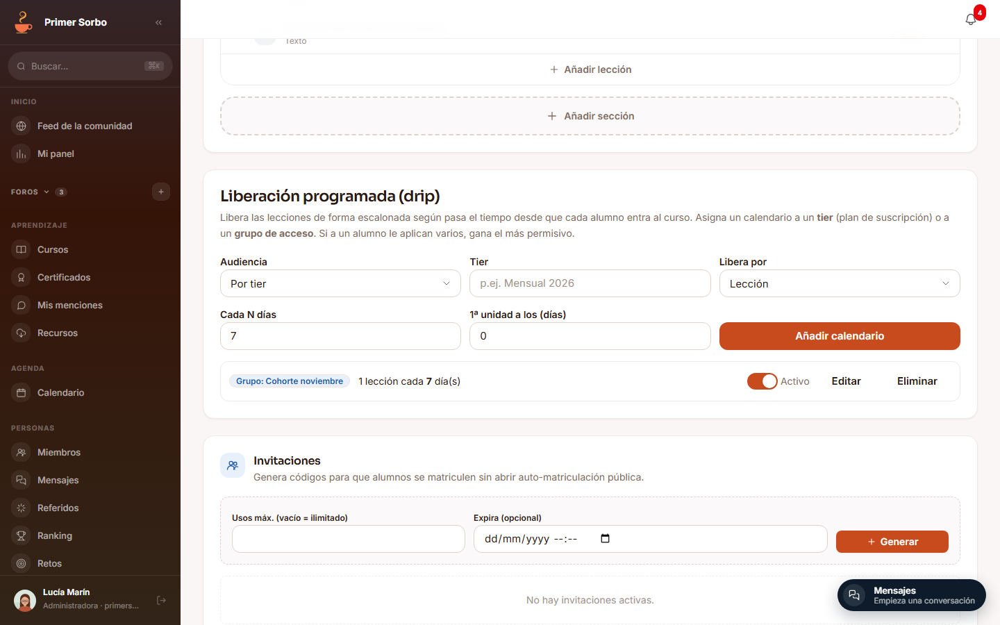
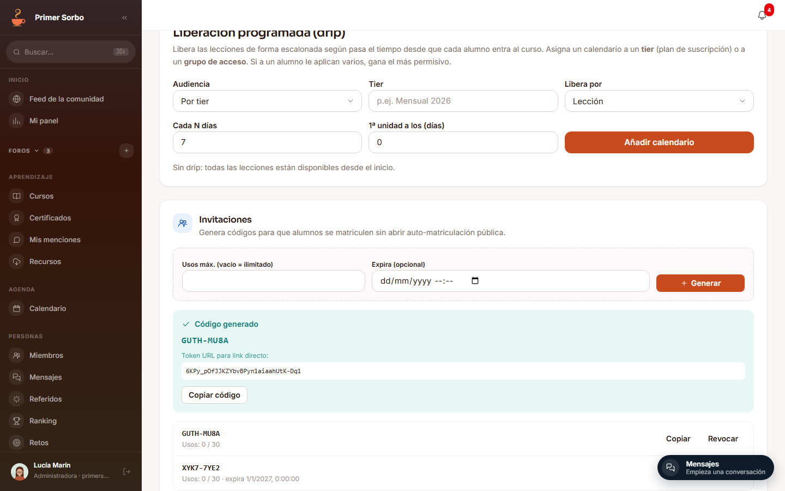
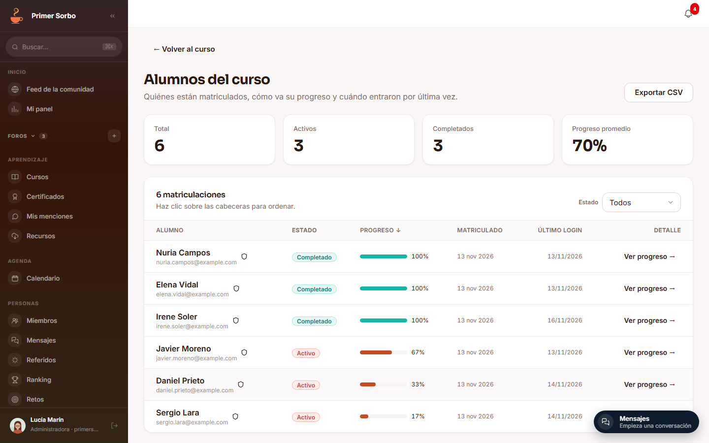
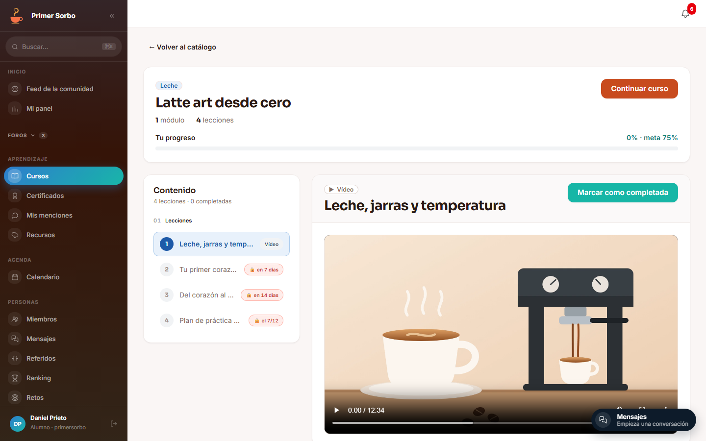

# mod.learning — Player, matrícula y progreso

Community · Categoría **core** (siempre activo)

## Qué hace

Gestiona todo el ciclo del alumno dentro de un curso: **matriculación** (directa, por admin, por código o enlace de invitación), **progreso por lección** (segundos vistos, posición de reanudación) y **finalización** con umbral configurable (75% por defecto). Añade además:

- **Drip content**: calendarios de liberación programada por intervalos relativos a la fecha de entrada del alumno, segmentables por tier de pago o por grupo de acceso, con aviso opcional por email al desbloquearse una lección.
- **Invitaciones** con código corto o token URL, con límite de usos, caducidad y revocación.
- **Comentarios de lección** con cola de moderación (nacen `PENDING` hasta que el formador aprueba).
- **Rutas de aprendizaje** (itinerarios de cursos, lineales o flexibles) y **competencias** ponderadas por curso.
- **SCORM 1.2/2004**: subida del paquete, parseo del `imsmanifest.xml` y persistencia del estado `cmi.*` por intento.

## Cómo funciona

- Solo se puede matricular en cursos `PUBLISHED` (`COURSE_NOT_PUBLISHED` 422); una matrícula activa duplicada responde `ALREADY_ENROLLED` 409.
- Cada matrícula guarda su **procedencia** (`source`): `ADMIN`, `CODE`, `INVITATION_LINK`, `PURCHASE`, `IMPORT`, `SUBSCRIPTION`, `API` o `GROUP` (la concede un grupo de acceso, y se retira por refcount al salir del último grupo que la daba). La procedencia decide qué se puede retirar solo y qué contenido se cierra.
- **Automatrícula solo en cursos que no se venden.** `POST /modules/learning/enrollments/me` solo funciona si el curso no tiene página de compra externa ni se cobra dentro del aula (precio propio, suscripción al curso, o entregado con la membresía o con un tier de pago); si se vende, responde `COURSE_NOT_FREE` 403. Apuntarse a una **ruta de aprendizaje** aplica la misma regla curso a curso: no regala los cursos de pago, y no toca los que la persona ya tiene.
- Un alumno solo puede registrar progreso en lecciones **del curso de su matrícula viva** (no cancelada ni pausada). Las lecciones de tipo `QUIZ` y `SCORM` no se pueden marcar como completadas por el cliente: las cierra el motor de evaluaciones o el runtime SCORM.
- Cuando a un alumno le aplican varios calendarios de drip, **gana el más permisivo** (la fecha de desbloqueo más temprana). Sin calendario aplicable, todo está disponible.
- El contenido de prueba (trial de membresía) se gatea con `TRIAL_CONTENT_LOCKED` 403, que el frontend convierte en CTA de pago.
- Contenido cerrado por **nivel de la gamificación**: si el aula tiene `mod.gamification` activo y define un nivel mínimo para un curso o una sección (ver [gamificación](gamification.md)), las lecciones salen bloqueadas hasta alcanzarlo y la API responde `LEVEL_CONTENT_LOCKED` 403. Solo cierra lo que llega con la comunidad (grupo, membresía o automatrícula): lo que la persona tiene por su cuenta (compra, suscripción al curso, venta por API, código o invitación, importación) no se cierra nunca. Sin gamificación activa no se cierra nada.
- Al cruzar el umbral emite `learning.course.completed` **una sola vez** — es lo que dispara la emisión de certificados.
- **Reembolso**: el reembolso de la compra de un curso retira la matrícula (también si ya estaba completada) y revoca sus certificados, salvo que quede otra compra cobrada o un grupo que siga dando el curso (en ese caso la matrícula pasa a `GROUP`). Si la persona vuelve a comprarlo, recupera la matrícula con su estado completado.

## Configuración

- **Activación**: módulo de categoría `core`, siempre activo. No aparece en la pestaña «Módulos» de `/admin/settings?tab=modules` y no se puede desactivar.
- **Umbral de finalización**: es un atributo de cada matrícula (columna `completion_threshold`, default 75%). No hay pantalla de ajuste global: se fija por API al crear o editar la matrícula.
- **Drip por curso**: se configura en el builder del formador (`/studio/courses/<id>`, tarjeta «Liberación programada (drip)»), no en el panel de administración.
- **Invitaciones por curso**: en el mismo builder, tarjeta «Invitaciones».
- **Competencias**: el catálogo y su asignación a cursos viven en `/admin/competencies` («Competencias»).
- **Permanencia mínima para completar** (ajuste del módulo `mod.learning`, clave `minWatchFraction`): fracción de la duración declarada (0 a 1) que la lección debe haber estado abierta para poder darla por vista; por defecto **0** (apagado). Con el valor apagado la finalización se acepta igualmente, pero queda marcada como autodeclarada. No tiene pantalla en el panel.
- **Variables de entorno**: `LESSON_UNLOCK_CRON` define la frecuencia del worker que avisa por email de lecciones desbloqueadas (patrón cron, por defecto `*/10 * * * *`; necesita `REDIS_URL`). Es la única variable propia.
- **Storage**: los paquetes SCORM se guardan en el backend de archivos de la instancia (`/admin/settings?tab=storage`).
- **Licencia**: todo el módulo es Community; ninguna función exige capabilities de Enterprise.

!!! note "Capturas en modo completo"
    Las capturas de esta página son del **modo completo** (menú lateral), el de una instalación nueva. En **modo sencillo** las mismas rutas siguen disponibles desde «Más», salvo las pantallas que ese modo sustituye por una versión simplificada (el editor de cursos, Ajustes, Ventas, Alumnos, Directos, la comunidad y Referidos); para usarlas tal como se ven aquí, cambia al modo completo en **Ajustes → «Usar el modo completo»**.

## Uso paso a paso

### Liberar contenido de forma escalonada — drip (formador)

1. En el builder (`/studio/courses/<id>`), baja hasta «Liberación programada (drip)».
2. Elige la «Audiencia»: «Por tier» (plan de suscripción, escribe el nombre en «Tier») o «Por grupo de acceso» (elige el «Grupo»).
3. Define el ritmo: «Libera por» («Lección» o «Módulo / sección»), «Cada N días» y «1ª unidad a los (días)». Pulsa «Añadir calendario».
4. Cada calendario puede activarse/desactivarse o eliminarse. Si a un alumno le aplican varios, gana el más permisivo; sin calendario, todas las lecciones están disponibles desde el inicio.

    

### Matricular alumnos con invitaciones (formador)

1. En el builder, tarjeta «Invitaciones»: define «Usos máx. (vacío = ilimitado)» y «Expira (opcional)» y pulsa «Generar».
2. Copia el código corto («Copiar código») y repártelo; la tarjeta también muestra el «Token URL para link directo», pensado para canjearlo por API (`POST /modules/learning/enrollments/by-link`) — hoy la web no tiene página propia de canje por token.
3. «Revocar» invalida una invitación; el listado marca las «Expirada» o «Agotada».

    

4. El alumno canjea el código en la ficha del curso (`/courses/<slug>`): campo «¿Tienes un código de invitación?» y botón «Canjear código». La matrícula directa de otro usuario (`POST /modules/learning/enrollments`) queda para formador/admin vía API o desde los flujos de importación de usuarios.

### Seguir el progreso del alumnado (formador)

1. Desde el builder, «Ver alumnos» abre `/studio/courses/<id>/students`: totales, activos, completados, progreso promedio, filtros por estado y «Exportar CSV».
2. «Ver progreso →» abre `/studio/courses/<id>/students/<enrollmentId>`: tiempo visto por lección, lecciones completadas y última actividad.

    

### Moderar comentarios de lección (formador)

1. Los comentarios de los alumnos nacen pendientes: la cola «Comentarios pendientes» aparece en el propio builder del curso.
2. Aprueba los útiles o recházalos con un motivo opcional que ve el autor. El alumno escribe desde la lección («¿Tienes una pregunta o anotación sobre esta lección?» → «Enviar comentario») y ve el aviso de que pasan por el profesor antes de ser visibles.

### Rutas de aprendizaje

1. Formador: `/studio/paths` lista tus rutas; «+ Nueva ruta» (`/studio/paths/new`) pide «Título», «Descripción» y «Tipo de secuencia» («Lineal» o «Flexible»).
2. En el editor (`/studio/paths/<id>`) añades cursos publicados con «Añadir curso», los ordenas y pulsas «Publicar» (exige al menos un curso).
3. Alumno: `/paths` lista las rutas publicadas; en `/paths/<slug>` pulsa «Matricularme en esta ruta». En rutas lineales los cursos se desbloquean en orden (chip «🔒 Bloqueado»).

### Competencias (admin)

1. En `/admin/competencies`, crea el catálogo («Catálogo de competencias» → «Añadir»).
2. En «Competencias por curso», elige un curso, marca las competencias que cubre y su peso, y pulsa «Guardar». La puntuación del alumno se calcula desde su progreso en los cursos asociados.

### Lo que ve el alumno

1. En la ficha del curso (`/courses/<slug>`) el alumno matriculado ve «Tu progreso» con la meta (p. ej. «62% · meta 75%») y el temario con el estado de cada lección.
2. El player guarda los segundos vistos y la posición de reanudación; el botón «Marcar como completada» cierra la lección a mano cuando el tipo lo permite.
3. Una lección con drip o fecha programada sale bloqueada («Se desbloqueará…») con el botón «🔔 Avísame cuando se desbloquee»; el aviso llega por email cuando el worker corre.
4. Durante un trial de membresía, las lecciones fuera del límite muestran «Disponible cuando pase el periodo de prueba» con la opción «Pagar ahora y desbloquear».
5. Al cruzar el umbral, el curso pasa a «¡Curso completado!» y, con `mod.certificates` activo, aparece «Descargar certificado».

    

## Dependencias

- Dura: `mod.courses`.
- Opcionales (declaradas en el manifest): `mod.payment-connections` (tier para el drip), `mod.access-groups` (grupos para el drip), `mod.subscriptions` (estado trial + límite de lecciones). Además, el host le pasa ya resueltas dos preguntas que `mod.learning` no puede leer por sí mismo: si un curso se vende (para la automatrícula) y si está cerrado por nivel (`mod.gamification`).

## Modelo de datos

`mod_learning_enrollment` (matrícula única por usuario y curso) · `mod_learning_progress` (con `completion_source`: quién dio la lección por hecha, `SELF`, `TIME`, `ASSESSMENT`, `SCORM` o `INSTRUCTOR`; las filas anteriores a esta columna quedan sin origen) · `mod_learning_invitation` · `mod_learning_drip_schedule` · `mod_learning_lesson_unlock_sub` · `mod_learning_scorm_package` · `mod_learning_scorm_attempt` · `mod_learning_lesson_comment` · `mod_learning_path` + `_path_course` + `_path_enrollment` · `mod_learning_competency` + `_course_competency`.

## API

Prefijo `/modules/learning` (+ `/modules/learning/paths`). Detalle completo en [Referencia → Aprendizaje](../../api/reference/learning.md#matriculas-progreso-y-drip-moduleslearning).

## Eventos

- **Emite**: `learning.enrollment.created`, `learning.enrollment.paused`, `learning.enrollment.resumed` (solo si alguna matrícula cambió de estado de verdad; un reintento sin cambios no emite nada), `learning.enrollment.cancelled`, `learning.progress.updated`, `learning.course.completed`, `learning.invitation.created` y `scorm.attempt.completed` (al completarse un intento SCORM; conserva el prefijo `scorm.*` porque es el nombre que escucha el puente que marca la lección como vista).
- **Consume**: `courses.course.archived`.
