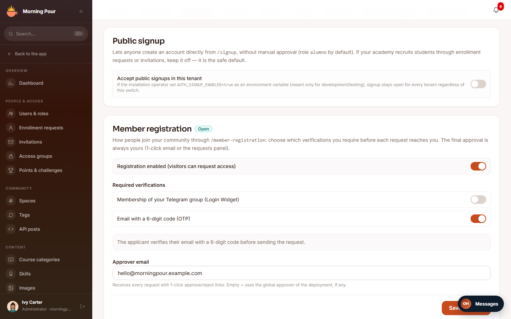
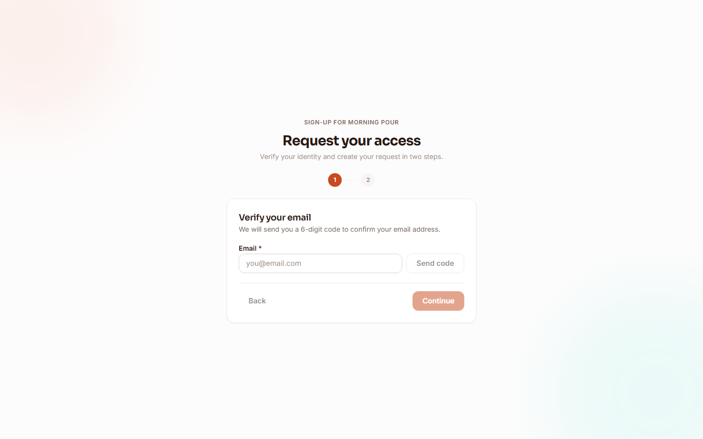
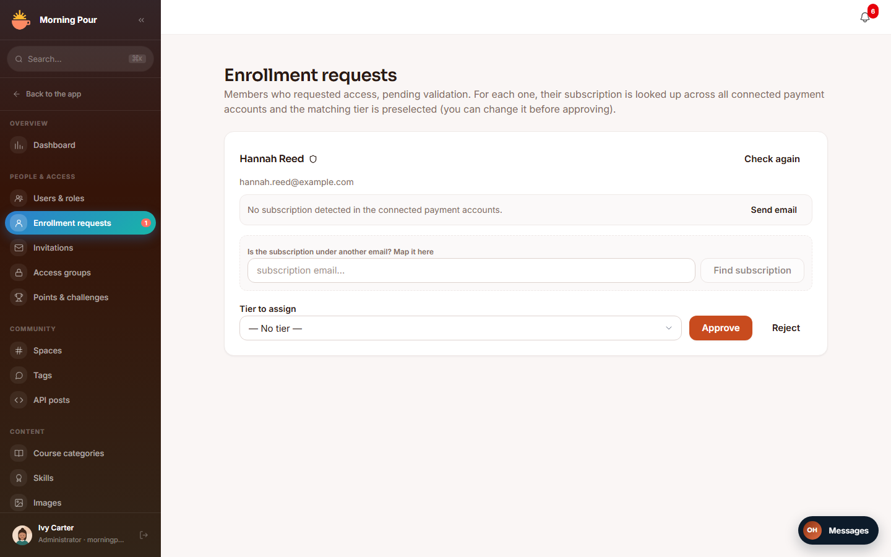

# mod.member-registration — Member registration

Community · **Core** category (always active)

## What it does

Member sign-up with **manual validation**: request → evidence → human decision. The public wizard (`/member-registration`) assembles its steps according to the tenant's policy:

- Verification through **Telegram** (Login Widget + a group membership check).
- **Email OTP** (a 6-digit code).
- Both, or **open registration** (the only gate being manual approval).

Registration creates the user as `PENDING`, kicks off a background **lookup of subscriptions and purchases** for that email across the connected payment accounts, and notifies the **approver** by email with two signed single-use links (approve / reject) plus the overdue payment status if there is one.

If the membership has a **free level**, this registration is its way in and, by default, whoever verifies their email with a code gets in straight away, without waiting for anyone. See [Automatic approval with the free level](#automatic-approval-with-the-free-level).

## How it works

- The steps are chained with **HMAC-signed tickets** using `AUTH_SECRET` (no state in the database): the Telegram ticket (15 min) authorises the OTP and the OTP's `verificationToken` (30 min) authorises registration. Each ticket carries the classroom it was issued in and is only valid there: a verification done in one classroom is useless for registering in another. The OTP code expires after 10 minutes. Without `AUTH_SECRET` the flow answers that it is not configured.
- Approving activates the user, assigns them the **default access group** and sends the welcome email; rejecting deactivates them and sends a notice.
- **The email links do not decide on their own.** "Approve" and "Reject" open `/member-registration/decision`, a confirmation screen ("Approve this request?"), and the decision is only applied when its button is clicked (`POST /modules/member-registration/decision`). That way the email security filters, which open every link, cannot approve or reject on the person's behalf. Whoever decides first wins: the stamp is atomic and a second attempt changes nothing.
- Emails go out in the language of whoever receives them (Spanish, English or Portuguese) and their links point to the verified classroom domain of the tenant; `WEB_PUBLIC_URL` is only used as a last resort on single-domain installs.
- If the tenant requires a verifier that is not operational (for example Telegram with no bot configured), registration returns a **fail-closed 503** — it never lets anyone through unverified.
- A daily **GDPR purge** worker anonymises the Telegram data of requests that were never decided once the retention window expires (90 days by default).
- The admin panel also supports re-running the payment lookup, deciding without the email, sending renewal reminders and managing **overdue payment flags** (with CSV import). **Manual sign-up** without OTP exists as an admin API endpoint (`POST /modules/member-registration/admin/requests`), with no dedicated panel screen.

## Configuration

A **core**-category module: always active, with no switch in the "Modules" tab. No setting requires an Enterprise licence.

**Per tenant, from the panel** — Administration → Brand & settings → **Settings**, "Registration" tab (`/admin/settings?tab=registration`), "Member registration" card:

- **"Registration enabled (visitors can request access)"** — when off, registration is CLOSED and accounts are created by the administrator.
- **"Required verifications"** — "Membership of your Telegram group (Login Widget)" and/or "Email with a 6-digit code (OTP)". None checked = open registration: anyone can send a request and the only gate is your manual approval.
- **Telegram bot** (appears when Telegram is required): "Bot username (without @)", "Group ID" (numeric, with the `-100` prefix for supergroups) and "Bot token". The token is encrypted at rest with AES-256-GCM, the API never returns it in plain text, and leaving the field empty keeps the stored one. Requiring Telegram without a configured bot is rejected on save.
- **"Approver email"** — receives every request with the 1-click links. Empty = uses the deployment's global approver, if any.

**Emails** — it registers 4 editable templates under Administration → Communication → **Emails** (`/admin/emails`), keys `member_registration.otp_code`, `member_registration.approval_request`, `member_registration.welcome_approved` and `member_registration.rejection`. Sending uses the tenant's SMTP (the "Notifications" tab of the same Settings screen): without SMTP neither the OTP code nor the notices go out.

**Environment variables** (legacy fallback for single-tenant deployments; the cascade is tenant setting → env → nothing):

- `TELEGRAM_BOT_TOKEN`, `TELEGRAM_GROUP_ID`, `TELEGRAM_BOT_USERNAME` — global bot. Without an explicit tenant setting, the default preserves the historical behaviour: with a bot in the env → Telegram+OTP required; without one → registration closed.
- `MEMBER_APPROVAL_EMAIL` — global approver.
- `MEMBER_PURGE_CRON` (default `0 3 * * *`, daily at 03:00 UTC) and `MEMBER_RETENTION_DAYS` (default 90) — the GDPR purge worker.

!!! note "Screenshots in full mode"
    The screenshots on this page come from **full mode** (side menu), the mode a new installation starts in. In **simple mode** the same routes are still available from "More", except for the screens that mode replaces with a simplified version (the course editor, Settings, Sales, Students, Live, the community and Referrals); to use them as shown here, switch to full mode under **Settings → "Use the full mode"**.

## Step-by-step usage

**Setup (admin):**

1. On `/admin/settings?tab=registration`, turn on "Registration enabled…", check the verifications you require, fill in the bot if you require Telegram plus the "Approver email", and press **Save settings**.

2. *(Optional)* Adjust the copy of the 4 templates on `/admin/emails`.
3. Share your tenant's public sign-up URL: `/member-registration`.

**What the applicant sees** (steps depend on the policy):

4. "Verify your Telegram" step: they press the Login Widget button; the screen confirms "Your Telegram account has been verified" or warns them when they are not in the group (they can continue and their case will be reviewed).
5. "Verify your email" step: they type their address, press **Send code**, enter the "6-digit code" and press **Verify**.
6. "Your details" step: name, password (at least 12 characters) and an optional bio — the email is asked for in this step when there is no OTP step — then they press **Create request**. Final screen: "Registration pending validation". With [automatic approval](#automatic-approval-with-the-free-level), the button is **Create my account** and the final screen is "You're in".

**The decision (approver):**

7. By email: "Nueva inscripción pendiente — {name}" arrives with the "Approve"/"Reject" buttons (single-use links, 7-day TTL) and the overdue status if there is one; clicking lands on `/member-registration/decision`, which asks for confirmation ("Approve this request?" / "Reject this request?"): the decision is applied when you click "Approve" or "Reject" on that screen, and then the outcome is shown.
8. Or from the panel: Administration → People & access → **Enrollment requests** (`/admin/member-requests`). Each request shows its detected subscription ("Active subscription" / "Subscription not active — canceled or past due"), one-off purchases, and lets you **Check again**, map the subscription under another email ("Is the subscription under another email? Map it here"), send reminders and pick the "Tier to assign" (preselected when it matches the subscription). Press **Approve** or **Reject**.

9. Approving activates the account, assigns the default access group and sends the welcome email; rejecting deactivates the user and notifies them.
10. Keep the overdue reference list under Administration → Revenue → **Overdue payments** (`/admin/delinquents`): manual entry ("New record", "Mark as overdue") or **Import CSV**. Registration uses these flags to warn you when someone requests access without being up to date.

## Automatic approval with the free level

When the membership has a [free level](subscriptions.md#the-free-level), this registration is that level's way in and nobody needs to approve each sign-up any more.

- **When the free level is created (or turned on)**, registration is enabled, the "Email with a 6-digit code (OTP)" verification is added to whatever you had (Telegram, if you required it, is kept) and the free level's group becomes the default access group on approval.
- **Whoever verifies their email with the code gets in straight away.** The sign-up follows the same path as "Approve" in the panel —default group (the free level's), welcome email, audit log entry (with `via: auto`) and the `member_registration.request.approved` event— but without notifying the approver, because there is nothing to approve.
- **The wizard talks about "your account" instead of "your request"**: "Verify your email and create your account in two steps." (three if Telegram is also required), the last button is **Create my account** and the final screen is **"You're in"** ("Your account is ready. Sign in with your email and password.") with the **Sign in** button.
- **Only with email verification**: without a code there is no proof that the email belongs to whoever signs up, so manual approval stays. And only a sign-up that is still pending changes: a rejected one, or an account that already existed, does not get in by signing up again.
- **"Review every free sign-up by hand"**, on the free level's card (Membership in full mode, Sales in simple mode), turns it off: every sign-up waits for your approval again. Turning the free level off or deleting it also turns it off.
- **Classrooms without a free level do not change**: manual approval, as always.

!!! note "With Telegram required"
    If you also require "Membership of your Telegram group", only people who **are in the group** get in straight away. Anyone who is not (or when Telegram does not let us check) stays **pending your approval**, as without a free level: the approver gets the notice and the wizard talks about "your request" again. Since version 0.1.0-beta.28; in 0.1.0-beta.27 they got in anyway.

Through the API, `GET /modules/member-registration/config` says `autoApprove` (whether people get in straight away) and `POST /modules/member-registration/register` answers `{ status: 'ACTIVE' }` when the sign-up gets in on its own (`PENDING` otherwise). The setting lives in the `member-registration` scope, key `auto-approve` (`{ enabled, manualReview }`), and the levels editor writes it.

## Dependencies

Hard: `mod.payment-connections` (lookup and renewal links) and `mod.access-groups` (default group on approval).

## Data model

`mod_member_registration_profile` (per-user flow data) · `mod_member_registration_decision_token` (single-use tokens, SHA-256 hash, 7-day TTL) · `mod_member_registration_payment_flag` (reference overdue payments) · `mod_member_registration_subscription_lookup` (the lookup result).

## API

Prefix `/modules/member-registration` (public, admin and payment-flags blocks). Details in [Reference → Community and people](../../api/reference/community.md#member-registration-modulesmember-registration).

## Events

**Emits**: `member_registration.request.created/approved/rejected`. It consumes none.
