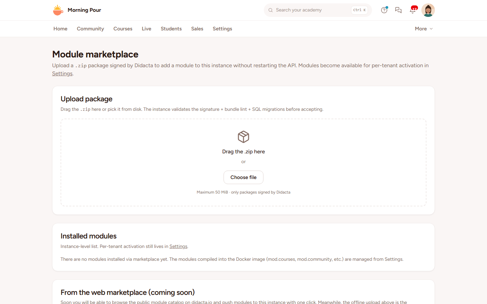

# mod.migrator-learndash — Migrator from WordPress + LearnDash

Community · **Migration** category · **Beta** · Distributed as a **signed ZIP** (third-party format)

## What it does

It migrates a **WordPress + LearnDash** academy to Didacta: courses, lessons, topics (which arrive as lessons), quizzes (header only: title, pass mark and the lesson they hang from, **without their questions**), users and enrollments. It does **not** migrate LearnDash groups, student progress or files (see the MVP limitations). It is driven by a **6-milestone wizard** (Start → Connect with a URL + Application Password → Source summary → Options → Trial → Full run), designed so a non-technical administrator can complete it in an hour. The **trial** genuinely imports 1 random course with up to 5 students so you can verify the result before committing to the full volume.

## How it works

- An **ETL pipeline with staging**: it extracts into staging tables, transforms and loads with **idempotent mapping** by checksum — re-running duplicates nothing, and the full run reuses whatever the trial already loaded.
- Data errors go to a **DLQ** without aborting the job; at the end there is a **reconciliation report** (totals plus a per-entity breakdown) that includes the verification of the SHA-256 audit chain.
- It **only reads** from the source: the WordPress site is left untouched.
- Images and files: **not copied**. The module does not download or upload files from the source WordPress (the media library is not extracted), and the migrated content keeps the addresses of your WordPress images: do not take it down until you have moved them to Didacta.
- Passwords: hashes are not imported (PHPass is not compatible with Argon2id) and the migration **sends no email** (users are created with the invitation suppressed, after an incident with thousands of emails): each person sets their own when the administrator invites them from **Users & roles**.
- The job runs on the backend: you can close the browser and it keeps going; the screen refreshes itself every 3 seconds.
- A permanent source error (e.g. an Application Password revoked halfway through the migration) **fails the job with its cause**; transient ones are retried up to a cap. A cut in the middle of pagination is not taken for the end of the list: the whole course is retried (loading is idempotent) and, if the attempts run out, the loss goes to the DLQ. LearnDash topics are loaded with their content, and names with HTML entities (`&ntilde;`…) are decoded.
- It is the **real-world example of the third-party format**: it is installed as a ZIP under Administration → Module marketplace, runs in the isolated VM with sandboxed `ctx.db`/`ctx.http`/`ctx.secrets`, and its WordPress credentials are stored AES-256-GCM encrypted with a key scoped to the job.

!!! note "Screenshots in simple mode"
    The screenshots on this page come from an academy in **simple mode** (tabs at the top). Screens without a tab of their own live under **"More"**, with the same name as in the administration menu; in **full mode** they open from the side menu. Routes (`/admin/…`, `/studio/…`) are the same in both modes.

## Configuration

- **Installation**: it is a marketplace module, not enabled out of the box. In **Admin → Module marketplace** (`/admin/marketplace`), **Upload package** area, drag the module's `.zip`; the instance validates the signature + bundle lint + SQL migrations before accepting.
- **Access**: once installed, the **Migrate from LearnDash** entry appears in the admin menu (`/admin/integrations/migrator-learndash`). Only the `super_admin` role can use it; everyone else sees a notice. The wizard and the monitor come out in Spanish, English or Portuguese according to the interface's active language (any other falls back to Spanish).
- **No environment variables and no settings screen of its own**: the WordPress URL, user and Application Password travel in the job the wizard creates, encrypted with a key scoped to that job.
- **Wizard options** (Options step): what to migrate (**courses only** / **only students enrolled in courses** / **everything**). Passwords and images are not options: the step shows a notice for each. Staging tables are retained for 30 days. There used to be a **Keep the original password (advanced)** selector and a **Copy images into Didacta** checkbox that the module never read, and they were removed.
- **Manifest permissions** (`module.json`): `migrator-learndash.import.create/read/cancel/rollback` and `migrator-learndash.report.read/export`. It neither emits nor consumes events. Module version in this release: 1.1.1.
- Nothing requires an Enterprise license.

## Step by step

Before starting: take a `pg_dump` of Didacta (it is the supported way back) and have an administrator user of your WordPress with LearnDash reachable over HTTPS.

The labels below are the English ones; the wizard shows them in the interface's active language (Spanish or Portuguese otherwise).

1. In your WordPress, create an **Application Password** for the administrator user (Users → Profile → Application Passwords). Do not use the normal password.
2. In Didacta, open **Migrate from LearnDash**, tab **Create migration**, and click **Get started**.
3. **Connect**: fill in **Your WordPress URL**, **Administrator username** and **Application Password**, and click **Check and continue**.

4. **Summary** ("this is what we are going to migrate"): counts of courses, lessons, topics, quizzes, groups and students, samples of the 5 most recent entities per type, and the source warnings. Click **Continue**.
5. **Options**: choose what to migrate, then click **Start the test**. The enrolled-students-only mode requires the courses to be migrated first: enrollments of unmigrated courses are recorded as incidents in the report.
6. **Trial**: 1 random course and up to 5 students are imported. The screen refreshes every 3 seconds and you can close the browser. When it finishes you see the Source / Loaded / Skipped / Failed figures and the per-entity detail.
7. Verify in Didacta that the trial course looks right, then decide: **Yes, run the full integration** (idempotent: the trial is not duplicated, only what is missing gets added) or **Stop here (keep only the sample)**.
8. On completion, the report shows the totals and the audit chain status. The **Migration monitor** tab lists every job with its status, a cancel button while it runs, the reconciliation report and the **DLQ** with per-entity incidents (this is where, for example, unsupported LearnDash groups show up, with the code `ADAPTER_GROUPS_NOT_SUPPORTED`).

9. Imported users receive **no** email: invite them yourself when you decide, from **Users & roles** (resend invitation), and then they set their password and sign in.

## Dependencies

Required: `mod.courses`, `mod.learning`, `mod.assessments` — the load phase writes courses, lessons, quizzes and enrollments through their tables. Optional: `mod.certificates`, `mod.community`.

## Data model

15 `mod_migrator_learndash_*` tables: `_jobs`, `_mappings` (source ↔ target per entity), `_dlq`, `_audit_events` (append-only, chained), `_validation_reports` and 10 staging tables (`_stg_users`, `_stg_courses`, `_stg_lessons`, `_stg_quizzes`…).

## API

Prefix `/modules/migrator-learndash`: `preflight`, `jobs` (create, list, status `jobs/:id`, cancel `jobs/:id/cancel`), the per-job reconciliation report (which includes the audit chain verification) and the paginated DLQ. Progress is read by polling the job status.

!!! warning "MVP limitations"
    There is no automatic rollback: the supported path is restoring from the `pg_dump` you took beforehand. **LearnDash groups are not migrated** yet (enrollments are imported course by course; each group is recorded in the DLQ with an actionable message). Also not migrated: **quiz questions** (the quiz arrives empty), student **progress** (every enrollment arrives as active, even if the student had finished the course), quiz attempt history, issued certificates and files.
