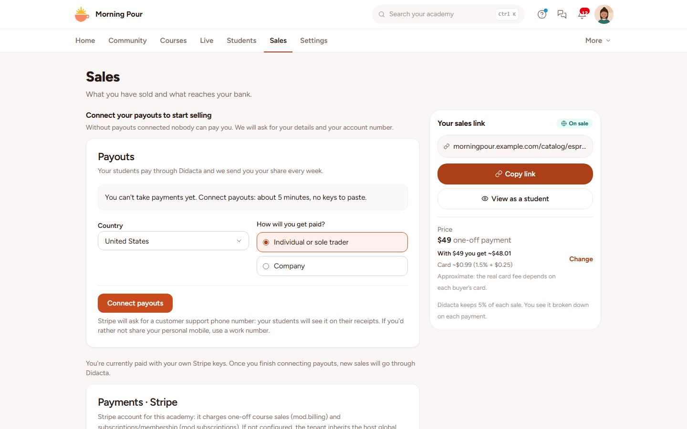

# mod.payouts — Platform payments

Community · **Core** category (always registered) · **inert unless the operator turns platform mode on**

## What it does

Lets **the operator of the installation collect in their own Stripe account and split the money** between creators: the creator receives `sale − Stripe's actual fee − the operator's commission`. It is the mode [Didacta Cloud](../../cloud/payouts.md) runs on; the creator does not paste Stripe keys, they connect a payments account and the platform does the rest.

The money domain lives here: the creator's connected account, the split of every sale, the ledger, debts, refunds, disputes, reconciliation against Stripe, the creator's tax details and the monthly commission invoice.

!!! note "A regular Community installation does not use it"
    Without `PAYMENTS_PLATFORM_STRIPE_SECRET_KEY` the module **neither reads nor writes a single row**: each academy keeps charging with its own Stripe keys (see [mod.billing](billing.md) and [mod.subscriptions](subscriptions.md)) and with no commission. This page is for whoever runs a platform with several academies and wants to collect on behalf of their creators. Didacta Cloud creators have their own guide in [Cloud → Payments and payouts](../../cloud/payouts.md).

## How it works

- **A single switch**: the `PAYMENTS_PLATFORM_STRIPE_SECRET_KEY` variable. Empty or unset, the mode is off and the other `PAYMENTS_PLATFORM_*` variables are not even read (even if they hold garbage). Set, the mode is on and **everything is validated at startup**: anything missing or wrong aborts startup with a message naming the variable. A platform that handles other people's money does not start half-configured; in particular, a key without `PAYMENTS_PLATFORM_STRIPE_WEBHOOK_SECRETS` is an error.
- **No dependencies between modules**: it does not import `mod.billing` or `mod.subscriptions`, nor do they import it. The host hands them a Stripe adapter with the Connect options and composes the three.
- **Connected account with hosted onboarding**: the creator picks a country and a type (individual/sole trader or company) under **Administration → Payments** (`/admin/payments`) and completes onboarding on Stripe. The screen says at every moment whether a detail is missing, whether Stripe is reviewing, or whether they can already sell. While the account is not ready, the academy's checkout does not open (and `/join` offers no plans).
- **Amounts always from the Stripe API**: when settling, the service re-reads the charge with its `balance_transaction` and computes the split with that payment's **actual fee**, in the settlement currency. The split is sealed before calling Stripe and a retry never recomputes it.
- **One transfer per sale**: created with `source_transaction` and a per-sale idempotency key; before creating it, Stripe is searched for an earlier transfer of that sale and, if one exists, it is adopted. A sale goes through `AWAITING_FEE` → `READY` → settled, or is **held** with a reason and a daily retry (restricted account, rejected transfer, refunded or disputed charge, tax details not completed).
- **Insert-only ledger**: every euro (sale, Stripe fee, operator commission, recovered debt, refund, dispute) leaves an entry that is never modified. Refunds are recorded as new entries.
- **Refunds and disputes**: the creator refunds from **Sales** (full or partial) with a preview of what is deducted from them. By default the operator returns its commission **proportionally**; the card fee (which the bank does not return) and the fee of a lost dispute are borne by the creator. If the money had already been sent and there is not enough balance, a **debt** is recorded and deducted from their next sales.
- **Reconciliation**: an hourly sweep and a deep nightly one compare the ledger with Stripe, and the operator can run it by hand (`POST /modules/payouts/admin/reconcile/run-now`). Discrepancies email the operator (`PAYMENTS_PLATFORM_OPERATOR_ALERT_EMAIL`).
- **Tax details and invoice**: transfers are **held** until the creator completes their tax details (`PAYMENTS_PLATFORM_TAX_PROFILE_REQUIRED`, on by default), which are needed for the commission invoice and for DAC7 reporting. The tax/VAT ID is validated (with a VIES lookup for intra-EU VAT). At the beginning of each month the **commission invoice** for the previous month is issued (one per academy and currency; series `DC-YYYY-NNNNNN`, corrective invoices `DCR-…`) as a PDF, with the commission VAT-inclusive and broken down according to where the creator is, and emailed; creators see them under **Payments → Invoices**. Without the issuer details (`PAYMENTS_PLATFORM_INVOICE_ISSUER_*`) nothing is invoiced and a warning is logged at startup.
- **Academy by academy**: the default commission is 5% (`PAYMENTS_PLATFORM_DEFAULT_FEE_BPS`, maximum 30%) and the operator can set a different one per academy from instance administration.

## Configuration (instance operator)

All are **instance environment variables**; there are no per-academy settings for the creator beyond onboarding and tax details. Full reference in [Environment variables → Platform payments](../../configuration/environment-variables.md#15-platform-payments-modpayouts).

| Variable | What it controls (default) |
| --- | --- |
| `PAYMENTS_PLATFORM_STRIPE_SECRET_KEY` | **Switch**. `sk_…`/`rk_…` key of the operator's account. |
| `PAYMENTS_PLATFORM_STRIPE_WEBHOOK_SECRETS` | `whsec_…` secrets of the platform webhook (1 to 3, comma-separated). Required if there is a key. |
| `PAYMENTS_PLATFORM_STRIPE_PUBLISHABLE_KEY` | `pk_…` key to render the payment inside the sales page (optional). |
| `PAYMENTS_PLATFORM_DEFAULT_FEE_BPS` | Operator commission in basis points (`500` = 5%). |
| `PAYMENTS_PLATFORM_SUPPORTED_COUNTRIES` | Countries whose creators can be paid (EU/EEA where Stripe operates, GB, CH, US, CA). |
| `PAYMENTS_PLATFORM_PAYOUT_INTERVAL` / `_WEEKLY_DAY` / `_DELAY_DAYS` | Stripe's payout schedule to the creator's bank account (`weekly`, `monday`, 7 days). |
| `PAYMENTS_PLATFORM_MIN_BALANCE` | Cushion left in the creator's account, per currency (`eur:5000,usd:5000,gbp:5000`). |
| `PAYMENTS_PLATFORM_REFUND_PLATFORM_FEE`, `_REFUND_CARD_FEE_BEARER`, `_DISPUTE_LOSS_BEARER`, `_DISPUTE_WON_FEE_BEARER` | Who bears what when money goes back. |
| `PAYMENTS_PLATFORM_TAX_PROFILE_REQUIRED` | Hold transfers without tax details (`true`). |
| `PAYMENTS_PLATFORM_INVOICE_*` | Issuer details, series and service name of the commission invoice. |
| `PAYMENTS_PLATFORM_OPERATOR_ALERT_EMAIL` | Operator email for money alerts. |

Workers (all with an adjustable cron): `PAYOUTS_SETTLE_CRON` (settlement sweep, every minute), `PAYOUTS_ACCOUNTS_PENDING_CRON` (`*/15 * * * *`) and `PAYOUTS_ACCOUNTS_READY_CRON` (`20 3 * * *`) to sync accounts, `PAYOUTS_RECONCILE_CRON` (`7 * * * *`) and `PAYOUTS_RECONCILE_DEEP_CRON` (`40 3 * * *`) for reconciliation, and `PAYOUTS_INVOICES_CRON` (`20 6 * * *`, Madrid time) for the monthly invoice.

The platform webhook is `POST /api/v1/modules/payouts/webhook` and verifies the signature against any of the configured secrets (several, so you can rotate without downtime).

## Step by step

1. **The operator** creates the keys and the webhook in their Stripe account, sets the `PAYMENTS_PLATFORM_*` variables and restarts. If something is wrong, startup aborts with the variable's name.
2. **The creator** opens **Administration → Payments** (`/admin/payments`), clicks **"Conectar cobros"** (Connect payments), completes onboarding on Stripe and, once the card says everything is ready, fills in their **tax details**.
3. Each sale shows up under **"Tus ventas"** (Your sales) with what was paid, the card fee, the operator's fee, what they receive, when it arrives and its status (charged, on its way, sent, held, refunded, disputed…).
4. To give a payment back, **"Reembolsar"** (Refund) first shows how much is deducted from them; with a full refund the student loses access, with a partial one they keep it.
5. Every month their **commission invoice** appears under **Payments → Invoices** (PDF).

!!! note "Screenshot with platform mode on"
    `/admin/payments` only exists when platform mode is on. The screenshot is of a sample academy in **simple mode** (**Sales** tab), with platform mode turned on using made-up Stripe keys (no real account is connected): it shows the "Payouts" card before connecting, in the English interface. The screens after sign-up (account, sales, invoices) need a real Stripe account and have no screenshot. The labels quoted above are the Spanish ones of the screen.

## Dependencies

None declared (`modules: []`, `optionalModules: []`). The composition with billing and subscriptions is done by the host.

## Data model

`mod_payouts_account` (connected account) · `mod_payouts_sale` · `mod_payouts_ledger_entry` (insert-only) · `mod_payouts_debt` · `mod_payouts_refund` · `mod_payouts_dispute` · `mod_payouts_object_ref` (Stripe object → academy) · `mod_payouts_webhook_event` (idempotency) · `mod_payouts_settings` · `mod_payouts_tax_profile` · `mod_payouts_invoice`, `_invoice_item` and `_invoice_counter`.

## Permissions

`payouts.account.read`, `payouts.account.manage`, `payouts.sale.read`, `payouts.sale.refund`.

## API

`/modules/payouts` prefix: `status`, `connect`, `connect/link`, `dashboard-link`, `disconnect`, `sales`, `summary`, `sales/:id/refund-preview`, `sales/:id/refund`, `tax-profile` (GET/PUT), `invoices`, `invoices/:id/pdf`, `webhook` (Stripe) and, operator only, `admin/reconcile/run-now` and `admin/invoices/run`.

## Events

The manifest declares no events of its own (`eventsEmitted: []`, `eventsConsumed: []`): Stripe's facts arrive through the platform webhook, not through the bus.
