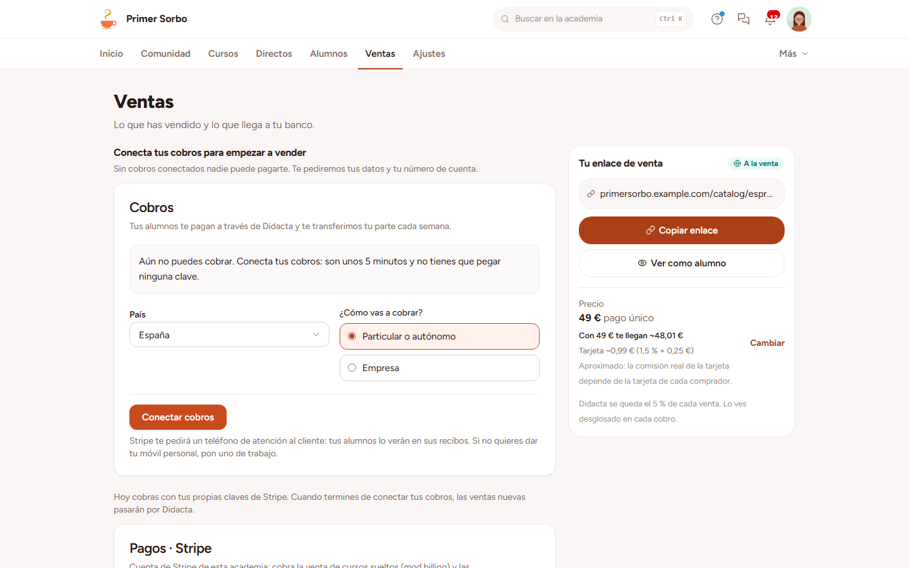

# mod.payouts — Cobros de plataforma

Community · Categoría **core** (siempre registrado) · **inerte salvo que el operador active el modo plataforma**

## Qué hace

Permite que **el operador de la instalación cobre en su propia cuenta de Stripe y reparta** el dinero a cada creador: al creador le llega `venta − comisión real de Stripe − comisión del operador`. Es el modo con el que funciona [Didacta Cloud](../../cloud/payouts.md); el creador no pega claves de Stripe, conecta una cuenta de cobros y el resto lo hace la plataforma.

Aquí vive el dominio del dinero: cuenta conectada del creador, reparto de cada venta, libro mayor, deudas, reembolsos, disputas, conciliación con Stripe, datos fiscales del creador y la factura mensual de la comisión.

!!! note "Una instalación Community normal no lo usa"
    Sin `PAYMENTS_PLATFORM_STRIPE_SECRET_KEY` el módulo **no consulta ni escribe una sola fila**: cada aula sigue cobrando con sus propias claves de Stripe (véase [mod.billing](billing.md) y [mod.subscriptions](subscriptions.md)) y sin comisión. Esta página es para quien opera una plataforma con varias aulas y quiere cobrar en nombre de sus creadores. Los creadores de Didacta Cloud tienen la guía propia en [Cloud → Cobros y pagos](../../cloud/payouts.md).

## Cómo funciona

- **Interruptor único**: la variable `PAYMENTS_PLATFORM_STRIPE_SECRET_KEY`. Vacía o sin definir, el modo está apagado y el resto de variables `PAYMENTS_PLATFORM_*` ni se leen (aunque traigan basura). Definida, el modo está encendido y **todo se valida al arrancar**: lo que falte o esté mal aborta el arranque con un mensaje que nombra la variable. Una plataforma que cobra dinero ajeno no arranca a medias; en particular, clave sin `PAYMENTS_PLATFORM_STRIPE_WEBHOOK_SECRETS` es un error.
- **Sin dependencias entre módulos**: no importa `mod.billing` ni `mod.subscriptions`, ni ellos a él. El host les pasa un adaptador de Stripe con las opciones de Connect y compone los tres.
- **Cuenta conectada con alta alojada**: el creador elige país y tipo (particular/autónomo o empresa) en **Administración → Cobros** (`/admin/payments`) y completa el alta en Stripe. La pantalla le dice en cada momento si falta un dato, si Stripe está revisando o si ya puede vender. Mientras la cuenta no está lista, la compra del aula no se abre (y `/join` no ofrece planes).
- **Importes siempre de la API de Stripe**: al liquidar, el servicio relee el cargo con su `balance_transaction` y calcula el reparto con la **comisión real** de ese cobro, en la divisa de liquidación. El reparto se sella antes de llamar a Stripe y un reintento nunca lo recalcula.
- **Una transferencia por venta**: se crea con `source_transaction` y una clave de idempotencia por venta; antes de crearla se busca en Stripe una transferencia previa de esa venta y, si existe, se adopta. Una venta pasa por `AWAITING_FEE` → `READY` → liquidada, o se queda **retenida** con motivo y reintento diario (cuenta restringida, transferencia rechazada, cargo reembolsado o disputado, datos fiscales sin completar).
- **Libro mayor de solo inserción**: cada euro (venta, comisión de Stripe, comisión del operador, deuda recuperada, reembolso, disputa) deja un asiento que no se modifica nunca. Los reembolsos de pagos posteriores se apuntan como asientos nuevos.
- **Reembolsos y disputas**: el creador reembolsa desde **Ventas** (total o parcial) con una vista previa de lo que se le descuenta. Por defecto el operador devuelve su comisión **en proporción**, la comisión de la tarjeta (que el banco no devuelve) la asume el creador, igual que la tasa de una disputa perdida. Si el dinero ya se le había enviado y no hay saldo suficiente, se anota una **deuda** que se descuenta de sus próximas ventas.
- **Conciliación**: un barrido horario y otro nocturno profundo comparan el libro con Stripe, y el operador puede lanzarlo a mano (`POST /modules/payouts/admin/reconcile/run-now`). Las discrepancias avisan por correo al operador (`PAYMENTS_PLATFORM_OPERATOR_ALERT_EMAIL`).
- **Datos fiscales y factura**: las transferencias se **retienen** hasta que el creador complete sus datos fiscales (`PAYMENTS_PLATFORM_TAX_PROFILE_REQUIRED`, activo por defecto) porque son necesarios para la factura de la comisión y para el reporte DAC7. El NIF/VAT se valida (con consulta a VIES para el IVA intracomunitario). A principios de cada mes se emite la **factura de la comisión** del mes anterior (una por aula y moneda; serie `DC-AAAA-NNNNNN`, rectificativas `DCR-…`) en PDF, con la comisión con el IVA incluido y desglosado según dónde esté el creador, y se envía por correo; el creador las ve en **Cobros → Facturas**. Sin los datos del emisor (`PAYMENTS_PLATFORM_INVOICE_ISSUER_*`) no se factura y se avisa al arrancar.
- **Aula a aula**: la comisión por defecto es el 5 % (`PAYMENTS_PLATFORM_DEFAULT_FEE_BPS`, máximo 30 %) y el operador puede fijar una distinta por aula desde la administración de instancia.

## Configuración (operador de la instancia)

Todas son **variables de entorno de instancia**; no hay ajustes por aula para el creador más allá del alta y los datos fiscales. Referencia completa en [Variables de entorno → Cobros de plataforma](../../configuration/environment-variables.md#15-cobros-de-plataforma-modpayouts).

| Variable | Qué controla (por defecto) |
| --- | --- |
| `PAYMENTS_PLATFORM_STRIPE_SECRET_KEY` | **Interruptor**. Clave `sk_…`/`rk_…` de la cuenta del operador. |
| `PAYMENTS_PLATFORM_STRIPE_WEBHOOK_SECRETS` | Secretos `whsec_…` del webhook de plataforma (1 a 3, separados por comas). Obligatoria si hay clave. |
| `PAYMENTS_PLATFORM_STRIPE_PUBLISHABLE_KEY` | Clave `pk_…` para pintar el pago dentro de la ficha de venta (opcional). |
| `PAYMENTS_PLATFORM_DEFAULT_FEE_BPS` | Comisión del operador en puntos básicos (`500` = 5 %). |
| `PAYMENTS_PLATFORM_SUPPORTED_COUNTRIES` | Países a cuyos creadores se paga (UE/EEE donde opera Stripe, GB, CH, US, CA). |
| `PAYMENTS_PLATFORM_PAYOUT_INTERVAL` / `_WEEKLY_DAY` / `_DELAY_DAYS` | Calendario de pago de Stripe a la cuenta bancaria del creador (`weekly`, `monday`, 7 días). |
| `PAYMENTS_PLATFORM_MIN_BALANCE` | Colchón que se deja en la cuenta del creador, por divisa (`eur:5000,usd:5000,gbp:5000`). |
| `PAYMENTS_PLATFORM_REFUND_PLATFORM_FEE`, `_REFUND_CARD_FEE_BEARER`, `_DISPUTE_LOSS_BEARER`, `_DISPUTE_WON_FEE_BEARER` | Quién asume qué cuando el dinero vuelve. |
| `PAYMENTS_PLATFORM_TAX_PROFILE_REQUIRED` | Retener transferencias sin datos fiscales (`true`). |
| `PAYMENTS_PLATFORM_INVOICE_*` | Datos del emisor, serie y nombre del servicio de la factura de la comisión. |
| `PAYMENTS_PLATFORM_OPERATOR_ALERT_EMAIL` | Correo del operador para las alertas de dinero. |

Workers (todos con cron ajustable): `PAYOUTS_SETTLE_CRON` (barrido de liquidación, cada minuto), `PAYOUTS_ACCOUNTS_PENDING_CRON` (`*/15 * * * *`) y `PAYOUTS_ACCOUNTS_READY_CRON` (`20 3 * * *`) para sincronizar cuentas, `PAYOUTS_RECONCILE_CRON` (`7 * * * *`) y `PAYOUTS_RECONCILE_DEEP_CRON` (`40 3 * * *`) para la conciliación, y `PAYOUTS_INVOICES_CRON` (`20 6 * * *`, hora de Madrid) para la factura mensual.

El webhook de plataforma es `POST /api/v1/modules/payouts/webhook` y verifica la firma contra cualquiera de los secretos configurados (varios para poder rotar sin cortes).

## Uso paso a paso

1. **El operador** crea las claves y el webhook en su cuenta de Stripe, define las variables `PAYMENTS_PLATFORM_*` y reinicia. Si algo está mal, el arranque aborta con el nombre de la variable.
2. **El creador** entra en **Administración → Cobros** (`/admin/payments`), pulsa **«Conectar cobros»**, completa el alta en Stripe y, cuando la tarjeta dice «Todo listo», rellena sus **datos fiscales**.
3. Cada venta aparece en **«Tus ventas»** con lo pagado, la comisión de la tarjeta, la del operador, lo que recibe, cuándo llega y su estado (cobrada, en camino, enviada, retenida, reembolsada, reclamada…).
4. Para devolver un pago, **«Reembolsar»** enseña antes cuánto se le descuenta; con un reembolso total el alumno pierde el acceso, con uno parcial lo conserva.
5. Cada mes aparece su **factura de la comisión** en **Cobros → Facturas** (PDF).

!!! note "Captura con el modo plataforma encendido"
    `/admin/payments` solo existe cuando el modo plataforma está encendido. La captura es de una aula de ejemplo, en **modo sencillo** (pestaña **Ventas**), con el modo plataforma activado con claves de Stripe inventadas (no hay ninguna cuenta real conectada): enseña la tarjeta «Cobros» antes de conectar. Las pantallas posteriores al alta (cuenta, ventas, facturas) necesitan una cuenta de Stripe de verdad y no llevan captura.

## Dependencias

Ninguna declarada (`modules: []`, `optionalModules: []`). La composición con billing y subscriptions la hace el host.

## Modelo de datos

`mod_payouts_account` (cuenta conectada) · `mod_payouts_sale` · `mod_payouts_ledger_entry` (solo inserción) · `mod_payouts_debt` · `mod_payouts_refund` · `mod_payouts_dispute` · `mod_payouts_object_ref` (objeto de Stripe → aula) · `mod_payouts_webhook_event` (idempotencia) · `mod_payouts_settings` · `mod_payouts_tax_profile` · `mod_payouts_invoice`, `_invoice_item` y `_invoice_counter`.

## Permisos

`payouts.account.read`, `payouts.account.manage`, `payouts.sale.read`, `payouts.sale.refund`.

## API

Prefijo `/modules/payouts`: `status`, `connect`, `connect/link`, `dashboard-link`, `disconnect`, `sales`, `summary`, `sales/:id/refund-preview`, `sales/:id/refund`, `tax-profile` (GET/PUT), `invoices`, `invoices/:id/pdf`, `webhook` (Stripe) y, solo operador, `admin/reconcile/run-now` y `admin/invoices/run`.

## Eventos

El manifest no declara eventos propios (`eventsEmitted: []`, `eventsConsumed: []`): los hechos de Stripe llegan por el webhook de plataforma, no por el bus.
