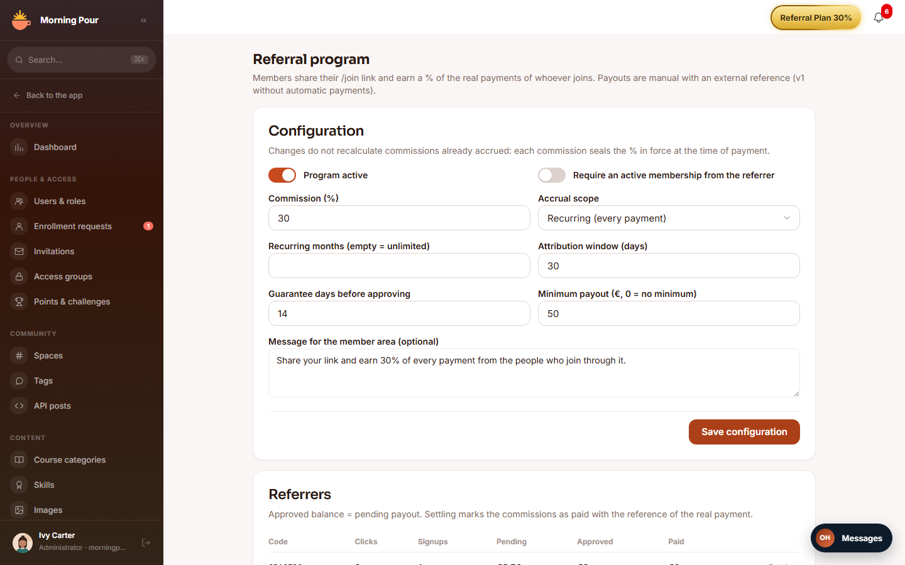
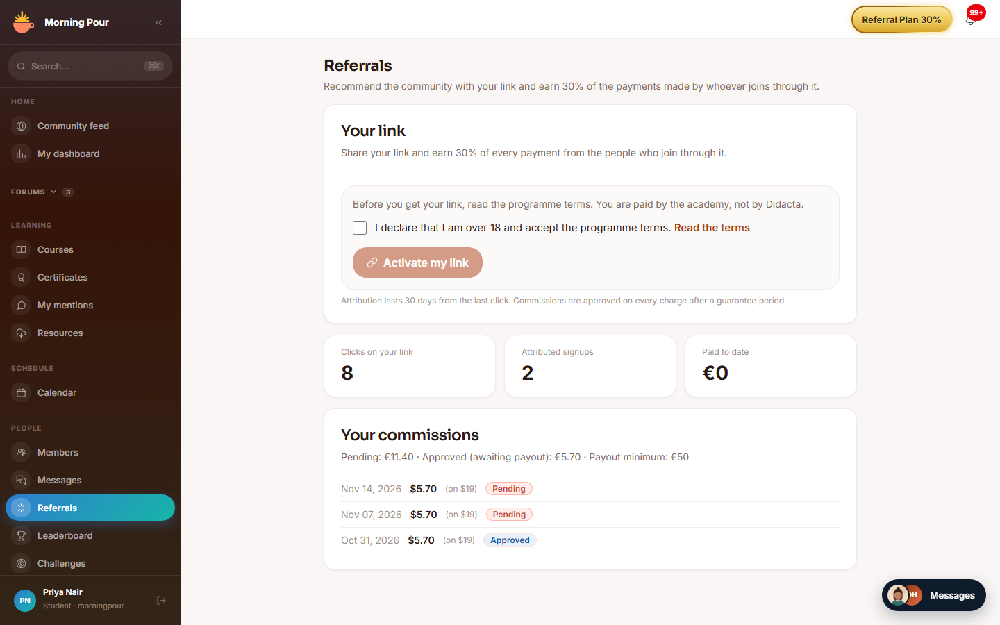
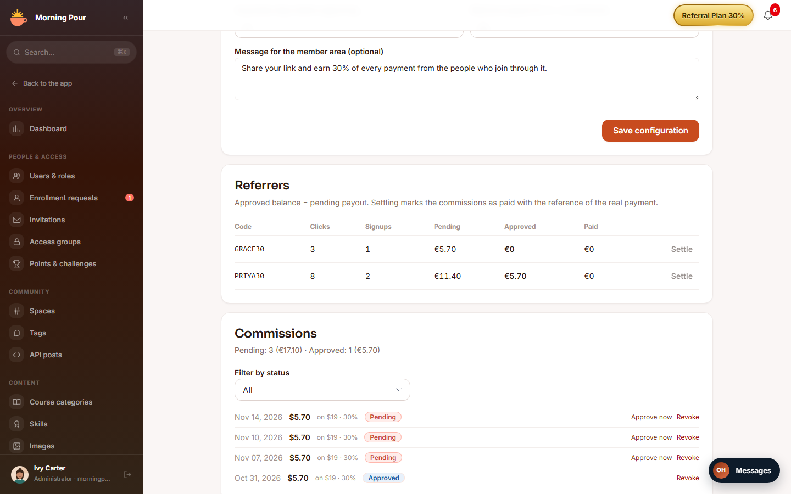

# mod.referrals — Referral program

Community · **Core** category (always active)

## What it does

The referral program for **everything the academy sells** (the membership and single courses): every member has their own code and link (`/join?ref=CODE`; the same `?ref=` works on `/catalog` and on each course's sales page, `/catalog/<slug>?ref=CODE`) and, if someone arrives through it and **pays**, the referrer earns a percentage of the actual charge. The operator configures everything from the panel without touching code: percentage (`commissionBps`), scope (first payment only, or recurring with a month limit), attribution window, guarantee period, minimum payout and whether the referrer must hold an active membership.

## How it works

The full cycle: click (deduplicated by code + day + **hash of the IP address** — the IP is never stored in the clear) → checkout with the code in Stripe's metadata → **attribution** during webhook fulfillment (idempotent and anti-self-referral) → a `PENDING` commission for every membership invoice or course purchase paid within scope → `APPROVED` once the guarantee period elapses (automatic worker) → **collected** by the referrer (a discount on their fee, or money with a manual payout by the admin and an external reference) → `PAID`.

- **Refunds**: a **full** one voids a commission that has not been collected (`PENDING`/`APPROVED`); a **partial** one trims it in the same proportion (using the cumulative amount refunded, so a redelivered event does not trim twice). If the commission had already been collected or reserved in a payout, a negative **adjustment** is created and deducted from whatever the referrer earns next: they are never asked for money back.
- **Terms and age**: before getting a link, the referrer declares they are **over 18** and accepts the current version of the "Invite and earn" terms (version and date are stored; if they change, they accept again). The terms are public at `/referral-terms`. Without accepting them there is no link and no commissions are attributed.
- **Collecting earnings** (once a commission is `APPROVED`): as a **discount on their next membership fee** — credited as a Stripe customer balance, capped at 80% of one fee, and the invoice shows it as "Pago con saldo de referidos" (paid with referral balance); if they cancel with an unused discount, the balance returns to their wallet (`referrals.credit.returned`) — or as **money**, giving name, tax ID and IBAN (stored encrypted), subject to the academy's minimum payout. The admin makes the transfer and marks it paid with its reference: a **PDF receipt** is generated that both can download.
- The referrer sees the list of **their invitees** (initials and status only: on trial, paying, bought a course, cancelled…).
- If the academy requires an active membership from the referrer, a membership **on pause** (the cancellation offer of [mod.subscriptions](subscriptions.md)) counts as live.
- The referrer gets an in-app notification + email when they earn a commission and when a payout is settled (templates editable under Administration → Emails).
- With the program disabled, the public endpoints behave as if it did not exist (404).

!!! note "Screenshots in full mode"
    The screenshots on this page come from **full mode** (side menu), the mode a new installation starts in. In **simple mode** the same routes are still available from "More", except for the screens that mode replaces with a simplified version (the course editor, Settings, Sales, Students, Live, the community and Referrals); to use them as shown here, switch to full mode under **Settings → "Use the full mode"**.

## Configuration

The module belongs to the **core** category (always registered), but the **program starts disabled**: until the admin switches it on, the public endpoints return 404 and members see nothing. Nothing requires an Enterprise licence.

Everything is configured per tenant under `/admin/referrals` (**"Referral program"**), card **"Configuration"** — changes do **not** recalculate commissions already accrued (each commission seals the % in force when it was charged):

| Panel field | What it controls (default) |
| --- | --- |
| **"Program active"** | The master switch (off). |
| **"Require an active membership from the referrer"** | Without a live membership (`ACTIVE`/`TRIALING`), no link and no accrual (off). |
| **"Commission (%)"** | Percentage over the actual charge (30%). |
| **"Accrual scope"** | **"Recurring (every payment)"** or **"First payment only"** (recurring). |
| **"Recurring months (empty = unlimited)"** | Time cap of the recurring accrual since attribution (unlimited). |
| **"Attribution window (days)"** | Lifetime of the stored code after a click, last-click (30). |
| **"Guarantee days before approving"** | Time in `PENDING` before automatic approval (14). |
| **"Minimum payout (€, 0 = no minimum)"** | Minimum approved balance to settle (€50). |
| **"Message for the member area (optional)"** | The copy the member sees at `/referrals`. |

Button **"Save configuration"** ("Configuration saved. It only affects future accruals.").

The **`allowCreditRedemption`** setting ("let them use it as a discount on their fee", **on** by default) is not on this card: it is changed in simple mode, under Sales → **"Your students sell for you"** → *"Let them use it as a discount on their fee"*, or through the API (`PUT /modules/referrals/admin/config`). Right there, **"Payment requests"** lists the cash payouts students have requested, with **"Mark as paid"** (transfer reference) and the receipt. Full mode has no screen yet for those cash payouts: use the API (`GET /modules/referrals/admin/cash-payouts`, `POST …/:id/paid`).

Environment variable (instance): `REFERRALS_APPROVAL_CRON` — cron of the worker approving commissions whose guarantee elapsed (`30 * * * *`, hourly).

Practical requirement: the program only generates commissions if the academy **sells something through Stripe**: the membership ([mod.subscriptions](subscriptions.md)), whose attribution travels in the `/join` checkout, or single courses ([mod.billing](billing.md)), whose checkout carries the `?ref=` through to the commission. On the **Sales** screen ([mod.billing → Sales](billing.md#sales)) each sale shows who brought it and the commission.

## Step-by-step usage

1. Enable the program under `/admin/referrals`: switch on **"Program active"**, adjust commission, scope and guarantee → **"Save configuration"**.
2. The member opens `/referrals` (**"Referrals"**): the page generates their code on demand and shows **"Your link"** with the **"Copy link"** button, plus their real results — **"Clicks on your link"**, **"Attributed signups"**, **"Paid to date"** — and the **"Your commissions"** / **"Payouts received"** history. If the program requires a membership and they lack one, the page tells them what is missing.

    

    In simple mode, the member area is "Invite and earn" (avatar menu): how it works, their invitees (initials only) and what they have earned, with the acceptance of the programme terms before sharing the link, per-product links (the membership or a specific course), **"Use as a discount on my next fee"** and **"Get paid in money"** (with their payout details and, once paid, **"Download receipt"**). In both modes, the first time they are asked to accept the terms before seeing the link.

3. The member shares `/join?ref=THEIRCODE` (or a course's link). The click is recorded (deduplicated by day and hashed IP) and the code is stored in the visitor's browser (last-click, for the attribution window) — it later travels in the membership or course checkout metadata.
4. When the referred person pays: attribution materialises during webhook fulfillment (first-touch, once per user; self-referral is blocked by user and by email). Every paid invoice or purchase with an amount > €0 within scope accrues a `PENDING` commission; €0 trials and 100% coupons accrue nothing.
5. Once the guarantee elapses, the worker approves commissions on its own (`APPROVED`). The admin can also move earlier with **"Approve now"** or withdraw one with **"Revoke"** (reason required, the member will see it) in the **"Commissions"** card, with its status filter.
6. Payout: in the **"Referrers"** card, each referrer's **"Settle"** button asks for the **external reference** of the actual payment (bank transfer, PayPal…) and marks the approved batch as `PAID` — all or nothing, no mixed currencies, and only above the minimum. Without Stripe Connect: the money moves outside Didacta. (If the student requested the payout themselves with their details, it is handled under **"Payment requests"**, see above.)

    

7. A refund of the source charge voids or trims the commission if it was not yet collected; if it already was, it creates an adjustment deducted from whatever the referrer earns next.

## Permissions

`referrals.code.read`, `referrals.commission.manage` and `referrals.config.manage`; the `admin/*` endpoints additionally require the `tenant_admin` or `super_admin` role.

## Dependencies

Optional: `mod.subscriptions` (checking that the referrer's membership is live).

## Data model

`mod_referrals_config` (per-tenant policy) · `mod_referrals_member` (terms acceptance and encrypted payout details) · `mod_referrals_code` (one unique code per user) · `mod_referrals_click` (deduplicated clicks) · `mod_referrals_referral` (attribution) · `mod_referrals_commission` (one per Stripe invoice) · `mod_referrals_payout` (payouts, in money or as a fee discount). Commissions can also be refund adjustments or a balance returned on cancellation.

## API

Prefix `/modules/referrals` (member: `me`, `me/stats`, `me/invitees`, `me/terms`, `me/payee`, `me/payouts`, `me/redeem-credit`; public: `track`, `public/terms`; admin: `admin/config`, `admin/commissions`, `admin/referrers`, `admin/payouts`, `admin/cash-payouts`). Details in [Reference → Community and people](../../api/reference/community.md#referrals-modulesreferrals).

## Events

- **Emits**: `referrals.referral.attributed`, `referrals.commission.created/approved/revoked`, `referrals.payout.recorded`, `referrals.credit.returned`.
- **Consumes** (through a bridge): `subscriptions.membership.activated`, `subscriptions.invoice.paid`, `subscriptions.invoice.refunded`, `subscriptions.invoice.partially_refunded`, `subscriptions.subscription.canceled`, `billing.order.completed`, `billing.order.refunded`, `billing.order.partially_refunded`.
