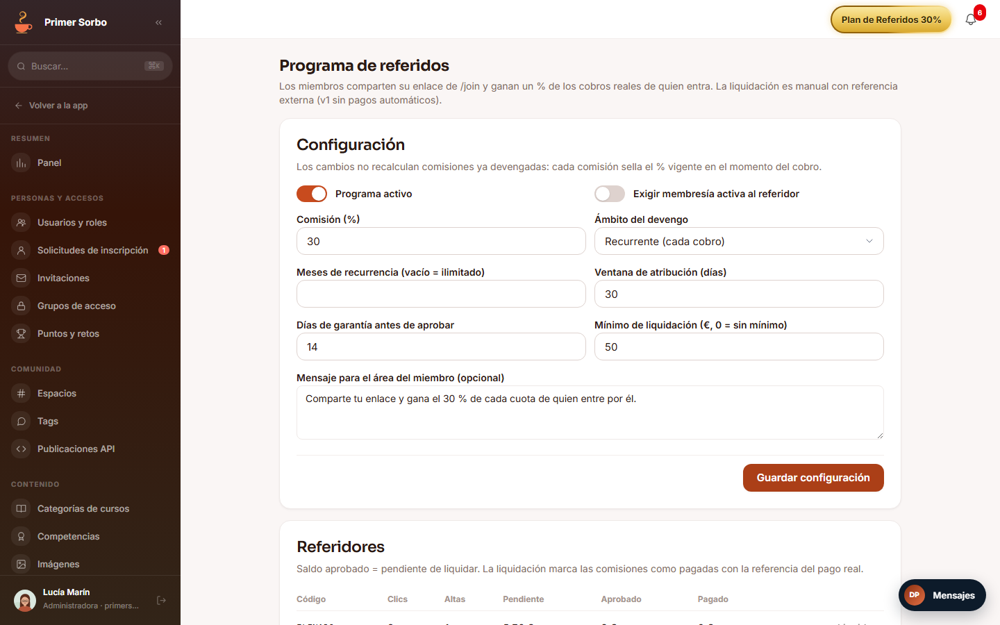
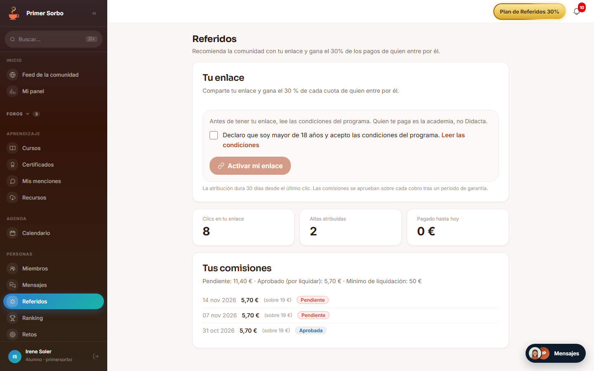
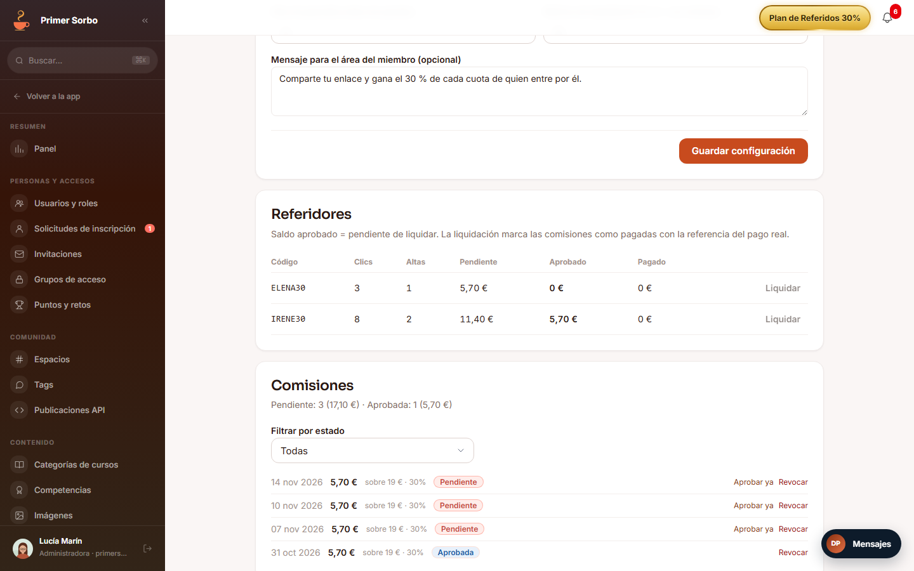

# mod.referrals — Programa de referidos

Community · Categoría **core** (siempre activo)

## Qué hace

Programa de referidos de **todo lo que vende el aula** (la membresía y los cursos sueltos): cada miembro tiene un código y enlace propios (`/join?ref=CODIGO`; el mismo `?ref=` vale en `/catalog` y en la ficha de cada curso, `/catalog/<slug>?ref=CODIGO`) y, si alguien entra por él y **paga**, el referidor devenga un porcentaje del cobro real. El operador configura todo desde el panel sin tocar código: porcentaje (`commissionBps`), ámbito (solo primer pago o recurrente con límite de meses), ventana de atribución, periodo de garantía, mínimo de liquidación y si exige membresía activa del referidor.

## Cómo funciona

El ciclo completo: clic (deduplicado por código + día + **hash de la IP** — la IP nunca se guarda en claro) → checkout con el código en la metadata de Stripe → **atribución** en el fulfillment del webhook (idempotente y anti-auto-referido) → comisión `PENDING` por cada factura de membresía o compra de curso pagada dentro del ámbito → `APPROVED` al vencer la garantía (worker automático) → **cobro** por el referidor (descuento en su cuota, o dinero con liquidación manual del admin y referencia externa) → `PAID`.

- **Reembolsos**: uno **total** anula la comisión sin cobrar (`PENDING`/`APPROVED`); uno **parcial** la recorta en la misma proporción (con lo devuelto acumulado, así un evento reentregado no recorta dos veces). Si la comisión ya estaba cobrada o reservada en un cobro, se crea un **ajuste** negativo que se descuenta de lo siguiente que gane el referidor: nunca se le reclama dinero.
- **Condiciones y mayoría de edad**: antes de tener enlace, el referidor declara ser **mayor de 18 años** y acepta la versión vigente de las condiciones de «Invita y gana» (se guardan versión y fecha; si cambian, vuelve a aceptar). Las condiciones son públicas en `/referral-terms`. Sin aceptarlas no hay enlace ni se atribuyen comisiones.
- **Cobrar lo ganado** (cuando la comisión está `APPROVED`): como **descuento en su próxima cuota** de membresía —se abona como saldo de cliente en Stripe, con tope del 80 % de una cuota, y la factura lo muestra como «Pago con saldo de referidos»; si se da de baja con descuento sin usar, el saldo vuelve a su cartera (`referrals.credit.returned`)— o en **dinero**, dando nombre, NIF/identificador fiscal e IBAN (se guardan cifrados), con el mínimo de liquidación del aula. El admin hace la transferencia y la marca como pagada con su referencia: se genera un **justificante en PDF** descargable por ambos.
- El referidor ve la lista de **sus invitados** (solo iniciales y estado: en prueba, pagando, compró un curso, se dio de baja…).
- Si el aula exige membresía activa al referidor, una membresía **en pausa** (oferta al darse de baja de [mod.subscriptions](subscriptions.md)) cuenta como viva.
- El referidor recibe notificación in-app + email al ganar comisión y al cobrar liquidación (plantillas editables en Administración → Emails).
- Con el programa desactivado, los endpoints públicos se comportan como si no existiera (404).

!!! note "Capturas en modo completo"
    Las capturas de esta página son del **modo completo** (menú lateral), el de una instalación nueva. En **modo sencillo** las mismas rutas siguen disponibles desde «Más», salvo las pantallas que ese modo sustituye por una versión simplificada (el editor de cursos, Ajustes, Ventas, Alumnos, Directos, la comunidad y Referidos); para usarlas tal como se ven aquí, cambia al modo completo en **Ajustes → «Usar el modo completo»**.

## Configuración

El módulo es de categoría **core** (siempre registrado), pero el **programa nace desactivado**: hasta que el admin lo enciende, los endpoints públicos devuelven 404 y los miembros no ven nada. Nada exige licencia Enterprise.

Todo se configura por tenant en `/admin/referrals` (**«Programa de referidos»**), tarjeta **«Configuración»** — los cambios **no** recalculan comisiones ya devengadas (cada comisión sella el % vigente al cobrarse):

| Campo del panel | Qué controla (default) |
| --- | --- |
| **«Programa activo»** | Interruptor general (apagado). |
| **«Exigir membresía activa al referidor»** | Sin membresía viva (`ACTIVE`/`TRIALING`), ni enlace ni devengo (apagado). |
| **«Comisión (%)»** | Porcentaje sobre el cobro real (30 %). |
| **«Ámbito del devengo»** | **«Recurrente (cada cobro)»** o **«Solo el primer cobro»** (recurrente). |
| **«Meses de recurrencia (vacío = ilimitado)»** | Tope temporal del devengo recurrente desde la atribución (ilimitado). |
| **«Ventana de atribución (días)»** | Vida del código guardado tras el clic, last-click (30). |
| **«Días de garantía antes de aprobar»** | Tiempo en `PENDING` antes de la aprobación automática (14). |
| **«Mínimo de liquidación (€, 0 = sin mínimo)»** | Saldo aprobado mínimo para poder liquidar (50 €). |
| **«Mensaje para el área del miembro (opcional)»** | Copy que ve el miembro en `/referrals`. |

Botón **«Guardar configuración»** («Configuración guardada. Solo afecta a devengos futuros.»).

El ajuste **`allowCreditRedemption`** («dejar que lo usen como descuento en su cuota», **encendido** por defecto) no está en esta tarjeta: se cambia en el modo sencillo, en Ventas → **«Tus alumnos venden por ti»** → *«Dejar que lo usen como descuento en su cuota»*, o por API (`PUT /modules/referrals/admin/config`). Ahí mismo, **«Cobros pedidos»** lista los cobros en dinero que han pedido los alumnos, con **«Marcar como pagado»** (referencia de la transferencia) y el justificante. El modo completo no tiene aún pantalla para esos cobros en dinero: usa la API (`GET /modules/referrals/admin/cash-payouts`, `POST …/:id/paid`).

Variable de entorno (instancia): `REFERRALS_APPROVAL_CRON` — cron del worker que aprueba las comisiones con garantía vencida (`30 * * * *`, cada hora).

Requisito práctico: el programa solo genera comisiones si el aula **vende algo con Stripe**: la membresía ([mod.subscriptions](subscriptions.md)), cuya atribución viaja en el checkout de `/join`, o cursos sueltos ([mod.billing](billing.md)), cuyo checkout lleva el `?ref=` hasta la comisión. En la pantalla de **Ventas** ([mod.billing → Ventas](billing.md#ventas)) cada venta indica quién la trajo y la comisión.

## Uso paso a paso

1. Activa el programa en `/admin/referrals`: enciende **«Programa activo»**, ajusta comisión, ámbito y garantía → **«Guardar configuración»**.
2. El miembro entra en `/referrals` (**«Referidos»**): la página genera su código bajo demanda y muestra **«Tu enlace»** con el botón **«Copiar enlace»**, más sus resultados reales — **«Clics en tu enlace»**, **«Altas atribuidas»**, **«Pagado hasta hoy»** — y el historial **«Tus comisiones»** / **«Liquidaciones recibidas»**. Si el programa exige membresía y no la tiene, la página le dice qué falta.

    

    En modo sencillo, el área del miembro es «Invita y gana» (menú del avatar): cómo funciona, sus invitados (solo iniciales) y lo que ha ganado, con la aceptación de las condiciones del programa antes de compartir el enlace, enlaces por producto (la membresía o un curso concreto), **«Usar como descuento en mi próxima cuota»** y **«Cobrar en dinero»** (con sus datos de cobro y, al pagarse, **«Descargar justificante»**). En ambos modos, la primera vez se pide aceptar las condiciones antes de ver el enlace.

3. El miembro comparte `/join?ref=SUCODIGO` (o el enlace de un curso). El clic queda registrado (deduplicado por día e IP hasheada) y el código se guarda en el navegador del visitante (last-click, durante la ventana de atribución) — viaja después en la metadata del checkout de membresía o de curso.
4. Cuando el referido paga: la atribución se materializa en el fulfillment del webhook (first-touch, una vez por usuario; el auto-referido se bloquea por usuario y por email). Cada factura o compra pagada con importe > 0 € dentro del ámbito devenga una comisión `PENDING`; el trial a 0 € y los cupones del 100 % no devengan.
5. Al vencer la garantía, el worker aprueba solas las comisiones (`APPROVED`). El admin también puede adelantarlo con **«Aprobar ya»** o retirar una con **«Revocar»** (motivo obligatorio, lo verá el miembro) en la tarjeta **«Comisiones»**, con su filtro por estado.
6. Liquidación: en la tarjeta **«Referidores»**, el botón **«Liquidar»** de cada referidor pide la **referencia externa** del pago real (transferencia, PayPal…) y marca el lote aprobado como `PAID` — todo o nada, sin mezclar monedas, y solo si supera el mínimo. Sin Stripe Connect: el dinero se mueve fuera de Didacta. (Si el alumno ha pedido él el cobro con sus datos, se gestiona desde **«Cobros pedidos»**, ver arriba.)

    

7. Un reembolso del cobro origen anula o recorta la comisión si aún no se cobró; si ya estaba cobrada, genera un ajuste que se descuenta de lo siguiente que gane el referidor.

## Permisos

`referrals.code.read`, `referrals.commission.manage` y `referrals.config.manage`; los endpoints `admin/*` exigen además rol `tenant_admin` o `super_admin`.

## Dependencias

Opcional: `mod.subscriptions` (comprobar membresía viva del referidor).

## Modelo de datos

`mod_referrals_config` (política por tenant) · `mod_referrals_member` (aceptación de condiciones y datos de cobro cifrados) · `mod_referrals_code` (código único por usuario) · `mod_referrals_click` (clics deduplicados) · `mod_referrals_referral` (atribución) · `mod_referrals_commission` (única por factura de Stripe) · `mod_referrals_payout` (liquidaciones, en dinero o como descuento en cuota). Las comisiones también pueden ser ajustes por devolución o saldo devuelto al darse de baja.

## API

Prefijo `/modules/referrals` (miembro: `me`, `me/stats`, `me/invitees`, `me/terms`, `me/payee`, `me/payouts`, `me/redeem-credit`; público: `track`, `public/terms`; admin: `admin/config`, `admin/commissions`, `admin/referrers`, `admin/payouts`, `admin/cash-payouts`). Detalle en [Referencia → Comunidad y personas](../../api/reference/community.md#referidos-modulesreferrals).

## Eventos

- **Emite**: `referrals.referral.attributed`, `referrals.commission.created/approved/revoked`, `referrals.payout.recorded`, `referrals.credit.returned`.
- **Consume** (vía bridge): `subscriptions.membership.activated`, `subscriptions.invoice.paid`, `subscriptions.invoice.refunded`, `subscriptions.invoice.partially_refunded`, `subscriptions.subscription.canceled`, `billing.order.completed`, `billing.order.refunded`, `billing.order.partially_refunded`.
