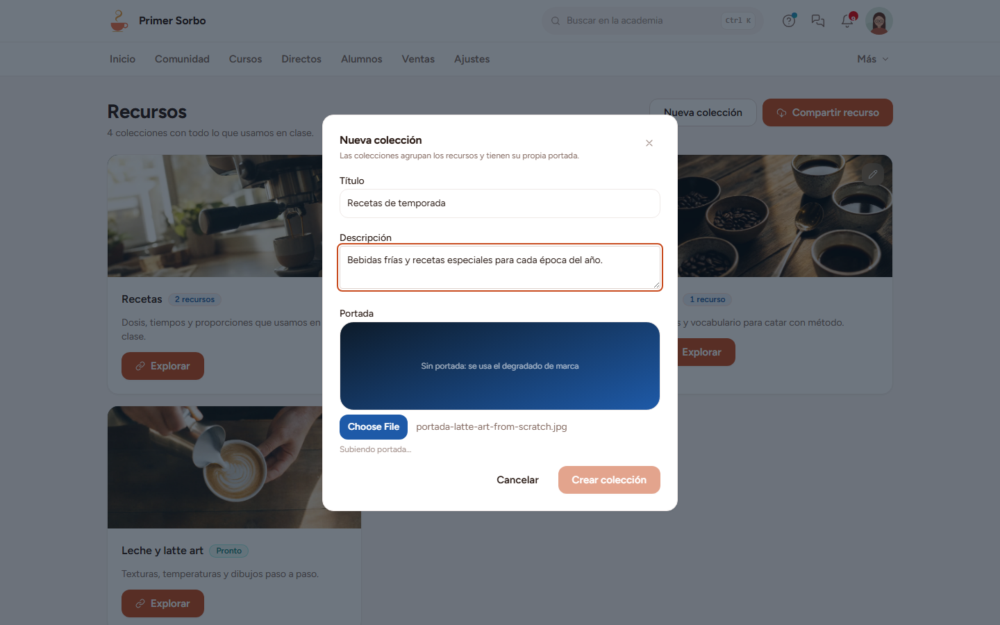
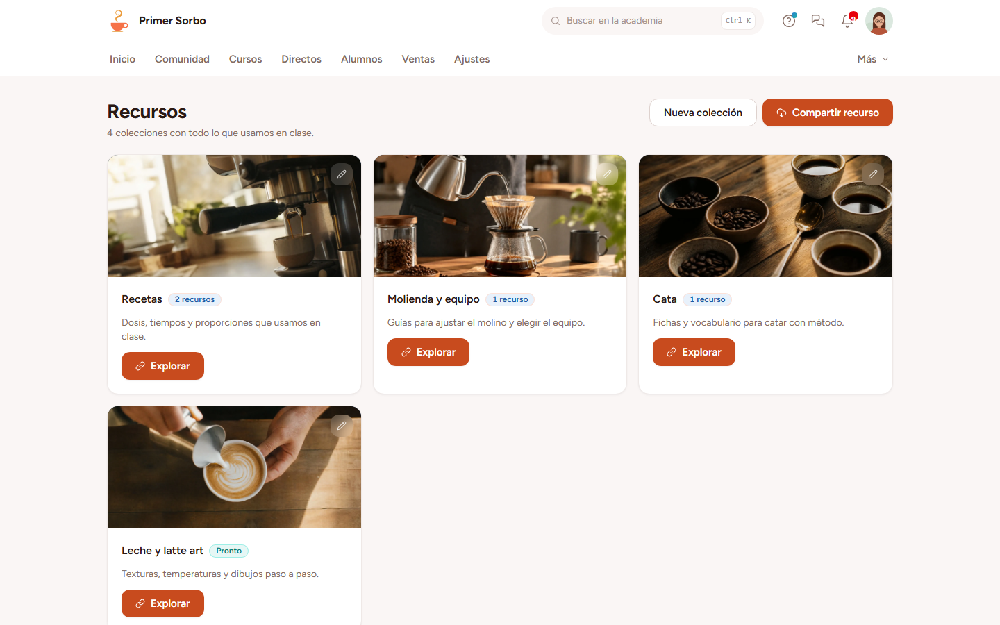
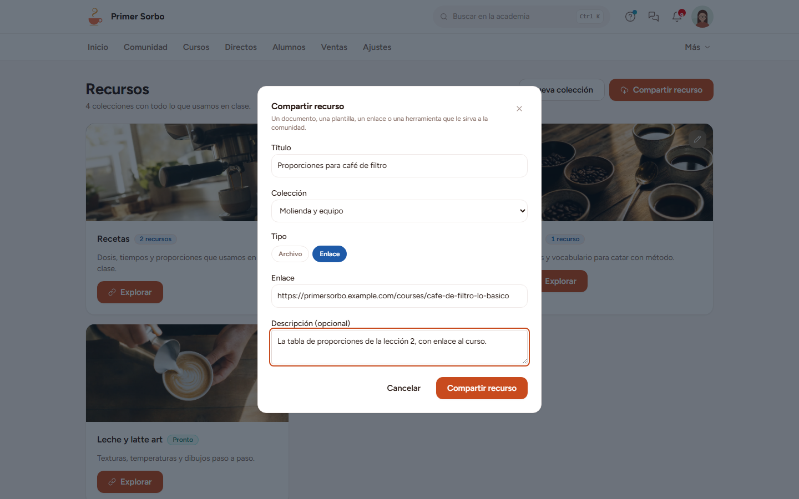
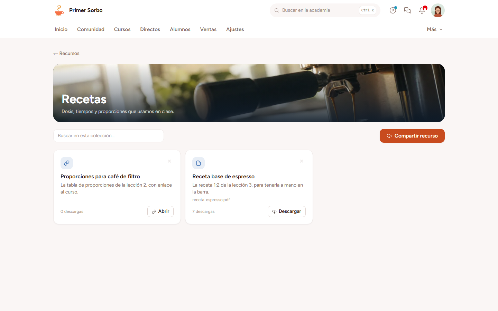

# mod.resources — Biblioteca de recursos

Community · Categoría **engagement** (desactivable)

## Qué hace

Biblioteca de recursos de la comunidad, organizados en **colecciones** y buscables: workflows de las clases, skills, directorio de herramientas de IA y plantillas. Cada recurso es un archivo subido al storage del tenant (`FILE`) o un enlace externo (`LINK`), puede quedar vinculado a la clase en directo que lo generó y lleva contador de descargas.

## Cómo funciona

- Una academia sin ninguna colección recibe, en su primera visita, **una colección neutra («General»)** en el idioma del aula (es, en o pt), editable; el staff puede crear más, con portada. Hace falta al menos una porque compartir un recurso exige elegir colección. Las aulas que ya tienen colecciones no se tocan.
- Cualquier miembro puede **compartir recursos**; borrar puede el autor (lo suyo) o el staff (cualquiera).
- El borrado de una colección con recursos dentro está **bloqueado a propósito** (`Restrict`, no cascade): hay que vaciarla antes — nunca se pierde contenido en silencio.
- `POST /:id/download` registra la descarga/apertura y devuelve la URL: el contador alimenta la ordenación por popularidad.

## Configuración

- **Activación** — `Administración → Configuración`, pestaña «Módulos» (`/admin/settings`): interruptor de «Biblioteca de recursos» (`mod.resources`). Al desactivarlo desaparece el ítem «Recursos» del grupo Aprendizaje del menú.
- **Colecciones** — no hay pantalla de administración aparte: las gestiona el staff (`super_admin`, `tenant_admin`, `formador`) desde la propia página `/resources`, con «Nueva colección» y el botón de editar de cada tarjeta. La primera visita de un aula sin colecciones siembra una, «General» («General» / «Geral» según el idioma del aula), editable.
- **Storage** — los recursos de tipo archivo suben al storage del tenant, que se configura en la pestaña «Storage» de `/admin/settings` (disco local del contenedor o bucket S3-compatible).
- Sin variables de entorno propias ni más ajustes. Ninguna función exige licencia Enterprise.

!!! note "Capturas en modo sencillo"
    Las capturas de esta página son de una academia en **modo sencillo** (pestañas arriba). Las pantallas que no tienen pestaña propia están en **«Más»**, con el mismo nombre que en el menú de administración; en **modo completo** se abren desde el menú lateral. Las rutas (`/admin/…`, `/studio/…`) son las mismas en los dos modos.

## Uso paso a paso

**El staff (admin o formador):**

1. En `/resources`, pulsa «Nueva colección»: «Título», «Descripción» y «Portada» (sin portada se usa el degradado de marca).

    

2. Edita cualquier colección con «Editar colección» (el botón de la tarjeta); cambiar la portada o el texto no toca los recursos.
3. Puede borrar cualquier recurso; una colección solo se elimina si está vacía.

**Cualquier miembro:**

1. `/resources` («Recursos», grupo Aprendizaje; en modo sencillo, en «Más») muestra la parrilla de colecciones con su número de recursos. Si la academia no tiene ninguna colección, la biblioteca crea una, «General», vacía: renómbrala o bórrala cuando tengas las tuyas. Toda colección sin recursos lleva la marca «Pronto».

    

    !!! note "La captura es de una biblioteca con varias colecciones"
        Una academia nueva ya no parte de las seis colecciones de ejemplo que se ven en la captura, sino de una sola, «General».

2. «Compartir recurso»: «Título», «Colección», tipo «Archivo» (PDF, Word, Excel, ZIP, JSON…) o «Enlace», y «Descripción (opcional)».

    

3. Dentro de una colección (`/resources/<id>`), busca con «Buscar en esta colección…» — la búsqueda corre en el servidor, dentro de esa colección.
4. «Descargar» (archivos) o «Abrir» (enlaces): cada apertura suma al contador de descargas que se ve en la tarjeta.

    

5. Cada autor puede eliminar lo suyo con la X de la tarjeta (con confirmación).

## Permisos

`resources.read` y `resources.manage`. Crear, editar y borrar colecciones exige rol `super_admin`, `tenant_admin` o `formador`.

## Dependencias

Ninguna. La referencia a la clase (`zoomSessionId`) es un ID lógico sin FK.

## Modelo de datos

`mod_resources_collection` (título único por tenant, orden, flag default) · `mod_resources_resource` (kind FILE/LINK, URL, autor, clase de origen, descargas).

## API

Prefijo `/modules/resources`. Detalle en [Referencia → Comunidad y personas](../../api/reference/community.md#recursos-modulesresources).

## Eventos

**Emite**: `resources.resource.created`, `resources.resource.deleted`, `resources.collection.created` (los dos primeros puntúan en [gamificación](gamification.md)). No consume.
