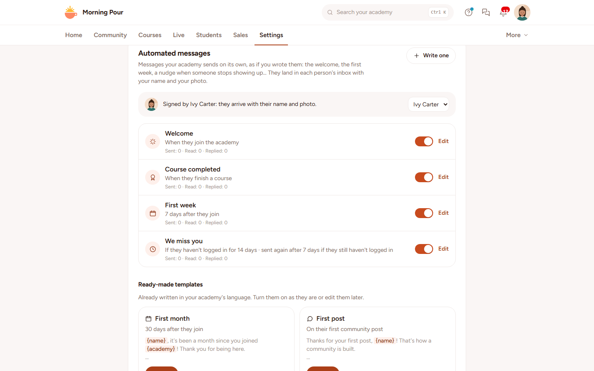
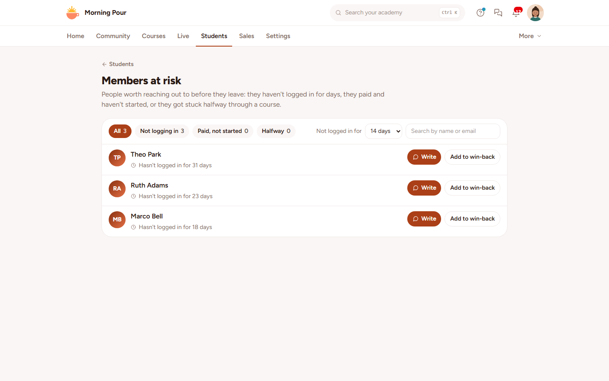

# mod.retention — Automated messages and at-risk members

Community · **Community** category (each academy can turn it off from Modules)

## What it does

Two things so that nobody leaves before you have written to them in time:

- **Automated messages**: direct messages the academy sends by itself, **as if written by whoever runs it** (with their name and photo in messaging): welcome, first week, first month, recovery if someone stops coming in, course completed, first post, level up and subscription anniversary. Each one can also carry a **copy by email**.
- **At-risk members**: a list of the people worth writing to before they leave, with a button to write to them by hand or add them to the recovery message.

## How it works

The channel is [mod.messaging](messaging.md): the module asks it to deliver a direct message; it neither reads nor writes other modules' tables. Everything it needs from the academy (members, enrolments, payments…) is handed over by the host, and facts reach it through events.

**Message types (triggers)**

| Trigger | When it is sent | Ready-made template |
| --- | --- | --- |
| On joining the academy | On sign-up. | Welcome |
| X days after joining | X days after sign-up. | First week (7), First month (30) |
| If they do not come in for X days | After X days without coming in; optional resend after N days if they still have not. | Recovery (14, resend after 7) |
| On finishing a course | On receiving `learning.course.completed`. | Course completed (needs `mod.learning`) |
| On their first post | On receiving `community.post.created` from someone who had never posted. | First post (needs `mod.community`) |
| On levelling up | On receiving `gamification.level.changed`. | Level up (needs `mod.gamification`) |
| On the anniversary | Anniversary of their subscription or membership. | Anniversary (needs `mod.subscriptions`) |

The templates come **written in the academy's language** (es, en, pt-BR), in the first person and promising nothing specific (no class, no discount, no deadline) that the person running the academy has not said: that person adds the specifics when editing. Templates whose module is off are not shown.

**Variables**: written between braces and accepted in all three languages in any academy (`{nombre}`, `{name}` and `{nome}` are equivalent): name, academy, course, course link, link to introduce yourself to the community, community link, academy link and, only on "On levelling up", the level. The list is closed: a variable that does not exist (for example, a typo) is **rejected on save** and reaches nobody.

**Rules to avoid overwhelming people** (not configurable, always on):

- At most **one automated message per day per person**: if two are due, the second waits until the next day (the more important one goes first: welcome, course completed, first post, level, X days, anniversary, recovery).
- They are **never** sent to the team (teachers and administrators).
- Nobody receives **the same message twice**.
- **From activation onward, never backwards**: switching on "after 30 days" in an academy with 500 old members does not write to all of them at once; it writes to each one when they reach 30 days counting from today.
- A message that has been unable to go out for more than a week is dropped.
- Whoever has unsubscribed from community emails does not receive the email copy.

## Configuration

Per-academy settings (no environment variables of its own except the cron):

| Setting | What it controls (default) |
| --- | --- |
| **Who signs the messages** | A team member; if not chosen, the first person who administers. |
| **Sending hours** | A window in **each person's own time** (the time zone of their profile): from 9 to 21. Outside it, the message waits until it is daytime where they live. |
| **If you wrote to them by hand** | Send anyway, or do not send if you wrote to them in the last X hours (24). |

Each message has its own switch, text, timing and, optionally, "Send also by email" with its own subject. The **preview** shows how a real person (or you) would see it, with their data.

- **Cron**: `RETENTION_CRON` (default `*/5 * * * *`, UTC) — the sweep that works out who is due each message; recomputing never duplicates anything.
- **Permission**: `retention.manage` (academy administration).
- No feature requires an Enterprise licence.

## Step by step

1. **Where it lives.** **Automated messages** are managed under **Settings → "Mensajes automáticos"** in **simple mode**; in full mode they have no screen and are handled through the [API](#api). The **at-risk members** list appears in **Students** (simple mode) and in **Administration → Users** (`/admin/users`), with its full screen at `/admin/users/at-risk`.
2. Start with a **template** (**"Activar"**): it switches on with one click and you can change it whenever you like. Or press **"Escribir uno"** to create your own: choose when it is sent, write the message, click a variable to add it and decide whether it also goes by email.
3. Each message shows its metrics: **sent, read and replied**, and how many are **queued**. It can be switched off and on without deleting it; **"Borrar"** does not touch what was already sent (it stays in the conversations).
4. **At-risk members**: filter by reason — **not coming in** (by default 14 days or more, adjustable), **paid but have not started** or **stalled** in a course — and search by name or email. **"Escribir"** sends them a direct message from you (with a starting template you can edit) and **"Añadir a recuperación"** gives them the recovery message, respecting the sending hours and the one-a-day limit (if you have not switched it on yet, the screen offers **"Activar recuperación"**).

!!! note "Screenshots in simple mode"
    The screenshots are of an academy in **simple mode** (tabs on top), with four templates turned on and sample data, in the English interface. The labels quoted above are the Spanish ones of the screen.

## Dependencies

**Required**: `mod.messaging` (the channel). **Optional**, only as a source of events and of data the host passes it: `mod.learning`, `mod.community`, `mod.gamification`, `mod.subscriptions`.

## Data model

`mod_retention_automation` (the configured messages) · `mod_retention_delivery` (each delivery, with its status: sent, read, replied, queued, skipped, failed, with email copy) · `mod_retention_settings` (signature, hours and wait after a manual message).

## API

`/modules/retention` prefix, everything under `admin/` and only for whoever administers the academy: `admin/settings` (GET/PUT), `admin/templates` and `admin/templates/:key/activate`, `admin/automations` (GET/POST) and `admin/automations/:id` (PATCH/DELETE), `admin/preview`, `admin/run` (runs the sweep for **this** academy now, with the same rules), `admin/at-risk` (`?days=&reason=&search=`) and `admin/at-risk/:userId/recovery`.

## Events

- **Emits**: `retention.message.sent`.
- **Consumes**: `learning.course.completed`, `community.post.created`, `gamification.level.changed`.
