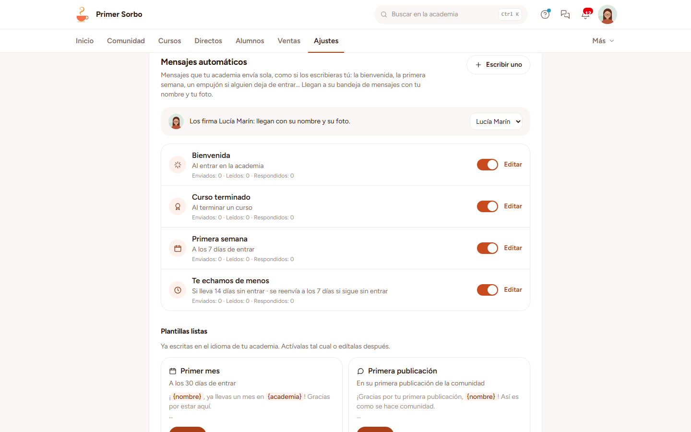
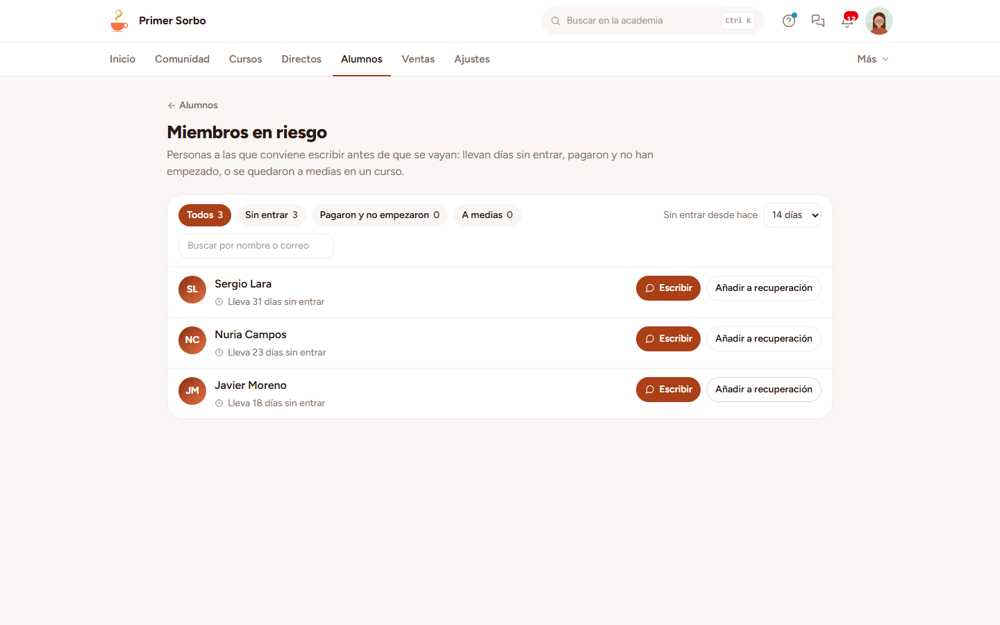

# mod.retention — Mensajes automáticos y miembros en riesgo

Community · Categoría **community** (cada academia puede apagarlo desde Módulos)

## Qué hace

Dos cosas pensadas para que nadie se vaya sin que le hayas escrito a tiempo:

- **Mensajes automáticos**: mensajes directos que el aula envía sola, **como si los escribiera quien la administra** (con su nombre y su foto en la mensajería): bienvenida, primera semana, primer mes, recuperación si alguien deja de entrar, curso terminado, primera publicación, subida de nivel y aniversario de la suscripción. Cada uno puede llevar además una **copia por correo**.
- **Miembros en riesgo**: una lista de las personas a las que conviene escribir antes de que se vayan, con un botón para escribirles a mano o meterlas en el mensaje de recuperación.

## Cómo funciona

El canal es [mod.messaging](messaging.md): el módulo le pide que entregue un mensaje directo; no lee ni escribe tablas de otros módulos. Todo lo que necesita del aula (miembros, matrículas, pagos…) se lo da el host, y los hechos le llegan por eventos.

**Tipos de mensaje (disparadores)**

| Disparador | Cuándo se envía | Plantilla lista |
| --- | --- | --- |
| Al entrar en la academia | Al darse de alta. | Bienvenida |
| A los X días de entrar | X días después del alta. | Primera semana (7), Primer mes (30) |
| Si no entra en X días | Al llevar X días sin entrar; reenvío opcional a los N días si sigue sin entrar. | Recuperación (14, reenvío a los 7) |
| Al terminar un curso | Al recibir `learning.course.completed`. | Curso terminado (requiere `mod.learning`) |
| En su primera publicación | Al recibir `community.post.created` de alguien que nunca había publicado. | Primera publicación (requiere `mod.community`) |
| Al subir de nivel | Al recibir `gamification.level.changed`. | Subida de nivel (requiere `mod.gamification`) |
| En el aniversario | Aniversario de su suscripción o membresía. | Aniversario (requiere `mod.subscriptions`) |

Las plantillas vienen **escritas en el idioma del aula** (es, en, pt-BR), en primera persona y sin prometer nada concreto (ni una clase, ni un descuento, ni un plazo) que quien administra no haya dicho: lo concreto lo pone esa persona al editar. Las plantillas cuyo módulo está apagado no se muestran.

**Variables**: se escriben entre llaves y se aceptan en los tres idiomas en cualquier aula (`{nombre}`, `{name}` y `{nome}` valen igual): nombre, academia, curso, enlace al curso, enlace para presentarse a la comunidad, enlace a la comunidad, enlace a la academia y, solo en «Al subir de nivel», el nivel. La lista es cerrada: una variable que no existe (por ejemplo, una errata) **se rechaza al guardar** y no le llega a nadie.

**Reglas para no agobiar** (no se configuran, van siempre):

- Como mucho **un mensaje automático al día por persona**: si le tocan dos, el segundo espera al día siguiente (sale primero el más importante: bienvenida, curso terminado, primera publicación, nivel, a los X días, aniversario, recuperación).
- **Nunca** se envían al equipo (profesorado y administración).
- Nadie recibe **dos veces el mismo mensaje**.
- **Desde que se activa, no hacia atrás**: encender «a los 30 días» en un aula con 500 miembros antiguos no les escribe a todos de golpe; escribe a cada uno cuando cumpla sus 30 días a partir de hoy.
- Un mensaje que lleva más de una semana sin poder salir se descarta.
- Quien se dio de baja de los correos de la comunidad no recibe la copia por correo.

## Configuración

Ajustes por academia (sin variables de entorno propias salvo el cron):

| Ajuste | Qué controla (por defecto) |
| --- | --- |
| **Quién firma los mensajes** | Un miembro del equipo; sin elegir, la primera persona que administra. |
| **Horario de envío** | Franja en la **hora de cada persona** (zona de su perfil): de las 9 a las 21. Fuera de ella, el mensaje espera a que sea de día donde vive. |
| **Si le has escrito tú a mano** | Enviar igualmente, o no enviar si le escribiste en las últimas X horas (24). |

Cada mensaje tiene su propio interruptor, su texto, su cuándo y, opcionalmente, «Enviar también por correo» con asunto propio. La **vista previa** enseña cómo lo vería una persona real (o tú) con sus datos.

- **Cron**: `RETENTION_CRON` (por defecto `*/5 * * * *`, UTC) — el barrido que calcula a quién le toca cada mensaje; recalcular no duplica nada.
- **Permiso**: `retention.manage` (la administración del aula).
- Ninguna función exige licencia Enterprise.

## Uso paso a paso

1. **Dónde está.** Los **mensajes automáticos** se gestionan en **Ajustes → «Mensajes automáticos»** del **modo sencillo**; en modo completo no tienen pantalla y se manejan por la [API](#api). La lista de **miembros en riesgo** aparece en **Alumnos** (modo sencillo) y en **Administración → Usuarios** (`/admin/users`), con su pantalla completa en `/admin/users/at-risk`.
2. Empieza por una **plantilla** (**«Activar»**): se activa con un clic y se puede cambiar cuando quieras. O pulsa **«Escribir uno»** para crear el tuyo: elige cuándo se envía, escribe el mensaje, pulsa una variable para añadirla y decide si también va por correo.
3. Cada mensaje enseña sus métricas: **enviados, leídos y respondidos**, y cuántos están **en cola**. Se apaga y se enciende sin borrarlo; **«Borrar»** no toca lo que ya se envió (se queda en las conversaciones).
4. **Miembros en riesgo**: filtra por motivo — **sin entrar** (por defecto, 14 días o más, ajustable), **pagaron y no empezaron** o **a medias** en un curso — y busca por nombre o correo. Con **«Escribir»** les mandas un mensaje directo tuyo (con plantilla de partida, editable) y con **«Añadir a recuperación»** reciben el mensaje de recuperación respetando horario y límite de uno al día (si aún no lo tienes activado, la pantalla te ofrece **«Activar recuperación»**).

!!! note "Capturas en modo sencillo"
    Las capturas son de una academia en **modo sencillo** (pestañas arriba), con cuatro plantillas activadas y datos de ejemplo.

## Dependencias

**Obligatoria**: `mod.messaging` (el canal). **Opcionales**, solo como origen de eventos y de datos que el host le pasa: `mod.learning`, `mod.community`, `mod.gamification`, `mod.subscriptions`.

## Modelo de datos

`mod_retention_automation` (los mensajes configurados) · `mod_retention_delivery` (cada envío, con su estado: enviado, leído, respondido, en cola, omitido, fallido, con copia por correo) · `mod_retention_settings` (firma, horario y espera tras un mensaje manual).

## API

Prefijo `/modules/retention`, todo bajo `admin/` y solo para quien administra el aula: `admin/settings` (GET/PUT), `admin/templates` y `admin/templates/:key/activate`, `admin/automations` (GET/POST) y `admin/automations/:id` (PATCH/DELETE), `admin/preview`, `admin/run` (pasa el barrido de **esta** aula ahora, con las mismas reglas), `admin/at-risk` (`?days=&reason=&search=`) y `admin/at-risk/:userId/recovery`.

## Eventos

- **Emite**: `retention.message.sent`.
- **Consume**: `learning.course.completed`, `community.post.created`, `gamification.level.changed`.
