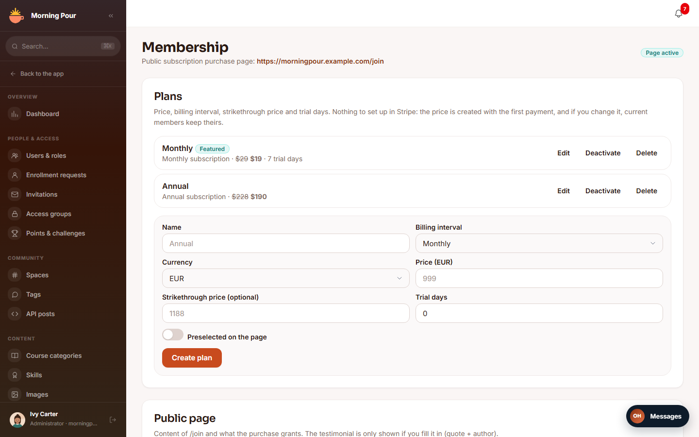

# mod.subscriptions — Recurring subscriptions

Community · **Core** category (always active)

## What it does

Recurring subscriptions with Stripe (`mode=subscription`), with a configurable billing period of 1 to 12 months (monthly, quarterly, semi-annual, annual…): subscriptions to specific courses and, on top of that, the **membership** behind the public `/join` page, with its own plans (billing period, price, struck-through price, trial days, featured plan) and its landing configuration (headlines, the access group it grants, the lesson limit during the trial, a testimonial).

The membership can be sold in **levels** (for example Basic and Pro, plus a free one), each with its own courses and prices: every student sees what their level includes and can switch level from their account, with proration. Without levels, everyone who pays sees the same thing. See [Levels](#levels).

## How it works

- Stripe webhooks (`customer.subscription.*`, `invoice.*`) update the local state: `PENDING → TRIALING / ACTIVE → PAST_DUE → UNPAID / CANCELED`.
- A configurable **grace period** after a failed payment (3 days by default): if Stripe charges successfully before it expires, the subscription returns to `ACTIVE`; if it expires, it moves to `UNPAID` and **pauses the enrollment** (an hourly cron expires elapsed grace periods). Dunning is handled by Stripe's automatic retries. A trial that never paid gets no grace: if its first charge fails, access is lost immediately.
- Cancellation can be at the end of the period (the default) or immediate (unenrolling right away) through the API; the student, from their account, only has **"Cancel my subscription"**, which opens the **cancellation offer** (see below) and ends in cancellation at the end of the paid period.
- Host bridges connect it to the rest: activation → enrollment; non-payment → pause; membership activated/revoked → granting/removing the access group (the one of the level being paid for or, without levels, the one of the public page); level change → the new level's group and, after that, removal of the old one.
- The membership checkout is **anonymous** (the visitor pays at `/join` and the account is materialised with the email confirmed by Stripe) and accepts referral codes, which `mod.referrals` interprets. A second membership is not sold to someone who already has a live one (409 `MEMBERSHIP_ALREADY_SUBSCRIBED`).
- As with course sales, without the **withdrawal-waiver checkbox** nothing is charged (422), and if the account that collects the money has a **publishable key**, payment happens **inside `/join`** (embedded Checkout; the return is `/join?status=success&session_id=…`, which asks the API whether it was paid and grants nothing by itself). Details in [mod.billing](billing.md).
- With **platform payments** ([mod.payouts](payouts.md)), if the creator's account cannot sell yet, `/join` shows no plans and checkout answers 409 `PAYOUTS_NOT_READY`.
- Every charge produces a receipt email (purchase, renewal, failed payment) that the creator can customise; see [mod.billing → Sales emails](billing.md#sales-emails). The subscription stores the buyer's country and the coupon applied, and shows up on the **Sales** screen ([mod.billing → Sales](billing.md#sales)).
- It coexists with `mod.billing` in the same tenant (one-off and subscription courses) without sharing tables.

!!! note "Screenshots in full mode"
    The screenshots on this page come from **full mode** (side menu), the mode a new installation starts in. In **simple mode** the same routes are still available from "More", except for the screens that mode replaces with a simplified version (the course editor, Settings, Sales, Students, Live, the community and Referrals); to use them as shown here, switch to full mode under **Settings → "Use the full mode"**.

## Configuration

The module belongs to the **core** category: it is active in every tenant and has no switch of its own. Nothing below requires an Enterprise licence.

### Stripe credentials (per tenant)

The same ones as `mod.billing`: under `/admin/settings?tab=payments` (the **Payments** tab), card **"Payments · Stripe"** (including the **"Publishable key (optional)"** to pay inside `/join`). This module adds one field of its own: **"Subscriptions webhook secret (optional)"** — leave it empty to reuse the same secret as the one-off course webhook. With no credentials (neither tenant nor instance) checkout returns 503 — plans, trials and the access group remain editable regardless, as they do not depend on Stripe.

### Webhook to register in Stripe

The card shows the exact URL. For this module (recommended as an endpoint separate from billing's):

- Endpoint: `https://<your-academy-domain>/api/v1/modules/subscriptions/webhook`
- Events to select: `checkout.session.completed`, `checkout.session.expired`, `customer.subscription.created`, `customer.subscription.updated`, `customer.subscription.deleted`, `invoice.paid`, `invoice.payment_failed`, `charge.refunded`.

!!! danger "`invoice.paid` and `invoice.payment_failed` hold up the whole lifecycle"
    They are not optional, and they are not "just for the history". If they are missing:

    - **There is no cut-off for non-payment.** `invoice.payment_failed` is what marks the subscription past due, starts the grace period and eventually revokes access. Without it, whoever stops paying **keeps the membership indefinitely** and shows as active in the admin panel.
    - **Trials never convert.** Whoever pays at the end of the trial stays stuck with the trial lesson limit.
    - **The student sees no invoices** in their account, however many receipts Stripe has charged.

    None of this raises an error in any log: an event that never arrives is never missed. If in doubt, check it the other way round — take one payment in test mode and confirm the invoice shows up in the student's account.

### Payment methods

Whichever you have enabled in your Stripe dashboard, same as for single-course sales. Stripe automatically filters out anything that doesn't work for recurring charges, so the list a membership buyer sees may be shorter than the one for a single course.

### Membership plans and page

Everything under `/admin/membership` (**"Membership"**). If Stripe is not configured, the page warns you ("you can prepare plans and the page, but real checkout will fail…").

- **"Levels"** card, the first one: the membership levels with their courses and prices. See [Levels](#levels). Without levels it says "You have no levels yet: everyone who pays for the membership sees the same thing." and the rest of the page works as always.
- **"Plans"** card (in a classroom with paid levels it only shows up if there are prices left outside a level: "These prices are not in any level and do not show on the sales page. Turn them off or delete them."): fields **"Name"**, **"Billing interval"** (monthly / quarterly / semi-annual / annual / every N months), **"Currency"**, **"Price"**, **"Strikethrough price (optional)"**, **"Trial days"**, toggle **"Preselected on the page"**; button **"Create plan"**. The Stripe Product/Price is created lazily on the first checkout and **rotated** when the amount, currency or period changes (Stripe prices are immutable); renaming the plan renames the Product. A plan with sales is never deleted: it is deactivated. Through the API a plan also accepts fixed per-market prices (`currencyOptions`, currency → amount).
- **"Public page"** card: toggle **"Purchase page active"**, **"Title"**, **"Subtitle"**, **"Access group it grants"**, **"Show the course catalog on the page"**, **"Lessons visible per course during the trial period"** (0 = no limit), per-course reference prices and an optional testimonial; button **"Save configuration"**. With paid levels, the **"Access group it grants"** picker is replaced by the note "Each level gives its own courses: change them above, in “Levels”."

- **"When someone wants to leave"** card (cancellation offer; in simple mode it lives in Settings): see the next section. Further down, **"Who wants to leave and why"** summarises the last days.

!!! note "The screenshot predates levels and the cancellation cards"
    The screenshot shows the plans and the public page of a classroom without levels; it does not include the **"Levels"** card (version 0.1.0-beta.27), which sits above "Plans", nor the **"When someone wants to leave"** and **"Who wants to leave and why"** cards, which were added later.

### Cancellation offer

When a student clicks **"Cancel my subscription"** under `/account?tab=subscription` (it is the only way to cancel: Stripe's portal no longer offers it), the dialog asks for the **reason** (*It's too expensive*, *I don't have time*, *It wasn't what I expected*, *I learned what I wanted*, *Topics I care about are missing*, *Something else*, with optional free text) and, if the academy has enabled it, offers a way to stay:

- **Offer a pause**: no payment and no access to the content; their account, progress and certificates stay and it restarts on its own. The **"Up to"** setting is 1 to 3 months (3 by default). It skips whole charges, so on a monthly plan any number of months up to the maximum is valid, on a quarterly plan only 3, and on a yearly plan it is not offered. One pause per person every 365 days.
- **Offer a discount**: **"Discount"** from 5 to 90 % (30 by default) **"For"** 1 to 12 months (3 by default). On monthly plans it applies to the next payments; on quarterly or yearly plans, to the next renewal. Once per person.

Both start **switched off**. The card is saved with **"Save offer"**. What the student chooses (pause, discount or cancellation at the end of the period) is confirmed by email, shown on their tab (*Pause scheduled…*, *Paused: restarts on its own on…*, *…% off until…*) and counted in the creator's summary. A sweep (the same hourly worker as the grace periods) starts pauses when their date arrives and emits `subscriptions.subscription.paused`. API: `GET|PUT /membership/admin/retention`, `GET /membership/admin/retention/summary`, and for the student `GET|POST /modules/subscriptions/me/:id/leave`.

### Environment variables

| Variable | What it is for |
| --- | --- |
| `STRIPE_SECRET_KEY` / `STRIPE_PUBLISHABLE_KEY` | Instance fallback: only if the tenant has not configured its keys in the panel. See also `STRIPE_ALLOW_GLOBAL_FALLBACK` in [mod.billing](billing.md). |
| `SUBSCRIPTIONS_WEBHOOK_SECRET` | A dedicated webhook (keeping it separate from billing's is recommended); instance fallback. |
| `SUBSCRIPTIONS_GRACE_PERIOD_DAYS` | Grace period after a failed payment (3). |
| `SUBSCRIPTIONS_GRACE_EXPIRATION_CRON` | Cron expiring elapsed grace periods and starting pauses whose date has arrived (`0 * * * *`, hourly UTC). |
| `SUBSCRIPTIONS_SUCCESS_URL_BASE` / `SUBSCRIPTIONS_CANCEL_URL_BASE` | Return URLs for the per-course subscription checkout (default: `/account/subscriptions` on the instance domain, which redirects to `/account?tab=subscription`). |

The daily summary and renewal notices (`SUBSCRIPTIONS_DAILY_CRON`, `SUBSCRIPTIONS_DAILY_TZ`, `SUBSCRIPTIONS_RENEWAL_WINDOW_DAYS`) belong to [mod.payment-connections](payment-connections.md), which is the module watching external subscriptions.

Out of scope for the MVP: B2B invoicing. Plan changes with proration exist since version 0.1.0-beta.27 in classrooms with levels ([Switching level from the account](#switching-level-from-the-account)), and pausing, in the [cancellation offer](#cancellation-offer).

## Levels

A **level** is a version of the membership with its own content and its own prices: for example **Basic** with two courses and **Pro** with all of them, each with a monthly and a yearly price. Every student sees the courses of the level they pay for and can switch level from their account. **Without levels, everyone who pays for the membership sees the same thing**: the access group of the "Public page" card.

### What a level includes

- **Courses.** Each level has its own [access group](access-groups.md) (it shows up in "Access groups" as "Membresía · Pro", with the level's name), and that group is what gives the courses. When you create it you choose **"Courses it gives"**: **"All courses (including the ones you publish later)"** or **"Only the courses you choose"**. That choice cannot be changed later ("This is chosen when you create the level and cannot be changed later. If you need something else, create another level."); the list of chosen courses can be edited.
- **One level doesn't include another.** Pro does not inherit what Basic gives: if Pro should also give Basic's courses, tick them in Pro as well.
- **Community spaces and live classes.** A space or a live class can be restricted to one or more levels with **"Who can see it"**. See [Community](community.md#spaces-by-level) and [Virtual classroom](zoom-live.md#live-classes-by-level).
- Fields: **"Level name"** (up to 60 characters; unique in the classroom, case-insensitive), **"What it includes, in one sentence (optional)"** and **"Courses it gives"**.

### Several billing periods per level

Each paid level has its own **"Prices"**, one per billing period, added with **"Add a price"**: **"Price name"** ("People see it when they pay."), **"How often it is paid"**, **"Currency"**, **"Price"**, **"Previous price, crossed out (optional)"**, **"Free trial days"** (0 to 365) and **"Recommended: highlighted on the sales page"**. They are plans like the usual ones (same Stripe Product/Price and same rules) that belong to a level; a plan's level is set when it is created and never changes, so whoever already pays for it keeps the same content.

The suggested name is "Level · Period" (for example "Pro · Annual"), because price names are unique within the classroom (409 `MEMBERSHIP_PLAN_NAME_TAKEN`). When you rename a level, its prices that start with the old name follow it. A level with no price shows on `/join` as "This plan isn't on sale yet."

### The free level

**"Add a free level"** creates a level with no prices and no Stripe (there can only be one) that gives the courses you choose, "so they get to know you before they buy". It is not bought: people join by **signing up to the academy** through the free sign-up of [Member registration](member-registration.md).

- When you create it (or turn it back on), its group becomes the one approved sign-ups receive and sign-up opens with **email verification by code** (any verification you already had, such as Telegram, is kept): "People join for free by signing up to your academy: when you create it, we open free sign-up."
- **Getting in straight away.** By default, whoever signs up for free confirms their email with a code and gets in at that very moment, without waiting for your approval. The `/join` card says so: "Sign up for free, confirm your email with a code and you are in straight away, without paying anything."
- **"Review every free sign-up by hand"**: a toggle on the free level's card, **off** by default. When on, "every free sign-up waits until you approve it in Students" (in full mode, **Enrollment requests**, `/admin/member-requests`).
- The card says whether free sign-up is open ("Free sign-up is open: whoever signs up for free joins this level.") or closed, with the **"Change who can sign up"** link to `/admin/settings?tab=registration`. With sign-up closed, the free card on `/join` says "Free sign-ups are closed right now."
- Turning the free level off or deleting it turns off instant entry: new sign-ups wait for your approval again, as before.
- When a paid membership ends (cancellation at the end of the period or non-payment) and the classroom has the free level turned on, the person **moves to the free level**.

### Switching level from the account

Under `/account?tab=subscription` the membership shows its level ("Level: Pro") and, if the classroom has paid levels and there is another price to switch to, **"Change plan"** appears. The dialog offers the prices of the paid levels that are on (including the other billing periods of the same level), each one marked "Costs more per month" or "Costs less per month", and before confirming it works out what will happen:

| Case | What happens |
| --- | --- |
| **Upgrade** (the new price costs more per month) | The difference until the next invoice is charged **right away**: "Today you'll be charged {amount}: the price difference until your next invoice." and the button "Pay {amount} and switch". If the card fails, **nothing changes** ("We couldn't charge the difference to your card. Your plan hasn't changed…"). |
| **Downgrade** (costs the same or less per month) | Nothing is charged today and the difference **is taken off the next invoice**: "Your next invoice will go down by {amount} (what you have left over from what you already paid)." |
| **During the free trial** | **No proration**: "You're still on your free trial: you won't be charged anything today. When it ends, you'll pay {price}." |

- **The change is immediate**: on confirming, the new level's content is granted and only then is the old one removed, so courses that are in both are never lost, not even for a moment.
- Upgrade or downgrade is decided by the **price per month**: moving from monthly to yearly within the same level counts as a downgrade if the yearly price is cheaper per month.
- A change is only possible with the membership up to date or on trial, with no scheduled cancellation or pause, and to a price in the **same currency**. If something prevents it, the account explains why (subscription not up to date, cancellation scheduled, pause scheduled).
- The invoice for the difference shows under "View invoices". With [platform payments](payouts.md) it is one more sale, with its commission; in [referrals](referrals.md) it only earns a commission with the **recurring** scope. A discount from the cancellation offer carries on after the change.
- **Moving to the free level** is not a plan change: the "Switch to Free (free)" button (with the free level's name) opens the same cancellation as "Cancel my subscription" and, when the paid period ends, the person moves to the free level.
- If the request is cut off after Stripe has applied the change, the `customer.subscription.updated` webhook reconciles it: one change, a single notice (`subscriptions.membership.plan_changed`).

### Where they are edited

| Mode | Where |
| --- | --- |
| **Full** | **Membership** (`/admin/membership`), **"Levels"** card, above "Plans". |
| **Simple** | **Sales**, **"Levels"** section (whether you collect through platform payments or with your own Stripe account). |

It is the same editor in both: **"Create a level"**, **"Add a free level"** and, on each level, **"Edit"**, **"Up"** / **"Down"** (the order of the cards on `/join`), **"Turn off"** / **"Turn on"** and **"Delete"**.

- **Turn off**: "Off: it is not sold, but people who already have it keep it." It is not offered as a plan change either.
- **Delete**: only a level with nobody in it (and its group, if it owns it). With students it answers 409 `MEMBERSHIP_TIER_IN_USE` and the editor offers **"Turn it off"**.

### `/join` with levels

With levels, `/join` becomes **"Choose your plan"** ("Each plan includes different things. You can switch plans later from your account."), with one card per level that is on, in the editor's order: **"What's included"** (all courses, or how many there are today and which ones), the **"Community spaces only for this plan"** and **"Upcoming live sessions only for this plan"** (name and date only) and the billing-period picker. **"Choose Pro"** (with each level's name) leads to the usual payment with the chosen price. The free level's card says **"Free"** and **"Join for free"** (it goes to `/member-registration`). If the payment is canceled, the level and billing period stay selected on the way back.

### Compatibility with classrooms without levels

- **A classroom without levels stays the same**: the same `/join`, the same "Plans" and "Public page" cards with their "Access group it grants", and the student's account without "Change plan".
- **The first paid level adopts the existing plans** and the group the page used to grant: "Your current prices will move to this level; people who already pay will not notice anything."
- With paid levels, every new price goes inside a level (through the API, `POST /membership/admin/plans` without `tierId` answers 400 `MEMBERSHIP_TIER_INVALID`).
- The **"Lessons visible per course during the trial period"** limit applies to every paid level (the free level has no trial). Courses in a paid level count as paid courses: students cannot enroll in them on their own.

### Endpoints

| Method | Route | Auth | What it does |
| --- | --- | --- | --- |
| GET | `/membership/admin/tiers` | admin | Levels with their courses, prices and how many people are in; how many plans are left without a level and the free sign-up state (`freeSignup: { moduleEnabled, open, manualReview }`). |
| POST | `/membership/admin/tiers` | admin | Creates a level: `{ name, description?, isFree?, allCourses?, courseIds? }`. |
| PATCH | `/membership/admin/tiers/:id` | admin | Edits: `{ name?, description?, active?, courseIds?, manualReview? }` (`courseIds` not on an "all courses" level; `manualReview` only on the free level). |
| PUT | `/membership/admin/tiers/order` | admin | Orders the levels: `{ tierIds }`. |
| DELETE | `/membership/admin/tiers/:id` | admin | Deletes a level with nobody in it; with students, 409. |
| POST | `/membership/admin/plans` | admin | Accepts `tierId` (required when there are paid levels; the free level is not valid). |
| GET | `/membership/tiers` | Public | Levels that are on: `{ tiers: [{ id, name, accessGroupId, isFree }] }`. |
| GET | `/membership/page` | Public | With levels it also returns `tiers` (what each includes), `freeSignupPath` and `freeSignupInstant`. |
| GET | `/modules/subscriptions/me/membership/change-options` | Bearer | The live membership, which prices it can switch to (paid levels that are on, same currency) and whether something blocks it right now (`blockedReason`). |
| POST | `/modules/subscriptions/me/membership/change-preview` | Bearer | `{ planId }` → what would happen: today's charge, credit or free trial. Changes nothing. |
| POST | `/modules/subscriptions/me/membership/change` | Bearer | `{ planId }` → switches plan right away with proration. |

`GET /modules/subscriptions/me` also returns `tierId` and `tierName`. Errors: `MEMBERSHIP_TIER_NOT_FOUND` 404 · `MEMBERSHIP_TIER_INVALID` / `MEMBERSHIP_TIER_IS_FREE` 400 · `MEMBERSHIP_TIER_IN_USE` / `MEMBERSHIP_PLAN_NAME_TAKEN` / `MEMBERSHIP_PLAN_CHANGE_NOT_ALLOWED` 409 · `MEMBERSHIP_PLAN_CHANGE_PAYMENT_FAILED` 402.

## Step-by-step usage

1. Configure Stripe under `/admin/settings?tab=payments` and register the subscriptions webhook with the URL and events above.
2. Under `/admin/membership`, create the plans: **"Name"**, **"Billing interval"**, **"Price"**, **"Trial days"** if you want a trial, and mark one as **"Preselected on the page"** → **"Create plan"**.
    If you are going to sell **levels**, create them instead in the **"Levels"** card with **"Create a level"** (name, "Courses it gives" → **"Create level"**) and give each one its prices with **"Add a price"**; for a free level, **"Add a free level"**. See [Levels](#levels).

3. In the **"Public page"** card, enable **"Purchase page active"**, pick the **"Access group it grants"** (that is what unlocks the courses upon payment; with paid levels it is not shown, because each level gives its own courses) and, if you use a trial, set **"Lessons visible per course during the trial period"** → **"Save configuration"**.
4. Share `/join`. The visitor picks a plan and clicks **"Continue to secure payment"** ("Payment processed by Stripe · Cancel anytime"; coupons can be applied on the payment screen). On return (`/join?status=success`) they see "Payment received!" and get the email to **set their password**; the account is created automatically and the access group granted through an event.

5. The student manages their subscription under `/account?tab=subscription` (the **"Subscription"** tab): trial and next-charge dates, **"Pay now and activate"** (ends the trial and charges right away), **"Cancel my subscription"** (the cancellation offer, see above) and **"View invoices"** (with a link to the Stripe PDF; if they paid with referral balance, the invoice says so: "Paid with referral balance"). With platform payments there is also **"Manage my subscription"** (Stripe portal to change the card and view invoices). In a classroom with levels they also see their level and **"Change plan"** ([Switching level from the account](#switching-level-from-the-account)).

6. Failed payments: nothing to do on your side. Stripe retries the charge; during the grace period the student keeps access (`PAST_DUE`) and, if the grace elapses unpaid, the enrollment is paused (`UNPAID`) until a later charge reactivates it.
7. The **per-course** subscription (besides the membership) exists today only through the API: `POST /modules/subscriptions/checkout/<courseId>` with a recurring Stripe price — the web app has no button for it.

## Permissions

`subscriptions.subscription.read`, `subscriptions.subscription.create` and `subscriptions.subscription.cancel`.

## Dependencies

Hard: `mod.learning`, `mod.courses`. Optional (read-only, declared in the manifest): `mod.access-groups` (each level's courses), `mod.community` and `mod.zoom-live` (the spaces and live classes of each level that `/join` names).

## Data model

`mod_subscriptions_subscription` (one live subscription per user and course) · `mod_subscriptions_plan` (membership plans + Stripe IDs; `tier_id`, the level it belongs to) · `mod_subscriptions_tier` (levels: name, description, access group, whether it is free, order and whether it is on) · `mod_subscriptions_membership_config` (the copy and rules of `/join`) · `mod_subscriptions_invoice` · `mod_subscriptions_webhook_event` (idempotent log) · `mod_subscriptions_retention_config` (cancellation-offer settings) · `mod_subscriptions_exit` (each cancellation: reason and what the student chose).

## API

Prefixes `/modules/subscriptions` (student + webhook) and `/membership` (public + admin). Details in [Reference → Payments](../../api/reference/payments-live-ai.md#subscriptions-modulessubscriptions) and [Reference → Community](../../api/reference/community.md#membership-membership).

## Events

**Emits**: `subscriptions.subscription.created/activated/past_due/unpaid/canceled/paused`, `subscriptions.invoice.paid/payment_failed/refunded/partially_refunded`, `subscriptions.membership.activated/plan_changed`, `subscriptions.retention.paused/discounted/canceled`. It consumes none. `subscriptions.membership.plan_changed` (level or billing-period change: `subscriptionId`, `userId`, `fromPlanId`, `toPlanId`, `fromTierId`, `toTierId`, `direction`, `via`) is what the groups bridge listens to; it is not in the outgoing-webhook catalog. There is no `membership.revoked`: a membership losing access travels in `subscriptions.subscription.canceled` (immediate cancellation), `.unpaid` and `.paused` with `planId`, which is what the groups bridge listens to.
