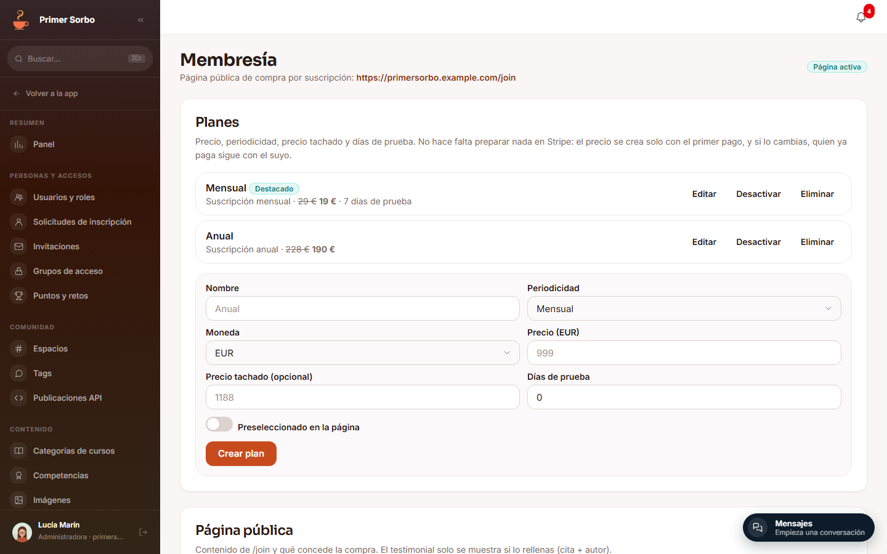

# mod.subscriptions — Suscripciones recurrentes

Community · Categoría **core** (siempre activo)

## Qué hace

Suscripciones recurrentes con Stripe (`mode=subscription`), con periodicidad configurable de 1 a 12 meses (mensual, trimestral, semestral, anual…): suscripción a cursos concretos y, sobre esa base, la **membresía** de la página pública `/join`, con planes propios (periodicidad, precio, precio tachado, días de trial, plan destacado) y su configuración de landing (titulares, grupo de acceso que concede, límite de lecciones en trial, testimonial).

La membresía puede venderse en **niveles** (por ejemplo, Básico y Pro, y uno gratis), cada uno con sus cursos y sus precios: cada alumno ve lo de su nivel y puede cambiar de nivel desde su cuenta, con prorrateo. Sin niveles, todos los que pagan ven lo mismo. Ver [Niveles](#niveles).

## Cómo funciona

- Los webhooks de Stripe (`customer.subscription.*`, `invoice.*`) actualizan el estado local: `PENDING → TRIALING / ACTIVE → PAST_DUE → UNPAID / CANCELED`.
- **Periodo de gracia** configurable tras un impago (3 días por defecto): si Stripe cobra antes de expirar, vuelve a `ACTIVE`; si expira, pasa a `UNPAID` y **pausa la matrícula** (un cron horario expira las gracias vencidas). El dunning lo hacen los reintentos automáticos de Stripe. Un trial que nunca pagó no tiene gracia: si su primer cobro falla, pierde el acceso al momento.
- La cancelación puede ser al final del periodo (default) o inmediata (desenrola al momento) por API; el alumno, desde su cuenta, solo tiene **«Darme de baja»**, que abre la **oferta al darse de baja** (ver más abajo) y acaba en la baja al final del periodo pagado.
- Bridges del host conectan con el resto: activación → matrícula; impago → pausa; membresía activada/revocada → concesión/retirada del grupo de acceso (el del nivel que se paga o, sin niveles, el de la página pública); cambio de nivel → grupo del nivel nuevo y, después, retirada del viejo.
- El checkout de membresía es **anónimo** (el visitante paga en `/join` y la cuenta se materializa con el email confirmado por Stripe) y acepta códigos de referido, que interpreta `mod.referrals`. No se vende una segunda membresía a quien ya tiene una viva (409 `MEMBERSHIP_ALREADY_SUBSCRIBED`).
- Como en la venta de cursos, sin la **casilla de renuncia al desistimiento** no se paga (422), y si la cuenta que cobra tiene **clave publicable** el pago se hace **dentro de `/join`** (Checkout embebido; vuelta `/join?status=success&session_id=…`, que pregunta a la API si se pagó y no concede nada por sí misma). Detalle en [mod.billing](billing.md).
- Con **cobros de plataforma** ([mod.payouts](payouts.md)), si la cuenta del creador aún no puede vender, `/join` se ve sin planes y el checkout responde 409 `PAYOUTS_NOT_READY`.
- Cada cobro genera un correo-recibo (compra, renovación, pago fallido) que el creador puede personalizar; ver [mod.billing → Correos de venta](billing.md#correos-de-venta). La suscripción guarda el país del comprador y el cupón aplicado, y aparece en la pantalla de **Ventas** ([mod.billing → Ventas](billing.md#ventas)).
- Convive con `mod.billing` en el mismo tenant (cursos one-shot y por suscripción) sin compartir tablas.

!!! note "Capturas en modo completo"
    Las capturas de esta página son del **modo completo** (menú lateral), el de una instalación nueva. En **modo sencillo** las mismas rutas siguen disponibles desde «Más», salvo las pantallas que ese modo sustituye por una versión simplificada (el editor de cursos, Ajustes, Ventas, Alumnos, Directos, la comunidad y Referidos); para usarlas tal como se ven aquí, cambia al modo completo en **Ajustes → «Usar el modo completo»**.

## Configuración

El módulo es de categoría **core**: viene activo en todos los tenants y no tiene interruptor propio. Nada de lo que sigue exige licencia Enterprise.

### Credenciales de Stripe (por tenant)

Las mismas de `mod.billing`: en `/admin/settings?tab=payments` (pestaña **Pagos**), tarjeta **«Pagos · Stripe»** (incluida la **«Clave publicable (opcional)»** para pagar dentro de `/join`). Este módulo añade un campo propio: **«Secreto del webhook de suscripciones (opcional)»** — si lo dejas vacío se usa el mismo secreto que el webhook de cursos sueltos. Sin credenciales (ni de tenant ni de instancia) el checkout responde 503 — planes, trial y grupo de acceso siguen editables igualmente, no dependen de Stripe.

### Webhook a dar de alta en Stripe

La tarjeta muestra la URL exacta. Para este módulo (recomendado como endpoint separado del de billing):

- Endpoint: `https://<dominio-de-tu-academia>/api/v1/modules/subscriptions/webhook`
- Eventos a seleccionar: `checkout.session.completed`, `checkout.session.expired`, `customer.subscription.created`, `customer.subscription.updated`, `customer.subscription.deleted`, `invoice.paid`, `invoice.payment_failed`, `charge.refunded`.

!!! danger "`invoice.paid` e `invoice.payment_failed` sostienen todo el ciclo de vida"
    No son opcionales ni «para el historial». Si faltan:

    - **No hay corte por impago.** `invoice.payment_failed` es lo que marca la suscripción como vencida, arranca el periodo de gracia y acaba retirando el acceso. Sin él, quien deja de pagar **conserva la membresía indefinidamente** y en el panel figura como activa.
    - **El periodo de prueba no convierte.** Quien paga al acabar el trial se queda con el límite de clases de la prueba.
    - **El alumno no ve ninguna factura** en su cuenta, por muchos recibos que haya cobrado Stripe.

    Nada de esto da error en ningún log: el evento que no llega no se echa de menos. Si dudas, compruébalo al revés — cobra una vez en modo de prueba y mira que aparezca la factura en la cuenta del alumno.

### Formas de pago

Las que tengas activadas en tu panel de Stripe, igual que en la venta de cursos sueltos. Stripe filtra automáticamente las que no sirven para cobros recurrentes, así que la lista que ve el comprador de membresía puede ser más corta que la de un curso suelto.

### Planes y página de membresía

Todo en `/admin/membership` (**«Membresía»**). Si Stripe no está configurado, la página lo avisa («puedes preparar planes y página, pero el checkout real fallará…»).

- Tarjeta **«Niveles»**, la primera: niveles de la membresía con sus cursos y sus precios. Ver [Niveles](#niveles). Sin niveles dice «Aún no tienes niveles: todos los que pagan la membresía ven lo mismo.» y el resto de la página funciona como siempre.
- Tarjeta **«Planes»** (en un aula con niveles de pago solo aparece si quedan precios fuera de un nivel: «Estos precios no están en ningún nivel y no se ven en la página de venta. Apágalos o bórralos.»): campos **«Nombre»**, **«Periodicidad»** (Mensual / Trimestral / Semestral / Anual / cada N meses), **«Moneda»**, **«Precio»**, **«Precio tachado (opcional)»**, **«Días de prueba»**, interruptor **«Preseleccionado en la página»**; botón **«Crear plan»**. El Product/Price de Stripe se crea perezosamente en el primer checkout y se **rota** al cambiar importe, moneda o periodicidad (los prices de Stripe son inmutables); renombrar el plan renombra el Product. Un plan con ventas no se borra: se desactiva. Por API un plan admite además precios fijos por mercado (`currencyOptions`, moneda → importe).
- Tarjeta **«Página pública»**: interruptor **«Página de compra activa»**, **«Título»**, **«Subtítulo»**, **«Grupo de acceso que concede»**, **«Mostrar el catálogo de cursos en la página»**, **«Clases visibles por curso durante el periodo de prueba»** (0 = sin límite), precios individuales de referencia por curso y testimonial opcional; botón **«Guardar configuración»**. Con niveles de pago, el selector **«Grupo de acceso que concede»** se sustituye por la nota «Cada nivel da sus propios cursos: se cambian arriba, en «Niveles».»

- Tarjeta **«Cuando alguien quiere irse»** (oferta al darse de baja; en modo sencillo está en Ajustes): ver la sección siguiente. Más abajo, **«Quién se quiere ir y por qué»** resume los últimos días.

!!! note "La captura es anterior a los niveles y a la tarjeta de bajas"
    La captura muestra los planes y la página pública de un aula sin niveles; no incluye la tarjeta **«Niveles»** (versión 0.1.0-beta.27), que va encima de «Planes», ni las tarjetas **«Cuando alguien quiere irse»** y **«Quién se quiere ir y por qué»**, que se añadieron después.

### Oferta al darse de baja

Cuando un alumno pulsa **«Darme de baja»** en `/account?tab=subscription` (es el único camino de baja: el portal de Stripe ya no la ofrece), la ventana le pide el **motivo** (*Me sale caro*, *No tengo tiempo*, *No era lo que esperaba*, *Ya aprendí lo que quería*, *Faltan temas que me interesan*, *Otro motivo*, con texto libre opcional) y, si el aula lo ha activado, le ofrece quedarse:

- **Ofrecer una pausa**: sin pagar ni tener acceso al contenido; su cuenta, progreso y certificados se quedan y vuelve sola al terminar. Ajuste **«Como mucho»** de 1 a 3 meses (3 por defecto). Salta cobros enteros, así que en un plan mensual vale cualquier número de meses hasta el máximo, en uno trimestral solo 3 y en uno anual no se ofrece. Una pausa por persona cada 365 días.
- **Ofrecer un descuento**: **«Descuento»** del 5 al 90 % (30 por defecto) **«Durante»** 1 a 12 meses (3 por defecto). En planes mensuales se aplica a las siguientes cuotas; en trimestrales o anuales, a la siguiente renovación. Una vez por persona.

Ambas nacen **apagadas**. La tarjeta se guarda con **«Guardar la oferta»**. Lo que elige el alumno (pausa, descuento o baja al final del periodo) se confirma por correo, se ve en su pestaña (*Pausa programada…*, *En pausa: vuelve sola el…*, *…% de descuento hasta…*) y entra en el resumen del creador. Un barrido (el mismo worker horario de las gracias) empieza las pausas cuando llega su fecha y emite `subscriptions.subscription.paused`. API: `GET|PUT /membership/admin/retention`, `GET /membership/admin/retention/summary`, y para el alumno `GET|POST /modules/subscriptions/me/:id/leave`.

### Variables de entorno

| Variable | Para qué |
| --- | --- |
| `STRIPE_SECRET_KEY` / `STRIPE_PUBLISHABLE_KEY` | Fallback de instancia: solo si el tenant no configuró sus claves en el panel. Ver también `STRIPE_ALLOW_GLOBAL_FALLBACK` en [mod.billing](billing.md). |
| `SUBSCRIPTIONS_WEBHOOK_SECRET` | Webhook dedicado (recomendado separarlo del de billing); fallback de instancia. |
| `SUBSCRIPTIONS_GRACE_PERIOD_DAYS` | Gracia tras impago (3). |
| `SUBSCRIPTIONS_GRACE_EXPIRATION_CRON` | Cron que expira las gracias vencidas y arranca las pausas que llegan a su fecha (`0 * * * *`, cada hora UTC). |
| `SUBSCRIPTIONS_SUCCESS_URL_BASE` / `SUBSCRIPTIONS_CANCEL_URL_BASE` | Retorno del checkout de suscripción por curso (default: `/account/subscriptions` del dominio de la instancia, que redirige a `/account?tab=subscription`). |

El resumen diario y los avisos de renovación (`SUBSCRIPTIONS_DAILY_CRON`, `SUBSCRIPTIONS_DAILY_TZ`, `SUBSCRIPTIONS_RENEWAL_WINDOW_DAYS`) pertenecen a [mod.payment-connections](payment-connections.md), que es quien vigila las suscripciones externas.

Fuera del MVP: facturación B2B. El cambio de plan con prorrateo existe desde la versión 0.1.0-beta.27 en las aulas con niveles ([Cambiar de nivel desde la cuenta](#cambiar-de-nivel-desde-la-cuenta)), y la pausa, en la [oferta al darse de baja](#oferta-al-darse-de-baja).

## Niveles

Un **nivel** es una versión de la membresía con su propio contenido y sus propios precios: por ejemplo, **Básico** con dos cursos y **Pro** con todos, cada uno con su precio mensual y anual. Cada alumno ve los cursos del nivel que paga y puede cambiar de nivel desde su cuenta. **Sin niveles, todos los que pagan la membresía ven lo mismo**: el grupo de acceso de la tarjeta «Página pública».

### Qué incluye un nivel

- **Cursos.** Cada nivel tiene su propio [grupo de acceso](access-groups.md) (en «Grupos de acceso» aparece como «Membresía · Pro», con el nombre del nivel), que es el que da los cursos. Al crearlo eliges **«Cursos que da»**: **«Todos los cursos (también los que publiques más adelante)»** o **«Solo los cursos que elijas»**. Esa elección no se cambia después («Esto se elige al crear el nivel y luego no se cambia. Si necesitas otra cosa, crea otro nivel.»); la lista de cursos elegidos sí se edita.
- **Un nivel no incluye a otro.** Pro no hereda lo de Básico: si Pro debe dar también los cursos de Básico, márcalos también en Pro.
- **Espacios de la comunidad y directos.** Un espacio o una clase en directo se pueden restringir a uno o varios niveles con **«Quién puede verlo»**. Ver [Comunidad](community.md#espacios-por-nivel) y [Aula virtual](zoom-live.md#directos-por-nivel).
- Campos: **«Nombre del nivel»** (hasta 60 caracteres; no se repite en el aula, sin distinguir mayúsculas), **«Qué incluye, en una frase (opcional)»** y **«Cursos que da»**.

### Varias periodicidades por nivel

Cada nivel de pago lleva sus **«Precios»**, uno por periodicidad, con **«Añadir precio»**: **«Nombre del precio»** («Lo verá quien vaya a pagar.»), **«Cada cuánto se paga»**, **«Moneda»**, **«Precio»**, **«Precio de antes, tachado (opcional)»**, **«Días de prueba gratis»** (de 0 a 365) y **«Recomendado: sale marcado en la página de venta»**. Son planes como los de siempre (mismo Product/Price de Stripe y mismas reglas) que pertenecen a un nivel; el nivel de un plan se fija al crearlo y no cambia, así que quien ya lo paga no cambia de contenido.

El nombre que se propone es «Nivel · Periodicidad» (por ejemplo, «Pro · Anual»), porque los nombres de precio no se repiten en el aula (409 `MEMBERSHIP_PLAN_NAME_TAKEN`). Al renombrar un nivel, sus precios que empiezan por el nombre viejo lo siguen. Un nivel sin ningún precio sale en `/join` como «Este plan todavía no está a la venta.»

### El nivel gratis

**«Añadir un nivel gratis»** crea un nivel sin precios ni Stripe (solo puede haber uno) que da los cursos que elijas: «así te conocen antes de comprar». No se compra: se entra **apuntándose en la academia** con el registro gratis de [Inscripción de miembros](member-registration.md).

- Al crearlo (o volver a encenderlo), su grupo pasa a ser el que reciben las altas aprobadas y el registro se abre con **verificación del correo por código** (se conservan las verificaciones que ya tuvieras, como Telegram): «Se entra gratis apuntándose en tu academia: al crearlo, abrimos el registro gratis.»
- **Entrar al momento.** Por defecto, quien se apunta gratis confirma su correo con un código y entra en ese mismo momento, sin esperar a que lo apruebes. La tarjeta de `/join` lo dice: «Te apuntas gratis, confirmas tu correo con un código y entras al momento, sin pagar nada.»
- **«Revisar a mano cada alta gratis»**: interruptor de la tarjeta del nivel gratis, **apagado** por defecto. Encendido, «cada alta gratis espera a que tú la apruebes en Alumnos» (en modo completo, **Solicitudes de inscripción**, `/admin/member-requests`).
- La tarjeta dice si el registro gratis está abierto («El registro gratis está abierto: quien se apunta gratis entra en este nivel.») o cerrado, con el enlace **«Cambiar quién puede apuntarse»** a `/admin/settings?tab=registration`. Con el registro cerrado, la tarjeta del gratis en `/join` dice «Ahora mismo no se admiten altas gratis.»
- Apagar o borrar el nivel gratis apaga la entrada al momento: las altas nuevas vuelven a esperar a que las apruebes, como antes.
- Cuando una membresía de pago termina (baja al final del periodo o impago) y el aula tiene el nivel gratis encendido, la persona **pasa al nivel gratis**.

### Cambiar de nivel desde la cuenta

En `/account?tab=subscription`, la membresía dice el nivel («Nivel: Pro») y, si el aula tiene niveles de pago y hay otro precio al que pasar, aparece **«Cambiar de plan»**. La ventana ofrece los precios de los niveles de pago encendidos (también las otras periodicidades del mismo nivel), cada uno marcado «Pagas más al mes» o «Pagas menos al mes», y antes de confirmar calcula lo que pasará:

| Caso | Qué pasa |
| --- | --- |
| **Subir** (el precio nuevo cuesta más al mes) | Se cobra **al momento** la diferencia hasta la próxima factura: «Hoy se te cobrarán {importe}: la diferencia de precio hasta tu próxima factura.» y el botón «Pagar {importe} y cambiar». Si la tarjeta no pasa, **no cambia nada** («No se pudo cobrar la diferencia con tu tarjeta. Tu plan no ha cambiado…»). |
| **Bajar** (cuesta lo mismo o menos al mes) | Hoy no se cobra nada y la diferencia **se descuenta de la próxima factura**: «Tu próxima factura bajará {importe} (lo que te queda a favor de lo que ya pagaste).» |
| **En la prueba gratis** | **Sin prorrateo**: «Sigues en tu prueba gratis: hoy no se te cobra nada. Cuando termine, pagarás {precio}.» |

- **El cambio es inmediato**: al confirmar se da el contenido del nivel nuevo y después se retira el del viejo, así que los cursos que están en los dos no se pierden ni un momento.
- Subir o bajar se decide por el **precio al mes**: pasar de mensual a anual en el mismo nivel cuenta como bajar si el anual sale más barato al mes.
- Solo se cambia con la membresía al día o en prueba, sin baja ni pausa programadas, y a un precio en la **misma moneda**. Si algo lo impide, la cuenta lo explica (suscripción que no está al día, baja programada, pausa programada).
- La factura de la diferencia sale en «Ver facturas». Con [cobros de plataforma](payouts.md) es una venta más, con su comisión; en [referidos](referrals.md) genera comisión solo con el ámbito **recurrente**. Un descuento de la oferta al darse de baja sigue después del cambio.
- **Pasar al nivel gratis** no es un cambio de plan: el botón «Pasar a Gratis (gratis)» (con el nombre del nivel gratis) abre la misma baja que «Darme de baja» y, al terminar el periodo pagado, la persona pasa al nivel gratis.
- Si la petición se corta después de que Stripe aplique el cambio, el webhook `customer.subscription.updated` lo reconcilia: un cambio, un único aviso (`subscriptions.membership.plan_changed`).

### Dónde se editan

| Modo | Dónde |
| --- | --- |
| **Completo** | **Membresía** (`/admin/membership`), tarjeta **«Niveles»**, encima de «Planes». |
| **Sencillo** | **Ventas**, sección **«Niveles»** (cobres con los cobros de plataforma o con tu propia cuenta de Stripe). |

Es el mismo editor en los dos: **«Crear un nivel»**, **«Añadir un nivel gratis»** y, en cada nivel, **«Editar»**, **«Subir»** / **«Bajar»** (el orden de las tarjetas en `/join`), **«Apagar»** / **«Encender»** y **«Borrar»**.

- **Apagar**: «Apagado: no se vende, pero quien ya lo tiene lo conserva.» Tampoco se ofrece para cambiar de plan.
- **Borrar**: solo un nivel sin nadie dentro (y su grupo, si es suyo). Con alumnos responde 409 `MEMBERSHIP_TIER_IN_USE` y el editor ofrece **«Apagarlo»**.

### `/join` con niveles

Con niveles, `/join` pasa a **«Elige tu plan»** («Cada plan incluye cosas distintas. Más adelante puedes cambiar de plan desde tu cuenta.»), con una tarjeta por nivel encendido en el orden del editor: **«Qué incluye»** (todos los cursos o cuántos hay hoy y cuáles), los **«Espacios de la comunidad solo para este plan»** y los **«Próximos directos solo para este plan»** (solo nombre y fecha) y el selector de periodicidad. **«Elegir Pro»** (con el nombre de cada nivel) lleva al mismo pago de siempre con el precio elegido. La tarjeta del nivel gratis dice **«Gratis»** y **«Entrar gratis»** (va a `/member-registration`). Si el pago se cancela, al volver siguen elegidos el nivel y la periodicidad.

### Compatibilidad con las aulas sin niveles

- **Un aula sin niveles sigue igual**: la misma `/join`, las mismas tarjetas «Planes» y «Página pública» con su «Grupo de acceso que concede», y la cuenta del alumno sin «Cambiar de plan».
- **El primer nivel de pago adopta los planes de siempre** y el grupo que concedía la página: «Tus precios de ahora pasarán a este nivel; quien ya paga no nota nada.»
- Con niveles de pago, todo precio nuevo va dentro de un nivel (por API, `POST /membership/admin/plans` sin `tierId` responde 400 `MEMBERSHIP_TIER_INVALID`).
- El límite **«Clases visibles por curso durante el periodo de prueba»** vale para todos los niveles de pago (el gratis no lleva prueba). Los cursos de un nivel de pago cuentan como cursos que se cobran: el alumno no se matricula solo en ellos.

### Endpoints

| Método | Ruta | Auth | Qué hace |
| --- | --- | --- | --- |
| GET | `/membership/admin/tiers` | admin | Niveles con sus cursos, sus precios y cuánta gente tienen dentro; cuántos planes quedan sin nivel y el estado del registro gratis (`freeSignup: { moduleEnabled, open, manualReview }`). |
| POST | `/membership/admin/tiers` | admin | Crea un nivel: `{ name, description?, isFree?, allCourses?, courseIds? }`. |
| PATCH | `/membership/admin/tiers/:id` | admin | Edita: `{ name?, description?, active?, courseIds?, manualReview? }` (`courseIds` no en un nivel de «todos los cursos»; `manualReview` solo en el gratis). |
| PUT | `/membership/admin/tiers/order` | admin | Ordena los niveles: `{ tierIds }`. |
| DELETE | `/membership/admin/tiers/:id` | admin | Borra un nivel sin nadie dentro; con alumnos, 409. |
| POST | `/membership/admin/plans` | admin | Acepta `tierId` (obligatorio si hay niveles de pago; no vale el gratis). |
| GET | `/membership/tiers` | Público | Niveles encendidos: `{ tiers: [{ id, name, accessGroupId, isFree }] }`. |
| GET | `/membership/page` | Público | Con niveles trae además `tiers` (lo que incluye cada uno), `freeSignupPath` y `freeSignupInstant`. |
| GET | `/modules/subscriptions/me/membership/change-options` | Bearer | La membresía viva, a qué precios puede pasar (niveles de pago encendidos, misma moneda) y si algo lo impide ahora (`blockedReason`). |
| POST | `/modules/subscriptions/me/membership/change-preview` | Bearer | `{ planId }` → lo que pasaría: cobro de hoy, saldo a favor o prueba gratis. No cambia nada. |
| POST | `/modules/subscriptions/me/membership/change` | Bearer | `{ planId }` → cambia de plan al momento con prorrateo. |

`GET /modules/subscriptions/me` trae además `tierId` y `tierName`. Errores: `MEMBERSHIP_TIER_NOT_FOUND` 404 · `MEMBERSHIP_TIER_INVALID` / `MEMBERSHIP_TIER_IS_FREE` 400 · `MEMBERSHIP_TIER_IN_USE` / `MEMBERSHIP_PLAN_NAME_TAKEN` / `MEMBERSHIP_PLAN_CHANGE_NOT_ALLOWED` 409 · `MEMBERSHIP_PLAN_CHANGE_PAYMENT_FAILED` 402.

## Uso paso a paso

1. Configura Stripe en `/admin/settings?tab=payments` y da de alta el webhook de suscripciones con la URL y los eventos de arriba.
2. En `/admin/membership`, crea los planes: **«Nombre»**, **«Periodicidad»**, **«Precio»**, **«Días de prueba»** si quieres trial, y marca uno como **«Preseleccionado en la página»** → **«Crear plan»**.
    Si vas a vender **niveles**, en lugar de eso créalos en la tarjeta **«Niveles»** con **«Crear un nivel»** (nombre, «Cursos que da» → **«Crear nivel»**) y ponle a cada uno sus precios con **«Añadir precio»**; si quieres un nivel gratis, **«Añadir un nivel gratis»**. Ver [Niveles](#niveles).

3. En la tarjeta **«Página pública»**, activa **«Página de compra activa»**, elige el **«Grupo de acceso que concede»** (es lo que desbloquea los cursos al pagar; con niveles de pago no aparece, porque cada nivel da sus cursos) y, si usas trial, fija **«Clases visibles por curso durante el periodo de prueba»** → **«Guardar configuración»**.
4. Comparte `/join`. El visitante elige plan y pulsa **«Continuar al pago seguro»** («Pago procesado por Stripe · Cancela cuando quieras»; admite cupones en la pantalla de pago). Al volver (`/join?status=success`) ve «¡Pago recibido!» y recibe el email para **definir su contraseña**; la cuenta se crea sola y el grupo de acceso se concede vía evento.

5. El alumno gestiona su suscripción en `/account?tab=subscription` (pestaña **«Suscripción»**): fechas de prueba y próximo cobro, **«Pagar ahora y activar»** (termina el trial y cobra ya), **«Darme de baja»** (oferta al darse de baja, ver arriba) y **«Ver facturas»** (con enlace al PDF de Stripe; si pagó con saldo de referidos, la factura lo indica: «Pago con saldo de referidos»). Con cobros de plataforma aparece además **«Gestionar mi suscripción»** (portal de Stripe para cambiar la tarjeta y ver facturas). En un aula con niveles ve también su nivel y **«Cambiar de plan»** ([Cambiar de nivel desde la cuenta](#cambiar-de-nivel-desde-la-cuenta)).

6. Impagos: no tienes que hacer nada. Stripe reintenta el cobro; durante la gracia el alumno conserva el acceso (`PAST_DUE`) y, si la gracia vence sin pago, la matrícula se pausa (`UNPAID`) hasta que un cobro posterior la reactive.
7. La suscripción **por curso** (además de la membresía) existe hoy solo por API: `POST /modules/subscriptions/checkout/<courseId>` con un price recurrente de Stripe — la web no tiene botón para ella.

## Permisos

`subscriptions.subscription.read`, `subscriptions.subscription.create` y `subscriptions.subscription.cancel`.

## Dependencias

Duras: `mod.learning`, `mod.courses`. Opcionales (solo lectura, declaradas en el manifest): `mod.access-groups` (los cursos de cada nivel), `mod.community` y `mod.zoom-live` (los espacios y directos de cada nivel que nombra `/join`).

## Modelo de datos

`mod_subscriptions_subscription` (una viva por usuario y curso) · `mod_subscriptions_plan` (planes de membresía + IDs de Stripe; `tier_id`, el nivel al que pertenece) · `mod_subscriptions_tier` (niveles: nombre, descripción, grupo de acceso, si es gratis, orden y si está encendido) · `mod_subscriptions_membership_config` (copy y reglas de `/join`) · `mod_subscriptions_invoice` · `mod_subscriptions_webhook_event` (log idempotente) · `mod_subscriptions_retention_config` (ajustes de la oferta al darse de baja) · `mod_subscriptions_exit` (cada baja: motivo y lo que eligió el alumno).

## API

Prefijos `/modules/subscriptions` (alumno + webhook) y `/membership` (público + admin). Detalle en [Referencia → Pagos](../../api/reference/payments-live-ai.md#suscripciones-modulessubscriptions) y [Referencia → Comunidad](../../api/reference/community.md#membresia-membership).

## Eventos

**Emite**: `subscriptions.subscription.created/activated/past_due/unpaid/canceled/paused`, `subscriptions.invoice.paid/payment_failed/refunded/partially_refunded`, `subscriptions.membership.activated/plan_changed`, `subscriptions.retention.paused/discounted/canceled`. No consume. `subscriptions.membership.plan_changed` (cambio de nivel o de periodicidad: `subscriptionId`, `userId`, `fromPlanId`, `toPlanId`, `fromTierId`, `toTierId`, `direction`, `via`) lo escucha el puente de grupos; no está en el catálogo de webhooks salientes. No hay un `membership.revoked`: la pérdida de acceso de una membresía viaja en `subscriptions.subscription.canceled` (cancelación inmediata), `.unpaid` y `.paused` con `planId`, que es lo que escucha el puente de grupos.
