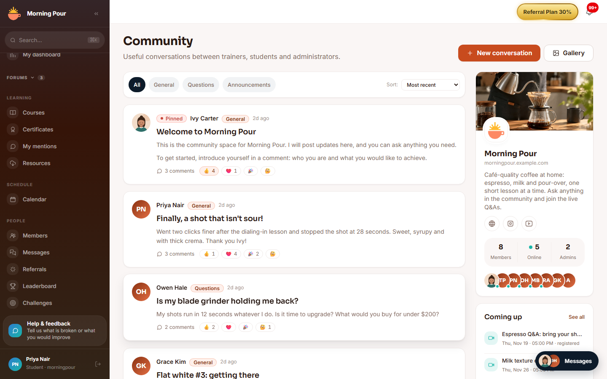
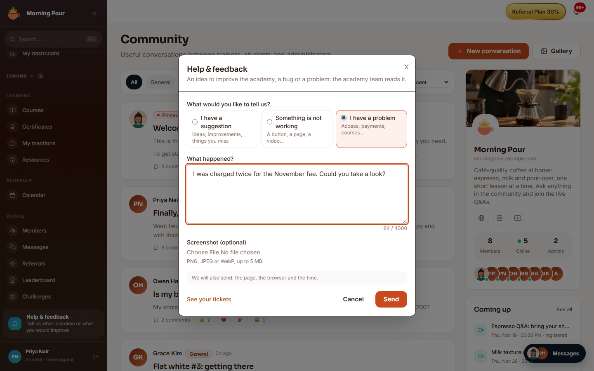
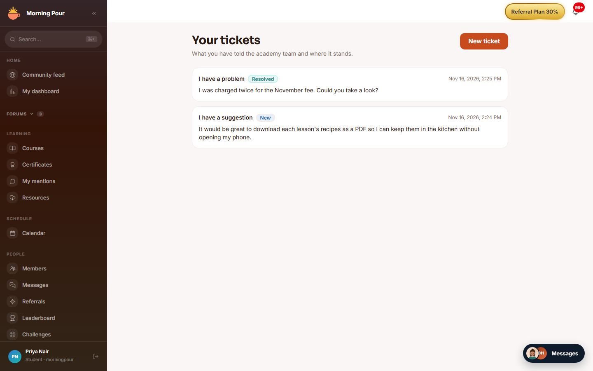
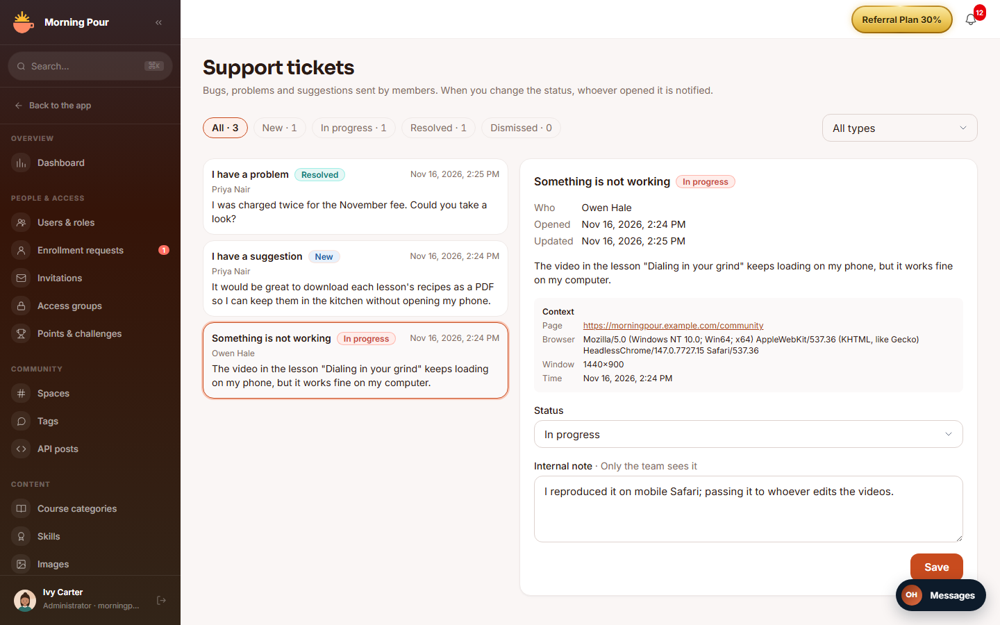

# mod.soporte — Help and suggestions

Community · **Community** category (on by default; each academy can turn it off from Modules)

## What it does

Adds the **"Ayuda y sugerencias"** (Help and suggestions) button: anyone in the academy can open a **ticket** — "Algo no funciona" (something is broken), "Tengo un problema" (I have a problem) or "Tengo una sugerencia" (I have a suggestion) —, with an optional screenshot and the context of the screen they were on, and follow it afterwards under **"Tus tickets"** (Your tickets). The team handles them in an inbox with a status and an internal note.

## How it works

**Where the ticket goes depends on who opens it**, and it is always decided by the server from the session's roles (never by the client):

| Who opens it | Destination | What happens |
| --- | --- | --- |
| A **member** (no administration role) | The **academy team** | Bell and email notice to the team; the ticket appears in the academy's inbox, where they change its status and write an internal note. The platform operator is not told. |
| Whoever **administers** the academy | **The platform operator** (Didacta) | Immediate email to the operator, in Spanish, with academy and domain, creator and their email, type, text and the screenshot attached; `Reply-To` is the creator, so the operator can answer by email. It does not notify the academy team or appear in their inbox. |

- **Statuses**: New, In progress, Resolved and Dismissed (the last two close the ticket). When the status changes, the person who opened it is notified.
- **Limits**: text of 5 to 4,000 characters, up to **5 tickets per person in a rolling 24 hours**, PNG, JPEG or WebP screenshot up to **5 MB** (the file's real content is checked, not just the extension). The internal note allows up to 4,000 characters and the author **never** sees it.
- **Background notices**: the response on submit goes out as soon as the ticket is saved; the notices (bell and emails) go out right after, so a slow SMTP does not leave the member stuck on "Sending…" or duplicate tickets. An email failure never undoes or blocks the ticket.
- **Languages**: notices use notification-hub templates in es, en and pt, according to each recipient's language.
- If nobody is on the other side — on a self-hosted installation without `SUPPORT_OPERATOR_ALERT_EMAIL`, whoever administers has nobody to write to — **the button is not shown** to that person.

## Configuration

- **Instance variable `SUPPORT_OPERATOR_ALERT_EMAIL`**: email of the platform operator that receives, right away, the tickets of the people who administer an academy. It goes out through the instance's SMTP (the platform's) and, if there is none, through the academy's. If left empty, or not a valid email (a warning is logged at startup), whoever administers does not see the button. Members' tickets do **not** depend on it: they go to their academy's inbox.
- **Permissions**: `soporte.send` (open tickets and see your own) and `soporte.manage` (the team inbox).
- **Turning it off**: from **Modules** (it is not core). When off, the button disappears, "Your tickets" says help is not available and the inbox asks you to turn it on.
- No feature requires an Enterprise licence.

## Step by step

**The member:**

1. Clicks **"Ayuda y sugerencias"**: chooses the type, writes the message, attaches a screenshot if they want and clicks **"Enviar"** (Send). The page, the browser and the time are sent as well.
2. Follows the ticket and its status at `/support` (**"Tus tickets"**); from there they open a new one with **"Nuevo ticket"**.

**The academy team:**

1. Opens **Support tickets** (`/admin/support`; the menu shows a counter of new, unclaimed ones).
2. Filters by **status** and **type** (the list shows the 200 newest and how many there are in each status) and opens a ticket to see its author, context and screenshot.
3. Changes the **status** and/or writes the **internal note** (only the team sees it) and clicks **"Guardar"** (Save). If the status changes, whoever opened it receives the notice.

!!! note "Screenshots in full mode"
    The screenshots are of an academy in **full mode**, with sample data and the English interface. In **simple mode** the button is the help icon in the header; the routes (`/support`, `/admin/support`) are the same in both modes. The labels quoted above are the Spanish ones of the screens.

## Dependencies

None (`modules: []`, `optionalModules: []`). It neither reads nor writes other modules' tables: the host passes it who administers the academy, the screenshot store, the academy's public address and the notice to the operator.

## Data model

`mod_soporte_ticket` (with the `AULA`/`PLATAFORMA` destination, the context and the internal note; the screenshot is kept in the instance's storage).

## API

`/modules/soporte` prefix: `POST tickets`, `GET canal` (where a ticket from the caller would go and whether anyone is on the other side), `GET tickets/mios`, `GET tickets/:id/captura` (only its author or whoever administers) and, for the team, `GET admin/tickets` (`?estado=&tipo=`), `GET admin/menu`, `GET admin/tickets/:id` and `PATCH admin/tickets/:id`.

## Events

- **Emits**: `soporte.ticket.created`, `soporte.ticket.status_changed`.
- **Consumes**: none.
