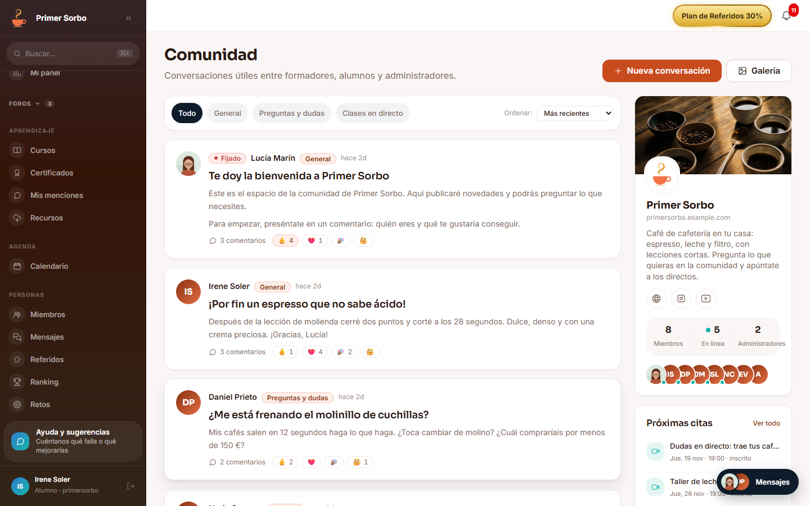
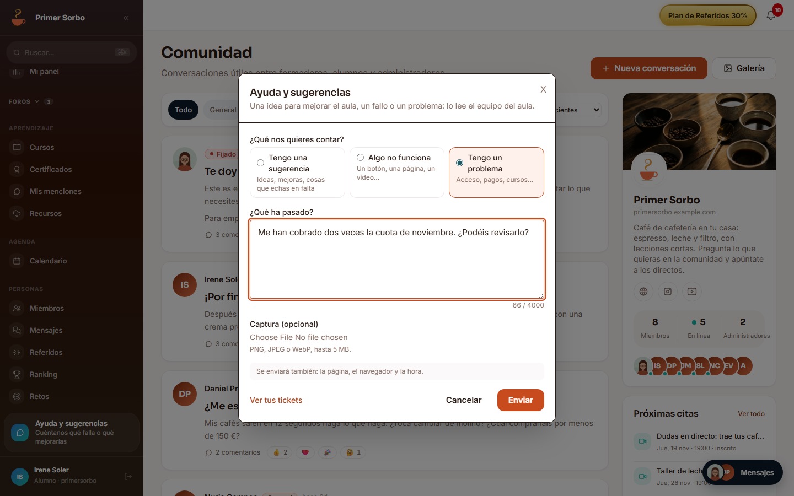
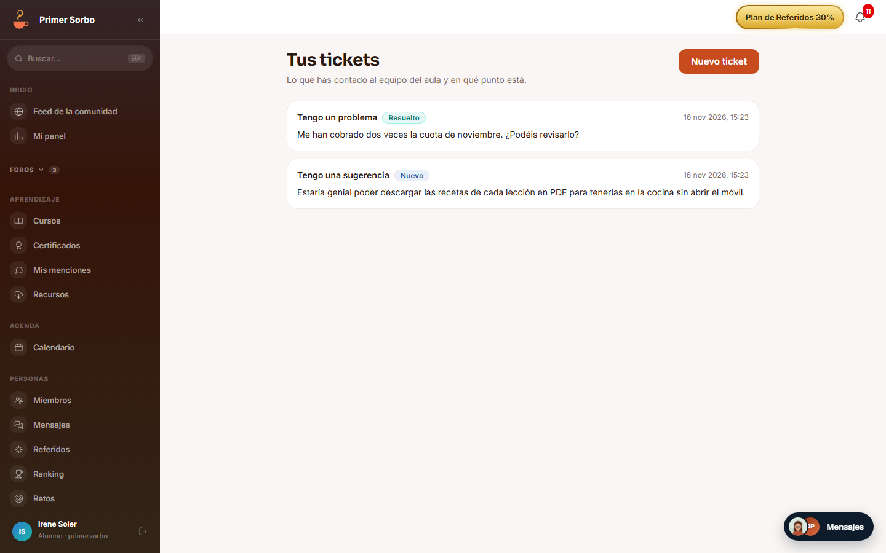
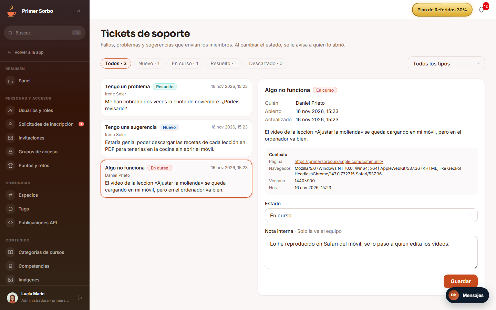

# mod.soporte — Ayuda y sugerencias

Community · Categoría **community** (activo por defecto; cada academia puede apagarlo desde Módulos)

## Qué hace

Añade el botón **«Ayuda y sugerencias»**: cualquier persona de la academia puede abrir un **ticket** — «Algo no funciona», «Tengo un problema» o «Tengo una sugerencia» —, con una captura opcional y el contexto de la pantalla en la que estaba, y seguirlo después en **«Tus tickets»**. El equipo lo gestiona en una bandeja con su estado y una nota interna.

## Cómo funciona

**A quién llega el ticket depende de quién lo abre**, y lo decide siempre el servidor con los roles de la sesión (nunca el cliente):

| Quién lo abre | Destino | Qué pasa |
| --- | --- | --- |
| Un **miembro** (sin rol de administración) | El **equipo del aula** | Aviso en la campana y por correo al equipo; el ticket sale en la bandeja de la academia, donde cambian el estado y escriben una nota interna. El operador de la plataforma no se entera. |
| Quien **administra** el aula | **El operador de la plataforma** (Didacta) | Correo inmediato al operador, en español, con aula y dominio, creador y su correo, tipo, texto y la captura adjunta; el `Reply-To` es el creador, para contestar por correo. No avisa al equipo del aula ni sale en su bandeja. |

- **Estados**: Nuevo, En curso, Resuelto y Descartado (estos dos cierran el ticket). Al cambiar el estado se avisa a quien lo abrió.
- **Límites**: texto de 5 a 4.000 caracteres, hasta **5 tickets por persona en 24 horas** móviles, captura PNG, JPEG o WebP de hasta **5 MB** (se comprueba el contenido real del fichero, no solo la extensión). La nota interna admite hasta 4.000 caracteres y **nunca** la ve el autor.
- **Avisos en segundo plano**: la respuesta al enviar sale en cuanto se guarda el ticket; los avisos (campana y correos) salen justo después, de modo que un SMTP lento no deja al miembro en «Enviando…» ni duplica tickets. Un fallo de correo nunca deshace ni bloquea el ticket.
- **Idiomas**: los avisos usan plantillas del hub de notificaciones en es, en y pt, según el idioma de cada destinatario.
- Si no hay nadie al otro lado — en una instalación propia sin `SUPPORT_OPERATOR_ALERT_EMAIL`, quien administra no tiene a quién escribir —, **el botón no se muestra** a esa persona.

## Configuración

- **Variable de instancia `SUPPORT_OPERATOR_ALERT_EMAIL`**: correo del operador de la plataforma al que llegan, al momento, los tickets de quienes administran un aula. Sale por el SMTP de la instancia (el de la plataforma) y, si no lo hay, por el del aula. Si se deja vacía, o no es un correo válido (se avisa al arrancar), quien administra no ve el botón. Los tickets de los miembros **no** dependen de ella: van a la bandeja de su aula.
- **Permisos**: `soporte.send` (abrir tickets y ver los propios) y `soporte.manage` (la bandeja del equipo).
- **Apagarlo**: desde **Módulos** (no es core). Apagado, el botón desaparece, «Tus tickets» dice que la ayuda no está disponible y la bandeja pide encenderla.
- Ninguna función exige licencia Enterprise.

## Uso paso a paso

**El miembro:**

1. Pulsa **«Ayuda y sugerencias»** (cabecera/menú del aula): elige el tipo, escribe el mensaje, adjunta una captura si quiere y pulsa **«Enviar»**. Se envían también la página, el navegador y la hora.
2. Sigue el ticket y su estado en `/support` (**«Tus tickets»**); desde ahí abre uno nuevo con **«Nuevo ticket»**.

**El equipo del aula:**

1. Entra en **Tickets de soporte** (`/admin/support`; en el menú lleva un contador con los nuevos sin coger).
2. Filtra por **estado** y **tipo** (la lista muestra los 200 más nuevos y cuántos hay en cada estado), abre un ticket para ver su autor, contexto y captura.
3. Cambia el **estado** y/o escribe la **nota interna** (solo la ve el equipo) y pulsa **«Guardar»**. Si el estado cambia, quien lo abrió recibe el aviso.

!!! note "Capturas en modo completo"
    Las capturas son de una academia en **modo completo**, con datos de ejemplo. En **modo sencillo** el botón es el icono de ayuda de la cabecera; las rutas (`/support`, `/admin/support`) son las mismas en los dos modos.

## Dependencias

Ninguna (`modules: []`, `optionalModules: []`). No lee ni escribe tablas de otros módulos: el host le pasa quién administra el aula, el almacén de capturas, la dirección pública del aula y el aviso al operador.

## Modelo de datos

`mod_soporte_ticket` (con el destino `AULA`/`PLATAFORMA`, el contexto y la nota interna; la captura se guarda en el almacenamiento de la instancia).

## API

Prefijo `/modules/soporte`: `POST tickets`, `GET canal` (a quién iría un ticket de quien llama y si hay alguien al otro lado), `GET tickets/mios`, `GET tickets/:id/captura` (solo su autor o quien administra), y para el equipo `GET admin/tickets` (`?estado=&tipo=`), `GET admin/menu`, `GET admin/tickets/:id` y `PATCH admin/tickets/:id`.

## Eventos

- **Emite**: `soporte.ticket.created`, `soporte.ticket.status_changed`.
- **Consume**: ninguno.
