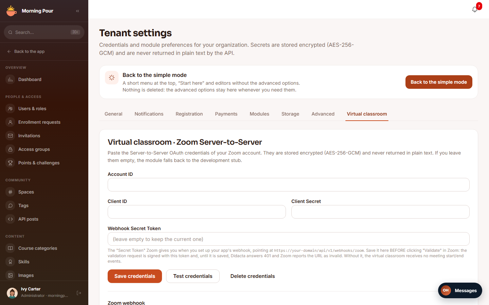
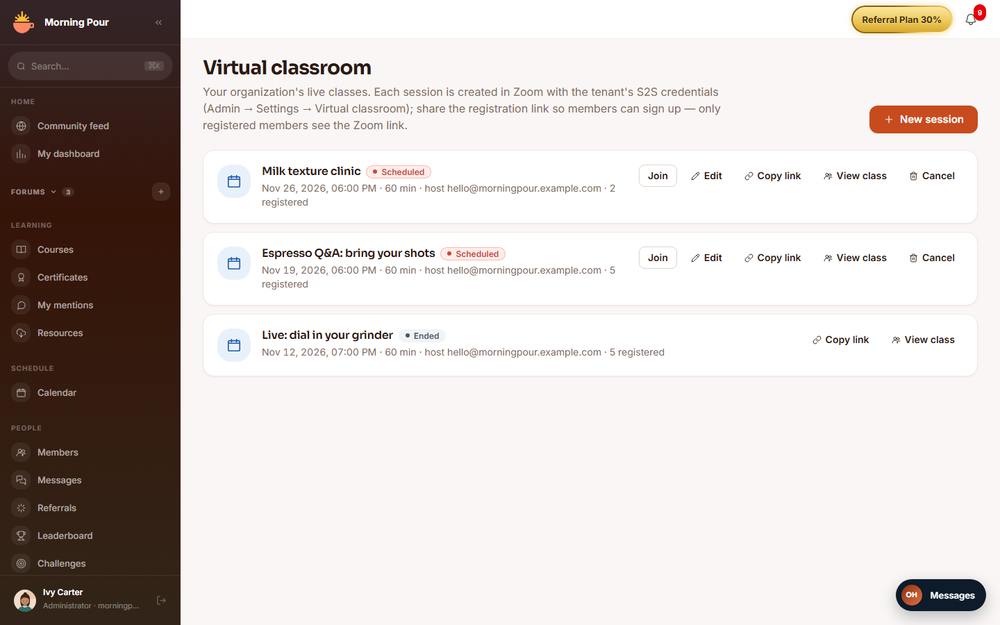
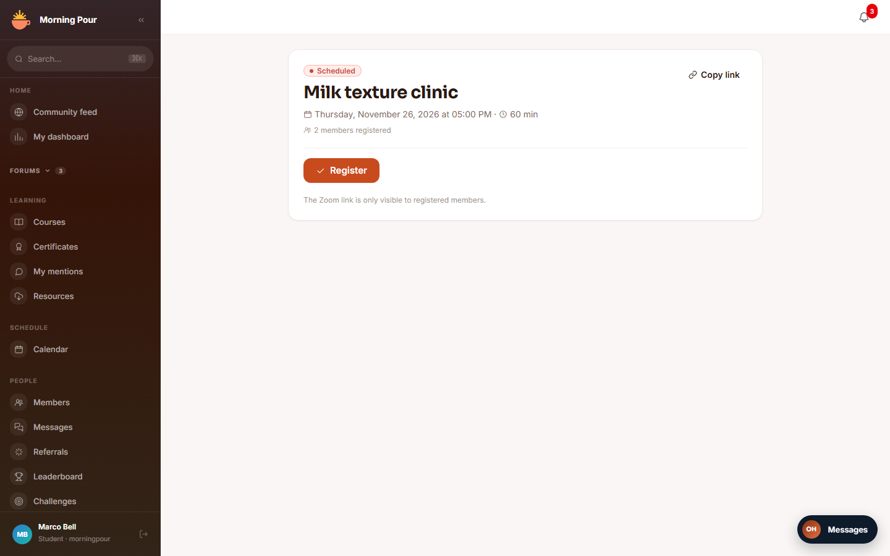
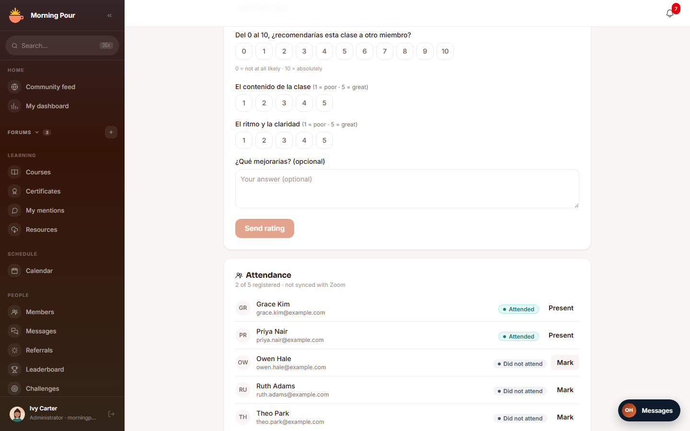

# mod.zoom-live — Virtual classroom (Zoom)

Community · **Live** category (can be disabled)

## What it does

Live classes over Zoom's **Server-to-Server OAuth** API. The instructor schedules sessions (optionally linked to a course or to a specific lesson, which enables the "Join" button in the lesson); students register from a shareable link, and both the `joinUrl` and the **recording** are gated server-side to registered attendees or staff. It includes:

- **Add to calendar** on registering: Google, Outlook.com, Microsoft 365 and `.ics` (the links never contain the `joinUrl`).
- An email + in-app **reminder** 2 hours beforehand (exactly one per class, with an atomic claim to prevent duplicates). If the class is **rescheduled**, the reminder is reopened and sent again 2 hours before the new time.
- **Real attendance**: an entry proxy (the click on "Join") reconciled afterwards against Zoom's Report API, with a manual override by the instructor.
- The recording is persisted when the `recording.completed` webhook arrives (Zoom's share link and the duration are stored).
- **Class with your own link**: besides Zoom, a class can carry the link of a third-party video call (Google Meet, Teams…); `https://` only, and that class does not talk to Zoom.

## How it works

- Without Zoom credentials, the classroom does not make up links: in production, creating a session returns "Paste the link to your video call (Zoom, Google Meet or Teams) or connect your Zoom account in Settings." (`ZOOM_NOT_CONFIGURED`). In **simple mode**, the "Live" form accepts the link of your own video call (through the API it is the `externalJoinUrl` field, which can only be changed on classes created with their own link). The development **deterministic stub** (to test the flow without a Zoom account) only works outside production or with `ZOOM_ALLOW_STUB=true`.
- Webhooks are processed with an **idempotent log** keyed by `event_id` (Zoom retries up to 3 times) and a verified HMAC signature; this includes Zoom's endpoint validation handshake.
- **Meetings opened out of hours**: a Zoom notice that happens with the class still far away is not applied. A `meeting.started` more than 30 minutes before the start time, a `meeting.ended` earlier than the start time, or a `recording.completed` for a recording that ended before the class began are archived as ignored (in the notice list they read "Outside the class time: not applied"). So testing the link the day before does not close the class, trigger the post-class survey or attach the test recording. The time that counts is the event's (signed by Zoom), not when the notice arrives.
- Zoom participants who match no user (guests, a different email address) are kept with their Zoom identity for manual reconciliation.
- A Zoom notice signed by one classroom never touches another classroom's classes, and a cancelled class is not reopened by a redelivered `meeting.started`.
- The calendar event (`.ics` and calendar links) carries a stable identifier per class — re-importing it updates the entry instead of duplicating it — and its text comes out in the language of whoever opens it or, if unknown, of the classroom (es, en, pt).
- The typical attendance sync error is a missing `report:read:admin` scope on the Zoom app; it is recorded on the session so the instructor knows why there is no data.
- When the class ends, `mod.surveys` can fire the post-class survey automatically.

## Configuration

- **Enabling or disabling the module**: `/admin/settings?tab=modules` (**Modules** tab) — a per-organization switch.
- **Zoom credentials, per tenant**: `/admin/settings?tab=virtual-classroom`, **Virtual classroom** tab (contributed by the module; it disappears if you disable it). Fields **Account ID**, **Client ID**, **Client Secret** and **Webhook Secret Token**, with **Save credentials**, **Test credentials** and **Delete credentials** buttons. They are stored encrypted (AES-256-GCM) and never returned in plain text; without credentials, see the previous point.
- **Webhook**: the endpoint is `https://your-domain/api/v1/webhooks/zoom`; the **Zoom webhook** block on the same tab shows the exact URL to paste into Zoom (with a **Copy** button). Zoom's **Secret Token** is pasted into the same panel form — it is **no longer** the `ZOOM_WEBHOOK_SECRET` environment variable (that one was global while the S2S credentials were already per tenant). Save it **before** clicking "Validate" in Zoom: the validation is signed with that token and, without it, Didacta answers 401. The **Check webhook** button makes Didacta call itself through its public URL with the same handshake and tells you whether the token is missing, whether the token is not the app's, whether the domain does not resolve to this classroom, or whether something in front (DNS, TLS, proxy) answers in its place.
- **Received notices**: the **Zoom** tab of `/admin/webhooks?tab=zoom` (the "Webhooks" menu entry) lists every notice with its event, meeting and result (OK, ignored or error), with filters by type and result. It is the place to diagnose classes that do not change state or recordings that do not show up (the old `/admin/zoom/webhook-events` route redirects there).
- **Environment (workers)**: `ZOOM_REMINDER_CRON`, `ZOOM_REMINDER_HOURS_BEFORE`, `ZOOM_ATTENDANCE_SYNC_CRON` control reminders and attendance reconciliation (they require Redis). Defaults: reminder check every 5 minutes (`*/5 * * * *`) with 2 hours of notice, and attendance sync every 10 minutes (`*/10 * * * *`). The defaults table and the Zoom App Marketplace setup live in [Configuring Zoom](../../configuration/zoom.md).
- Nothing in this module requires an Enterprise license.

!!! note "Screenshots in full mode"
    The screenshots on this page come from **full mode** (side menu), the mode a new installation starts in. In **simple mode** the same routes are still available from "More", except for the screens that mode replaces with a simplified version (the course editor, Settings, Sales, Students, Live, the community and Referrals); to use them as shown here, switch to full mode under **Settings → "Use the full mode"**.

## Step by step

As an instructor (or admin):

1. Open **Virtual classroom** in the instructor menu (`/studio/live`) and click **New session**.
2. Fill in **Title**, **Date and time**, **Duration (min)** (15–480) and **Time zone** — the time is interpreted in the chosen zone, not in your computer's. The **Host email** must have a user in your Zoom account: the meeting is created under their name.
3. Optional: link a **Course (optional)** and a **Lesson (optional)** — with a lesson, enrolled students see the session in its detail. Leave **Announce in the community** checked to publish a feed card people can register from. If the membership has levels, choose in **"Who can see it"** whether the class is for all members or only some levels (see [Live classes by level](#live-classes-by-level)).
4. Click **Create session**, then **Copy link** to share the registration page (`/live/<id>`).
5. **Edit** only allows changing title, date, duration, time zone, agenda and "Who can see it"; the host, course and lesson are fixed at creation. **Cancel** notifies everyone registered.
6. At class time, click **Start** (or **Start (host)** from the class page).

As a student:

1. Open the `/live/<id>` link (or the class from `/calendar`); with no session you go through sign-in and come back.
2. Click **Register**. The **Add to calendar** dialog opens (Google Calendar, Outlook.com, Outlook (Microsoft 365), Apple Calendar and others via `.ics`).
3. The **Join the class** / **Join now** button only appears if you are registered; the click seals your entry as attendance evidence. You get a reminder 2 hours beforehand.
4. Once the class ends, **Watch recording** appears for registered attendees as soon as Zoom delivers the recording.

Attendance (staff, on the same class page):

1. The **Attendance** panel lists registered members and unmatched Zoom participants.
2. **Sync with Zoom** reconciles against the Report API; each row shows how strong the evidence is.
3. The **Mark** button cycles the manual override: **Present** → **Absent** → back to the automatic calculation.

## Live classes by level

If the membership has [levels](subscriptions.md#levels) (Basic, Pro…), a class can be for only some of them. The class form —in full mode, **Virtual classroom** (`/studio/live`); in simple mode, **Live**— has **"Who can see it"**, both when creating and when editing:

- **"All members"**: as always. A class where nothing is chosen belongs to everyone.
- **"Only these levels"**: one checkbox per paid level, with its name and in its order. When you pick this option they all come **ticked**; untick the ones that should not see it. The screen reminds you: **"One level doesn't include another: tick every level that should see it."** With none ticked it is not saved ("Tick at least one level.").
- The free level is not offered (what the free level sees, everyone sees). Without paid levels there are no checkboxes: only "All members" is possible (plain access groups are not levels and are not offered).
- In the panel's class list, a restricted class carries the "Only for: Pro" mark (with its levels) and a padlock.

**Who sees it.** The classroom team (`super_admin`, `tenant_admin` and instructor, who hosts) always does. A member does if they are an active member of any of the ticked levels. Only they register and receive the link, the reminder, the cancellation notice, the recording and the post-class survey.

**What someone without the level sees.** At `/live/<id>`, the title, time and duration, a padlock with "This class is only for some membership levels.", **"Available in: Pro"** (with its levels) and the **"See plans"** button, which leads to `/join`. The live class card in the community feed shows just as closed (the announcement of a class with a level is published without its description). They never see the description, the link or the recording, and have no button to register; even if they registered before the class was restricted, they no longer get the link.

Left as they were, on purpose: the `.ics` file and calendar links (only title, time, duration and `/live/<id>`), the "next live class" on the public home page (title and time, no link) and notifications sent before the class was restricted. The level cards on `/join` name each level's upcoming live classes (name and date only).

**Through the API**: the detail of a closed class comes with `locked: true` and `accessLevels`, without description, link or recording; registering or asking for the link (`register`, `join`) answers 403 `ZOOM_SESSION_LOCKED`. When creating or editing, `accessGroupIds` (`[]` opens it to everyone; a group that does not exist gives 422 `ZOOM_ACCESS_GROUP_UNKNOWN`).

## Dependencies

Optional: `mod.courses` (linking a session ↔ course/lesson) and `mod.access-groups` (who is an active member of each level, for live classes by level; the host resolves it, the module does not read its tables).

## Data model

`mod_zoom_live_session` (the class: schedule, host, URLs, recording, sync flags and `access_group_ids`, empty = all members) · `_session_registration` (registration, the basis for gating) · `_session_attendance` (entry click + Zoom data + override) · `_webhook_event` (idempotent log).

Manifest permissions: `zoom.session.read` and `zoom.session.write`.

## API

Prefix `/modules/zoom-live` (sessions, registration, `join`, attendance, `test-credentials`, `test-webhook` and `webhook-events`) + the calendar (`sessions/:id/calendar.ics`, `calendar/google`, `calendar/outlook`, `calendar/office365`) + the webhook at `/webhooks/zoom`. Details in [Reference → Payments, classroom and AI](../../api/reference/payments-live-ai.md#virtual-classroom-moduleszoom-live).

## Events

**Emits**: `zoom.session.created/updated/cancelled/started/ended`, `zoom.session.recording_ready`, `zoom.session.registration.created/cancelled`, `zoom.session.attendance_synced`. It consumes none.
