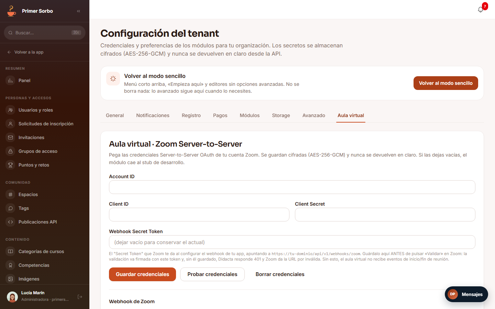
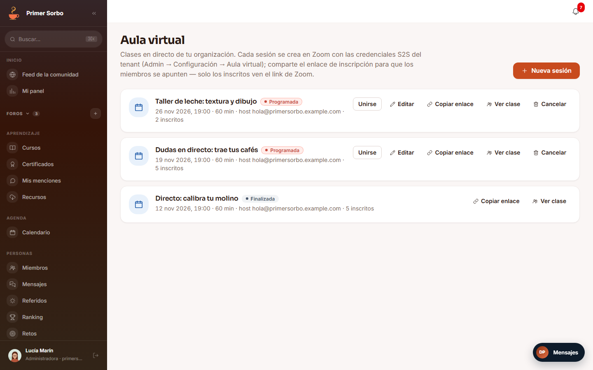
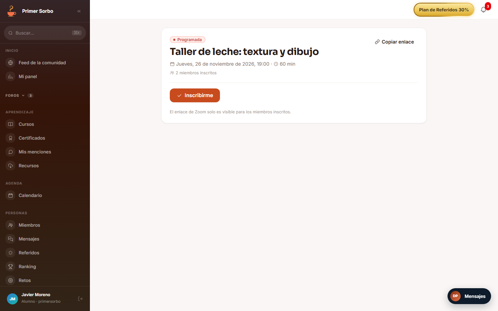
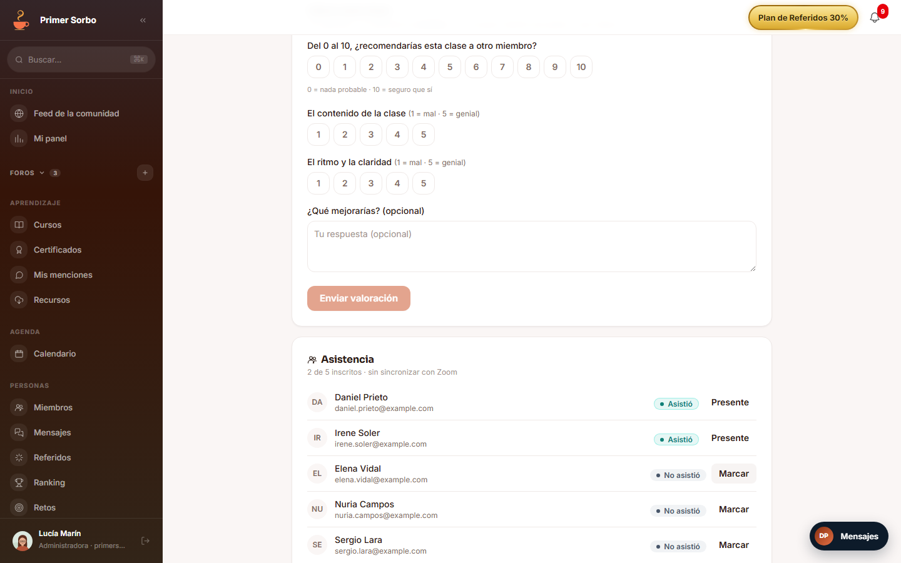

# mod.zoom-live — Aula virtual (Zoom)

Community · Categoría **live** (desactivable)

## Qué hace

Clases en directo con la API **Server-to-Server OAuth** de Zoom. El formador programa sesiones (opcionalmente vinculadas a un curso o a una lección concreta, lo que habilita el botón «Unirse» en la lección); los alumnos se inscriben desde un enlace compartible, y el `joinUrl` y la **grabación** quedan gateados server-side a inscritos o staff. Incluye:

- **Añadir al calendario** al inscribirse: Google, Outlook.com, Microsoft 365 y `.ics` (los enlaces nunca contienen el `joinUrl`).
- **Recordatorio** por email + in-app 2 horas antes (uno solo por clase, con claim atómico anti-duplicados). Si la clase se **reprograma**, el recordatorio se reabre y se vuelve a avisar 2 horas antes de la hora nueva.
- **Asistencia real**: proxy de entrada (clic en «Unirme») reconciliado después contra la Report API de Zoom, con override manual del formador.
- La grabación se persiste al llegar el webhook `recording.completed` (se guarda el enlace para compartir de Zoom y la duración).
- **Clase con enlace propio**: además de Zoom, una clase puede llevar el enlace de una videollamada ajena (Google Meet, Teams…); solo `https://`, y esa clase no habla con Zoom.

## Cómo funciona

- Sin credenciales de Zoom, el aula no inventa enlaces: en producción, crear una sesión responde «Pega el enlace de tu videollamada (Zoom, Google Meet o Teams) o conecta tu cuenta de Zoom en Ajustes» (`ZOOM_NOT_CONFIGURED`). En **modo sencillo**, el formulario de «Directos» acepta el enlace de una videollamada propia (por API es el campo `externalJoinUrl`, que solo se puede cambiar en clases creadas con enlace propio). El **stub determinístico** de desarrollo (para probar el flujo sin cuenta de Zoom) solo funciona fuera de producción o con `ZOOM_ALLOW_STUB=true`.
- Los webhooks se procesan con **log idempotente** por `event_id` (Zoom reintenta hasta 3 veces) y firma HMAC verificada; incluye el handshake de validación de endpoint de Zoom.
- **Reuniones abiertas fuera de hora**: un aviso de Zoom que ocurre con la clase todavía lejos no se aplica. Un `meeting.started` más de 30 minutos antes de la hora, un `meeting.ended` anterior a la hora de inicio o un `recording.completed` de una grabación que acabó antes de empezar se archivan como ignorados (en el listado de avisos figuran como «Fuera de la hora de la clase: no se aplica»). Así, probar el enlace la víspera no cierra la clase, ni lanza la encuesta post-clase, ni cuelga la grabación de la prueba. La hora que cuenta es la del suceso (firmada por Zoom), no la de llegada del aviso.
- Los participantes de Zoom que no casan con ningún usuario (invitados, otro email) se conservan con su identidad de Zoom para conciliación manual.
- Un aviso de Zoom firmado por un aula no toca las clases de otra, y una clase cancelada no se reabre por un `meeting.started` reentregado.
- El evento de calendario (`.ics` y enlaces de calendario) lleva un identificador estable por clase —reimportarlo actualiza la entrada en vez de duplicarla— y su texto sale en el idioma de quien lo abre o, si no se sabe, en el del aula (es, en, pt).
- El error típico del sync de asistencia es que falte el scope `report:read:admin` en la app de Zoom; queda registrado en la sesión para que el formador sepa por qué no hay datos.
- Al terminar la clase, `mod.surveys` puede lanzar automáticamente la encuesta post-clase.

!!! note "Capturas en modo completo"
    Las capturas de esta página son del **modo completo** (menú lateral), el de una instalación nueva. En **modo sencillo** las mismas rutas siguen disponibles desde «Más», salvo las pantallas que ese modo sustituye por una versión simplificada (el editor de cursos, Ajustes, Ventas, Alumnos, Directos, la comunidad y Referidos); para usarlas tal como se ven aquí, cambia al modo completo en **Ajustes → «Usar el modo completo»**.

## Configuración

- **Activar o desactivar el módulo**: `/admin/settings?tab=modules` (pestaña **Módulos**) — interruptor por organización.
- **Credenciales Zoom, por tenant**: `/admin/settings?tab=virtual-classroom`, pestaña **Aula virtual** (la aporta el módulo; desaparece si lo desactivas). Campos **Account ID**, **Client ID**, **Client Secret** y **Webhook Secret Token**, con botones **Guardar credenciales**, **Probar credenciales** y **Borrar credenciales**. Se guardan cifradas (AES-256-GCM) y nunca se devuelven en claro; sin credenciales, mira el punto anterior.
- **Webhook**: el endpoint es `https://tu-dominio/api/v1/webhooks/zoom`; el bloque **Webhook de Zoom** de la misma pestaña muestra la URL exacta para pegar en Zoom (con botón **Copiar**). El **Secret Token** de Zoom se pega en el mismo formulario del panel — ya **no** es la variable de entorno `ZOOM_WEBHOOK_SECRET` (era global y las credenciales ya eran per-tenant). Guárdalo **antes** de pulsar «Validate» en Zoom: la validación va firmada con ese token y, sin él, Didacta responde 401. El botón **Comprobar webhook** hace que Didacta se llame a sí misma por su URL pública con el mismo handshake y te dice si falta el token, si el token no es el de la app, si el dominio no resuelve a este aula o si algo delante (DNS, TLS, proxy) contesta en su lugar.
- **Avisos recibidos**: la pestaña **Zoom** de `/admin/webhooks?tab=zoom` (menú «Webhooks») lista cada aviso con su evento, reunión y resultado (OK, ignorado o error), con filtros por tipo y resultado. Es el sitio para diagnosticar clases que no cambian de estado o grabaciones que no aparecen (la ruta antigua `/admin/zoom/webhook-events` redirige ahí).
- **Entorno (workers)**: `ZOOM_REMINDER_CRON`, `ZOOM_REMINDER_HOURS_BEFORE`, `ZOOM_ATTENDANCE_SYNC_CRON` controlan recordatorios y reconciliación de asistencia (requieren Redis). Valores por defecto: recordatorio cada 5 minutos (`*/5 * * * *`) y 2 horas de antelación, y sincronización de asistencia cada 10 minutos (`*/10 * * * *`). La tabla de valores por defecto y el alta de la app en el Zoom App Marketplace están en [Configurar Zoom](../../configuration/zoom.md).
- Ninguna función del módulo exige licencia Enterprise.

## Uso paso a paso

Como formador (o admin):

1. Abre **Aula virtual** en el menú del formador (`/studio/live`) y pulsa **Nueva sesión**.
2. Rellena **Título**, **Fecha y hora**, **Duración (min)** (15–480) y **Zona horaria** — la hora se interpreta en la zona elegida, no en la de tu ordenador. El **Email del host** debe tener usuario en vuestra cuenta de Zoom: la reunión se crea a su nombre.
3. Opcional: vincula **Curso (opcional)** y **Lección (opcional)** — con lección, los alumnos matriculados ven la sesión en su detalle. Deja marcado **Anunciar en la comunidad** para publicar una tarjeta en el feed desde la que inscribirse. Si la membresía tiene niveles, elige en **«Quién puede verlo»** si la clase es para todos los miembros o solo para algunos niveles (ver [Directos por nivel](#directos-por-nivel)).
4. Pulsa **Crear sesión** y luego **Copiar enlace** para compartir la página de inscripción (`/live/<id>`).
5. **Editar** solo permite cambiar título, fecha, duración, zona, agenda y «Quién puede verlo»; el host, el curso y la lección quedan fijos desde la creación. **Cancelar** avisa a los inscritos.
6. A la hora de la clase, pulsa **Iniciar** (o **Iniciar (host)** desde la página de la clase).

Como alumno:

1. Abre el enlace `/live/<id>` (o la clase desde `/calendar`); si no tienes sesión, pasas por el login y vuelves.
2. Pulsa **Inscribirme**. Se abre el diálogo **Añadir al calendario** (Google Calendar, Outlook.com, Outlook (Microsoft 365), Apple Calendar y otros vía `.ics`).
3. El botón **Unirme a la clase** / **Unirme ahora** solo aparece si estás inscrito; el clic sella tu entrada como evidencia de asistencia. Recibirás recordatorio 2 horas antes.
4. Cuando la clase termina, **Ver grabación** aparece para los inscritos en cuanto Zoom entrega la grabación.

Asistencia (staff, en la misma página de la clase):

1. El panel **Asistencia** lista inscritos y participantes de Zoom sin casar.
2. **Sincronizar con Zoom** reconcilia contra la Report API; cada fila indica la confianza de la evidencia.
3. El botón **Marcar** cicla el override manual: **Presente** → **Ausente** → vuelta al cálculo automático.

## Directos por nivel

Si la membresía tiene [niveles](subscriptions.md#niveles) (Básico, Pro…), una clase puede ser solo para algunos. El formulario de la clase —en modo completo, **Aula virtual** (`/studio/live`); en modo sencillo, **Directos**— tiene **«Quién puede verlo»**, al crearla y al editarla:

- **«Todos los miembros»**: lo de siempre. Una clase en la que no se elige nada es de todos.
- **«Solo estos niveles»**: una casilla por nivel de pago, con su nombre y en su orden. Al elegir esta opción salen **todas marcadas**; desmarca las que no deban verla. La pantalla lo recuerda: **«Un nivel no incluye a otro: marca todos los que deben verlo.»** Sin ninguna marcada no se guarda («Marca al menos un nivel.»).
- El nivel gratis no se ofrece (lo que ve el gratis lo ven todos). Sin niveles de pago no hay casillas: solo cabe «Todos los miembros» (los grupos de acceso sueltos no son niveles y no se ofrecen).
- En la lista de clases del panel, una clase restringida lleva la marca «Solo para: Pro» (con sus niveles) y un candado.

**Quién la ve.** El equipo del aula (`super_admin`, `tenant_admin` y formador, que es quien anfitriona) la ve siempre. Un miembro, si es miembro activo de alguno de los niveles marcados. Solo ellos se inscriben y reciben el enlace, el recordatorio, el aviso de cancelación, la grabación y la encuesta post-clase.

**Qué ve quien no tiene el nivel.** En `/live/<id>`, el título, la hora y la duración, un candado con «Esta clase es solo para algunos niveles de la membresía.», **«Disponible en: Pro»** (con sus niveles) y el botón **«Ver planes»**, que lleva a `/join`. La tarjeta del directo en el feed de la comunidad sale igual de cerrada (el anuncio de una clase con nivel se publica sin su descripción). Nunca ve la descripción, el enlace ni la grabación, y no tiene botón para inscribirse; aunque se hubiera inscrito antes de restringirla, ya no recibe el enlace.

Se quedan como estaban, a propósito: el `.ics` y los enlaces de calendario (solo título, hora, duración y `/live/<id>`), el «próximo directo» de la portada pública (título y hora, sin enlace) y las notificaciones enviadas antes de restringir la clase. Las tarjetas de los niveles en `/join` nombran los próximos directos de cada nivel (solo nombre y fecha).

**Por API**: el detalle de una clase cerrada llega con `locked: true` y `accessLevels`, sin descripción, enlace ni grabación; inscribirse o pedir el enlace (`register`, `join`) responden 403 `ZOOM_SESSION_LOCKED`. Al crear o editar, `accessGroupIds` (`[]` la abre a todos; un grupo que no existe da 422 `ZOOM_ACCESS_GROUP_UNKNOWN`).

## Dependencias

Opcionales: `mod.courses` (vincular sesión ↔ curso/lección) y `mod.access-groups` (quién es miembro activo de cada nivel, para los directos por nivel; lo resuelve el host, el módulo no lee sus tablas).

## Modelo de datos

`mod_zoom_live_session` (clase: horario, host, URLs, grabación, marcas de sync y `access_group_ids`, vacío = todos los miembros) · `_session_registration` (inscripción, base del gating) · `_session_attendance` (clic de entrada + datos de Zoom + override) · `_webhook_event` (log idempotente).

Permisos del manifest: `zoom.session.read` y `zoom.session.write`.

## API

Prefijo `/modules/zoom-live` (sesiones, inscripción, `join`, asistencia, `test-credentials`, `test-webhook` y `webhook-events`) + calendario (`sessions/:id/calendar.ics`, `calendar/google`, `calendar/outlook`, `calendar/office365`) + webhook en `/webhooks/zoom`. Detalle en [Referencia → Pagos, aula e IA](../../api/reference/payments-live-ai.md#aula-virtual-moduleszoom-live).

## Eventos

**Emite**: `zoom.session.created/updated/cancelled/started/ended`, `zoom.session.recording_ready`, `zoom.session.registration.created/cancelled`, `zoom.session.attendance_synced`. No consume.
